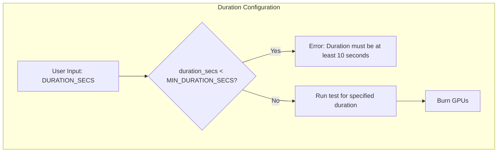
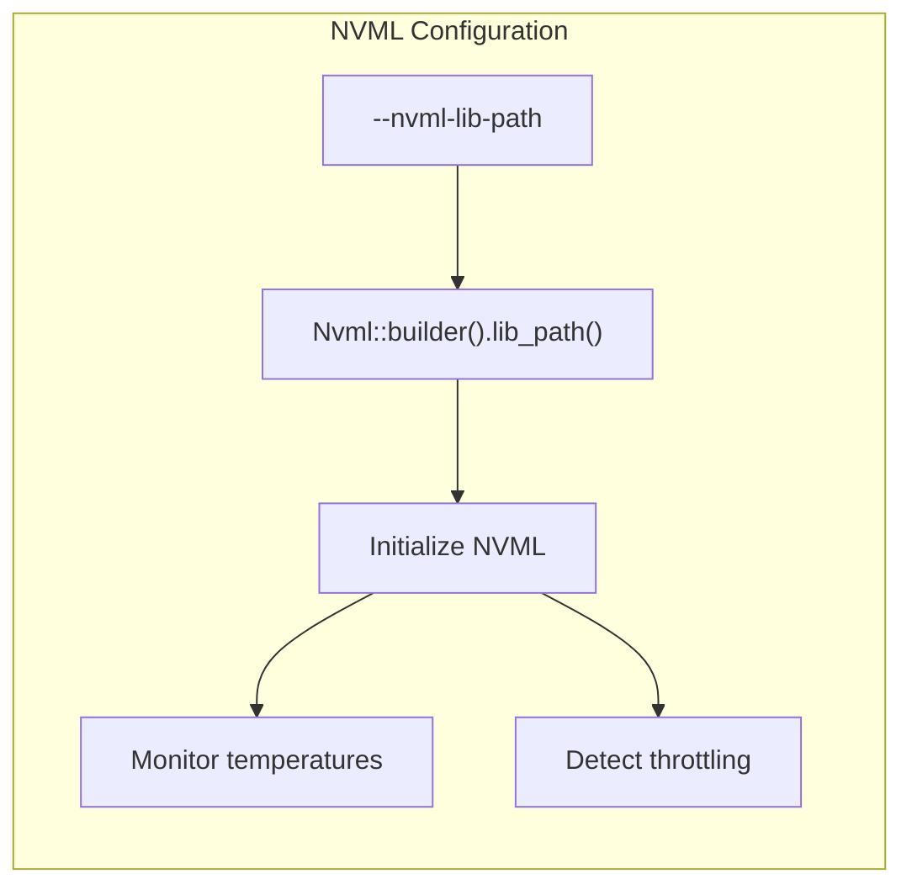
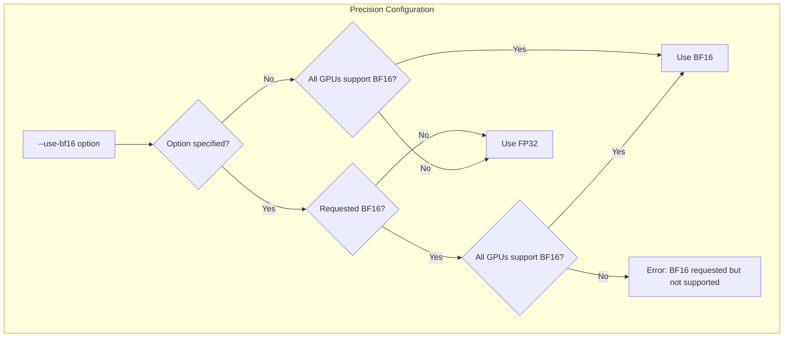
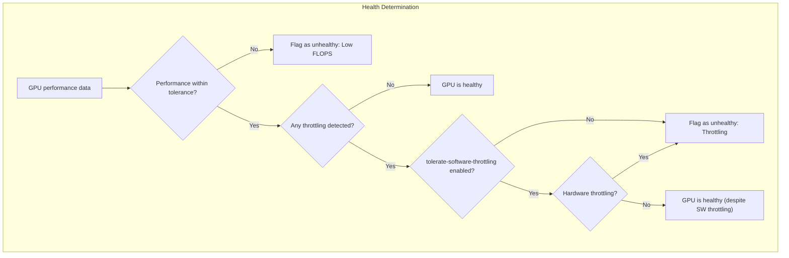
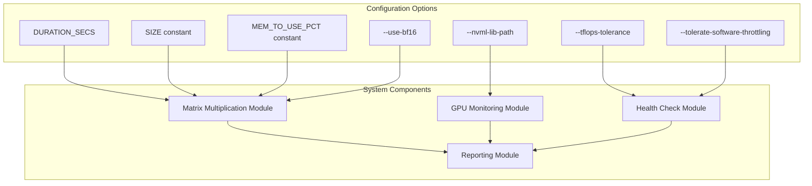
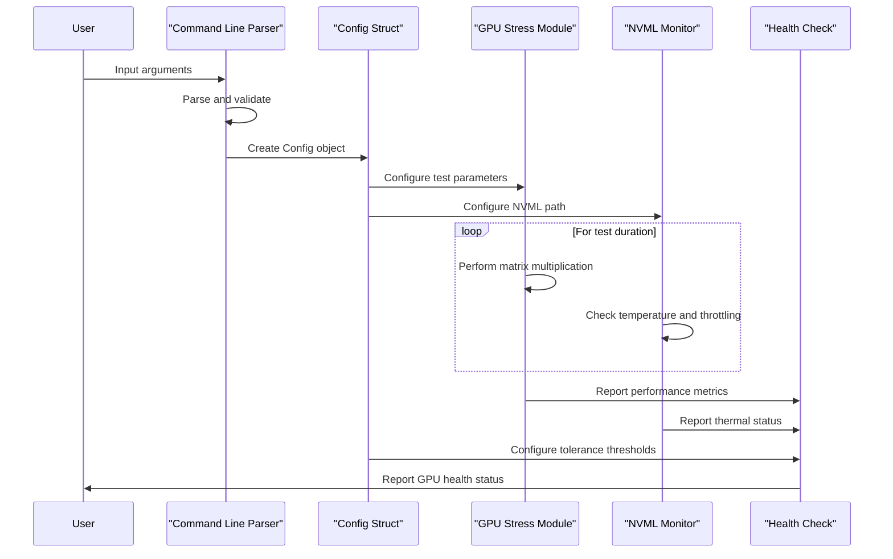

<!-- source: DeepWiki mcp.deepwiki.com · repo huggingface/gpu-fryer · page 3.2 Configuration Options · fetched 2026-10-26 -->

# Configuration Options

<details>
<summary>Relevant source files</summary>

The following files were used as context for generating this wiki page:

- [README.md](README.md)
- [src/main.rs](src/main.rs)

</details>


This document provides a comprehensive reference for all configuration options available in GPU-Fryer. These options control how GPU-Fryer runs its stress tests, monitors hardware, and evaluates the health of NVIDIA GPUs. For information about running GPU-Fryer, see [Command-Line Interface](#3.1), and for interpreting the results, see [Output Interpretation](#3.3).

## Command-Line Arguments

GPU-Fryer accepts several command-line arguments that modify its behavior. These arguments allow you to customize the test duration, tolerance thresholds, and precision settings.

| Argument | Type | Default | Description |
|----------|------|---------|-------------|
| `DURATION_SECS` | Integer | 60 | Duration in seconds to burn the GPUs |
| `--nvml-lib-path` | String | /usr/lib/x86_64-linux-gnu/libnvidia-ml.so.1 | Path to NVIDIA Management Library |
| `--tolerate-software-throttling` | Boolean | false | Tolerate software throttling if TFLOPS are in acceptable range |
| `--tflops-tolerance` | Float | 10.0 | TFLOPS tolerance (%) compared to best GPU |
| `--use-bf16` | Boolean | Auto | Use BF16 precision instead of FP32 |
| `-h, --help` | Flag | - | Print help message |
| `-V, --version` | Flag | - | Print version information |

Sources: [README.md:32-50](), [src/main.rs:31-50]()

### Usage Examples

Basic usage with default options (60 seconds test):
```bash
gpu-fryer
```

Run a longer test (5 minutes):
```bash
gpu-fryer 300
```

Run with custom NVML library path:
```bash
gpu-fryer --nvml-lib-path /path/to/libnvidia-ml.so 60
```

Allow software throttling if performance is acceptable:
```bash
gpu-fryer --tolerate-software-throttling 60
```

Set a stricter TFLOPS tolerance (5%):
```bash
gpu-fryer --tflops-tolerance 5 60
```

Explicitly use FP32 precision:
```bash
gpu-fryer --use-bf16 false 60
```

Sources: [README.md:15-25]()

## Detailed Configuration Options

### Duration Settings

The `DURATION_SECS` argument specifies how long GPU-Fryer should run the stress test. The minimum allowed duration is 10 seconds, as specified by the `MIN_DURATION_SECS` constant.



The test duration affects the reliability of the results. Longer durations provide more accurate measurements but take more time. The recommended minimum is 60 seconds for reliable results.

Sources: [src/main.rs:22](), [src/main.rs:146-149]()

### NVML Library Path

The `--nvml-lib-path` option specifies the path to the NVIDIA Management Library (NVML), which is used to monitor GPU temperatures and throttling status. This option is primarily useful in non-standard installations where the library is not in the default location.



Sources: [src/main.rs:263](), [src/main.rs:299-315]()

### Precision Mode (FP32/BF16)

GPU-Fryer can run in either FP32 (single precision) or BF16 (brain float 16) mode. BF16 is used to stress the Tensor Cores on compatible GPUs.

The `--use-bf16` option controls precision mode selection:
- If set to `true`, BF16 is explicitly requested (error if not all GPUs support it)
- If set to `false`, FP32 is used regardless of GPU capabilities
- If not specified, BF16 is automatically used if all GPUs support it, otherwise FP32 is used



BF16 mode provides higher TFLOPS on compatible GPUs. For reference:
- NVIDIA H100 80GB HBM3: ~51 TFLOPS in FP32 mode
- NVIDIA H100 80GB HBM3: ~676 TFLOPS in BF16 mode

Sources: [src/main.rs:200-222](), [README.md:62-65]()

### Performance Tolerance Settings

GPU-Fryer includes two important settings for determining when GPUs are considered healthy:

1. **TFLOPS Tolerance** (`--tflops-tolerance`): Specifies the acceptable percentage difference in performance between GPUs. Default is 10%, meaning all GPUs should be within 10% of the best-performing GPU.

2. **Software Throttling Tolerance** (`--tolerate-software-throttling`): If set to `true`, allows software thermal throttling as long as the performance (TFLOPS) is within the acceptable range.



Sources: [src/main.rs:433-446](), [src/main.rs:450-481]()

## Internal Configuration Constants

Besides command-line arguments, GPU-Fryer has internal constants that affect its behavior:

| Constant | Value | Description |
|----------|-------|-------------|
| `SIZE` | 8192 | Size of matrices used for multiplication (8192×8192) |
| `MEM_TO_USE_PCT` | 0.9 | Percentage of GPU memory to use (90%) |
| `MIN_DURATION_SECS` | 10 | Minimum allowed test duration in seconds |

These constants determine the intensity of the stress test and resource utilization:

- The matrix size (`SIZE`) affects computational intensity - larger matrices create more computational load
- Memory usage percentage (`MEM_TO_USE_PCT`) determines how much GPU memory is utilized during the test
- Matrix multiplications are performed using CUBLAS to maximize GPU utilization

Sources: [src/main.rs:20-22]()

## Configuration and System Components Interaction

The following diagram illustrates how configuration options affect different components of GPU-Fryer:



Sources: [src/main.rs:143-170](), [src/main.rs:183-221]()

## Configuration Data Flow

This diagram shows how configuration data flows through the system during execution:



Sources: [src/main.rs:143-170](), [src/main.rs:183-221]()

## Best Practices for Configuration

### For General Testing

- Use the default duration of 60 seconds for routine checks
- Keep the default TFLOPS tolerance of 10% unless you need stricter homogeneity
- Use automatic precision detection (don't specify `--use-bf16`)

### For Detailed Analysis

- Run longer tests (300 seconds or more) for more accurate results
- Use stricter TFLOPS tolerance (5% or less) to catch subtle performance variations
- Manually specify precision mode based on your workload (FP32 or BF16)

### For Production Environments

- Set appropriate throttling tolerance based on your cooling infrastructure
- If your environment has controlled cooling but allows some thermal throttling, enable `--tolerate-software-throttling`
- Use longer duration tests for pre-deployment validation

Sources: [README.md:13-29](), [src/main.rs:433-446]()

## Configuration Impact on Results

The configuration options directly affect what GPU-Fryer considers "healthy" behavior:

1. With default settings (`--tflops-tolerance 10`):
   - All GPUs must be within 10% performance of the best GPU
   - No throttling of any kind is allowed

2. With `--tolerate-software-throttling`:
   - Software thermal throttling is allowed if performance is acceptable
   - Hardware throttling is never allowed

3. With stricter tolerance (`--tflops-tolerance 5`):
   - All GPUs must be within 5% performance of the best GPU
   - More likely to detect subtle performance variations

The precision mode also affects expected performance numbers:
- FP32 mode typically shows lower TFLOPS values
- BF16 mode shows higher TFLOPS on supported GPUs due to tensor core utilization

Sources: [src/main.rs:450-481]()

---

