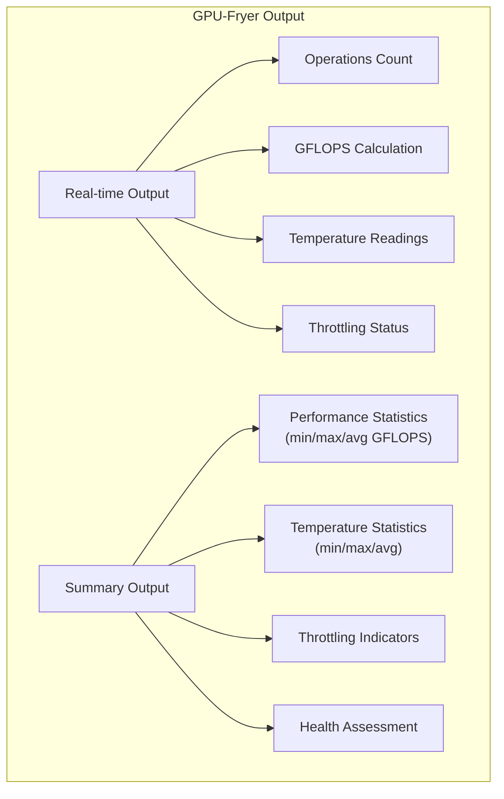
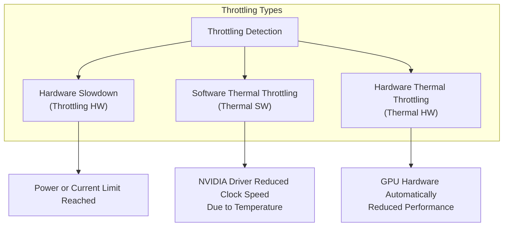
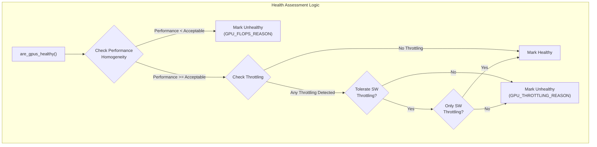
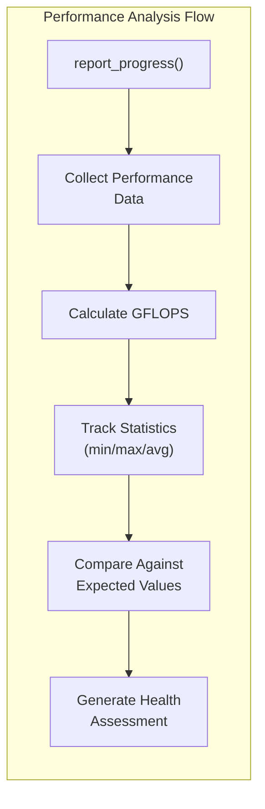

<!-- source: DeepWiki mcp.deepwiki.com · repo huggingface/gpu-fryer · page 3.3 Output Interpretation · fetched 2026-10-26 -->

# Output Interpretation

<details>
<summary>Relevant source files</summary>

The following files were used as context for generating this wiki page:

- [README.md](README.md)
- [assets/utilization.png](assets/utilization.png)
- [src/main.rs](src/main.rs)

</details>


This page provides a comprehensive guide to understanding and analyzing the output generated by the GPU-Fryer tool. You'll learn how to interpret performance metrics, identify potential GPU issues, and determine if your GPUs are performing as expected. For information on configuration options, see [Configuration Options](#3.2).

## Output Format Overview

GPU-Fryer produces both real-time and summary output during and after the stress test. The real-time output displays current performance, temperatures, and throttling status, while the summary output provides aggregated statistics and a final health assessment.



Sources: [src/main.rs:335-447](), [README.md:23-29]()

## Real-time Output

During the test, GPU-Fryer prints real-time statistics every second:

```
123 (409 Gflops/s) - 123 (409 Gflops/s) | Temperatures: 47°C - 49°C | Throttling: None - None
```

This line shows:
- Operations count (matrix multiplications) performed in the last second
- Calculated GFLOPS for each GPU (operations × matrix size²)
- Current temperature of each GPU in Celsius
- Throttling status for each GPU

The real-time output is useful for observing sudden changes in performance or temperature during the test.

Sources: [src/main.rs:347-407]()

## Summary Output

After the test completes, GPU-Fryer displays a comprehensive summary for each GPU:

```
GPU #7:  51494 Gflops/s (min: 50577.53, max: 51677.05, dev: 51493.79)
         Temperature: 48.83°C (min: 47.00, max: 50.00)
         Throttling HW: false, Thermal SW: false, Thermal HW: false
All GPUs seem healthy
```

### Performance Statistics

The first line contains performance statistics for each GPU:
- Average GFLOPS/s achieved during the test
- Minimum GFLOPS/s recorded
- Maximum GFLOPS/s recorded
- Standard deviation value (labeled as "dev")

The GFLOPS value represents Giga Floating Point Operations Per Second, calculated by multiplying the number of matrix operations by the computational complexity: `operations × SIZE × SIZE × SIZE × 2` and dividing by 10^9.

Reference performance values for NVIDIA GPUs (from README.md):

| GPU                   | TFLOPS | Precision |
|-----------------------|--------|-----------|
| NVIDIA H100 80GB HBM3 | ~51    | FP32      |
| NVIDIA H100 80GB HBM3 | ~676   | BF16      |

Sources: [src/main.rs:410-418](), [README.md:60-65]()

### Temperature Statistics

The second line contains temperature statistics for each GPU:
- Average temperature in Celsius
- Minimum temperature recorded
- Maximum temperature recorded

High temperatures (above 85°C) may indicate cooling issues, which can lead to thermal throttling.

Sources: [src/main.rs:419-424]()

### Throttling Indicators

The third line contains throttling indicators:
- `Throttling HW`: Hardware slowdown throttling
- `Thermal SW`: Software thermal throttling
- `Thermal HW`: Hardware thermal throttling

A `true` value for any throttling indicator suggests that the GPU reduced its performance during the test to protect itself.



Sources: [src/main.rs:425-430](), [src/main.rs:382-407]()

### Health Assessment

The final line provides an overall health assessment:
- `All GPUs seem healthy`: All GPUs are performing as expected
- `Some GPUs are not healthy. Reasons:`: Lists specific issues detected

The health assessment is determined by two main factors:

1. **Performance Homogeneity**: Comparing each GPU's performance to the best-performing GPU in the system. By default, a GPU is considered healthy if its performance is within 10% of the best GPU (configurable with `--tflops-tolerance`).

2. **Throttling Status**: By default, any throttling is considered unhealthy. With the `--tolerate-software-throttling` option, software thermal throttling is acceptable if performance remains within tolerance.



Sources: [src/main.rs:433-447](), [src/main.rs:450-481]()

## Performance Interpretation

### Comparing Performance Across GPUs

In multi-GPU systems, performance should be relatively consistent across all GPUs. Significant variations can indicate problems:

1. **Thermal Issues**: GPUs with higher temperatures may throttle, reducing performance
2. **Hardware Problems**: Damaged or defective GPUs may underperform
3. **Power Delivery Issues**: Insufficient power can cause performance drops
4. **Cooling Differences**: GPUs with better cooling may maintain higher performance

Sources: [src/main.rs:450-481]()

### Expected Performance

The expected GFLOPS depends on:
1. **GPU Model**: Different GPUs have different theoretical maximum performance
2. **Precision Mode**: BF16 precision (if supported) delivers significantly higher performance than FP32
3. **Matrix Size**: GPU-Fryer uses 8192×8192 matrices, optimized for maximum utilization



Sources: [src/main.rs:327-447](), [README.md:73-78]()

## Warning Signs

### Performance Degradation

Warning signs from the performance metrics:
- GFLOPS significantly below expected values for your GPU model
- Large variation between minimum and maximum GFLOPS
- Performance much lower than other identical GPUs in the system

Sources: [src/main.rs:450-469]()

### Thermal Issues

Warning signs from the temperature metrics:
- High average temperatures (>80°C)
- Large temperature fluctuations
- Different temperature patterns across identical GPUs

Sources: [src/main.rs:299-306](), [src/main.rs:366-380]()

### Throttling Detection

Any throttling is typically a warning sign:
- `Thermal SW: true`: Software thermal throttling (NVIDIA driver reducing clock speeds)
- `Thermal HW: true`: Hardware thermal throttling (GPU protecting itself from damage)
- `Throttling HW: true`: Hardware throttling (power or current limits reached)

Throttling indicates that the GPU cannot maintain its full performance under the test conditions.

Sources: [src/main.rs:307-315](), [src/main.rs:381-407]()

## Diagnostic Examples

### Healthy System Example

```
GPU #0:  51494 Gflops/s (min: 50577.53, max: 51677.05, dev: 51493.79)
         Temperature: 48.83°C (min: 47.00, max: 50.00)
         Throttling HW: false, Thermal SW: false, Thermal HW: false
All GPUs seem healthy
```

Analysis:
- Consistent performance (small difference between min and max)
- Low temperature with small variations
- No throttling detected
- Performance meets expectations for the GPU model

Sources: [README.md:23-29]()

### Problematic System Examples

```
GPU #0:  32494 Gflops/s (min: 20577.53, max: 51677.05, dev: 35493.79)
         Temperature: 88.83°C (min: 75.00, max: 92.00)
         Throttling HW: false, Thermal SW: true, Thermal HW: false
Some GPUs are not healthy. Reasons:
  - GPU 0 - GPU is throttled. Check the throttling reasons and temperatures
```

Analysis:
- Large variations in performance
- Very high temperature with concerning peaks
- Software thermal throttling detected
- Performance significantly below expectations

```
GPU #0:  51494 Gflops/s (min: 50577.53, max: 51677.05, dev: 51493.79)
GPU #1:  41494 Gflops/s (min: 40577.53, max: 42677.05, dev: 41493.79)
         Temperature: 48.83°C (min: 47.00, max: 50.00)
         Temperature: 72.83°C (min: 68.00, max: 76.00)
         Throttling HW: false, Thermal SW: false, Thermal HW: false
         Throttling HW: false, Thermal SW: false, Thermal HW: false
Some GPUs are not healthy. Reasons:
  - GPU 1 - GPU is not performing as expected. Check the flops values and temperatures
```

Analysis:
- GPU #1 performing ~20% worse than GPU #0
- Higher temperature on GPU #1
- No throttling detected, but performance discrepancy flagged

Sources: [src/main.rs:433-447](), [src/main.rs:450-481]()

## Troubleshooting Actions

Based on output interpretation, here are recommended actions for various issues:

| Issue | Possible Cause | Recommended Action |
|-------|----------------|-------------------|
| `GPU is throttled` | Thermal issues | Check cooling, clean dust, improve airflow |
| `GPU is not performing as expected` | Underperforming hardware | Check power connections, update drivers |
| High temperatures | Poor cooling | Improve case airflow, clean heat sinks |
| Consistent throttling | Inadequate cooling solution | Consider better cooling system |
| Performance degradation over time | Thermal paste degradation | Reapply thermal paste |
| Inconsistent performance | Power delivery issues | Check PCIe slot and power connectors |

Sources: [src/main.rs:24-27]()

## Programmatic Use of Output

GPU-Fryer's exit code can be used in scripts to automatically detect issues:
- Exit code 0: All GPUs healthy
- Exit code 1: One or more GPUs not healthy

This allows for integration with monitoring systems or CI/CD pipelines to automate GPU health checks.

Sources: [src/main.rs:163-169](), [src/main.rs:292-296]()

---

