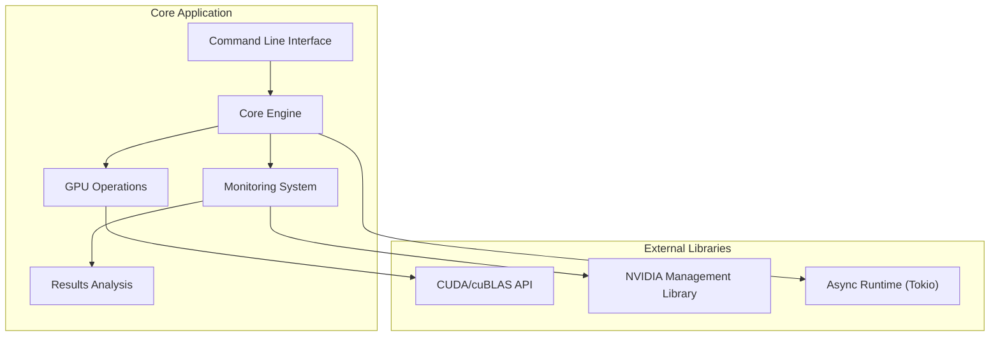
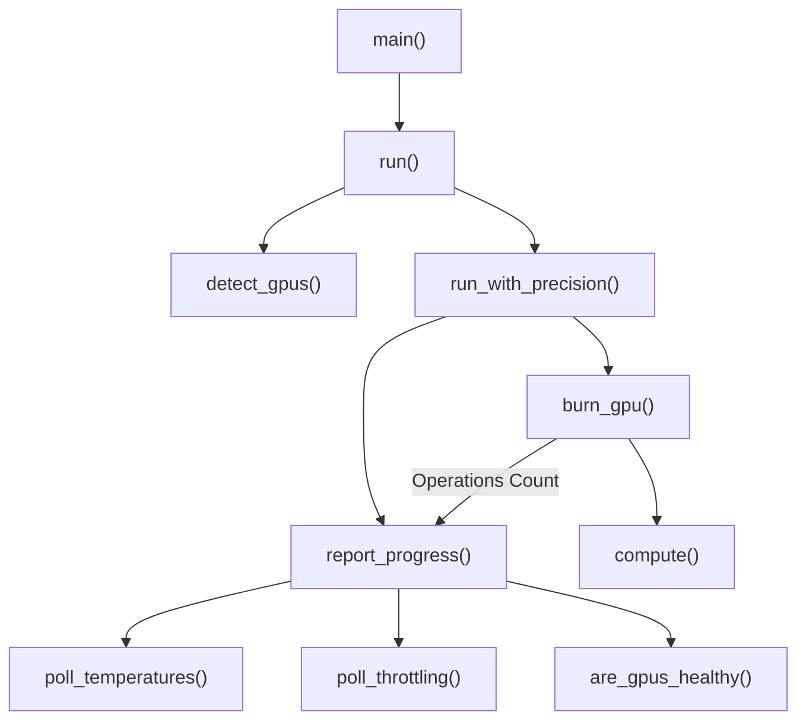
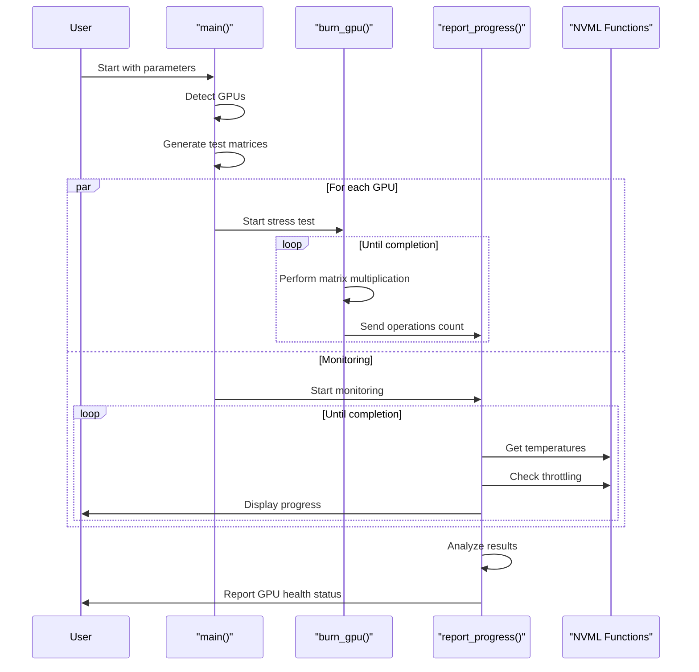
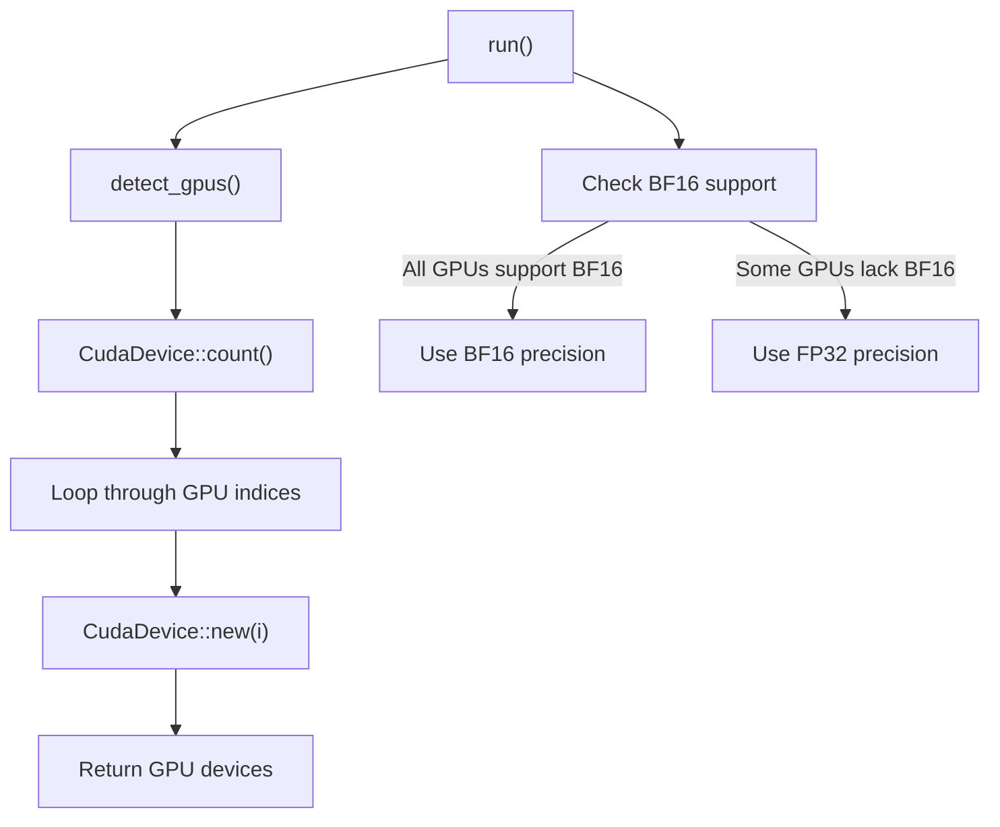
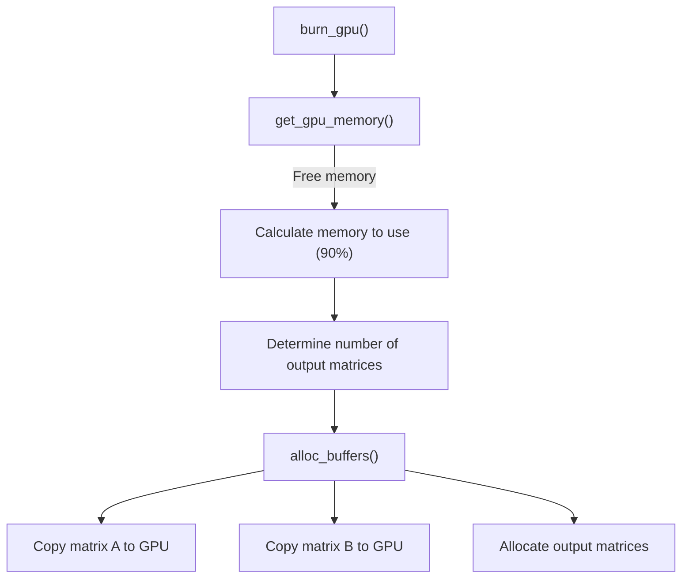
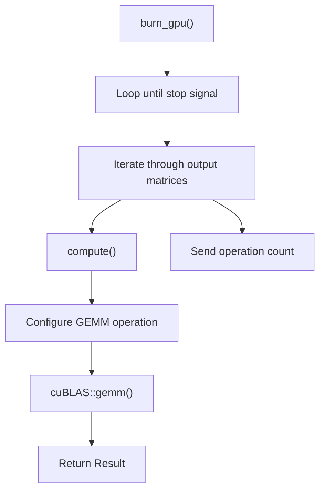
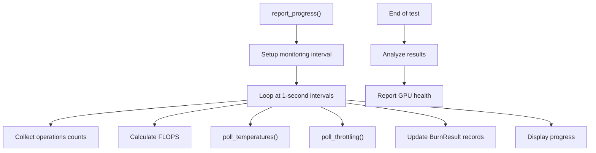
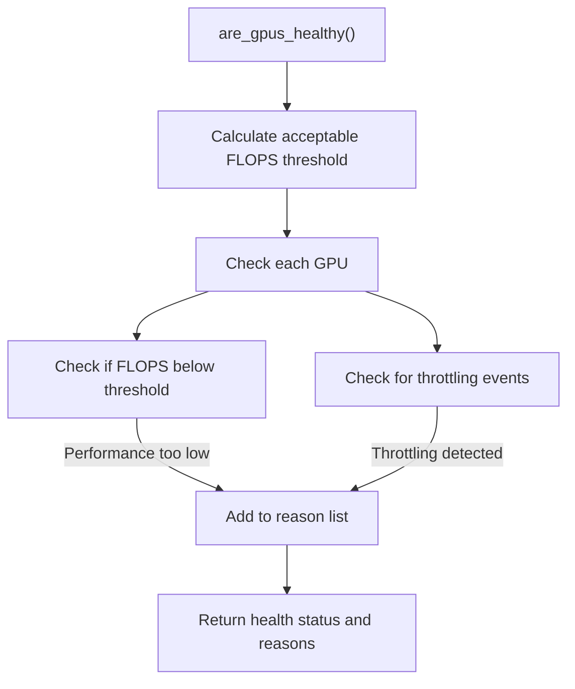
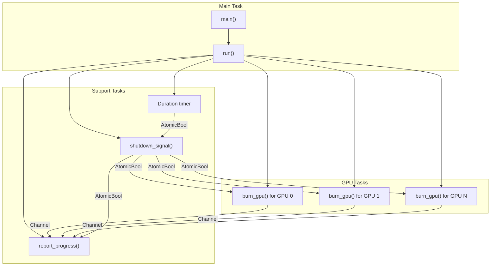

<!-- source: DeepWiki mcp.deepwiki.com · repo huggingface/gpu-fryer · page 4 Technical Architecture · fetched 2026-10-26 -->

# Technical Architecture

<details>
<summary>Relevant source files</summary>

The following files were used as context for generating this wiki page:

- [Cargo.toml](Cargo.toml)
- [src/main.rs](src/main.rs)

</details>


This document provides a detailed explanation of GPU-Fryer's internal architecture and design. It describes the core components, their interactions, and implementation details that enable effective GPU stress testing and performance monitoring.

For information about how to use the tool, please refer to the [Usage Guide](#3). For information about building or contributing to the project, see the [Development Guide](#5).

## System Overview

GPU-Fryer is designed to stress test NVIDIA GPUs by performing intensive matrix multiplication operations while monitoring key performance metrics. The system uses cuBLAS for computation and NVML (NVIDIA Management Library) for monitoring GPU temperatures and throttling conditions.



Sources: [src/main.rs:1-9](), [Cargo.toml:6-13]()

## Component Architecture

The application is structured around several key components that work together to provide comprehensive GPU stress testing.



Sources: [src/main.rs:143-169](), [src/main.rs:184-221](), [src/main.rs:223-297]()

### Key Components and Functions

| Component | Primary Function | Purpose |
|-----------|------------------|---------|
| Command Line Interface | `Args` struct | Parses user configuration options |
| GPU Detection | `detect_gpus()` | Identifies available NVIDIA GPUs |
| Precision Management | `VariablePrecisionFloat` trait | Supports both FP32 and BF16 operations |
| Matrix Multiplication | `compute<T>()` | Performs GEMM operations via cuBLAS |
| GPU Monitoring | `poll_temperatures()`, `poll_throttling()` | Collects GPU health metrics |
| Results Analysis | `are_gpus_healthy()` | Determines if GPUs are functioning properly |

Sources: [src/main.rs:31-50](), [src/main.rs:125-141](), [src/main.rs:299-315](), [src/main.rs:450-481]()

## Data Flow

The following sequence diagram illustrates how data flows through the system during operation:



Sources: [src/main.rs:223-297](), [src/main.rs:327-448](), [src/main.rs:483-517]()

## Core Subsystems

### 1. GPU Detection and Initialization

The system begins by identifying available GPUs and their capabilities:



Sources: [src/main.rs:184-221](), [src/main.rs:572-580]()

### 2. Memory Management

GPU-Fryer allocates memory efficiently to maximize GPU utilization:

- Targets 90% of available GPU memory (`MEM_TO_USE_PCT` = 0.9)
- Uses fixed matrix size of 8192×8192 (defined by `SIZE` constant)
- Creates multiple output matrices as a ring buffer



Sources: [src/main.rs:20-22](), [src/main.rs:483-517](), [src/main.rs:523-543]()

### 3. Matrix Multiplication Engine

The core stress testing mechanism uses matrix multiplication:



Sources: [src/main.rs:483-517](), [src/main.rs:545-570]()

Key characteristics:
- Uses cuBLAS for optimized matrix multiplication
- Supports both FP32 and BF16 precision through generic implementation
- Continuously performs operations, cycling through output buffers

### 4. Monitoring System

While the stress test runs, the monitoring component:



Sources: [src/main.rs:327-448](), [src/main.rs:299-315]()

The `BurnResult` structure [src/main.rs:52-113]() tracks per-GPU metrics including:
- FLOPS (min, max, average)
- Temperature (min, max, average)
- Throttling events (hardware, thermal software, thermal hardware)

### 5. Results Analysis

After testing completes, GPU-Fryer analyzes results to determine GPU health:



Sources: [src/main.rs:450-481]()

Health determination is based on:
- Performance consistency (within configurable tolerance of the best GPU)
- Presence of throttling events (with option to tolerate software throttling)

## Implementation Details

### Precision Management

GPU-Fryer supports both FP32 and BF16 precision modes through a trait-based approach:

```rust
trait VariablePrecisionFloat:
    Copy + Debug + Send + Sync + Unpin + DeviceRepr + ValidAsZeroBits + 'static
{
    fn from_f32(f: f32) -> Self;
}
```

Sources: [src/main.rs:125-141]()

This trait allows the core computation functions to be generic over the floating-point type, with specializations for both `f32` and `half::bf16`.

### Asynchronous Execution Model

The application leverages Rust's async/await with Tokio:



Sources: [src/main.rs:242-288](), [src/main.rs:582-602]()

This design enables:
- Parallel operation across multiple GPUs
- Responsive monitoring and user feedback
- Graceful shutdown on timeout or user interruption

### Cross-Thread Communication

Components communicate using:
- Tokio's unbounded channels (`UnboundedSender`/`UnboundedReceiver`) for operation counts
- Shared atomic boolean (`Arc<AtomicBool>`) for coordinating shutdown
- Tokio's task spawning mechanism for parallel execution

Sources: [src/main.rs:16-18](), [src/main.rs:242-253]()

## Dependencies

GPU-Fryer relies on several key dependencies:

| Dependency | Version | Purpose |
|------------|---------|---------|
| cudarc | 0.13.0 | CUDA runtime and cuBLAS operations |
| nvml-wrapper | 0.10.0 | GPU monitoring via NVIDIA Management Library |
| tokio | 1.42 | Async runtime and concurrency |
| clap | 4.5.26 | Command-line argument parsing |
| rand | 0.8.5 | Random number generation for test matrices |
| half | 2.4.1 | BF16 floating-point support |
| anyhow | 1.0.95 | Error handling |

Sources: [Cargo.toml:6-13]()

## Conclusion

GPU-Fryer's architecture is designed for effective GPU stress testing through heavy matrix multiplication workloads while monitoring performance and health metrics. The system's modular design, asynchronous execution model, and comprehensive monitoring capabilities enable accurate detection of GPU performance issues, thermal throttling, and other potential problems.

For more detailed information about specific components, refer to the following pages:
- [GPU Stress Testing Mechanism](#4.2)
- [Performance Monitoring](#4.3)
- [CUDA Integration](#4.4)

---

