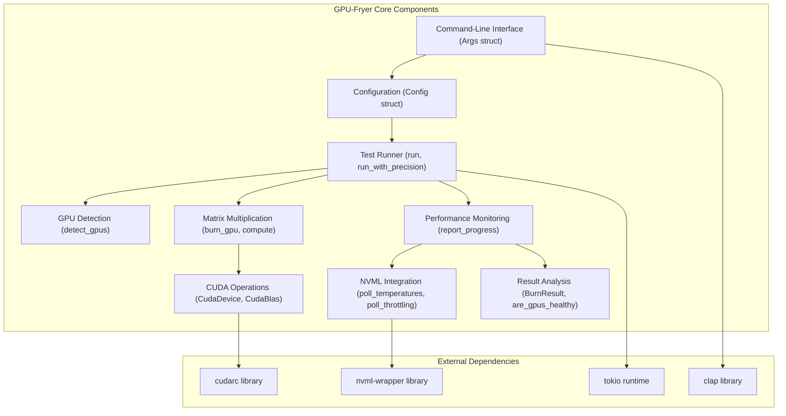
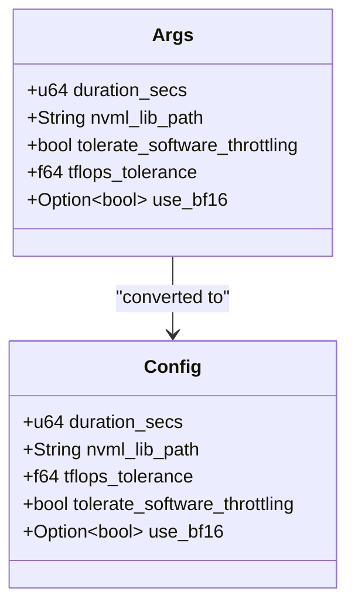
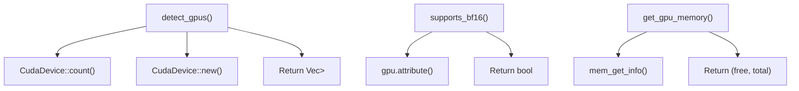
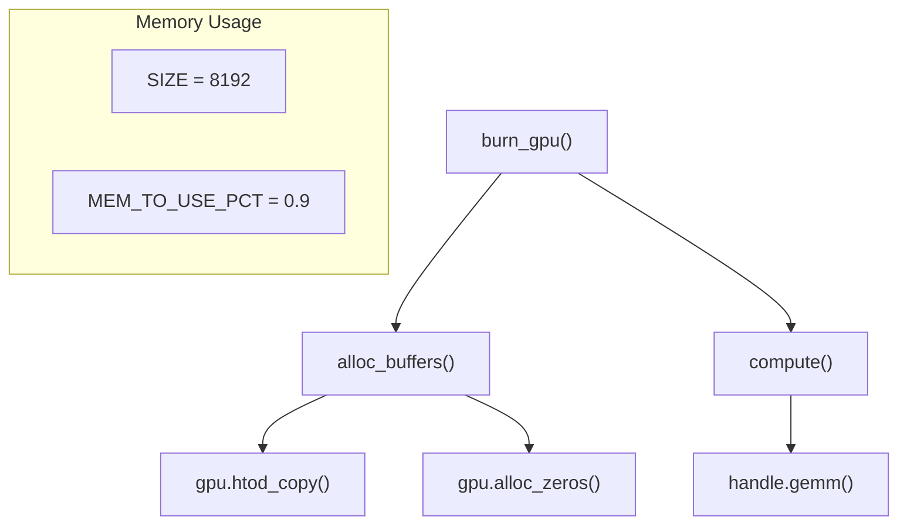
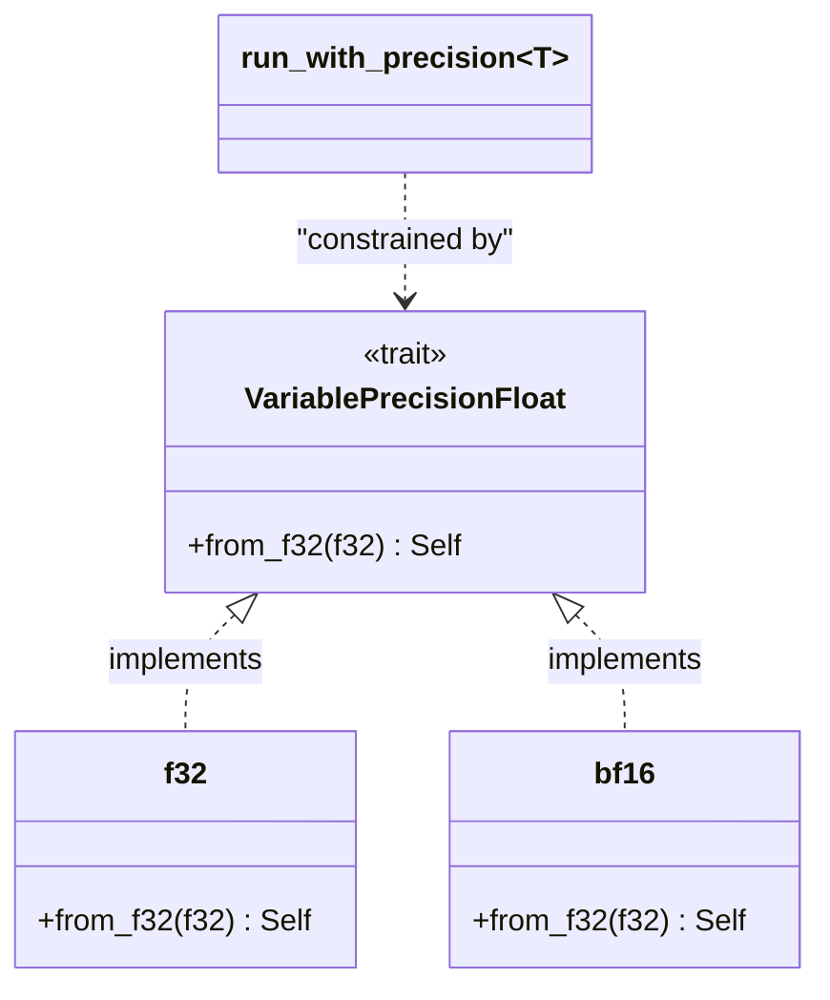
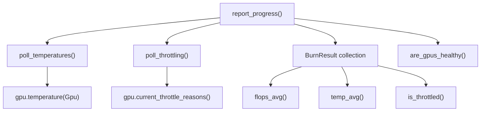
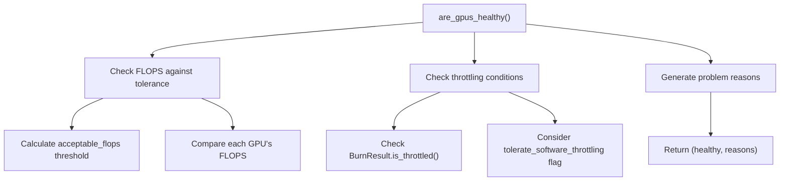
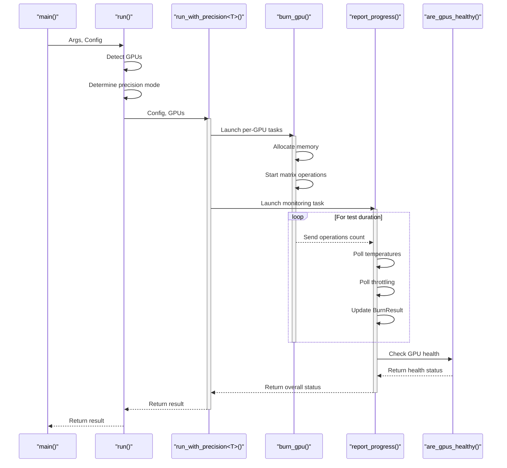

<!-- source: DeepWiki mcp.deepwiki.com · repo huggingface/gpu-fryer · page 4.1 Core Components · fetched 2026-10-26 -->

# Core Components

Relevant source files

The following files were used as context for generating this wiki page:

- [Cargo.toml](Cargo.toml)
- [src/main.rs](src/main.rs)

This page documents the core architectural components of GPU-Fryer and how they interact with each other. The documentation focuses on the internal structure of the system rather than its usage patterns or installation processes. For information on how to use the system, see [Usage Guide](#3).

## System Overview

GPU-Fryer consists of several key components working together to perform GPU stress testing and monitoring. The following diagram shows the high-level architecture of the system:

Sources: [src/main.rs:31-50](), [src/main.rs:116-123](), [src/main.rs:184-221](), [src/main.rs:223-297](), [src/main.rs:572-580](), [Cargo.toml:7-13]()

## Command-Line Interface

The Command-Line Interface component handles user input via command-line arguments, configuring the test parameters through the `Args` struct. This is implemented using the `clap` library with the `derive` feature for a declarative approach.

Key parameters configurable through the CLI:
- Test duration in seconds (default: 60)
- Path to NVIDIA Management Library (default: "/usr/lib/x86_64-linux-gnu/libnvidia-ml.so.1")
- Tolerance for software throttling (default: false)
- TFLOPS tolerance percentage compared to best GPU (default: 10%)
- Precision mode selection (FP32 or BF16)

Command-line arguments are parsed using the `clap` crate's `derive` feature and validated in the `main` function before being converted to the internal `Config` struct.

Sources: [src/main.rs:31-50](), [src/main.rs:116-123](), [src/main.rs:143-170](), [Cargo.toml:8]()

## GPU Detection and Management

The GPU Detection component identifies and initializes available GPUs on the system. It's responsible for detecting GPU capabilities, retrieving GPU information, and preparing GPUs for testing.

Key functions:
- `detect_gpus()`: Returns a vector of CUDA devices available on the system
- `supports_bf16()`: Checks if a GPU supports BF16 precision by querying compute capability
- `get_gpu_memory()`: Retrieves available and total memory for a GPU

This component interacts with the CUDA runtime through the `cudarc` library to enumerate devices and query their capabilities.

Sources: [src/main.rs:572-580](), [src/main.rs:317-325](), [src/main.rs:523-527](), [Cargo.toml:9]()

## Matrix Multiplication Engine

The Matrix Multiplication Engine is the core stress testing component, responsible for allocating GPU memory and performing intensive matrix multiplications to stress the GPU.

Key functions and constants:
- `SIZE`: Matrix dimension (8192×8192), selected for GPU stress testing
- `MEM_TO_USE_PCT`: Percentage of GPU memory to utilize (90%)
- `burn_gpu()`: Main function that orchestrates the GPU stress testing
- `alloc_buffers()`: Allocates GPU memory for matrices
- `compute()`: Performs matrix multiplication using cuBLAS

The engine generates random matrices and performs repeated matrix multiplications using the CUDA Basic Linear Algebra Subroutines (cuBLAS) library. It's designed to use approximately 90% of available GPU memory to ensure thorough stress testing.

Sources: [src/main.rs:20-21](), [src/main.rs:483-517](), [src/main.rs:529-543](), [src/main.rs:545-570]()

## Precision Handling

GPU-Fryer supports different numerical precision modes through the `VariablePrecisionFloat` trait. This allows the system to use either 32-bit floating point (FP32) or Brain Floating Point (BF16) precision depending on GPU capabilities.

The precision mode is determined through the following process:
1. Check if user explicitly requested BF16 or FP32 via command-line arguments
2. If not specified, detect if all GPUs support BF16 precision
3. Select appropriate precision implementation and call `run_with_precision<T>()`

The implementation uses generic programming to share code between precision modes while maintaining type safety.

Sources: [src/main.rs:125-141](), [src/main.rs:200-214](), [src/main.rs:223-227](), [Cargo.toml:13]()

## Performance Monitoring

The Performance Monitoring component tracks GPU metrics during stress testing, including temperature, throttling status, and computational performance (FLOPS).

Key functions:
- `report_progress()`: Monitors and reports GPU performance metrics
- `poll_temperatures()`: Retrieves current temperatures from all GPUs
- `poll_throttling()`: Checks for throttling conditions on all GPUs
- `BurnResult`: Struct that tracks performance metrics for each GPU

The monitoring component uses the NVIDIA Management Library (NVML) to obtain real-time information about GPU status. It tracks:
- Temperature readings
- Throttling conditions (hardware slowdown, thermal slowdown)
- Performance metrics (GFLOPS, operation counts)

Sources: [src/main.rs:52-113](), [src/main.rs:299-315](), [src/main.rs:327-448](), [Cargo.toml:10]()

## Result Analysis

The Result Analysis component evaluates the collected performance data to determine if GPUs are operating properly or experiencing issues.

Key components:
- `are_gpus_healthy()`: Main analysis function that determines overall GPU health
- `BurnResult.is_throttled()`: Helper method to check for any throttling condition
- Tolerance parameters that control acceptable performance variation

The analysis considers two main factors:
1. **Performance homogeneity**: Whether all GPUs are performing within the configured tolerance range
2. **Throttling detection**: Whether any GPUs are experiencing throttling, with configurable tolerance for software throttling

Sources: [src/main.rs:94-95](), [src/main.rs:450-481]()

## Runtime Workflow

The following diagram illustrates the data flow and execution sequence during a typical GPU-Fryer run:

Sources: [src/main.rs:143-170](), [src/main.rs:184-221](), [src/main.rs:223-297](), [src/main.rs:483-517](), [src/main.rs:327-448](), [src/main.rs:450-481]()

## Key Dependencies

GPU-Fryer relies on several external libraries to provide its functionality:

| Dependency | Version | Purpose |
|------------|---------|---------|
| cudarc | 0.13.0 | CUDA runtime interface for GPU operations |
| nvml-wrapper | 0.10.0 | Interface to NVIDIA Management Library for monitoring |
| tokio | 1.42 | Asynchronous runtime for concurrent operations |
| clap | 4.5.26 | Command-line argument parsing |
| anyhow | 1.0.95 | Error handling |
| rand | 0.8.5 | Random number generation for test matrices |
| half | 2.4.1 | Support for BF16 precision |

Each dependency plays a critical role:
- **cudarc**: Provides safe Rust bindings to CUDA, enabling GPU computation
- **nvml-wrapper**: Enables monitoring of GPU temperature and throttling status
- **tokio**: Powers the asynchronous architecture, allowing concurrent GPU testing and monitoring
- **clap**: Provides the command-line interface with argument parsing and validation
- **half**: Implements the BF16 floating-point format for precision testing

Sources: [Cargo.toml:7-13]()

## Summary

The GPU-Fryer architecture consists of several well-defined components that work together to stress test GPUs and detect performance issues:

1. **Command-Line Interface**: Configures test parameters through user input
2. **GPU Detection**: Identifies available GPUs and their capabilities
3. **Matrix Multiplication Engine**: Stresses GPUs through intensive computation
4. **Precision Handling**: Supports different floating-point precision modes
5. **Performance Monitoring**: Tracks GPU metrics in real-time
6. **Result Analysis**: Evaluates GPU health based on performance data

These components are orchestrated by the main execution flow in `run()` and `run_with_precision<T>()` functions, which manage the lifecycle of the stress test from initialization to result reporting.

For more detailed information about specific aspects of the system, see:
- [GPU Stress Testing Mechanism](#4.2) for details on the matrix multiplication approach
- [Performance Monitoring](#4.3) for more on temperature and throttling detection
- [CUDA Integration](#4.4) for information about how GPU-Fryer interfaces with NVIDIA GPUs

Sources: [src/main.rs](), [Cargo.toml]()

---

