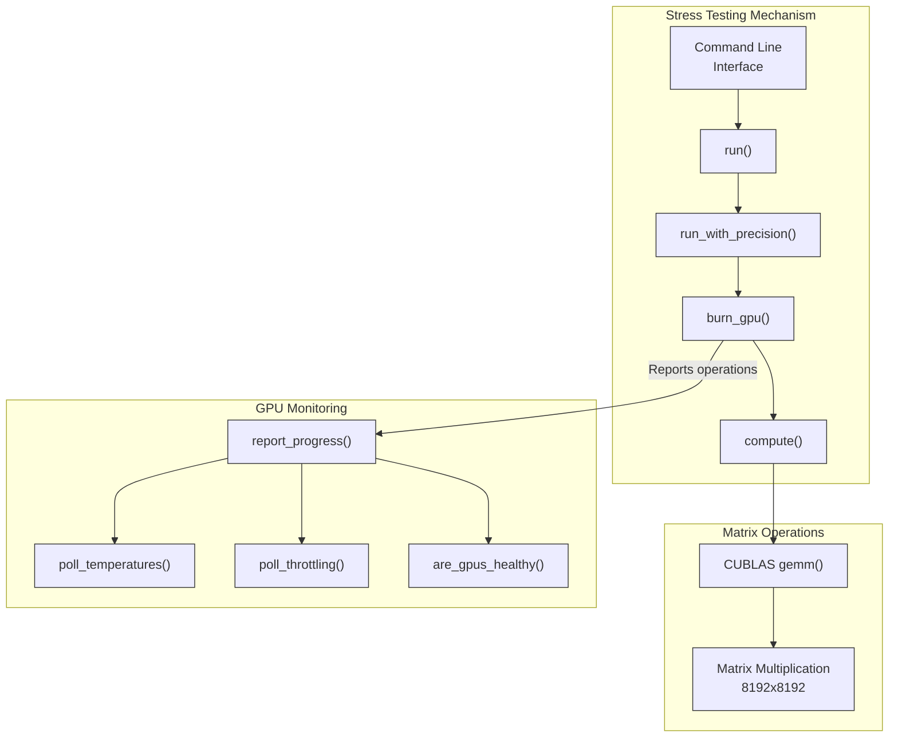
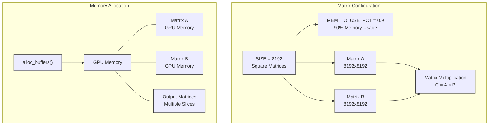
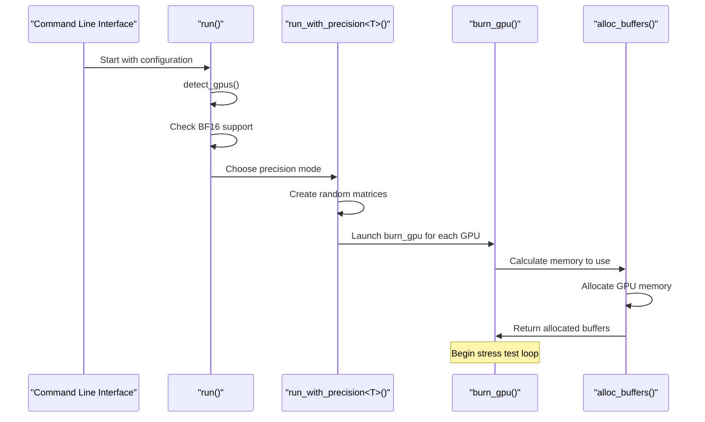
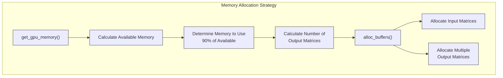
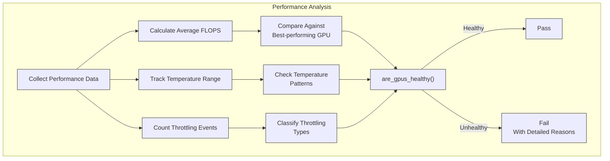

<!-- source: DeepWiki mcp.deepwiki.com · repo huggingface/gpu-fryer · page 4.2 GPU Stress Testing Mechanism · fetched 2026-10-26 -->

# GPU Stress Testing Mechanism

<details>
<summary>Relevant source files</summary>

The following files were used as context for generating this wiki page:

- [assets/tensorcores.png](assets/tensorcores.png)
- [src/main.rs](src/main.rs)

</details>


## Purpose and Scope

This document details the GPU stress testing mechanism implemented in the gpu-fryer tool. The stress testing mechanism is designed to push GPUs to their thermal and computational limits by performing intensive matrix multiplication operations while monitoring performance metrics, temperature, and throttling status. This page explains how the stress test is implemented, how matrix multiplication is used to load the GPU, and how the system detects performance degradation.

For information about how the tool monitors GPU performance during testing, see [Performance Monitoring](#4.3).

Sources: [src/main.rs:483-517]()

## Overview of the Stress Testing Approach

The GPU-Fryer tool uses matrix multiplication as its primary stress testing method. This operation is computationally intensive, predictable in its resource usage, and scales well across different GPU architectures. The stress test:

1. Creates large matrices filled with random data
2. Allocates nearly all available GPU memory (90% by default)
3. Performs continuous matrix multiplications for a specified duration
4. Monitors temperature, throttling conditions, and computational throughput
5. Reports on GPU health based on performance consistency



Sources: [src/main.rs:183-221](), [src/main.rs:223-297](), [src/main.rs:483-517]()

## Matrix Multiplication Implementation

### Matrix Configuration

The stress test uses square matrices with a size of 8192×8192. This size was specifically chosen for several reasons:

- Large enough to create significant computational load
- Optimized for Tensor Core operations (size is divisible by 16)
- Creates predictable memory usage patterns



Sources: [src/main.rs:20-21](), [src/main.rs:529-543]()

### Precision Modes

The tool supports two floating-point precision modes:

1. **FP32** (32-bit floating point) - Default mode, supported by all NVIDIA GPUs
2. **BF16** (16-bit brain floating point) - More memory efficient, but requires GPU architecture support (Compute Capability ≥ 8.0)

The choice of precision affects both memory usage and computational performance. BF16 operations can potentially run faster and allow more matrices to fit in memory, but are only available on newer GPU architectures.

Sources: [src/main.rs:125-141](), [src/main.rs:200-214](), [src/main.rs:317-325]()

## Stress Testing Process

### Initialization Phase

1. **GPU Detection**: The system automatically detects all available NVIDIA GPUs
2. **Precision Mode Selection**: Determines whether to use FP32 or BF16 based on GPU capabilities
3. **Matrix Creation**: Initializes input matrices with random values
4. **Memory Allocation**: Allocates GPU memory for input and output matrices



Sources: [src/main.rs:183-221](), [src/main.rs:484-505](), [src/main.rs:529-543](), [src/main.rs:572-580]()

### Execution Phase

The stress test runs continuously for the specified duration (default: 60 seconds), performing these operations:

1. **Matrix Multiplication**: Uses CUBLAS `gemm` operation to multiply matrices
2. **Ring Buffer**: Continuously rotates through multiple output buffers to maximize GPU usage
3. **Operation Counting**: Tracks the number of matrix operations performed
4. **Monitoring**: Collects temperature, throttling status, and performance metrics

Sources: [src/main.rs:507-517](), [src/main.rs:545-570]()

### Matrix Multiplication Details

The core computational work is performed using the CUBLAS General Matrix Multiply (GEMM) operation:

```
C = α × op(A) × op(B) + β × C
```

Where:
- A, B are input matrices (8192×8192)
- C is the output matrix (8192×8192)
- op() represents optional transpose operations
- α, β are scaling factors (α=1.0, β=0.0 in this implementation)

The operation is configured in the `compute` function:

Sources: [src/main.rs:545-570]()

## Memory Management

### Memory Allocation Strategy

The stress test aims to use approximately 90% of available GPU memory (`MEM_TO_USE_PCT = 0.9`). This strategy:

1. Leaves some memory available for GPU system operations
2. Maximizes the stress on the memory subsystem
3. Prevents out-of-memory errors that would terminate the test

The number of output matrices that can be allocated depends on:
- Total available GPU memory
- Size of input matrices
- Precision mode (FP32 vs BF16)



Sources: [src/main.rs:496-504](), [src/main.rs:523-527](), [src/main.rs:529-543]()

### Buffer Management

The stress test uses a ring buffer approach for output matrices:

1. Multiple output matrices are allocated upfront
2. The test cycles through these matrices during execution
3. This approach maintains constant memory pressure
4. Avoids memory allocation/deallocation overhead during the test

Sources: [src/main.rs:503-505](), [src/main.rs:508-514](), [src/main.rs:529-543]()

## Performance Monitoring and Metrics

### Real-time Metrics Collection

During the stress test, the system collects and reports:

1. **FLOPS (Floating Point Operations Per Second)**: Measures computational throughput
2. **Temperature**: Monitors GPU temperature in real-time
3. **Throttling Status**: Detects whether the GPU is throttling due to thermal or other constraints

These metrics are collected at regular intervals and displayed during the test.

| Metric | Description | Calculation |
|--------|-------------|-------------|
| FLOPS | Computational throughput | operations × SIZE³ × 2 |
| Temperature | GPU temperature in °C | Direct NVML reading |
| Throttling | Detection of throttling events | NVML throttling reasons |

Sources: [src/main.rs:327-448](), [src/main.rs:299-315]()

### Performance Analysis

After the stress test completes, the system analyzes the collected metrics to determine GPU health:

1. **FLOPS Consistency**: Checks if any GPU's performance is significantly lower than others
2. **Throttling Events**: Identifies any thermal or hardware throttling events
3. **Temperature Profile**: Analyzes temperature patterns during the test

The system uses these metrics to determine if GPUs are healthy based on:
- Performance within tolerance of the best-performing GPU
- Absence of hardware throttling
- Configurable tolerance for software throttling



Sources: [src/main.rs:433-447](), [src/main.rs:450-481]()

## Throttling Detection

The system checks for three types of GPU throttling:

1. **Hardware Throttling** (`HW_SLOWDOWN`): General hardware throttling
2. **Software Thermal Throttling** (`SW_THERMAL_SLOWDOWN`): Driver-level thermal throttling
3. **Hardware Thermal Throttling** (`HW_THERMAL_SLOWDOWN`): Hardware-level thermal throttling

Throttling detection is implemented using the NVIDIA Management Library (NVML) and is used to determine GPU health.

Sources: [src/main.rs:308-315](), [src/main.rs:382-407](), [src/main.rs:450-481]()

## Precision Mode Implementation

### VariablePrecisionFloat Trait

The stress testing mechanism supports multiple precision modes through a trait-based approach:

```mermaid
classDiagram
    class "VariablePrecisionFloat" {
        <<trait>>
        +from_f32(f32) -> Self
    }
    
    class "f32" {
        +from_f32(f32) -> Self
    }
    
    class "half::bf16" {
        +from_f32(f32) -> Self
    }
    
    VariablePrecisionFloat <|-- f32
    VariablePrecisionFloat <|-- half::bf16
    
    class "run_with_precision<T>" {
        <<function>>
        +where T: VariablePrecisionFloat
        +where CudaBlas: Gemm<T>
    }
    
    class "burn_gpu<T>" {
        <<function>>
        +where T: VariablePrecisionFloat
        +where CudaBlas: Gemm<T>
    }
    
    class "compute<T>" {
        <<function>>
        +where T: VariablePrecisionFloat
        +where CudaBlas: Gemm<T>
    }
    
    run_with_precision <-- f32
    run_with_precision <-- half::bf16
    run_with_precision --> burn_gpu
    burn_gpu --> compute
```

This trait allows the system to use the same code for both FP32 and BF16 operations, with the precision type determined at runtime based on GPU capabilities.

Sources: [src/main.rs:125-141](), [src/main.rs:223-297](), [src/main.rs:483-517](), [src/main.rs:545-570]()

## Safety and Error Handling

The stress testing mechanism includes several safety measures:

1. **Graceful Shutdown**: Handles interruption signals (Ctrl+C or terminate)
2. **Error Handling**: Uses Rust's `anyhow` for robust error handling
3. **Memory Management**: Carefully manages GPU memory to prevent crashes
4. **Tolerance Configuration**: Allows configurable tolerance for performance variations and throttling

Sources: [src/main.rs:582-602](), [src/main.rs:143-170]()

## Summary

The GPU stress testing mechanism in gpu-fryer provides a robust way to evaluate GPU performance and reliability under load. By using matrix multiplication, the system creates a predictable, intensive workload that stresses both the computational units and memory subsystems of the GPU.

The key strengths of this approach are:
- Consistent load pattern across different GPU architectures
- Precise memory usage control
- Real-time performance and thermal monitoring
- Comprehensive analysis of GPU health based on multiple metrics

This mechanism allows users to identify potential issues with GPU performance, cooling, or power delivery by pushing the GPU to its limits in a controlled, measurable way.

Sources: [src/main.rs:20-597]()

---

