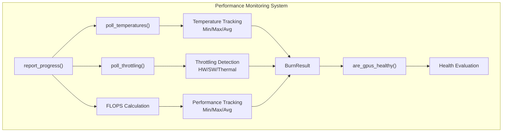
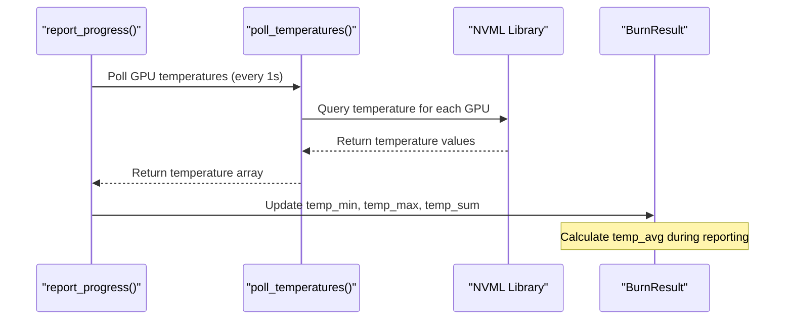
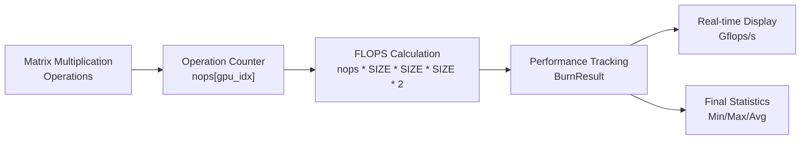
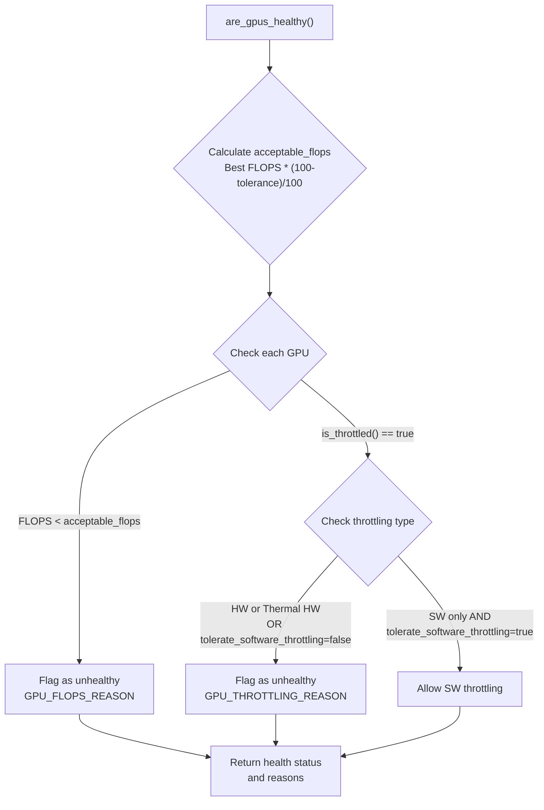
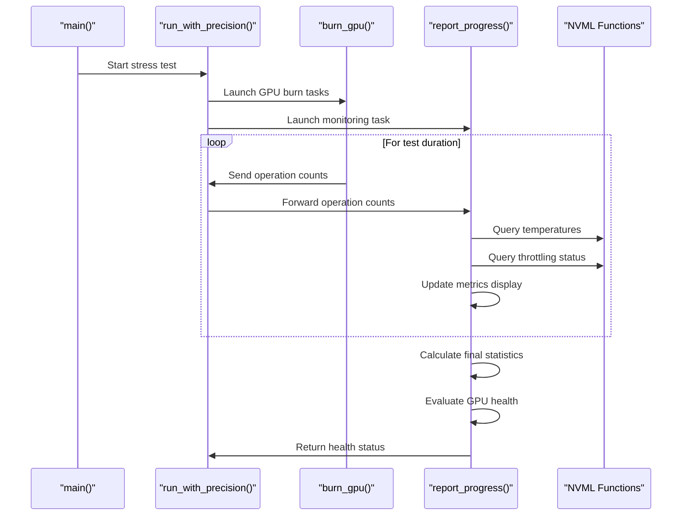

<!-- source: DeepWiki mcp.deepwiki.com · repo huggingface/gpu-fryer · page 4.3 Performance Monitoring · fetched 2026-10-26 -->

# Performance Monitoring

<details>
<summary>Relevant source files</summary>

The following files were used as context for generating this wiki page:

- [assets/utilization.png](assets/utilization.png)
- [src/main.rs](src/main.rs)

</details>


This page explains how the GPU-Fryer tool monitors GPU performance, temperature, and throttling status during stress testing. It covers the internal mechanisms used to collect metrics, detect issues, and evaluate GPU health. For information about the stress testing mechanism itself, see [GPU Stress Testing Mechanism](#4.2).

## Overview of Performance Monitoring Architecture

GPU-Fryer implements a comprehensive monitoring system that runs alongside the stress testing process. This monitoring system continuously tracks several key metrics:

1. **Performance (FLOPS)** - Measures computational throughput
2. **Temperature** - Tracks GPU temperature
3. **Throttling Status** - Detects when GPUs are throttling performance

The monitoring runs in a dedicated Tokio task and provides real-time reporting while collecting data for final evaluation.



Sources: [src/main.rs:327-448](), [src/main.rs:299-315](), [src/main.rs:450-481]()

## Data Collection Architecture

The `BurnResult` structure serves as the central data repository for all monitoring metrics. It accumulates data during the test run and provides methods to calculate averages and determine throttling status.

```mermaid
classDiagram
    class BurnResult {
        +usize gpu_idx
        +usize flops_max
        +usize flops_min
        +usize flops_sum
        +usize n_iters
        +usize temp_max
        +usize temp_min
        +usize temp_sum
        +usize throttling_hw
        +usize throttling_thermal_sw
        +usize throttling_thermal_hw
        +flops_avg() float
        +temp_avg() float
        +is_throttled() bool
    }
    
    BurnResult --> "report_progress()"
    BurnResult --> "are_gpus_healthy()"
```

Sources: [src/main.rs:52-96]()

## Temperature Monitoring

Temperature monitoring is implemented using the NVIDIA Management Library (NVML) to query GPU temperatures at regular intervals.

### Temperature Monitoring Process



The system polls temperatures for all GPUs once per second and records:
- Current temperature (displayed in real-time)
- Minimum temperature observed
- Maximum temperature observed
- Average temperature (calculated at the end)

Temperature monitoring is especially important for detecting thermal throttling and evaluating cooling efficiency.

Sources: [src/main.rs:299-306](), [src/main.rs:366-380]()

## Throttling Detection

GPU-Fryer detects three distinct types of throttling conditions:

| Throttling Type | Description | Code Reference |
|-----------------|-------------|----------------|
| SW Thermal Slowdown | Software-initiated thermal throttling | `ThrottleReasons::SW_THERMAL_SLOWDOWN` |
| HW Thermal Slowdown | Hardware-initiated thermal throttling | `ThrottleReasons::HW_THERMAL_SLOWDOWN` |
| HW Slowdown | General hardware throttling | `ThrottleReasons::HW_SLOWDOWN` |

Throttling detection works by:
1. Polling the NVML library for current throttle reasons
2. Incrementing counters in `BurnResult` when throttling is detected
3. Flagging GPUs that experienced throttling during the test

The system can be configured to tolerate software thermal throttling through the `tolerate_software_throttling` flag, which can be useful when maximum performance is not a critical requirement.

Sources: [src/main.rs:308-315](), [src/main.rs:382-407](), [src/main.rs:93-95]()

## Performance Measurement

GPU-Fryer measures performance in FLOPS (Floating Point Operations Per Second), which indicates the computational throughput of each GPU.

### Performance Calculation Process



Performance is calculated by:
1. Counting the number of matrix multiplications performed
2. Multiplying by the operation count per multiplication (2 × SIZE³)
3. Converting to GFLOPS for readability

The system tracks:
- Current performance (displayed in real-time)
- Minimum performance observed
- Maximum performance observed 
- Average performance (for health evaluation)

Sources: [src/main.rs:343-363](), [src/main.rs:410-418]()

## GPU Health Evaluation

After the stress test completes, GPU-Fryer evaluates the health of each GPU using the collected monitoring data. This evaluation is performed by the `are_gpus_healthy()` function.

### Health Evaluation Process



The health evaluation considers:

1. **Performance Homogeneity**: Compares each GPU's average FLOPS against the best performing GPU, allowing for a specified tolerance percentage.

2. **Throttling Occurrences**: Flags GPUs that experienced throttling, with the option to tolerate software thermal throttling.

The system provides detailed reasons for any unhealthy GPUs, which helps diagnose issues like:
- "GPU is not performing as expected. Check the flops values and temperatures"
- "GPU is throttled. Check the throttling reasons and temperatures"

Sources: [src/main.rs:450-481](), [src/main.rs:433-447]()

## Integration with Test Flow

Performance monitoring is tightly integrated with the stress testing flow in GPU-Fryer.



The monitoring system operates in parallel with the GPU stress testing:

1. While `burn_gpu()` tasks stress each GPU with matrix multiplications, they send operation counts through a channel
2. The `report_progress()` task receives these counts, polls temperature and throttling status, and updates metrics
3. At test completion, the monitoring system evaluates GPU health and returns results

This parallel architecture ensures continuous monitoring with minimal impact on the stress test itself.

Sources: [src/main.rs:225-296](), [src/main.rs:327-448]()

## Configuration Options

GPU-Fryer provides several configuration options that affect performance monitoring:

| Option | CLI Flag | Description | Default |
|--------|----------|-------------|---------|
| TFLOPS Tolerance | `--tflops-tolerance` | Acceptable performance deviation (%) compared to best GPU | 10% |
| Tolerate Software Throttling | `--tolerate-software-throttling` | Whether to tolerate SW thermal throttling if FLOPS are acceptable | false |
| NVML Library Path | `--nvml-lib-path` | Path to NVIDIA Management Library | "/usr/lib/x86_64-linux-gnu/libnvidia-ml.so.1" |

These options allow users to customize the monitoring sensitivity based on their specific requirements and environment.

Sources: [src/main.rs:31-50](), [src/main.rs:433-447]()

## Performance Reporting

During test execution, GPU-Fryer provides real-time monitoring information displayed in the console:

1. **Operation counts and GFLOPS** for each GPU
2. **Temperatures** for each GPU
3. **Throttling status** for each GPU

After test completion, it provides a comprehensive summary including:

1. **Average GFLOPS** for each GPU with min/max values
2. **Average temperature** for each GPU with min/max values
3. **Throttling occurrences** for each GPU
4. **Health evaluation** with detailed reasons for any unhealthy GPUs

This detailed reporting helps identify performance issues, thermal problems, and inconsistencies between GPUs in multi-GPU environments.

Sources: [src/main.rs:350-407](), [src/main.rs:410-447]()

---

