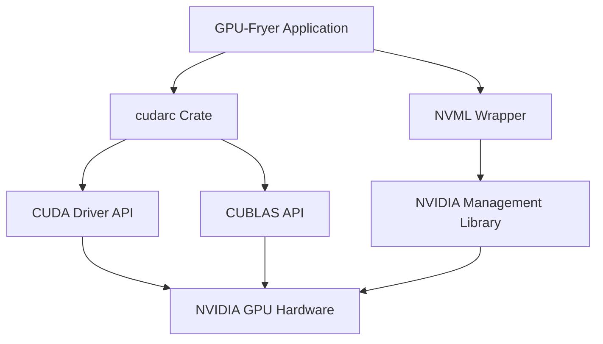
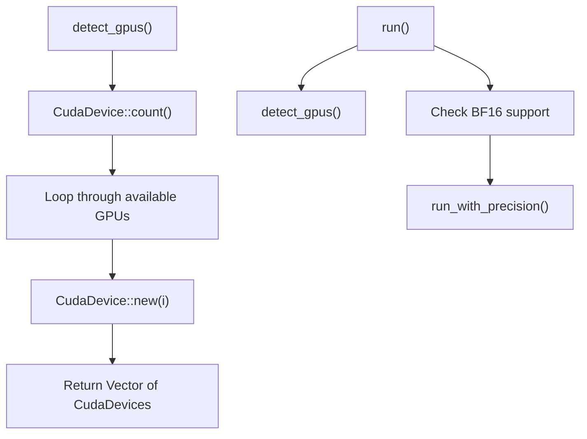
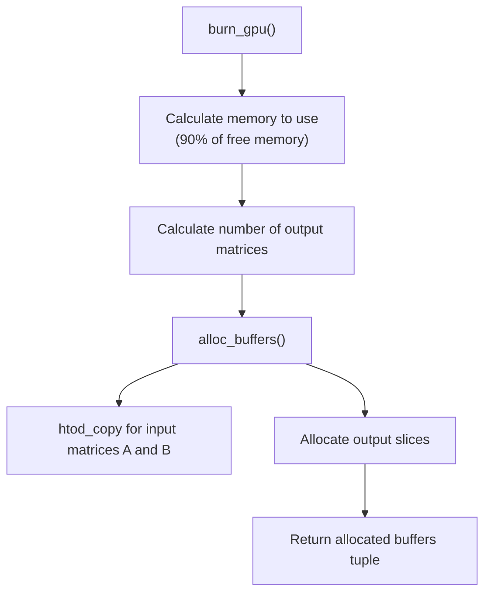
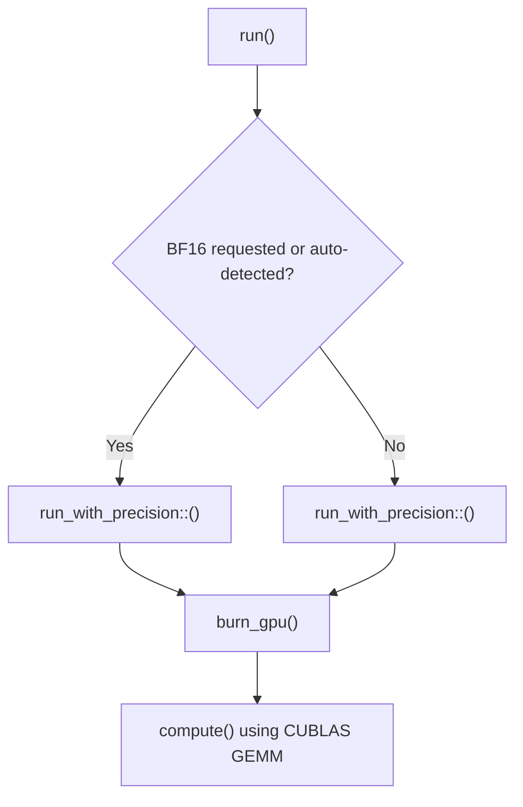
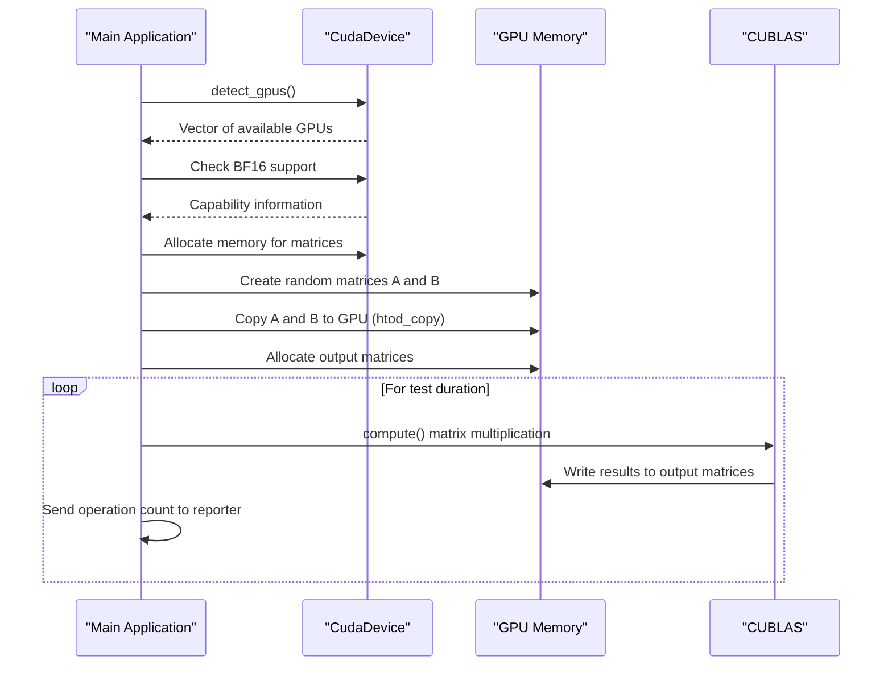
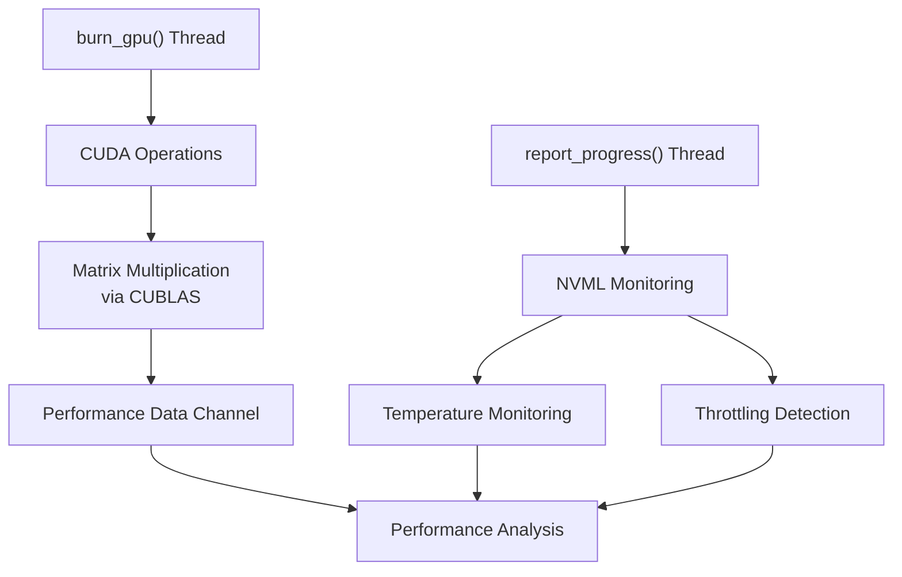

<!-- source: DeepWiki mcp.deepwiki.com · repo huggingface/gpu-fryer · page 4.4 CUDA Integration · fetched 2026-10-26 -->

# CUDA Integration

<details>
<summary>Relevant source files</summary>

The following files were used as context for generating this wiki page:

- [Cargo.toml](Cargo.toml)
- [src/main.rs](src/main.rs)

</details>


This page documents how the GPU-Fryer application integrates with NVIDIA's CUDA platform to perform GPU stress testing through intensive matrix multiplication operations. The page focuses specifically on the low-level CUDA implementation details, memory management, and computational operations that enable the stress testing functionality.

For information about the overall GPU stress testing mechanism, see [GPU Stress Testing Mechanism](#4.2). For details on how performance metrics are monitored and measured, see [Performance Monitoring](#4.3).

## CUDA Framework Integration

GPU-Fryer leverages the CUDA platform through the Rust `cudarc` crate, which provides safe Rust bindings to CUDA functionality. The application specifically uses CUBLAS (CUDA Basic Linear Algebra Subroutines) for performing matrix multiplication operations.



Sources: [src/main.rs:2-6](), [Cargo.toml:9]()

## GPU Detection and Initialization

The application begins by detecting available CUDA-capable GPUs on the system using the CUDA Driver API. Each GPU is initialized as a `CudaDevice` from the `cudarc` crate.



Sources: [src/main.rs:572-580](), [src/main.rs:184-221]()

The application detects all available GPUs and checks their capabilities to determine which precision mode (FP32 or BF16) to use. BF16 is used automatically if all GPUs support it, or if explicitly requested via command-line parameters.

## Memory Management and Buffer Allocation

GPU-Fryer employs a specific memory allocation strategy to maximize GPU utilization. It allocates approximately 90% of available GPU memory for matrices used in stress testing.



Sources: [src/main.rs:493-517](), [src/main.rs:529-543](), [src/main.rs:20-21]()

The application uses the following memory allocation pattern:
1. Determine available GPU memory using `mem_get_info()`
2. Allocate 90% of that memory (controlled by `MEM_TO_USE_PCT` constant)
3. Copy input matrices A and B from host to device memory
4. Allocate as many output matrices as possible with the remaining memory

## Matrix Multiplication Implementation

The core stress testing mechanism uses matrix multiplication operations via CUBLAS. The application performs general matrix multiplication (GEMM) operations on large matrices (8192×8192) to stress the GPU.

### Precision Modes

GPU-Fryer supports two precision modes:
- FP32 (32-bit floating-point)
- BF16 (Brain Floating Point 16-bit) for newer GPUs with Tensor Cores

| Precision | Data Type | Support Detection | Matrix Size |
|-----------|-----------|-------------------|-------------|
| FP32 | `f32` | Supported on all CUDA GPUs | 8192×8192 |
| BF16 | `half::bf16` | Compute capability ≥ 8.0 | 8192×8192 |



Sources: [src/main.rs:200-220](), [src/main.rs:316-325](), [src/main.rs:545-570](), [src/main.rs:20]()

### CUBLAS GEMM Operation

Matrix multiplication is performed using the CUBLAS GEMM operation, which is configured through the `GemmConfig` struct:

```
C = α × op(A) × op(B) + β × C
```

Where:
- A, B are input matrices (8192×8192)
- C is the output matrix
- α = 1.0, β = 0.0
- op() is based on the transpose operation settings

Sources: [src/main.rs:545-570]()

## CUDA Operation Workflow

The overall workflow of CUDA operations in GPU-Fryer follows this sequence:



Sources: [src/main.rs:483-517](), [src/main.rs:222-297]()

## Performance Measurement

CUDA operations are measured to calculate GPU performance in terms of FLOPS (Floating Point Operations Per Second):

```
FLOPS = operations × matrix_size³ × 2
```

For the default matrix size of 8192×8192, each matrix multiplication operation performs approximately:
- 8192³ × 2 = 1,099,511,627,776 floating-point operations

The application reports performance metrics for each GPU including:
- Average GFLOPS (Giga FLOPS)
- Minimum and maximum GFLOPS
- Temperature correlation with performance

Sources: [src/main.rs:343-364](), [src/main.rs:410-425]()

## Integration with Device Monitoring

While CUDA handles the computational aspects, GPU-Fryer uses NVML (NVIDIA Management Library) in parallel to monitor device status:



The two systems work in tandem:
1. CUDA operations generate computational load and measure raw performance
2. NVML monitors the physical state of the GPU during the load

Sources: [src/main.rs:327-447](), [src/main.rs:299-315]()

## Error Handling and Device Management

GPU-Fryer implements proper error handling for CUDA operations, with error propagation using the `anyhow` crate. The application also manages device resources correctly, including proper initialization and memory allocation.

The application gracefully handles:
- Missing CUDA devices
- Insufficient GPU memory
- CUDA operation failures
- Precision mode compatibility

Sources: [src/main.rs:162-169](), [src/main.rs:183-221]()

---

