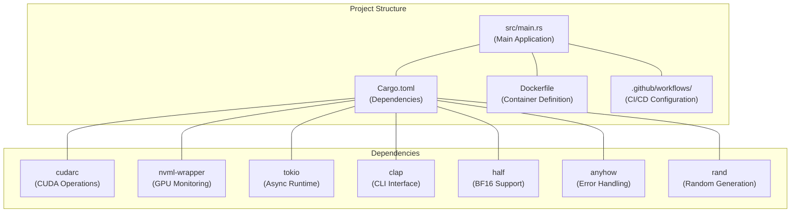
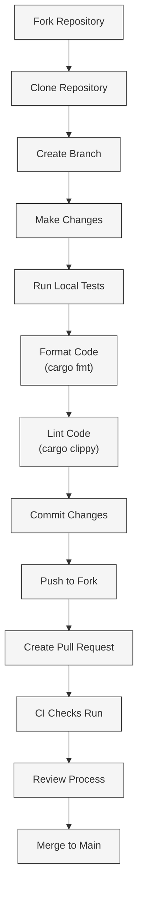
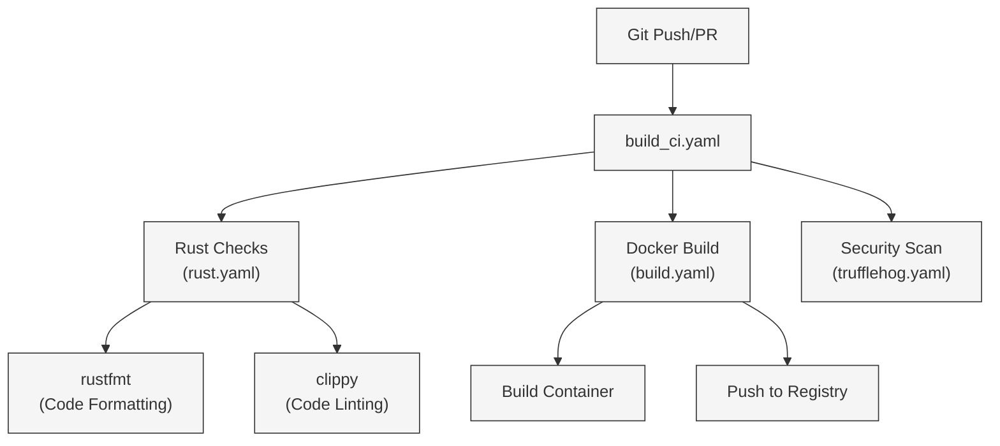
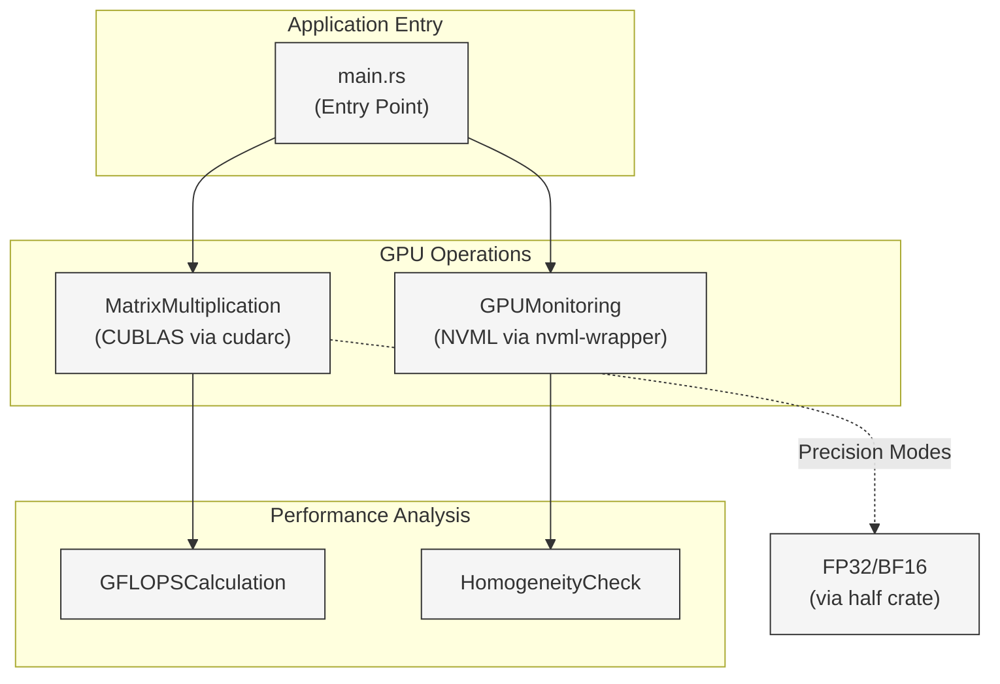

<!-- source: DeepWiki mcp.deepwiki.com · repo huggingface/gpu-fryer · page 5 Development Guide · fetched 2026-10-26 -->

# Development Guide

<details>
<summary>Relevant source files</summary>

The following files were used as context for generating this wiki page:

- [.github/workflows/rust.yaml](.github/workflows/rust.yaml)
- [.gitignore](.gitignore)
- [Cargo.toml](Cargo.toml)

</details>


This guide provides information for developers who want to contribute to or modify the GPU-fryer project. It covers development environment setup, building from source, the CI/CD pipeline, and contribution guidelines. For information about using the tool, see the [Usage Guide](#3).

## Development Environment Setup

### Prerequisites

To develop for GPU-fryer, you need:

1. **Rust toolchain** - The project uses Rust with edition 2021
2. **CUDA toolkit** - Compatible with CUDA 12.0+
3. **NVIDIA GPU and drivers** - For testing
4. **Git** - For version control

### Environment Setup Steps

1. Clone the repository:
   ```bash
   git clone https://github.com/huggingface/gpu-fryer.git
   cd gpu-fryer
   ```

2. Install the Rust toolchain with `rustup`:
   ```bash
   curl --proto '=https' --tlsv1.2 -sSf https://sh.rustup.rs | sh
   rustup default stable
   # For formatting checks
   rustup component add rustfmt
   # For linting
   rustup component add clippy
   ```

3. Verify CUDA installation:
   ```bash
   nvcc --version
   ```

Sources: [Cargo.toml:1-14]()

## Project Structure



Sources: [Cargo.toml:1-14]()

## Building from Source

### Local Development Build

1. Build the project in debug mode:
   ```bash
   cargo build
   ```

2. Build with optimizations for testing performance:
   ```bash
   cargo build --release
   ```

3. Run the application:
   ```bash
   cargo run -- --help
   cargo run --release -- --duration 60
   ```

### Docker Build

For containerized development and testing:

```bash
docker build -t gpu-fryer:dev .
docker run --gpus all gpu-fryer:dev --duration 60
```

Sources: [Cargo.toml:1-14]()

## Code Style and Standards

### Formatting and Linting

The project uses:
- **rustfmt** for code formatting
- **clippy** for linting

Run these checks locally before submitting changes:

```bash
# Check formatting
cargo fmt --all -- --check

# Run clippy
cargo clippy -- -Dwarnings
```

Both of these checks are enforced in the CI pipeline.

Sources: [.github/workflows/rust.yaml:1-54]()

## Development Workflow



Sources: [.github/workflows/rust.yaml:1-54]()

## CI/CD Pipeline

The project uses GitHub Actions for continuous integration and deployment.

### CI Components



### Rust Workflow

The Rust workflow (`rust.yaml`) performs two main checks:

1. **Format check** using `rustfmt` - Ensures code follows formatting guidelines
2. **Linting** using `clippy` - Checks for code quality issues and potential bugs

The CI pipeline will fail if either of these checks fails, ensuring code quality standards are maintained.

Sources: [.github/workflows/rust.yaml:1-54]()

## Contributing Guidelines

### Pull Request Process

1. **Fork the repository** to your own GitHub account
2. **Create a branch** with a descriptive name
3. **Make your changes** following the code style guidelines
4. **Run local tests** to ensure functionality
5. **Submit a pull request** with a clear description of changes
6. **Address review comments** if any are provided

### Commit Message Guidelines

Follow conventional commit message format:
- `feat:` for new features
- `fix:` for bug fixes
- `docs:` for documentation changes
- `test:` for test additions or modifications
- `refactor:` for code refactoring

### Code Review Checklist

| Aspect | Check |
|--------|-------|
| Functionality | Does the code work as expected? |
| Performance | Is the code optimized for GPU operations? |
| Error Handling | Are errors properly handled and reported? |
| Tests | Are there appropriate tests for new functionality? |
| Documentation | Is the code well-documented? |
| Code Style | Does the code follow project style guidelines? |

Sources: [.gitignore:1-55](), [.github/workflows/rust.yaml:1-54]()

## Debugging and Testing

### Debugging

For debugging GPU operations, use:
1. **CUDA-GDB** for device-side debugging
2. **Rust's standard debug tools** for host-side code

### Testing GPU Performance

To validate performance changes:
1. Run on multiple GPU types if possible
2. Test with different precision modes (FP32/BF16)
3. Compare GFLOPS measurements with baseline

## Project Architecture

This diagram shows the relationship between code modules and GPU operations:



Sources: [Cargo.toml:1-14]()

## Dependencies Management

The project uses several key dependencies:

| Dependency | Version | Purpose |
|------------|---------|---------|
| `cudarc` | 0.13.0 | CUDA operations with CUDA 12.06+ support |
| `nvml-wrapper` | 0.10.0 | GPU monitoring via NVIDIA Management Library |
| `tokio` | 1.42 | Async runtime for concurrent operations |
| `clap` | 4.5.26 | Command-line argument parsing |
| `half` | 2.4.1 | BF16 precision support |
| `anyhow` | 1.0.95 | Error handling |
| `rand` | 0.8.5 | Random number generation |

When updating dependencies, ensure compatibility with existing CUDA operations.

Sources: [Cargo.toml:1-14]()

## Advanced Development Topics

### Adding New GPU Operations

To extend with new stress testing operations:
1. Add new CUDA kernel functions
2. Implement proper memory management
3. Add monitoring for the new operations
4. Update the CLI interface to expose new options

### Performance Optimization

For optimizing GPU operations:
1. Minimize host-device memory transfers
2. Use appropriate memory access patterns
3. Consider mixed precision for compute-heavy operations

Sources: [Cargo.toml:1-14]()

---

