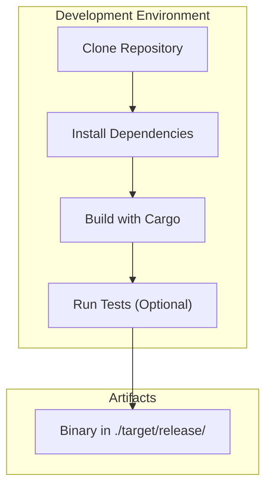
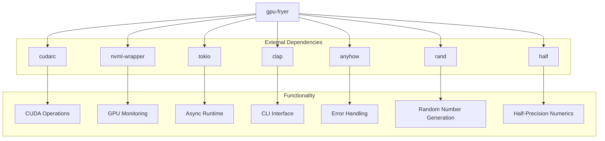
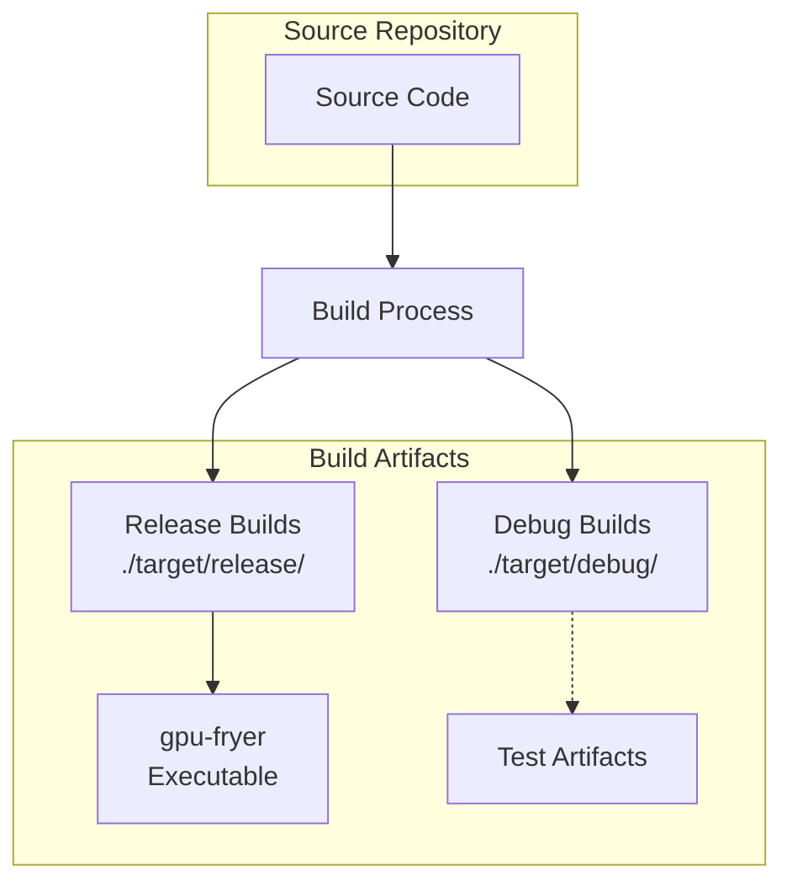
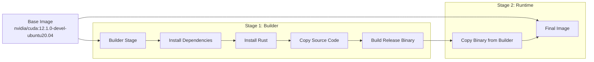

<!-- source: DeepWiki mcp.deepwiki.com · repo huggingface/gpu-fryer · page 5.1 Building from Source · fetched 2026-10-26 -->

# Building from Source

<details>
<summary>Relevant source files</summary>

The following files were used as context for generating this wiki page:

- [.gitignore](.gitignore)
- [Cargo.toml](Cargo.toml)
- [Dockerfile](Dockerfile)

</details>


This guide provides detailed instructions for building the GPU-Fryer tool from source code. For users who prefer to use the pre-built Docker image instead, please refer to [Docker Installation](#2.1).

## Prerequisites

Before building GPU-Fryer from source, ensure your system meets the following requirements:

### Hardware Requirements

- NVIDIA GPU(s) with CUDA support
- Sufficient system memory (recommended 8GB+)

### Software Requirements

The following software components are required:

| Component | Minimum Version | Purpose |
|-----------|----------------|---------|
| CUDA Toolkit | 12.0 | Required for GPU operations |
| Rust | 1.70+ | Programming language and build system |
| Git | Any recent version | To clone the repository |
| libssl-dev | Any recent version | Required by Rust dependencies |

Sources: [Dockerfile:2-6](), [Cargo.toml:6-13]()

## Build Process Overview

The build process for GPU-Fryer follows standard Rust project practices, utilizing Cargo as the build system.



Sources: [Dockerfile:11-13]()

## Step-by-Step Build Instructions

### 1. Install Rust and CUDA

First, ensure you have Rust installed via rustup:

```bash
curl --proto '=https' --tlsv1.2 -sSf https://sh.rustup.rs | sh
```

Install the CUDA Toolkit (12.x recommended) from the NVIDIA website or your distribution's package manager.

### 2. Install Required System Dependencies

On Ubuntu/Debian-based systems:

```bash
sudo apt-get update
sudo apt-get install -y git libssl-dev
```

On other distributions, install the equivalent packages.

Sources: [Dockerfile:2-6]()

### 3. Clone the Repository

```bash
git clone https://github.com/huggingface/gpu-fryer
cd gpu-fryer
```

### 4. Build the Project

```bash
cargo build --release
```

The compiled binary will be available at `./target/release/gpu-fryer`.

Sources: [Dockerfile:13]()

## Dependency Structure

GPU-Fryer relies on several Rust crates to provide its functionality. Understanding these dependencies can help when troubleshooting build issues.



Sources: [Cargo.toml:6-13]()

## Detailed Dependency Information

The table below lists the dependencies and their specific features used in GPU-Fryer:

| Dependency | Version | Features | Purpose |
|------------|---------|----------|---------|
| cudarc | 0.13.0 | cuda-12060, f16 | CUDA runtime and computation |
| nvml-wrapper | 0.10.0 | - | NVIDIA Management Library for monitoring |
| tokio | 1.42 | rt, rt-multi-thread, macros, time, sync, signal | Async runtime |
| clap | 4.5.26 | derive | Command-line argument parsing |
| anyhow | 1.0.95 | - | Error handling |
| rand | 0.8.5 | small_rng | Random number generation |
| half | 2.4.1 | - | Half-precision floating point support |

Sources: [Cargo.toml:6-13]()

## Build Artifacts and Structure

After building the project, the following structure will be created:



Sources: [.gitignore:38-51]()

## Building with Docker

As an alternative to building directly on your system, you can use Docker to build and run GPU-Fryer.

### Build Docker Image

```bash
docker build -t gpu-fryer .
```

### Run with Docker

```bash
docker run --gpus all gpu-fryer [options]
```

The Dockerfile uses a multi-stage build process to create a minimal final image:



Sources: [Dockerfile:1-17]()

## Troubleshooting Common Build Issues

### CUDA Version Compatibility

The project is configured to use CUDA 12.x. If you have a different version, you may need to adjust the `cudarc` dependency in `Cargo.toml`.

### Linker Errors

If you encounter linker errors related to CUDA libraries, ensure the CUDA installation paths are correctly set in your environment.

### Build Performance

Building with the `--release` flag will produce optimized binaries but takes longer. For development and testing, you can omit this flag for faster builds.

## Platform-Specific Considerations

### Linux

Linux is the primary development platform for GPU-Fryer and should build without issues on most distributions with the prerequisites installed.

### Windows and macOS

While Rust supports cross-platform development, GPU-Fryer relies on NVIDIA CUDA and NVML which have limited support on non-Linux platforms. Building on Windows may require additional configuration, and macOS support is limited due to NVIDIA's reduced support for macOS.

Sources: [.gitignore:4-35]()

## Verifying the Build

After building, you can verify the installation by running:

```bash
./target/release/gpu-fryer --help
```

This should display the help information for the GPU-Fryer tool.

---

