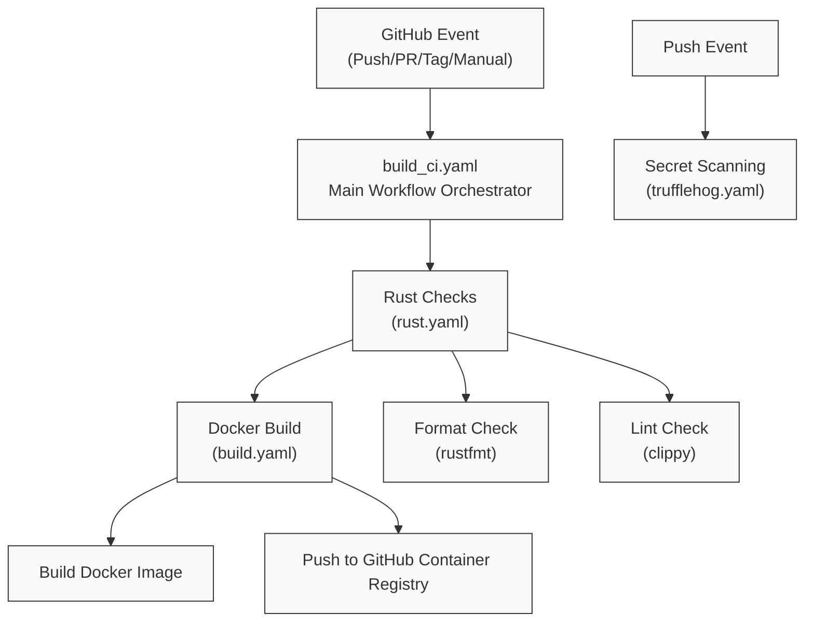
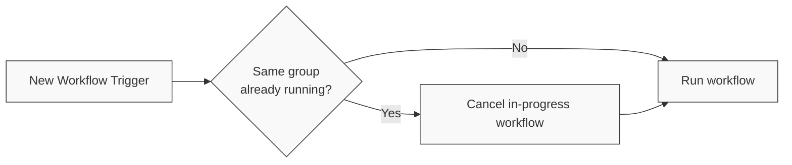
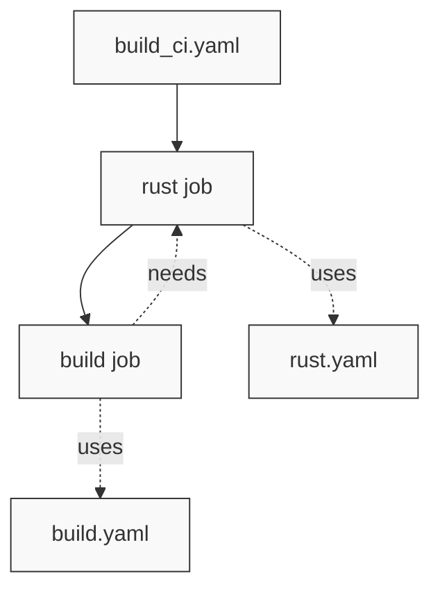
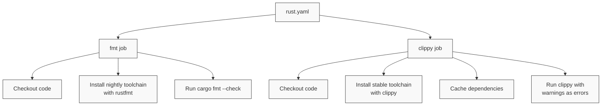
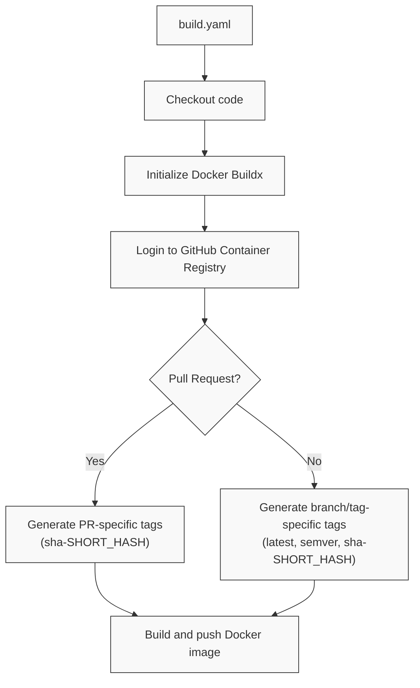
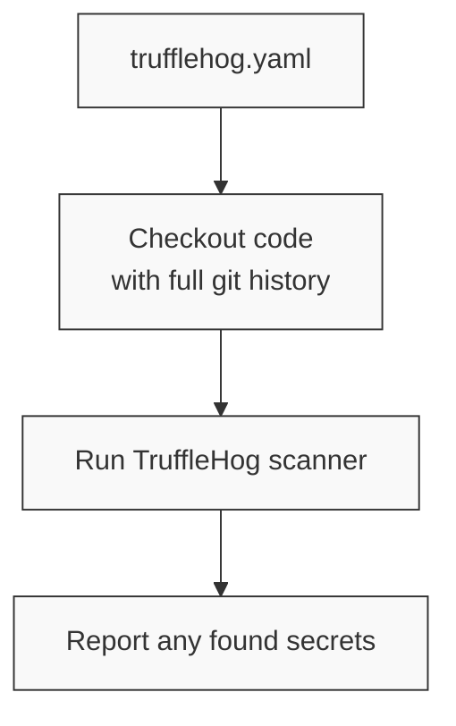
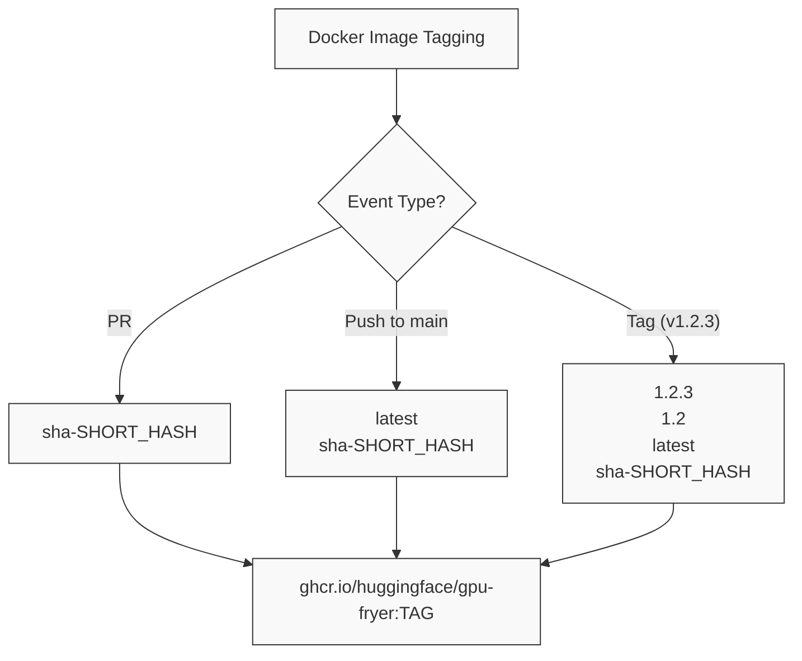
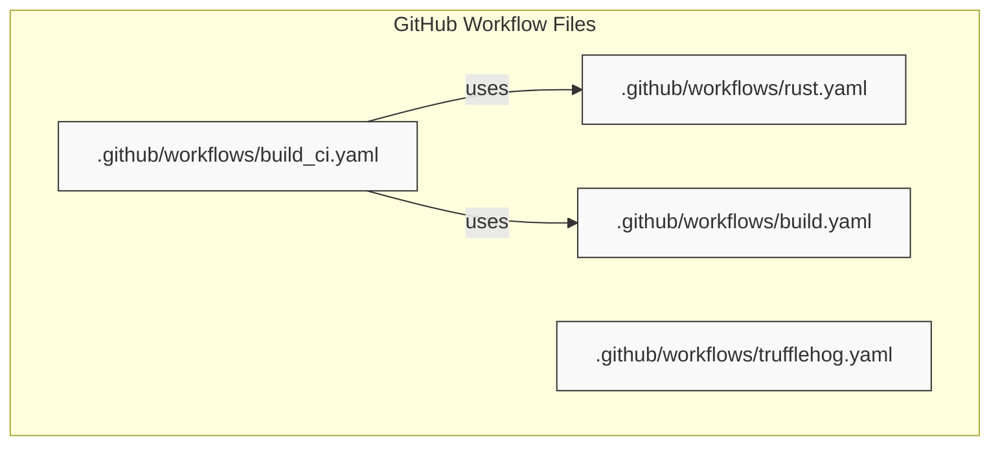

<!-- source: DeepWiki mcp.deepwiki.com · repo huggingface/gpu-fryer · page 5.2 CI/CD Pipeline · fetched 2026-10-26 -->

# CI/CD Pipeline

Relevant source files

The following files were used as context for generating this wiki page:

- [.github/workflows/build.yaml](.github/workflows/build.yaml)
- [.github/workflows/build_ci.yaml](.github/workflows/build_ci.yaml)
- [.github/workflows/rust.yaml](.github/workflows/rust.yaml)
- [.github/workflows/trufflehog.yaml](.github/workflows/trufflehog.yaml)

This document describes the Continuous Integration and Continuous Deployment (CI/CD) pipeline used in the GPU-Fryer project. The pipeline automates testing, building, and deployment processes to ensure code quality and streamline releases. For information about building the project from source manually, see [Building from Source](#5.1).

## Pipeline Overview

GPU-Fryer employs GitHub Actions to automate its CI/CD process. The pipeline consists of code quality checks, security scanning, and Docker image building and publishing.

Sources: [.github/workflows/build_ci.yaml:1-32](), [.github/workflows/rust.yaml:1-55](), [.github/workflows/build.yaml:1-70](), [.github/workflows/trufflehog.yaml:1-19]()

## Workflow Triggers

The CI/CD pipeline can be triggered in several ways:

| Trigger Type | Description | Source |
|--------------|-------------|--------|
| Push to `main` | Automatically run on any push to the main branch | [.github/workflows/build_ci.yaml:6-8]() |
| Tag push | Run when a version tag (`v*`) is pushed | [.github/workflows/build_ci.yaml:9-10]() |
| Pull Request | Run on PRs targeting the main branch | [.github/workflows/build_ci.yaml:11-13]() |
| Manual | Can be triggered manually via GitHub UI | [.github/workflows/build_ci.yaml:4]() |

The pipeline uses GitHub's concurrency features to avoid running multiple instances of the same workflow unnecessarily:

Sources: [.github/workflows/build_ci.yaml:15-17]()

## Pipeline Components

### Main Workflow Orchestrator

The `build_ci.yaml` workflow serves as the main entry point and orchestrator for the CI/CD pipeline. It coordinates the different stages and ensures they run in the correct order.

Sources: [.github/workflows/build_ci.yaml:19-32]()

### Rust Checks

The first phase of the pipeline performs code quality checks on the Rust codebase through the `rust.yaml` workflow:

1. **Formatting Check** (fmt): Ensures consistent code style using `rustfmt` with the nightly toolchain
2. **Linting** (clippy): Identifies potential issues, bugs, and suboptimal code using the Clippy linter

Both checks run on AWS GitHub runners with at least 8 cores (`aws-general-8-plus`).

Sources: [.github/workflows/rust.yaml:1-55]()

### Docker Build and Push

After the Rust checks pass, the `build.yaml` workflow builds and publishes the Docker image to GitHub Container Registry:

1. Checks out the repository
2. Sets up Docker Buildx
3. Logs in to GitHub Container Registry
4. Extracts metadata for Docker image tagging
5. Builds and pushes the Docker image

Sources: [.github/workflows/build.yaml:1-70]()

### Security Scanning

In addition to the main workflow, there's a separate security scanning workflow that runs on every push to detect accidentally committed secrets or sensitive information:

Sources: [.github/workflows/trufflehog.yaml:1-19]()

## Docker Image Tagging Strategy

The CI/CD pipeline uses different tagging strategies depending on the event that triggered the workflow:

| Event Type | Tags Generated | Example |
|------------|----------------|---------|
| Pull Request | `sha-<SHORT_COMMIT_HASH>` | `sha-a1b2c3d` |
| Push to main | `latest`, `sha-<SHORT_COMMIT_HASH>` | `latest`, `sha-a1b2c3d` |
| Tag push (v1.2.3) | `1.2.3`, `1.2`, `latest`, `sha-<SHORT_COMMIT_HASH>` | `1.2.3`, `1.2`, `latest`, `sha-a1b2c3d` |

This tagging strategy ensures that:
- Each PR has its own uniquely identified Docker image for testing
- The `latest` tag always points to the most recent build from the main branch
- Version tags follow semantic versioning for stable releases
- Every image can be traced back to its source commit via the SHA tag

Sources: [.github/workflows/build.yaml:32-56]()

## GitHub Actions File Structure

The CI/CD pipeline is defined by the following GitHub Actions workflow files:

| File | Purpose |
|------|---------|
| `build_ci.yaml` | Main workflow orchestrator that coordinates all processes |
| `rust.yaml` | Runs Rust code quality checks (formatting and linting) |
| `build.yaml` | Builds and pushes the Docker image to GitHub Container Registry |
| `trufflehog.yaml` | Scans for accidentally committed secrets |

The workflows use reusable components through the `workflow_call` trigger, allowing the main workflow to call the others as needed:

Sources: [.github/workflows/build_ci.yaml:1-32](), [.github/workflows/rust.yaml:3-5](), [.github/workflows/build.yaml:3-5]()

## Pipeline Access Control

The CI/CD pipeline uses GitHub's permission system to control what workflows can access:

| Workflow | Permissions | Purpose |
|----------|-------------|---------|
| Rust Checks | `pull-requests: write` `contents: read` | Allows commenting on PRs with linting results |
| Docker Build | `packages: write` `contents: read` | Allows pushing to GitHub Container Registry |

This follows the principle of least privilege, giving each workflow only the permissions it needs.

Sources: [.github/workflows/build_ci.yaml:21-25](), [.github/workflows/build_ci.yaml:27-30](), [.github/workflows/rust.yaml:6-8](), [.github/workflows/build.yaml:12-14]()

## Conclusion

The GPU-Fryer CI/CD pipeline provides automated testing, building, and deployment of the project. It ensures code quality through formatting and linting checks, builds Docker images with appropriate tags, and scans for security issues. This automation helps maintain project quality and simplifies the release process.

---

