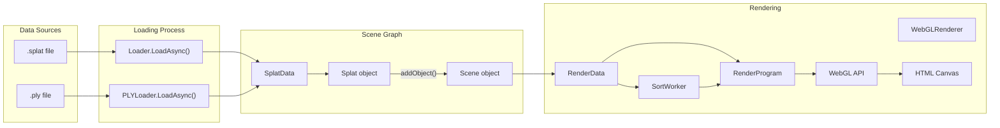

<!-- source: DeepWiki mcp.deepwiki.com · repo huggingface/gsplat.js · page 1 Overview · fetched 2026-10-26 -->

# Overview

<details>
<summary>Relevant source files</summary>

The following files were used as context for generating this wiki page:

- [README.md](README.md)
- [package.json](package.json)

</details>


This document provides a comprehensive introduction to gsplat.js, a JavaScript library for rendering 3D Gaussian Splatting scenes in web browsers. For detailed information on specific components, please refer to their respective documentation pages in this wiki.

## What is gsplat.js?

gsplat.js is an open-source JavaScript library that enables real-time rendering of 3D Gaussian Splatting models in web browsers. It provides functionality similar to three.js but specifically for Gaussian Splatting rendering. The library offers a complete solution for loading, manipulating, and rendering 3D point-based scenes represented as Gaussian splats.

Sources: [README.md:3-5](), [package.json:2-4]()

## Key Capabilities

gsplat.js provides the following core capabilities:

- **WebGL-based rendering** of Gaussian splats with custom shader implementations
- **Efficient scene management** through a hierarchical scene graph
- **Multiple camera control options** including orbit and first-person controls
- **Support for various file formats** including .ply and the optimized .splat format
- **High-performance processing** through WebAssembly for critical operations
- **Multi-threaded depth sorting** using Web Workers
- **Real-time editing and transformation** of Gaussian splat scenes
- **Intersection testing** for object selection in 3D space

Sources: [README.md:5-74]()

## System Architecture

The gsplat.js library is built on a modular architecture that separates concerns between scene management, rendering, data loading, and user interaction:

```mermaid
graph TD
    subgraph "Public API"
        Scene["Scene"] --> Object3D["Object3D"]
        Object3D --> Splat["Splat"]
        Camera["Camera"] --> Object3D
        WebGLRenderer["WebGLRenderer"]
        Controls["Controls (Orbit/FPS)"]
        Loader["Loader/PLYLoader"]
    end

    subgraph "Rendering Pipeline"
        WebGLRenderer --> RenderProgram["RenderProgram"]
        RenderProgram --> ShaderProgram["ShaderProgram"]
        RenderProgram --> RenderData["RenderData"]
        SortWorker["SortWorker (Web Worker)"] --> RenderProgram
    end

    subgraph "WASM Modules"
        SortWASM["sort.wasm"]
        DataWASM["data.wasm"]
        SortWorker --> SortWASM
    end

    subgraph "Math Utilities"
        Vector3["Vector3"]
        Matrix4["Matrix4"]
        Quaternion["Quaternion"]
    end

    Scene --> |"manages"| Splat
    WebGLRenderer --> |"renders"| Scene
    WebGLRenderer --> |"uses"| Camera
    Controls --> |"manipulates"| Camera
    Object3D --> |"uses"| Math Utilities
    Loader --> |"creates"| Splat
```

Sources: [README.md:40-74]()

## Data Flow

The following diagram illustrates the primary data flow from file loading to rendering:



Sources: [README.md:56-59]()

## Core Components

### Scene Management

The Scene class serves as the container for all objects in a 3D environment. It manages the hierarchical organization of Object3D instances, which include Splat objects representing Gaussian splats. This system provides an intuitive way to organize and manipulate 3D elements.

For more details on scene management, see [Scene Management](#3.1).

Sources: [README.md:51]()

### Rendering System

The WebGLRenderer is the central component for rendering, working with the RenderProgram and custom shader implementations to efficiently render Gaussian splats. The rendering pipeline includes:

1. Preparing splat data for rendering
2. Sorting splats by depth (using WebAssembly for performance)
3. Rendering splats using custom WebGL shaders optimized for Gaussian splatting

For more information on the rendering system, see [Rendering System](#4).

Sources: [README.md:53]()

### Camera System

The Camera provides the viewpoint for rendering the scene. The library includes:

- Perspective camera implementation
- Integration with control systems for navigation
- View and projection matrix generation

For more on the camera system, see [Camera System](#3.3).

Sources: [README.md:52]()

### User Interaction

gsplat.js provides several control mechanisms for user interaction:

- **OrbitControls**: Allows orbiting around a target point with mouse or touch input
- **FPSControls**: First-person controls for navigating through the scene

For more details on user interaction, see [User Interaction](#7).

Sources: [README.md:54]()

### Data Loading

The library supports loading Gaussian splat data from different file formats:

- **.splat files**: A compact binary format optimized for quick loading
- **.ply files**: Point cloud format that can include spherical harmonics for view-dependent coloring

The Loader and PLYLoader classes handle fetching and parsing these files, constructing the appropriate data structures for rendering.

For more information on data loading, see [Data Loading](#5).

Sources: [README.md:78-92]()

## Getting Started

To use gsplat.js in your project:

1. Install the library:
   ```
   npm install --save gsplat
   ```

2. Create a basic scene:
   ```javascript
   import * as SPLAT from "gsplat";

   const scene = new SPLAT.Scene();
   const camera = new SPLAT.Camera();
   const renderer = new SPLAT.WebGLRenderer();
   const controls = new SPLAT.OrbitControls(camera, renderer.canvas);

   async function main() {
       const url = "path/to/your/model.splat";
       await SPLAT.Loader.LoadAsync(url, scene, () => {});

       const frame = () => {
           controls.update();
           renderer.render(scene, camera);
           requestAnimationFrame(frame);
       };

       requestAnimationFrame(frame);
   }

   main();
   ```

The library supports both ES6 modules and provides TypeScript definitions. For more examples and detailed usage instructions, see the [Examples](#8) section.

Sources: [README.md:13-74]()

## Compatibility and Performance

gsplat.js is designed to work in modern web browsers with WebGL support. Performance optimizations include:

- WebAssembly modules for computationally intensive operations like depth sorting
- Multi-threaded processing using Web Workers
- Efficient memory management for large Gaussian splat datasets
- Optimized WebGL shader implementations

For development and contribution information, see the [Development Guide](#9).

Sources: [README.md:94-106]()

---

