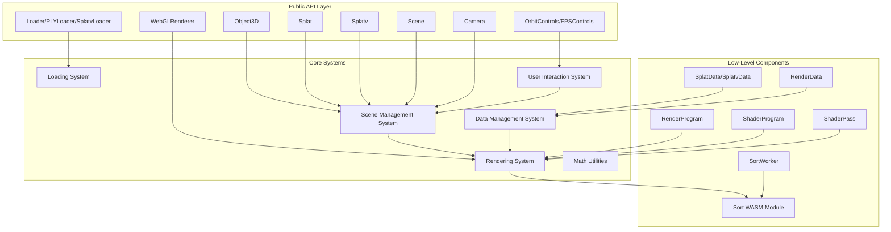
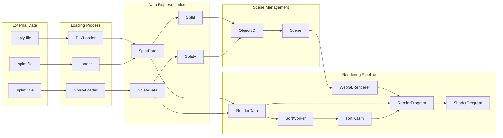
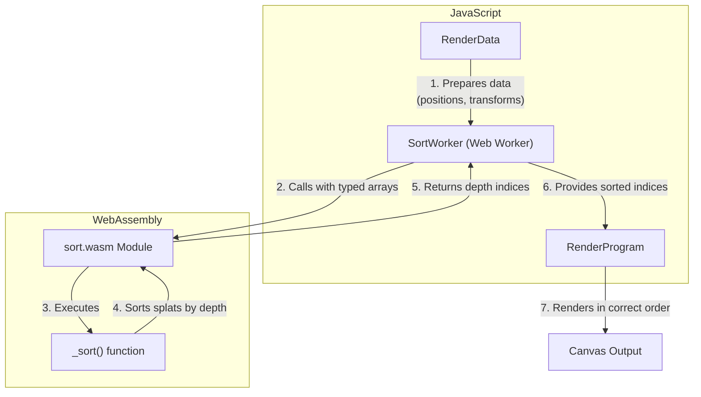
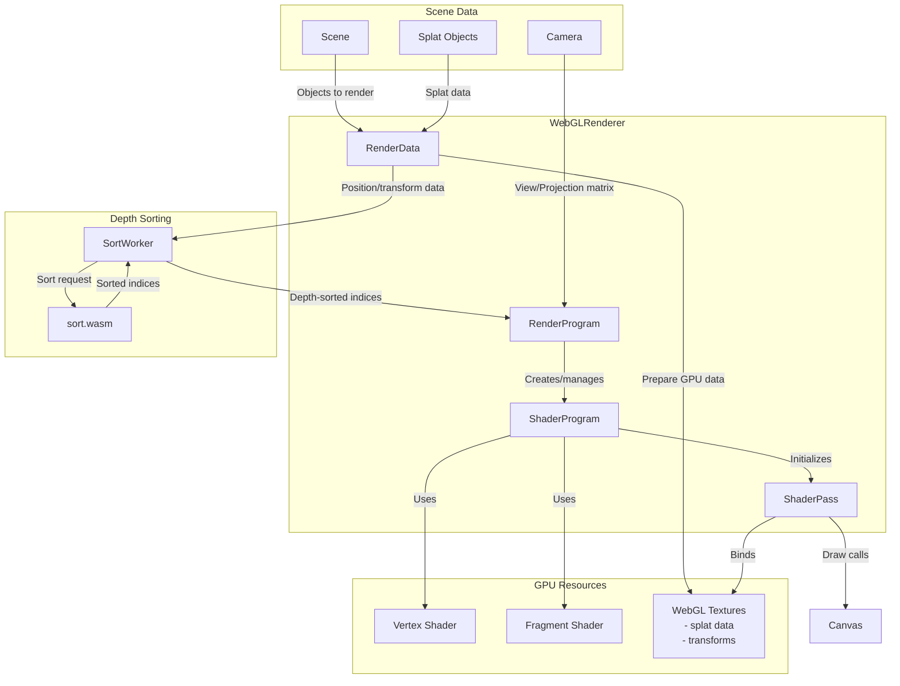
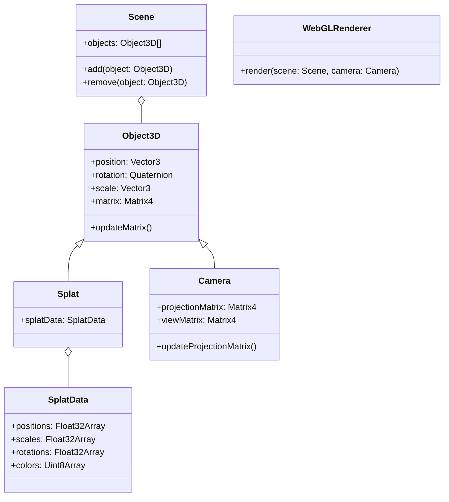

<!-- source: DeepWiki mcp.deepwiki.com · repo huggingface/gsplat.js · page 2 Architecture · fetched 2026-10-26 -->

# Architecture

Relevant source files

The following files were used as context for generating this wiki page:

- [.gitattributes](.gitattributes)
- [README.md](README.md)
- [package.json](package.json)
- [src/index.ts](src/index.ts)
- [src/wasm/sort.d.ts](src/wasm/sort.d.ts)
- [wasm/sort.cpp](wasm/sort.cpp)

This document outlines the high-level architecture of gsplat.js, a JavaScript library for rendering 3D Gaussian Splatting scenes in web browsers. It describes the core systems, their components, and how they interact with each other to provide efficient rendering of Gaussian splats. For specific details about individual components, please refer to their dedicated pages in the wiki.

## Core System Architecture

The gsplat.js library employs a modular architecture inspired by other 3D libraries like three.js, but specialized for Gaussian splatting. The architecture consists of several interconnected systems working together to provide a complete rendering solution.

Sources: [src/index.ts:1-29](), [package.json:1-58]()

## System Components and Relationships

The gsplat.js architecture includes the following key systems and their relationships:

| System | Purpose | Main Components |
|--------|---------|----------------|
| Scene Management | Manages 3D objects and their relationships | `Scene`, `Object3D`, `Splat`, `Splatv` |
| Rendering | Handles WebGL rendering of Gaussian splats | `WebGLRenderer`, `RenderProgram`, `ShaderProgram` |
| Data Management | Stores and processes Gaussian splat data | `SplatData`, `SplatvData`, `RenderData` |
| Loading | Loads data from various file formats | `Loader`, `PLYLoader`, `SplatvLoader` |
| Math Utilities | Provides mathematical operations for 3D rendering | `Vector3`, `Matrix4`, `Quaternion` |
| User Interaction | Handles user input for camera control | `OrbitControls`, `FPSControls` |
| WebAssembly | Accelerates performance-critical operations | `sort.wasm` |

The architecture follows a layered approach:

1. **Public API Layer**: Exposes user-facing classes for scene creation and rendering
2. **Core Systems**: Implements the main functionality 
3. **Low-Level Components**: Handles specific tasks like shader management and WASM integration

Sources: [src/index.ts:1-29]()

## Data Flow Architecture

Data flow in gsplat.js follows a clear path from loading to rendering:

Sources: [src/index.ts:1-29](), [src/wasm/sort.d.ts:1-19](), [wasm/sort.cpp:1-61]()

## WebAssembly Integration

The gsplat.js library leverages WebAssembly for performance-critical operations, particularly for depth sorting of Gaussian splats:

The WebAssembly module (`sort.wasm`) handles depth sorting of the Gaussian splats, which is crucial for correct rendering. The sorting process:

1. Takes camera view projection matrix and splat transforms
2. Computes the projected depth of each splat
3. Sorts splats by depth for correct back-to-front rendering
4. Returns a sorted index array for rendering

This operation is performed in a separate Web Worker thread to avoid blocking the main thread during sorting.

Sources: [wasm/sort.cpp:1-61](), [src/wasm/sort.d.ts:1-19]()

## Rendering Pipeline

The rendering pipeline in gsplat.js transforms Gaussian splat data into a rendered image on the canvas:

The key components of the rendering pipeline:

1. **WebGLRenderer**: Coordinates the overall rendering process
2. **RenderProgram**: Manages the specific rendering program for Gaussian splats
3. **RenderData**: Prepares splat data for GPU rendering
4. **ShaderProgram**: Handles WebGL shader setup and management
5. **ShaderPass**: Represents a rendering pass with specific shader settings
6. **SortWorker**: Performs depth sorting in a separate thread using WebAssembly

Sources: [src/index.ts:1-29]()

## API Design Philosophy

The gsplat.js API is designed to be familiar to web 3D developers, particularly those with experience using three.js. Key design principles include:

1. **Object-Oriented API**: Classes like `Scene`, `Camera`, and `WebGLRenderer` provide an intuitive, object-oriented interface
2. **Extensibility**: Core classes can be extended for specialized functionality
3. **Separation of Concerns**: Clear separation between scene management, rendering, and user interaction
4. **Performance Optimization**: Performance-critical operations are offloaded to WebAssembly
5. **Web Standards**: Built on standard web technologies (WebGL, WebAssembly, Web Workers)

Sources: [src/index.ts:1-29](), [README.md:1-107]()

## Summary

The gsplat.js architecture provides a robust foundation for rendering 3D Gaussian Splatting scenes in web browsers. Its modular design separates concerns into distinct systems while maintaining clear relationships between components. The use of WebAssembly for performance-critical operations allows for efficient rendering, even with large numbers of Gaussian splats.

The architecture balances ease of use with rendering performance, making it suitable for a wide range of web-based 3D visualization applications. Future developments can build upon this architecture to extend functionality while maintaining backward compatibility.

Sources: [package.json:1-58](), [README.md:1-107](), [src/index.ts:1-29]()

---

