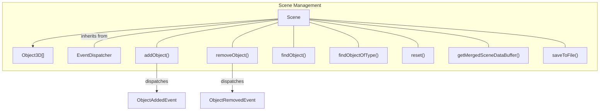
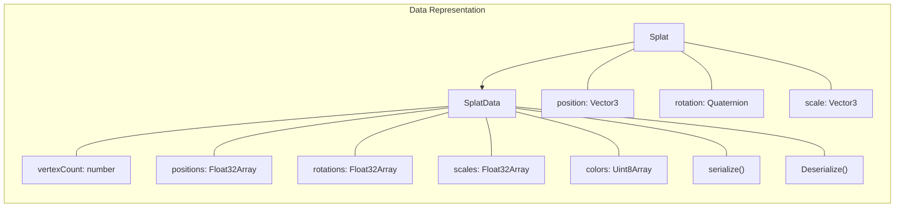
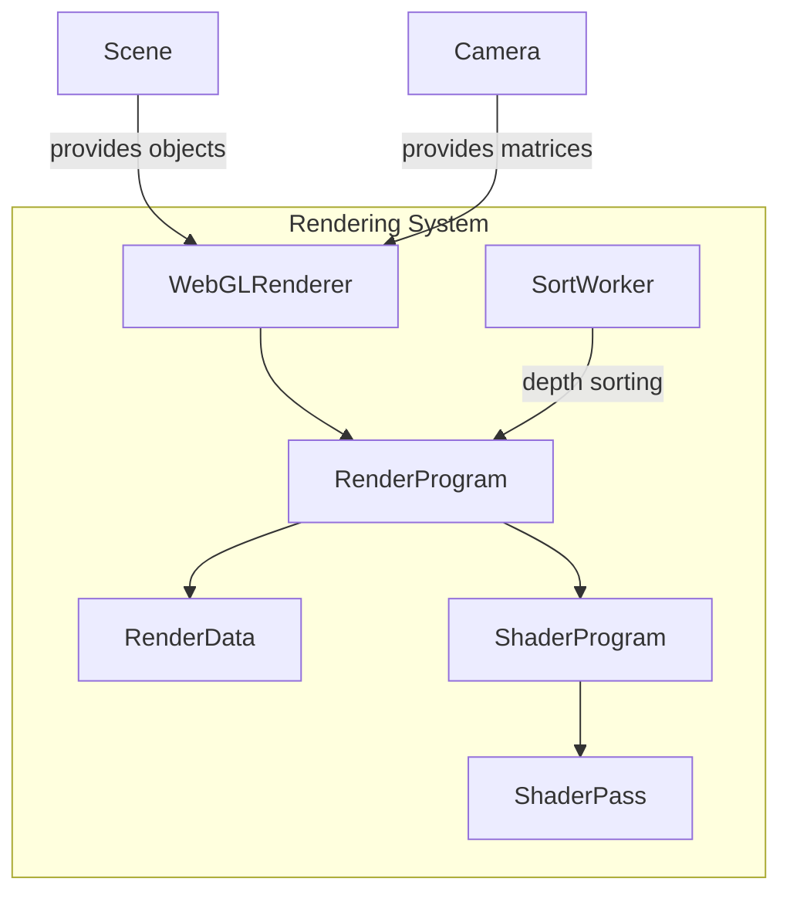
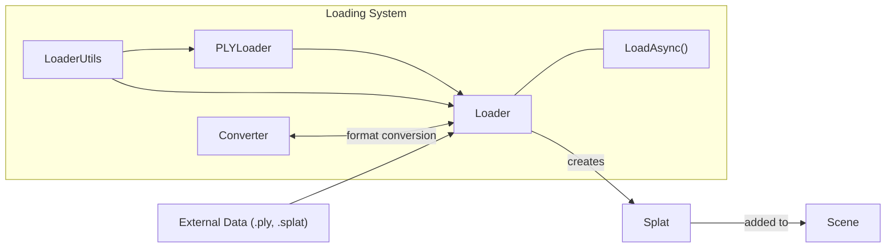
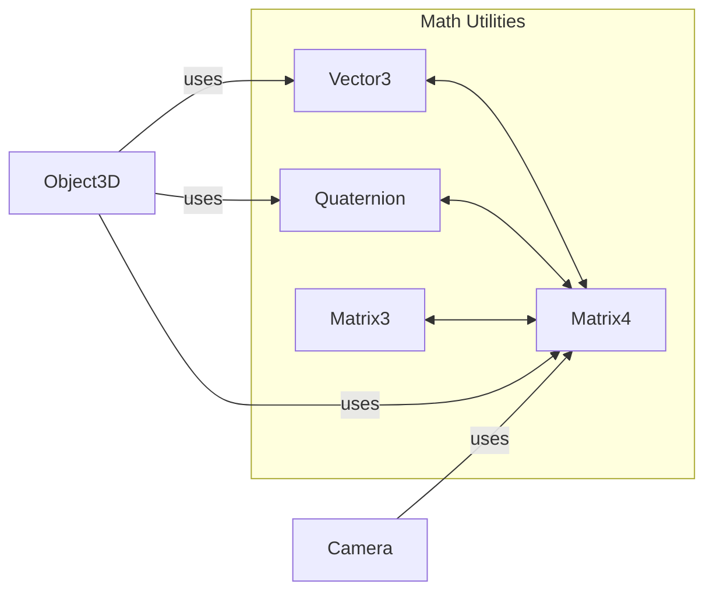
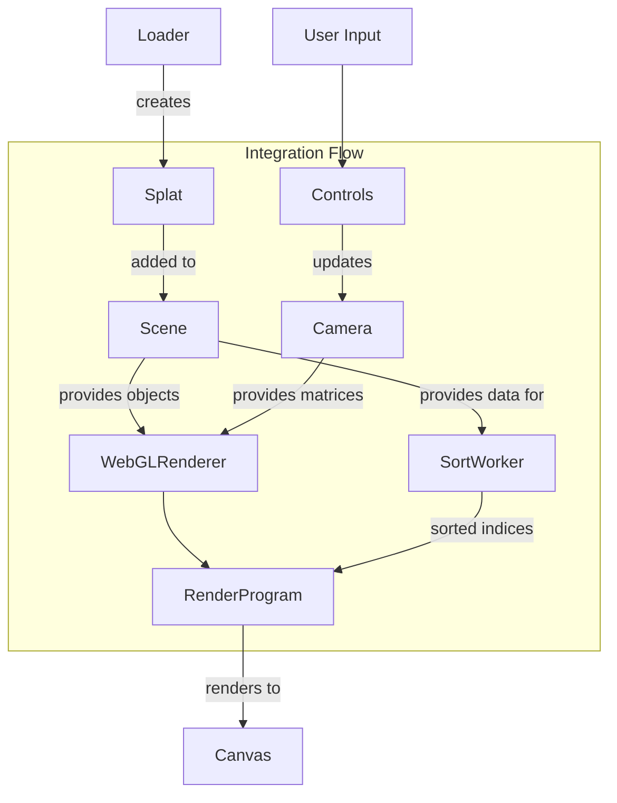

<!-- source: DeepWiki mcp.deepwiki.com · repo huggingface/gsplat.js · page 3 Core Components · fetched 2026-10-26 -->

# Core Components

<details>
<summary>Relevant source files</summary>

The following files were used as context for generating this wiki page:

- [README.md](README.md)
- [src/core/Scene.ts](src/core/Scene.ts)

</details>


## Purpose and Scope

This document provides an overview of the main components that form the foundation of the gsplat.js library. These components work together to enable the rendering of 3D Gaussian Splatting scenes in web browsers. This page covers the core architectural elements and their relationships, but does not delve into implementation details of each component - those are covered in dedicated pages for each subsystem.

For detailed information about Scene Management, see [Scene Management](#3.1). For specific implementation of Gaussian splats, see [Splat Objects](#3.2). For camera implementation details, see [Camera System](#3.3).

## Component Architecture Overview

The core components of gsplat.js are organized in a layered architecture that separates concerns between scene management, data representation, rendering, and user interaction.

```mermaid
classDiagram
    class "Scene" {
        +objects: Object3D[]
        +addObject(object)
        +removeObject(object)
        +findObject(predicate)
        +reset()
    }
    
    class "Object3D" {
        +position: Vector3
        +rotation: Quaternion
        +scale: Vector3
        +matrix: Matrix4
        +updateMatrix()
    }
    
    class "Splat" {
        +data: SplatData
        +applyPosition()
        +applyRotation()
        +applyScale()
    }
    
    class "Camera" {
        +position: Vector3
        +projectionMatrix: Matrix4
        +viewMatrix: Matrix4
        +updateMatrices()
    }
    
    class "WebGLRenderer" {
        +canvas: HTMLCanvasElement
        +renderProgram: RenderProgram
        +render(scene, camera)
    }
    
    class "Controls" {
        +camera: Camera
        +update()
    }
    
    class "SplatData" {
        +vertexCount: number
        +positions: Float32Array
        +rotations: Float32Array
        +scales: Float32Array
        +colors: Uint8Array
    }
    
    Object3D <|-- Splat
    Object3D <|-- Camera
    Scene o-- "many" Object3D
    Splat o-- SplatData
    Controls --> Camera
    WebGLRenderer --> Scene
    WebGLRenderer --> Camera
```

Sources: [src/core/Scene.ts:1-117]()

## Key Component Groups

The core components of gsplat.js can be grouped into the following functional categories:

| Component Group | Key Classes | Purpose |
|-----------------|-------------|---------|
| Scene Management | Scene, Object3D | Manages the 3D scene graph and objects |
| Data Representation | Splat, SplatData | Represents Gaussian splat data and properties |
| Rendering | WebGLRenderer, RenderProgram | Handles the rendering pipeline via WebGL |
| Camera & Viewing | Camera | Defines how the scene is viewed |
| User Interaction | OrbitControls, FPSControls | Enables user navigation of the scene |
| Data Loading | Loader, PLYLoader | Loads splat data from various file formats |
| Math Utilities | Vector3, Matrix4, Quaternion | Provides mathematical operations for 3D transforms |

## Scene Management System

The Scene class serves as the central container for all 3D objects in gsplat.js. It manages an array of Object3D instances and provides methods for adding, removing, and finding objects.



The Scene class extends EventDispatcher, enabling it to dispatch events when objects are added or removed. This allows other components to react to changes in the scene graph.

Key methods:
- `addObject(object)`: Adds an Object3D to the scene
- `removeObject(object)`: Removes an Object3D from the scene
- `findObject(predicate)`: Finds an object matching a predicate function
- `findObjectOfType(type)`: Finds an object of a specific type
- `getMergedSceneDataBuffer(format)`: Exports the scene data to a buffer
- `saveToFile(name, format)`: Saves the scene to a file

Sources: [src/core/Scene.ts:8-117]()

## Object Hierarchy

At the core of gsplat.js is a clear object hierarchy that defines how 3D elements are represented and manipulated.

```mermaid
classDiagram
    class "Object3D" {
        +position: Vector3
        +rotation: Quaternion
        +scale: Vector3
        +matrix: Matrix4
        +updateMatrix()
    }
    
    class "EventDispatcher" {
        +addEventListener()
        +removeEventListener()
        +dispatchEvent()
    }
    
    class "Splat" {
        +data: SplatData
        +applyPosition()
        +applyRotation()
        +applyScale()
    }
    
    class "Camera" {
        +projectionMatrix: Matrix4
        +viewMatrix: Matrix4
        +updateMatrices()
    }
    
    EventDispatcher <|-- Object3D
    Object3D <|-- Splat
    Object3D <|-- Camera
```

The Object3D class serves as the base class for all 3D objects in the scene. It provides:
- 3D transform properties (position, rotation, scale)
- Matrix calculations for transformations
- Event handling through its parent EventDispatcher

Splat extends Object3D to specifically represent Gaussian splats, adding specialized methods for applying transformations to splat data.

Camera also extends Object3D, adding functionality for defining view and projection matrices that determine how the scene is rendered.

Sources: [src/core/Scene.ts:1-1]()

## Data Representation

Gaussian splats in gsplat.js are represented through two main classes: Splat and SplatData.



The Splat class extends Object3D and contains a reference to a SplatData instance, which stores the actual Gaussian splat data:

- `vertexCount`: The number of Gaussian splats
- `positions`: 3D coordinates of each splat
- `rotations`: Rotations of each splat (as quaternions)
- `scales`: Scale factors for each splat
- `colors`: RGB colors and opacity for each splat

The SplatData class provides methods for serializing and deserializing data, making it possible to save and load splat scenes.

Sources: [src/core/Scene.ts:2-3]()

## Rendering System

The rendering system in gsplat.js is responsible for drawing Gaussian splats to the screen using WebGL.



The WebGLRenderer class is the main entry point for rendering, with these key responsibilities:
- Managing the WebGL context and canvas
- Maintaining the render program for Gaussian splats
- Coordinating between scene data and shader programs

The RenderProgram handles the specialized shader pipeline for Gaussian splats, including:
- Creating and managing WebGL buffers and textures
- Coordinating with SortWorker for depth sorting
- Managing the render passes

Sources: [README.md:52-53]()

## Camera System

The Camera class defines how the 3D scene is viewed and projected onto the 2D canvas.

```mermaid
flowchart LR
    subgraph "Camera System"
        Camera["Camera"]
        Position["position: Vector3"]
        ViewMatrix["viewMatrix: Matrix4"]
        ProjectionMatrix["projectionMatrix: Matrix4"]
        UpdateMatrices["updateMatrices()"]
    end
    
    Camera --- Position
    Camera --- ViewMatrix
    Camera --- ProjectionMatrix
    Camera --- UpdateMatrices
    
    Object3D["Object3D"] --> |"extends"| Camera
    Camera --> |"used by"| WebGLRenderer["WebGLRenderer"]
    Camera <-- |"controlled by"| Controls["Controls"]
```

As a subclass of Object3D, Camera inherits position, rotation, and scale properties. It adds specialized properties and methods for:
- Generating view matrices based on the camera's position and orientation
- Creating projection matrices that define the viewing frustum
- Updating these matrices when the camera moves or the viewport changes

The camera's matrices are used by the WebGLRenderer to transform scene objects appropriately during rendering.

Sources: [README.md:52-53]()

## User Interaction System

gsplat.js provides camera control systems that allow users to navigate the 3D scene.

```mermaid
flowchart TD
    subgraph "User Interaction"
        Controls["Controls"]
        OrbitControls["OrbitControls"]
        FPSControls["FPSControls"]
        
        Update["update()"]
        HandleEvents["event handlers"]
    end
    
    Controls --- Update
    Controls --- HandleEvents
    
    Controls --> OrbitControls
    Controls --> FPSControls
    
    Camera["Camera"] <-- |"controls"| Controls
    UserInput["DOM Events"] --> |"triggers"| HandleEvents
```

The control systems intercept user input (mouse, touch, keyboard) and translate it into camera movements. OrbitControls enables orbiting around a target point, while FPSControls provides first-person navigation.

The Controls classes typically:
- Attach event listeners to the canvas
- Process input events to determine camera movement
- Update the camera's position and orientation
- Provide constraints to limit camera movement

Sources: [README.md:54-54]()

## Loading System

gsplat.js provides loaders for importing Gaussian splat data from various file formats.



The loading system supports:
- Loading from URLs or local files
- Parsing different file formats (PLY, splat)
- Converting between formats
- Asynchronous loading with progress callbacks

Sources: [src/core/Scene.ts:6-6]()

## Math Utilities

The math utilities in gsplat.js provide the foundation for 3D transformations and calculations.



These utilities provide operations for:
- Vector mathematics (addition, subtraction, dot and cross products)
- Quaternion-based rotations
- Matrix transformations (scaling, rotation, translation)
- Coordinate space conversions

The math utilities are used throughout the library for tasks such as:
- Transforming objects in the scene
- Computing camera matrices
- Performing ray-casting for interactions
- Processing Gaussian splat transformations

Sources: [src/core/Scene.ts:1-1]()

## Integration and Relationships

The core components of gsplat.js work together in a well-defined flow to render Gaussian splats.



The typical rendering flow is:
1. Gaussian splat data is loaded and added to the Scene
2. User input is processed by Controls to update the Camera
3. WebGLRenderer combines Scene objects and Camera matrices
4. SortWorker sorts splats by depth
5. RenderProgram uses shaders to render the sorted splats to the Canvas

This integration demonstrates how the core components collaborate to provide a complete rendering pipeline for Gaussian splats.

Sources: [README.md:56-71]()

## Summary

The core components of gsplat.js provide a comprehensive foundation for working with Gaussian splats in a web environment. The architecture follows a clear separation of concerns, with specialized components for scene management, data representation, rendering, and user interaction.

The modular design enables:
- Easy integration into existing web projects
- Extensibility for custom requirements
- Efficient rendering of Gaussian splats
- Intuitive control systems

For detailed information about specific components, refer to their dedicated wiki pages:
- [Scene Management](#3.1) for more details on the Scene class
- [Splat Objects](#3.2) for in-depth coverage of Splat and SplatData
- [Camera System](#3.3) for camera implementation details
- [Rendering System](#4) for the complete rendering pipeline

Sources: [README.md:5-5](), [src/core/Scene.ts:8-117]()

---

