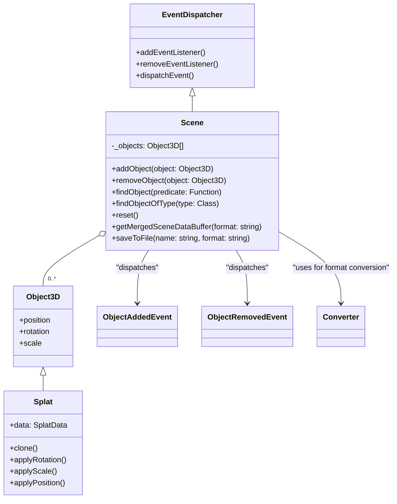
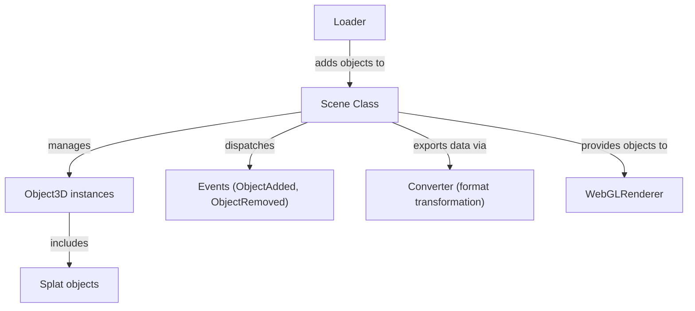

<!-- source: DeepWiki mcp.deepwiki.com · repo huggingface/gsplat.js · page 3.1 Scene Management · fetched 2026-10-26 -->

# Scene Management

<details>
<summary>Relevant source files</summary>

The following files were used as context for generating this wiki page:

- [src/core/Scene.ts](src/core/Scene.ts)

</details>


## Purpose and Scope

The Scene Management system in gsplat.js provides a centralized structure for organizing and manipulating 3D objects within a scene. It serves as the foundation that connects the data loading pipeline with the rendering system.

The Scene class is responsible for:
- Maintaining a collection of 3D objects (Object3D instances)
- Providing methods to add, remove, and find objects
- Dispatching events when scene changes occur
- Merging scene data for export to various file formats

For information about specific objects that can be added to a scene, see [Splat Objects](#3.2).
For details on how scenes are rendered, see [WebGL Renderer](#4.1).

## Scene Class Structure

The Scene class extends EventDispatcher and manages a collection of Object3D instances, providing methods for object management and scene data operations.



Sources: [src/core/Scene.ts:1-117]()

## Integration with gsplat.js Components

The Scene class integrates with various components of the gsplat.js library, serving as a central hub for 3D object management:



Sources: [src/core/Scene.ts:8-115]()

## Object Management

The Scene class provides several methods for managing objects within the scene:

| Method | Description |
|--------|-------------|
| `addObject(object: Object3D)` | Adds an Object3D instance to the scene and dispatches an ObjectAddedEvent |
| `removeObject(object: Object3D)` | Removes an Object3D instance from the scene and dispatches an ObjectRemovedEvent |
| `findObject(predicate: Function)` | Returns the first object that satisfies the predicate function |
| `findObjectOfType<T>(type: Class)` | Returns the first object of the specified type |
| `reset()` | Removes all objects from the scene |

Sources: [src/core/Scene.ts:11-60]()

### Adding Objects

Objects are added to the scene using the `addObject` method, which stores the object in the internal array and dispatches an event to notify listeners:

```
addObject = (object: Object3D) => {
    this.objects.push(object);
    this.dispatchEvent(new ObjectAddedEvent(object));
};
```

Sources: [src/core/Scene.ts:20-23]()

### Removing Objects

Objects can be removed using the `removeObject` method, which removes the object from the internal array and dispatches an event:

```
removeObject = (object: Object3D) => {
    const index = this.objects.indexOf(object);
    if (index < 0) {
        throw new Error("Object not found in scene");
    }
    this.objects.splice(index, 1);
    this.dispatchEvent(new ObjectRemovedEvent(object));
};
```

Sources: [src/core/Scene.ts:25-32]()

### Finding Objects

The Scene class provides two methods for finding objects:

1. `findObject`: Finds the first object that satisfies a predicate function
2. `findObjectOfType`: Finds the first object of a specific type

Sources: [src/core/Scene.ts:34-50]()

### Resetting the Scene

The `reset` method removes all objects from the scene by creating a copy of the objects array and removing each object individually, which ensures proper event dispatching:

```
reset = () => {
    const objectsToRemove = this.objects.slice();
    for (const object of objectsToRemove) {
        this.removeObject(object);
    }
};
```

Sources: [src/core/Scene.ts:52-57]()

## Event System

The Scene class inherits from EventDispatcher and uses events to notify listeners about changes to the scene:

| Event | Description |
|-------|-------------|
| ObjectAddedEvent | Dispatched when an object is added to the scene |
| ObjectRemovedEvent | Dispatched when an object is removed from the scene |

These events allow other components, such as the WebGLRenderer, to react to changes in the scene and update accordingly.

Sources: [src/core/Scene.ts:5-5](), [src/core/Scene.ts:22-22](), [src/core/Scene.ts:31-31]()

## Scene Data Operations

The Scene class provides methods for working with scene data, including merging and exporting:

### Merging Scene Data

The `getMergedSceneDataBuffer` method merges data from all Splat objects in the scene into a single buffer, with the following steps:

1. Iterate through all objects in the scene
2. For each Splat object, create a clone
3. Apply transformations (position, rotation, scale) to the clone
4. Serialize the Splat data to a buffer
5. Collect all buffers and merge them into a single buffer
6. Convert the format if needed (splat to ply)

Sources: [src/core/Scene.ts:62-92]()

### Exporting Scene Data

The `saveToFile` method exports the merged scene data to a file:

1. Generates a default filename if none is provided
2. Gets the merged scene data buffer
3. Creates a Blob from the buffer
4. Creates a download link and triggers it to save the file

This allows users to export their scene for sharing or later use in other applications.

Sources: [src/core/Scene.ts:94-110]()

## Usage Patterns

Here are common usage patterns for the Scene class:

### Creating a Scene and Adding Objects

```javascript
// Create a new scene
const scene = new Scene();

// Create a splat object and add it to the scene
const splat = new Splat(splatData);
scene.addObject(splat);
```

### Finding Objects in the Scene

```javascript
// Find the first Splat object in the scene
const splat = scene.findObjectOfType(Splat);

// Find an object with a specific name
const namedObject = scene.findObject(obj => obj.name === "my-object");
```

### Exporting the Scene

```javascript
// Export as .splat file
scene.saveToFile("my-scene.splat", "splat");

// Export as .ply file
scene.saveToFile("my-scene.ply", "ply");
```

## Summary

The Scene Management system provides a robust foundation for organizing and manipulating 3D objects in gsplat.js. Through its object management methods, event system, and data operations, it enables developers to create, modify, and export complex 3D scenes with Gaussian splat rendering. The Scene class acts as a critical link between the data loading system and the rendering pipeline, ensuring that 3D objects are properly managed throughout their lifecycle.

Sources: [src/core/Scene.ts:8-115]()

---

