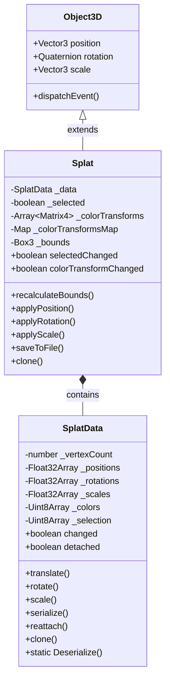
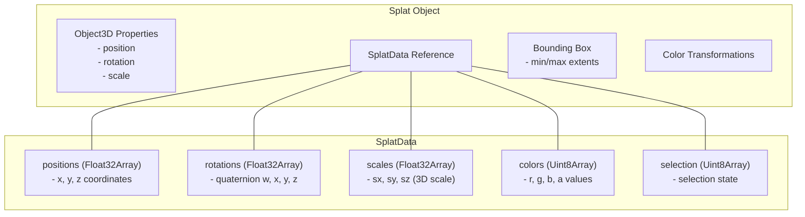
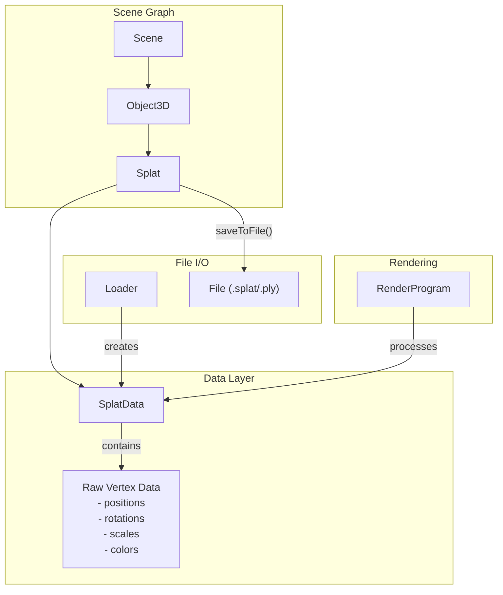

<!-- source: DeepWiki mcp.deepwiki.com · repo huggingface/gsplat.js · page 3.2 Splat Objects · fetched 2026-10-26 -->

# Splat Objects

<details>
<summary>Relevant source files</summary>

The following files were used as context for generating this wiki page:

- [src/splats/Splat.ts](src/splats/Splat.ts)
- [src/splats/SplatData.ts](src/splats/SplatData.ts)

</details>


## Purpose and Scope

This document details the `Splat` and `SplatData` classes in gsplat.js, which together represent 3D Gaussian splats for rendering. These classes form the core data representation layer in the library, storing and managing all properties required to render Gaussian splats. For information about how these objects are managed within the scene hierarchy, see [Scene Management](#3.1). For details on how splats are rendered, see [Rendering System](#4).

## Class Structure



Sources: [src/splats/Splat.ts:9-134](). [src/splats/SplatData.ts:5-211]().

## Data Representation

Gaussian splats are represented by a combination of geometric and appearance properties:



Sources: [src/splats/Splat.ts:13-17](). [src/splats/SplatData.ts:11-16]().

## Splat Class

The `Splat` class extends `Object3D` and serves as a wrapper for `SplatData`, adding scene graph functionality like transformation, selection, and bounds.

### Key Properties

| Property | Type | Description |
|----------|------|-------------|
| `data` | `SplatData` | Contains the raw splat vertex data (positions, rotations, scales, colors) |
| `selectedChanged` | `boolean` | Flag indicating selection state change |
| `colorTransformChanged` | `boolean` | Flag indicating color transformation changes |
| `bounds` | `Box3` | 3D bounding box encompassing all splat positions |
| `selected` | `boolean` | Selection state of the splat object |
| `colorTransforms` | `Array<Matrix4>` | Color transformation matrices |
| `colorTransformsMap` | `Map<number, number>` | Maps splat indices to color transform indices |

Sources: [src/splats/Splat.ts:10-17]().

### Key Methods

| Method | Purpose |
|--------|---------|
| `recalculateBounds()` | Recomputes the bounding box based on splat positions |
| `applyPosition()` | Applies the Object3D position to the underlying SplatData and resets position |
| `applyRotation()` | Applies the Object3D rotation to the underlying SplatData and resets rotation |
| `applyScale()` | Applies the Object3D scale to the underlying SplatData and resets scale |
| `saveToFile()` | Serializes and saves the splat data to a file (splat or ply format) |
| `clone()` | Creates a deep copy of the Splat object |

Sources: [src/splats/Splat.ts:19-133]().

### Transformation Workflow

The `Splat` class provides a two-stage transformation approach:

1. **Temporary transformations**: Applied via Object3D's position, rotation, and scale properties
2. **Permanent transformations**: Applied to the actual data via `applyPosition()`, `applyRotation()`, and `applyScale()`

This pattern allows for non-destructive manipulation until changes are ready to be committed to the data.

Sources: [src/splats/Splat.ts:46-59]().

## SplatData Class

The `SplatData` class manages the raw data arrays representing Gaussian splats, providing methods for data manipulation and serialization.

### Data Storage

`SplatData` stores vertex data in typed arrays for performance:

| Property | Type | Size Per Vertex | Description |
|----------|------|-----------------|-------------|
| `_positions` | `Float32Array` | 12 bytes (3 floats) | XYZ position of each splat |
| `_rotations` | `Float32Array` | 16 bytes (4 floats) | Quaternion rotation (w,x,y,z) |
| `_scales` | `Float32Array` | 12 bytes (3 floats) | Scale factors along each axis |
| `_colors` | `Uint8Array` | 4 bytes | RGBA color values |
| `_selection` | `Uint8Array` | 1 byte | Selection state |

The total binary size per splat is defined by `SplatData.RowLength = 48` bytes.

Sources: [src/splats/SplatData.ts:6-16](). [src/splats/SplatData.ts:178-200]().

### Data Transformation Methods

`SplatData` provides methods to transform the underlying data:

#### `translate(translation: Vector3)`
Adds the translation vector to all splat positions.

#### `rotate(rotation: Quaternion)`
Applies rotation to both positions and rotations of all splats.

#### `scale(scale: Vector3)`
Multiplies both positions and scales by the given scale factors.

Sources: [src/splats/SplatData.ts:44-94]().

### Serialization and Deserialization

`SplatData` provides methods for binary serialization:

- `serialize()`: Converts data into a compact binary representation
- `static Deserialize(data: Uint8Array)`: Creates a SplatData instance from binary data

The binary format packs each splat into a 48-byte structure:
- Position (3 floats): 12 bytes
- Scale (3 floats): 12 bytes
- Color (4 bytes): 4 bytes
- Rotation (4 bytes, quantized): 4 bytes

This binary format is compatible with the .splat file format used for Gaussian splat data interchange.

Sources: [src/splats/SplatData.ts:96-176]().

## Integration with Scene Graph



Sources: [src/splats/Splat.ts:9](). [src/splats/Splat.ts:64-91]().

## Working with Splat Objects

### Creating a Splat

A Splat can be created:
1. From existing SplatData: `new Splat(splatData)`
2. Empty (for programmatic construction): `new Splat()`

### Applying Transformations

Transformations can be applied in two ways:

```javascript
// Temporary transformations (non-destructive)
splat.position.set(x, y, z);
splat.rotation.setFromEuler(rx, ry, rz);
splat.scale.set(sx, sy, sz);

// Permanent transformations (modifies underlying data)
splat.applyPosition();
splat.applyRotation();
splat.applyScale();
```

### Saving to File

Splats can be exported to file formats:

```javascript
// Save as .splat format
splat.saveToFile("myModel.splat", "splat");

// Save as .ply format
splat.saveToFile("myModel.ply", "ply");
```

Sources: [src/splats/Splat.ts:64-91]().

## Cloning and Bounds

- **Cloning**: The `clone()` method creates a deep copy of a Splat object including its data
- **Bounds**: The `bounds` property provides a 3D bounding box for the splat object, useful for spatial queries and frustum culling

Sources: [src/splats/Splat.ts:117-133](). [src/splats/SplatData.ts:202-210]().

## Usage in the Rendering Pipeline

Splat objects serve as the core data structure used in the gsplat.js rendering pipeline. The `WebGLRenderer` component accesses the underlying `SplatData` to render Gaussian splats as screen-aligned quads. For more details on this process, see [Render Program](#4.2).

---

