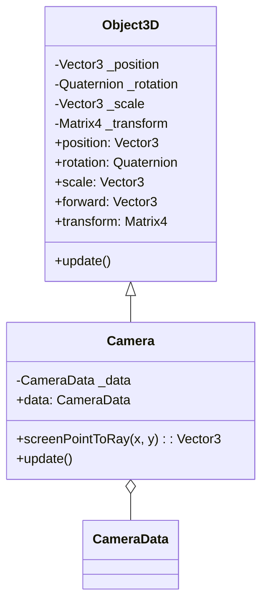
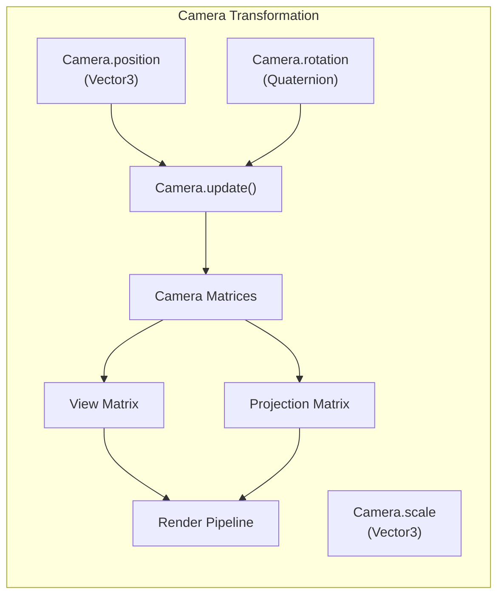
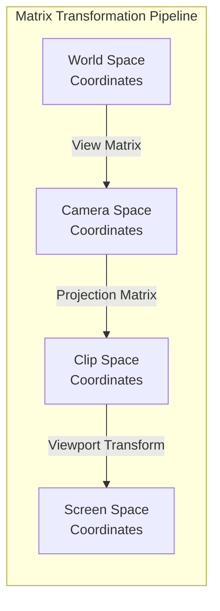
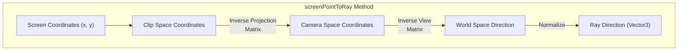
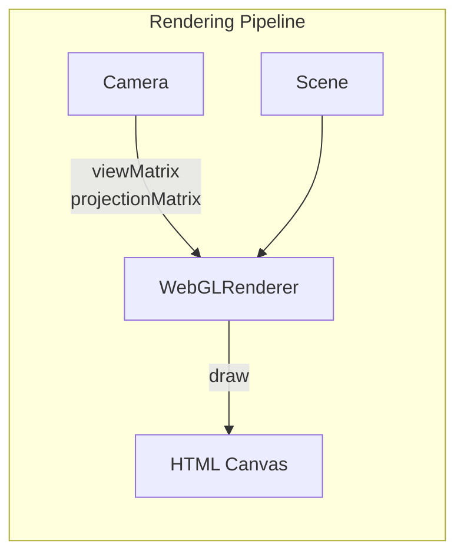
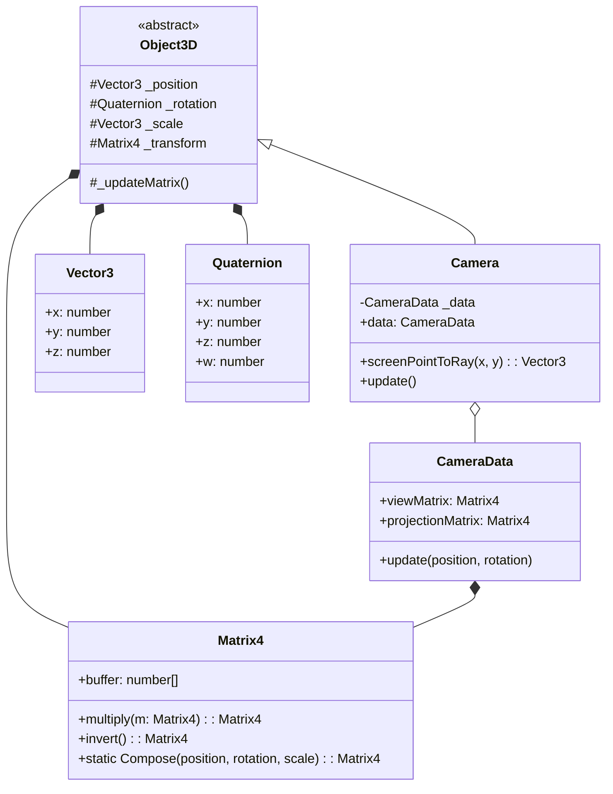

<!-- source: DeepWiki mcp.deepwiki.com · repo huggingface/gsplat.js · page 3.3 Camera System · fetched 2026-10-26 -->

# Camera System

Relevant source files

The following files were used as context for generating this wiki page:

- [src/cameras/Camera.ts](src/cameras/Camera.ts)
- [src/core/Object3D.ts](src/core/Object3D.ts)
- [src/math/Matrix4.ts](src/math/Matrix4.ts)

The Camera System in gsplat.js provides the virtual viewpoint from which the 3D Gaussian splat scene is rendered. It defines how and what part of the 3D scene is projected onto the 2D canvas. This document explains the architecture, components, and usage of the camera system.

For information about camera controls and user interaction, see [Camera Controls](#7.1).

## Camera Architecture

The camera system is built around the `Camera` class, which extends the core `Object3D` class. This inheritance gives cameras the ability to be positioned, rotated, and scaled in 3D space like any other object.

Sources: [src/cameras/Camera.ts:1-42](), [src/core/Object3D.ts:1-101]()

The camera maintains a `CameraData` object that contains the camera-specific properties needed for rendering, including view and projection matrices. When the camera's position or rotation changes, these matrices are recalculated to ensure the scene is rendered correctly from the new viewpoint.

## Camera Properties and Transformation

As an `Object3D`, the camera has the following key properties:

| Property | Type | Description |
|----------|------|-------------|
| position | Vector3 | The 3D position of the camera in world space |
| rotation | Quaternion | The orientation of the camera |
| scale | Vector3 | The scale of the camera (rarely changed) |
| forward | Vector3 | The direction the camera is facing (derived from rotation) |

The transformation system follows this process:

Sources: [src/cameras/Camera.ts:16-19](), [src/core/Object3D.ts:46-49]()

When the camera's properties change, the `_updateMatrix()` method in `Object3D` is called to update the camera's transform matrix. The camera's `update()` method further updates the view and projection matrices in the `CameraData` object based on the new position and rotation.

## View and Projection Matrices

The camera system uses two critical matrices for rendering:

1. **View Matrix**: Transforms world space coordinates to camera space (what the camera sees)
2. **Projection Matrix**: Projects camera space coordinates to clip space (the 2D view on screen)

These matrices are composed as follows:

Sources: [src/cameras/Camera.ts:17-19](), [src/math/Matrix4.ts:34-140]()

The `Matrix4` class provides the mathematical operations needed for these transformations, including matrix multiplication, inversion, and composition from position, rotation, and scale components.

## Ray Casting

The camera system implements ray casting through the `screenPointToRay()` method, which is essential for user interactions such as selecting objects:

Sources: [src/cameras/Camera.ts:21-34]()

The process involves:
1. Converting screen coordinates to clip space
2. Transforming to camera space using the inverse projection matrix
3. Transforming to world space using the inverse view matrix
4. Creating a ray direction by normalizing the vector from camera position to the world space point

## Camera Integration in Rendering Pipeline

The camera is a central component in the rendering pipeline:

Sources: [src/cameras/Camera.ts:16-19]()

The WebGLRenderer uses the camera's view and projection matrices to transform the Gaussian splats in the scene and project them onto the 2D canvas. This enables the renderer to accurately display the 3D scene from the camera's perspective.

## Typical Camera Implementation

Here's how the Camera class is implemented:

Sources: [src/cameras/Camera.ts:1-42](), [src/core/Object3D.ts:7-99](), [src/math/Matrix4.ts:4-176]()

The Camera inherits transformation capabilities from Object3D and adds camera-specific functionality through the CameraData object, which manages the view and projection matrices needed for rendering.

## Usage Example

To use a camera in gsplat.js, you typically:

1. Create a Camera instance
2. Position and orient it
3. Attach camera controls if needed
4. Use it with a WebGLRenderer

The camera's position and rotation can be changed at runtime, and the `update()` method should be called to ensure the view and projection matrices are updated accordingly.

Sources: [src/cameras/Camera.ts:11-35]()

---

