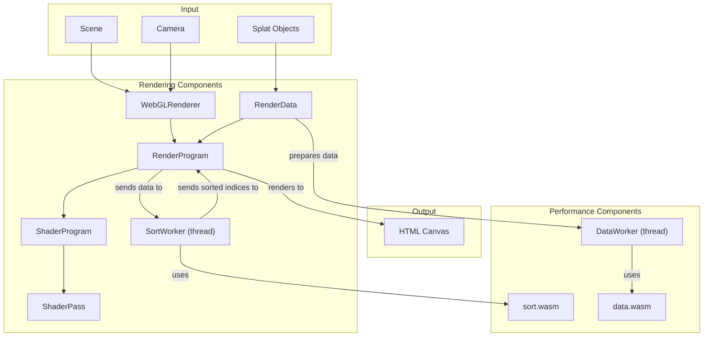
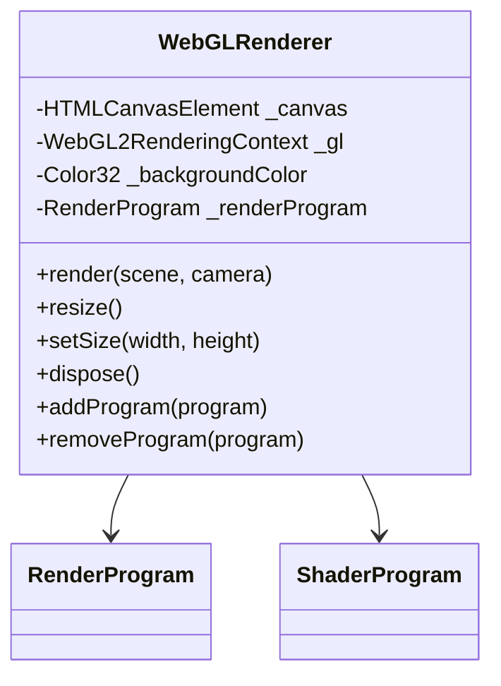
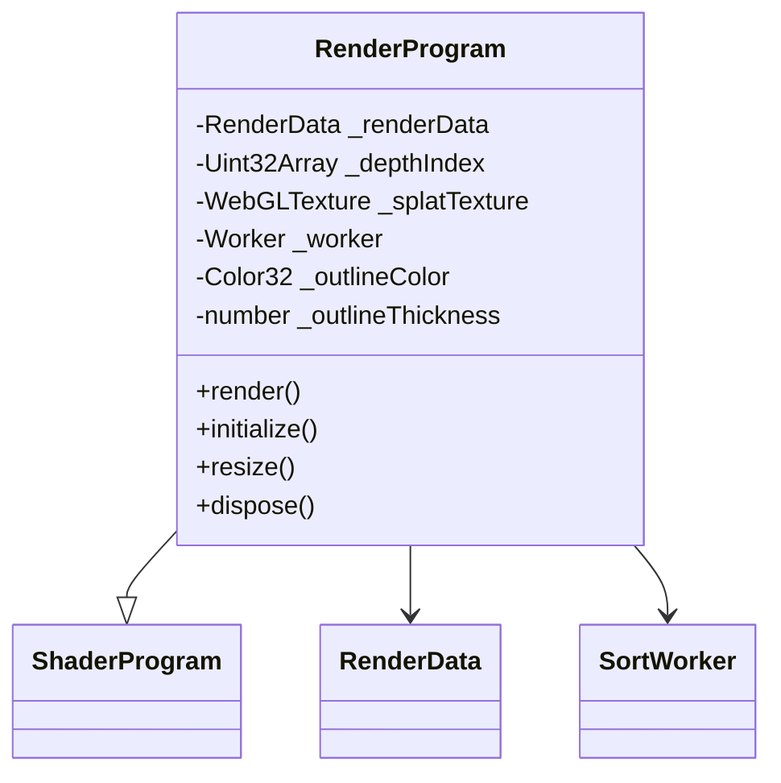
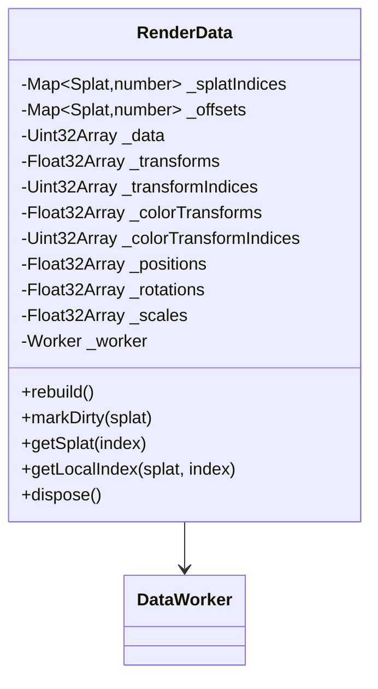
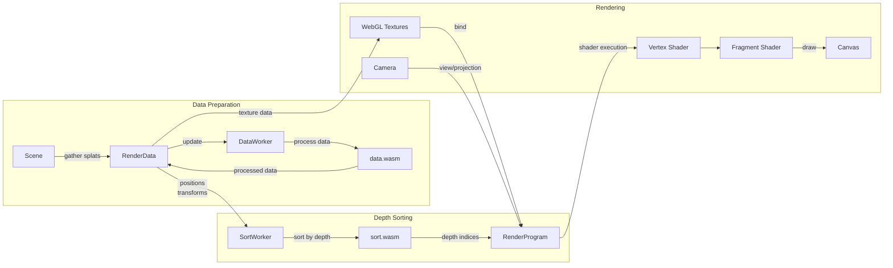
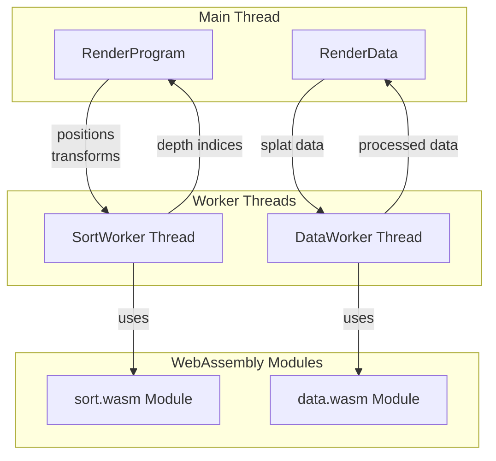
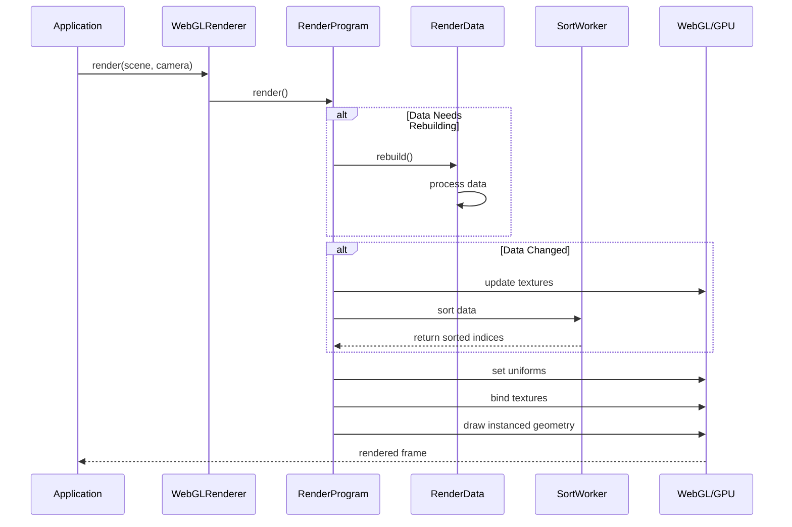

<!-- source: DeepWiki mcp.deepwiki.com · repo huggingface/gsplat.js · page 4 Rendering System · fetched 2026-10-26 -->

# Rendering System

Relevant source files

The following files were used as context for generating this wiki page:

- [src/renderers/WebGLRenderer.ts](src/renderers/WebGLRenderer.ts)
- [src/renderers/webgl/programs/RenderProgram.ts](src/renderers/webgl/programs/RenderProgram.ts)
- [src/renderers/webgl/utils/DataWorker.ts](src/renderers/webgl/utils/DataWorker.ts)
- [src/renderers/webgl/utils/RenderData.ts](src/renderers/webgl/utils/RenderData.ts)

The Rendering System in gsplat.js is responsible for efficiently rendering 3D Gaussian splats to WebGL contexts in web browsers. This page documents the architecture, components, and processes involved in transforming Splat objects from the scene into visual representations on the canvas.

## Overview

The rendering system converts mathematical 3D Gaussian splat representations into viewable images through a pipeline of operations including data preparation, sorting, transformation, and rasterization. The system employs WebGL for hardware-accelerated rendering and leverages WebAssembly and web workers for performance-critical operations.

Sources: [src/renderers/WebGLRenderer.ts](), [src/renderers/webgl/programs/RenderProgram.ts](), [src/renderers/webgl/utils/RenderData.ts](), [src/renderers/webgl/utils/DataWorker.ts]()

## Core Components

### WebGLRenderer

The `WebGLRenderer` serves as the primary interface for rendering operations. It manages the HTML canvas, initializes the WebGL context, and coordinates rendering passes.

Key responsibilities:
- Canvas and WebGL context initialization
- Managing the render program and shader passes
- Executing the render loop
- Handling resize events

Sources: [src/renderers/WebGLRenderer.ts:9-110]()

### RenderProgram

The `RenderProgram` is the core class responsible for the actual rendering of Gaussian splats. It extends the `ShaderProgram` class and implements specialized shaders and rendering logic.

Key responsibilities:
- Shader management for Gaussian splatting
- Texture creation and management
- WebGL state management
- Depth sorting coordination with `SortWorker`
- Rendering loop implementation

Sources: [src/renderers/webgl/programs/RenderProgram.ts:159-572]()

### RenderData

The `RenderData` class prepares and manages all the data necessary for rendering Gaussian splats. It organizes the splat data into formats suitable for GPU processing.

Key responsibilities:
- Managing splat data for rendering
- Creating texture data structures
- Tracking changes to splats
- Coordinating with `DataWorker` for data processing
- Rebuilding data when needed

Sources: [src/renderers/webgl/utils/RenderData.ts:7-438]()

## Rendering Pipeline

The rendering pipeline in gsplat.js transforms 3D Gaussian splats into 2D representations on the screen through a series of steps:

Sources: [src/renderers/webgl/programs/RenderProgram.ts:336-491](), [src/renderers/webgl/utils/RenderData.ts:310-349]()

### Data Flow in Detail

The rendering system processes data through several stages:

1. **Data Collection**: Gather all splat objects from the scene
2. **Data Processing**: Convert and prepare data for GPU rendering using WebAssembly
3. **Texture Creation**: Build GPU textures for efficient rendering
4. **Depth Sorting**: Sort all splats by depth for correct transparency handling
5. **Shader Execution**: Execute specialized shaders for Gaussian splatting
6. **Rendering**: Draw the final result to the canvas

### WebGL Textures

The rendering system uses several WebGL textures to efficiently pass data to the GPU:

| Texture | Description | Format | Content |
|---------|-------------|--------|---------|
| `splatTexture` | Main splat data | RGBA32UI | Center points and covariance data |
| `transformsTexture` | Object transforms | RGBA32F | 4x4 transformation matrices |
| `transformIndicesTexture` | Indices for transforms | R32UI | Index mapping to transforms |
| `colorTransformsTexture` | Color transforms | RGBA32F | 4x4 color transformation matrices |
| `colorTransformIndicesTexture` | Indices for color transforms | R32UI | Index mapping to color transforms |

Sources: [src/renderers/webgl/programs/RenderProgram.ts:261-282](), [src/renderers/webgl/programs/RenderProgram.ts:352-445]()

## Shaders and Rendering Algorithm

The rendering system uses specialized shaders to render Gaussian splats efficiently. These shaders are implemented in GLSL and are part of the `RenderProgram` class.

### Vertex Shader

The vertex shader is responsible for:
1. Computing the 2D projection of the 3D Gaussian
2. Calculating the elliptical splat parameters from covariance matrices
3. Determining the splat size and orientation
4. Setting up the correct quad positions for each splat

Key operations:
- Covariance matrix projection from 3D to 2D
- Eigenvalue decomposition to find major/minor axes
- Quad positioning based on splat shape

Sources: [src/renderers/webgl/programs/RenderProgram.ts:12-120]()

### Fragment Shader

The fragment shader performs:
1. Gaussian evaluation for each fragment
2. Alpha blending for smooth rendering
3. Optional outline rendering for selected splats
4. Discard fragments outside the Gaussian footprint

Key operations:
- Gaussian function evaluation
- Alpha computation for transparency
- Outline rendering for selected splats

Sources: [src/renderers/webgl/programs/RenderProgram.ts:123-156]()

## Multithreaded Processing

The rendering system leverages web workers and WebAssembly for performance-critical operations:

Sources: [src/renderers/webgl/programs/RenderProgram.ts:219-229](), [src/renderers/webgl/programs/RenderProgram.ts:447-468](), [src/renderers/webgl/utils/DataWorker.ts:1-163]()

### SortWorker

The `SortWorker` runs in a separate thread and is responsible for depth-sorting Gaussian splats. It uses a WebAssembly module (`sort.wasm`) for efficient sorting.

Key responsibilities:
- Receiving position and transform data from the main thread
- Calculating splat depths based on camera view
- Sorting splats by depth
- Returning sorted indices to the main thread

Sources: [src/renderers/webgl/programs/RenderProgram.ts:163-174](), [src/renderers/webgl/programs/RenderProgram.ts:447-468]()

### DataWorker

The `DataWorker` runs in a separate thread and processes raw splat data into formats suitable for rendering. It uses a WebAssembly module (`data.wasm`) for efficient data processing.

Key responsibilities:
- Processing raw splat data
- Computing world-space transforms
- Packing data into efficient formats for the GPU
- Managing batched processing to maintain responsiveness

Sources: [src/renderers/webgl/utils/DataWorker.ts:1-163](), [src/renderers/webgl/utils/RenderData.ts:92-171]()

## Rendering Process

The rendering process in gsplat.js follows these steps:

1. **Initialization**:
   - Create WebGL textures and buffers
   - Set up shaders and uniforms
   - Initialize worker threads

2. **Per-frame Updates**:
   - Update camera view and projection matrices
   - Rebuild data if needed
   - Update textures if data has changed
   - Send data to SortWorker for depth sorting

3. **Rendering**:
   - Set up WebGL state (blending, viewport, etc.)
   - Bind textures and buffers
   - Set shader uniforms
   - Draw the scene using instanced rendering

4. **Cleanup**:
   - Dispose of resources when no longer needed

Sources: [src/renderers/webgl/programs/RenderProgram.ts:336-491](), [src/renderers/WebGLRenderer.ts:63-67]()

## Performance Considerations

The rendering system is designed with performance in mind:

1. **WebAssembly for Heavy Computation**:
   - Depth sorting is performed in WebAssembly for speed
   - Data processing uses WebAssembly for efficient transformation

2. **Multi-threading**:
   - Worker threads keep the main thread responsive
   - Background processing of data minimizes frame drops

3. **GPU-Optimized Data Structures**:
   - Data is organized to minimize GPU state changes
   - Texture formats chosen for performance

4. **Instanced Rendering**:
   - Uses WebGL instanced rendering for efficient drawing
   - Minimizes draw calls for better performance

5. **Lazy Updates**:
   - Only updates textures when data changes
   - Tracks dirty state to avoid unnecessary processing

Sources: [src/renderers/webgl/programs/RenderProgram.ts:342-465](), [src/renderers/webgl/utils/RenderData.ts:310-349]()

## Integration with Other Systems

The rendering system integrates with other components of gsplat.js:

- **Scene Management**: Renders objects from the [Scene Management](#3.1) system
- **Camera System**: Uses the camera from the [Camera System](#3.3) for view and projection
- **Splat Objects**: Renders [Splat Objects](#3.2) with their transformations
- **Math Utilities**: Leverages [Math Utilities](#6) for matrix operations

---

