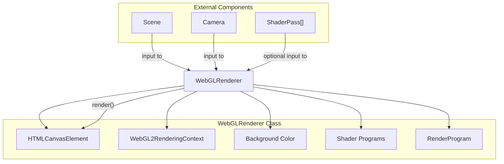
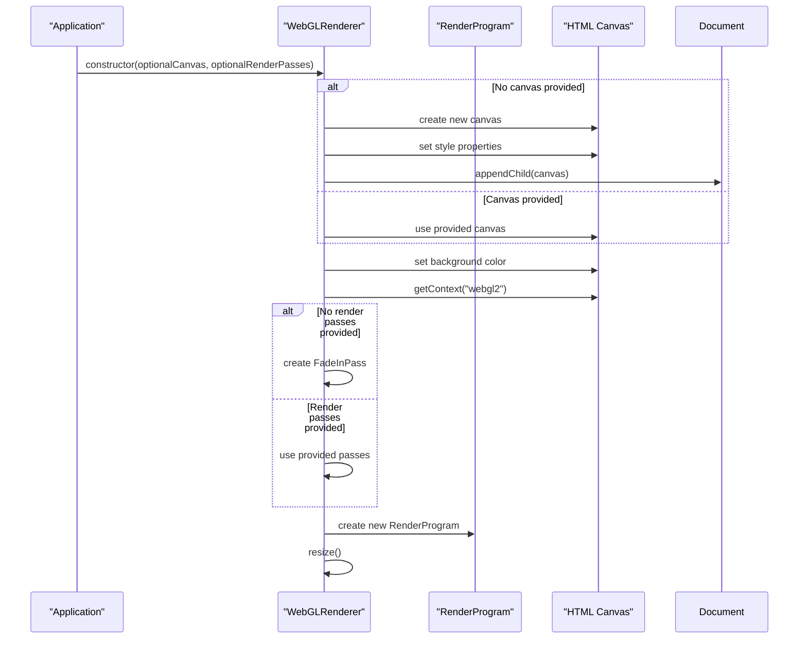
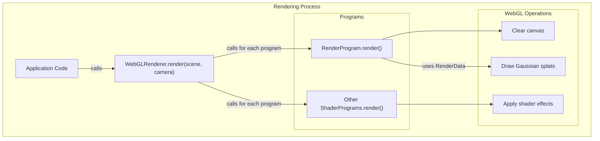
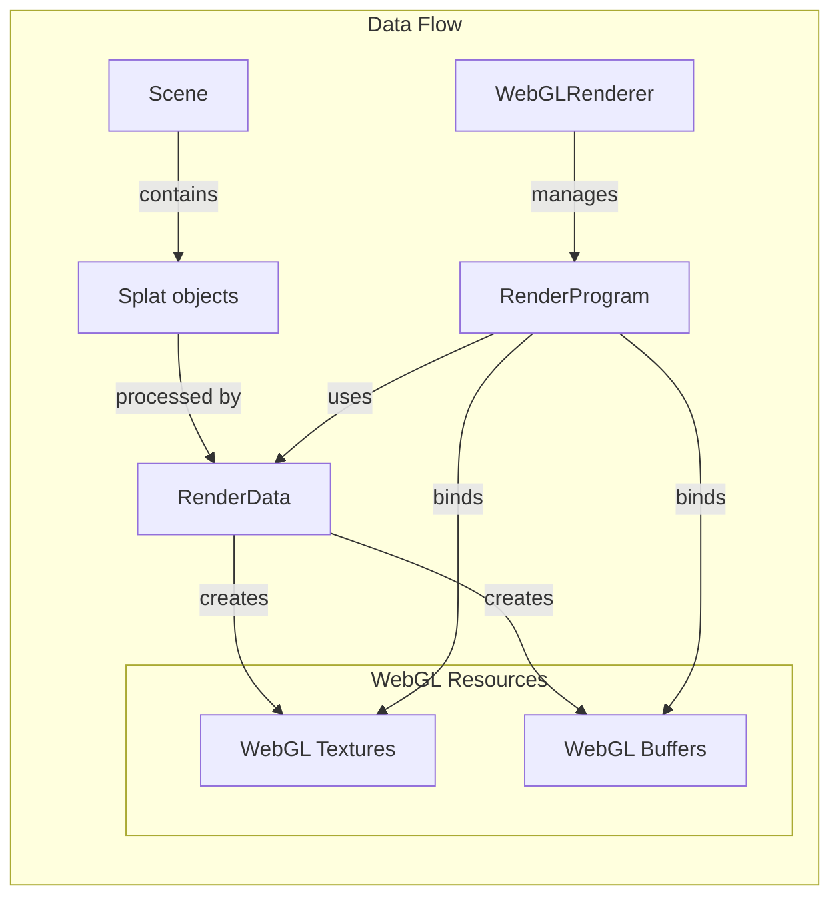
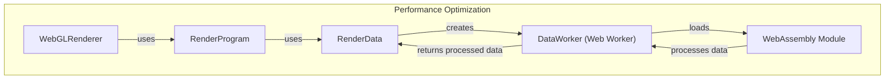

<!-- source: DeepWiki mcp.deepwiki.com · repo huggingface/gsplat.js · page 4.1 WebGL Renderer · fetched 2026-10-26 -->

# WebGL Renderer

Relevant source files

The following files were used as context for generating this wiki page:

- [src/renderers/WebGLRenderer.ts](src/renderers/WebGLRenderer.ts)
- [src/renderers/webgl/utils/DataWorker.ts](src/renderers/webgl/utils/DataWorker.ts)
- [src/renderers/webgl/utils/RenderData.ts](src/renderers/webgl/utils/RenderData.ts)

## Purpose and Overview

The WebGLRenderer is a core component in gsplat.js responsible for rendering 3D Gaussian Splatting scenes to an HTML canvas using WebGL 2. This component serves as the primary interface between the scene graph (containing the 3D splats) and the actual rendering on screen.

This document details the WebGLRenderer specifically. For information about the RenderProgram that handles the actual Gaussian splat rendering, see [Render Program](#4.2). For details on WebAssembly integration for performance optimization, see [WASM Integration](#4.3).

Sources: [src/renderers/WebGLRenderer.ts:9-110]()

## Architecture and Structure

The WebGLRenderer acts as a coordinator in the rendering process, managing the WebGL context, shader programs, and delegating the actual rendering work to specialized programs like RenderProgram. It doesn't directly implement the Gaussian Splatting rendering algorithm, but rather provides the infrastructure for it.

Sources: [src/renderers/WebGLRenderer.ts:9-44]()

## Initialization and Setup

The WebGLRenderer constructor takes two optional parameters:
- `optionalCanvas`: An HTML canvas element to render to (creates a new one if not provided)
- `optionalRenderPasses`: An array of ShaderPass instances for post-processing effects

If no canvas is provided, the renderer creates a new canvas and appends it to the document body, configuring it to fill the available space.

Sources: [src/renderers/WebGLRenderer.ts:22-44](), [src/renderers/WebGLRenderer.ts:46-52]()

## Core Properties and Methods

### Properties

| Property | Type | Description |
|----------|------|-------------|
| canvas | HTMLCanvasElement | The canvas element where rendering occurs |
| gl | WebGL2RenderingContext | The WebGL 2 context used for rendering |
| renderProgram | RenderProgram | The main program that handles Gaussian splat rendering |
| backgroundColor | Color32 | The background color of the canvas |

Sources: [src/renderers/WebGLRenderer.ts:90-109]()

### Key Methods

| Method | Parameters | Description |
|--------|------------|-------------|
| resize() | None | Resizes the canvas to match its client dimensions |
| setSize(width, height) | width: number, height: number | Explicitly sets the canvas size and updates the viewport |
| render(scene, camera) | scene: Scene, camera: Camera | Renders the scene from the camera's perspective |
| dispose() | None | Releases resources used by the renderer and its programs |
| addProgram(program) | program: ShaderProgram | Adds a shader program to the renderer |
| removeProgram(program) | program: ShaderProgram | Removes a shader program from the renderer |

Sources: [src/renderers/WebGLRenderer.ts:15-20](), [src/renderers/WebGLRenderer.ts:46-85]()

## Rendering Pipeline

The WebGLRenderer delegates the actual rendering to the shader programs it manages, primarily the RenderProgram. When the `render` method is called, the renderer iterates through all registered shader programs and calls their `render` method with the provided scene and camera.

Sources: [src/renderers/WebGLRenderer.ts:63-67]()

## Data Preparation and Processing

While the WebGLRenderer itself doesn't directly handle the Gaussian splat data, it's important to understand how it connects to the data preparation pipeline. The RenderProgram it uses relies on RenderData, which prepares the splat data for efficient GPU rendering.

Sources: [src/renderers/webgl/utils/RenderData.ts:7-349]()

## Canvas Management

The WebGLRenderer handles canvas creation, sizing, and viewport management. It sets up the initial canvas if one is not provided and offers methods to resize the canvas either automatically (matching its container) or to an explicit size.

When the canvas is resized, the WebGLRenderer:
1. Updates the canvas dimensions
2. Updates the WebGL viewport
3. Notifies all shader programs about the resize

Sources: [src/renderers/WebGLRenderer.ts:46-61]()

## Integration with Web Workers and WebAssembly

While the WebGLRenderer doesn't directly use Web Workers or WebAssembly, its dependent components do. The RenderData class uses a DataWorker for processing splat data, and this worker uses WebAssembly for efficient computation.

Sources: [src/renderers/webgl/utils/RenderData.ts:3-4](), [src/renderers/webgl/utils/DataWorker.ts:1-8]()

## Usage Example

To use the WebGLRenderer, you typically:

1. Create a Scene and add Splat objects to it
2. Create a Camera and position it
3. Create a WebGLRenderer, optionally with a custom canvas
4. Call the render method in an animation loop

The renderer will handle the rest, delegating the actual rendering to its shader programs.

## Conclusion

The WebGLRenderer is the central component for rendering Gaussian splats in gsplat.js. It provides a clean API for managing the WebGL context, canvas, and shader programs, while delegating the actual rendering logic to specialized components like RenderProgram. This separation of concerns allows for a modular and extensible rendering system.

---

