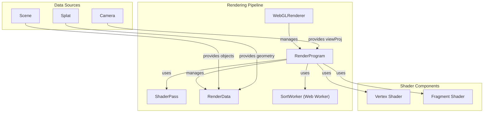
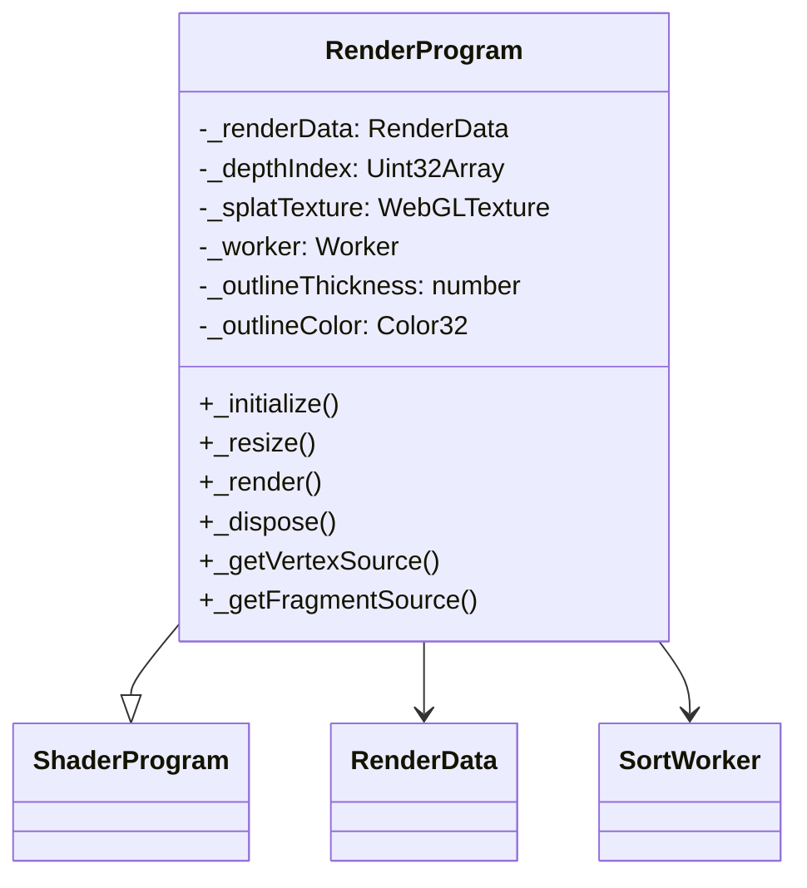
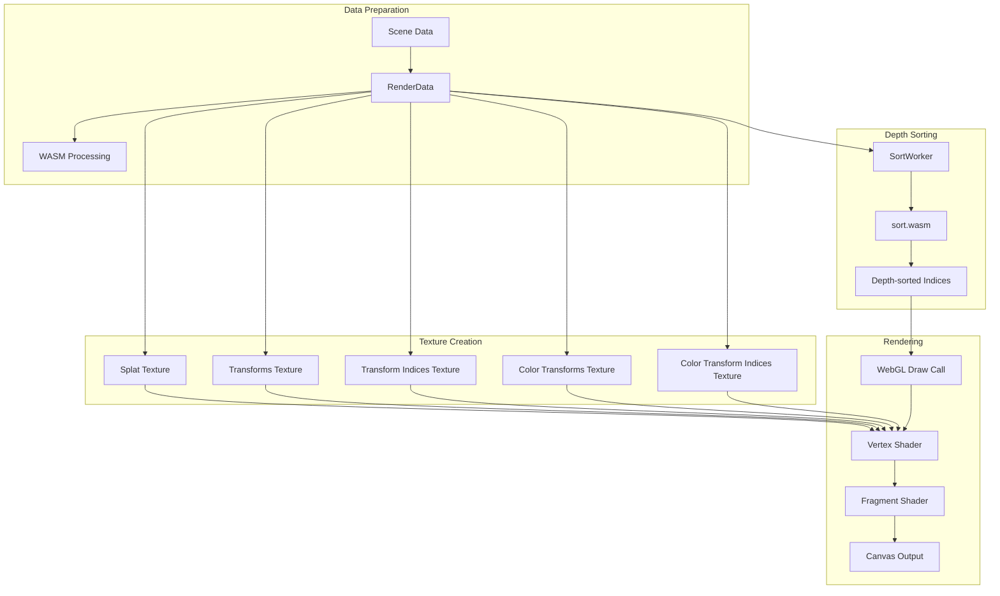
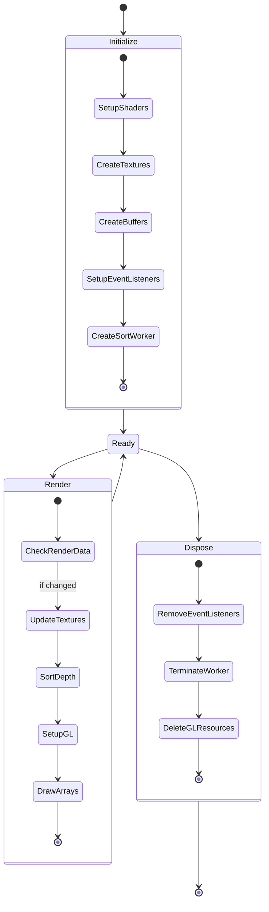
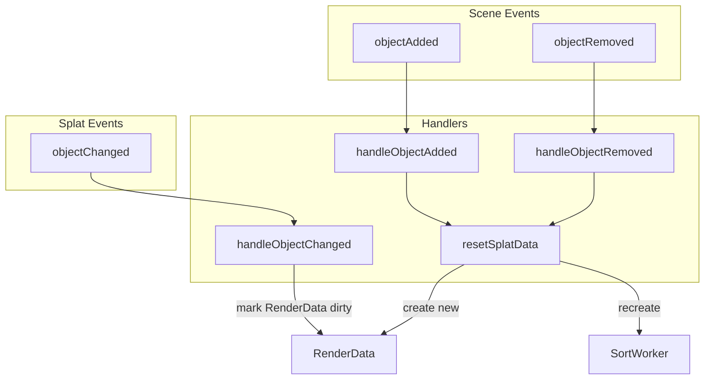

<!-- source: DeepWiki mcp.deepwiki.com · repo huggingface/gsplat.js · page 4.2 Render Program · fetched 2026-10-26 -->

# Render Program

Relevant source files

The following files were used as context for generating this wiki page:

- [src/renderers/webgl/programs/RenderProgram.ts](src/renderers/webgl/programs/RenderProgram.ts)

The Render Program is a core component of the WebGL rendering system in gsplat.js that handles the shader-based rendering of 3D Gaussian splats. It manages both the vertex and fragment shaders responsible for transforming 3D Gaussian splats into 2D screen-space elements and rendering them with appropriate blending and visual properties.

For information about the overall WebGL rendering system, see [WebGL Renderer](#4.1).

## Overview and Position in the Rendering Pipeline

The `RenderProgram` class extends the `ShaderProgram` base class and implements the specific shader logic required for Gaussian splatting. It serves as the bridge between the scene data and the GPU rendering pipeline, translating the mathematical representation of 3D Gaussians into visually rendered splats.

Sources: [src/renderers/webgl/programs/RenderProgram.ts:159-574]()

## Class Structure and Core Components

The `RenderProgram` class includes several key properties and methods that manage the rendering process:

Sources: [src/renderers/webgl/programs/RenderProgram.ts:159-174]()

### Key Properties

| Property | Type | Description |
|----------|------|-------------|
| `_renderData` | `RenderData` | Contains all the splat data prepared for rendering |
| `_depthIndex` | `Uint32Array` | Stores indices of splats sorted by depth |
| `_splatTexture` | `WebGLTexture` | WebGL texture containing splat data |
| `_worker` | `Worker` | Web Worker used for depth sorting splats |
| `_outlineThickness` | `number` | Controls the thickness of outlines for selected splats |
| `_outlineColor` | `Color32` | Defines the color of outlines for selected splats |

Sources: [src/renderers/webgl/programs/RenderProgram.ts:160-165]()

## Shader Implementation

The `RenderProgram` includes both vertex and fragment shaders specifically designed for Gaussian splat rendering.

### Vertex Shader

The vertex shader is responsible for:
1. Projecting 3D Gaussian splats to 2D screen space
2. Computing the 2D covariance matrix for each splat
3. Calculating major and minor axes of the 2D Gaussian
4. Setting up data for the fragment shader

The vertex shader implementation is quite advanced, using mathematical operations to convert 3D Gaussian covariance matrices to 2D screen-space representations.

Sources: [src/renderers/webgl/programs/RenderProgram.ts:12-121]()

### Fragment Shader

The fragment shader handles:
1. Rendering the Gaussian splat with appropriate transparency
2. Applying outlines to selected splats
3. Discarding pixels outside the Gaussian's effective radius

Sources: [src/renderers/webgl/programs/RenderProgram.ts:123-157]()

## Rendering Pipeline and Texture Management

The rendering process in `RenderProgram` involves several steps that transform raw splat data into rendered images.

Sources: [src/renderers/webgl/programs/RenderProgram.ts:336-491]()

### Data Flow

During initialization and rendering, `RenderProgram` manages the following data flow:

1. The scene data (splat positions, transforms, colors) is gathered in `RenderData`
2. This data is uploaded to GPU as textures:
   - splatTexture: Contains center positions and covariance matrices
   - transformsTexture: Contains transformation matrices
   - transformIndicesTexture: Maps splats to their transforms
   - colorTransformsTexture: Contains color transformation matrices
   - colorTransformIndicesTexture: Maps splats to color transforms

3. The `SortWorker` processes position data to sort splats by depth
4. The rendering process binds these textures and renders splats using instanced drawing

Sources: [src/renderers/webgl/programs/RenderProgram.ts:336-491]()

## Initialization and Lifecycle

The `RenderProgram` follows a defined lifecycle with distinct phases:

Sources: [src/renderers/webgl/programs/RenderProgram.ts:175-516]()

### Initialization

The `_initialize` method sets up:
1. Camera parameters
2. WebGL shader uniforms
3. Textures for splat data
4. Vertex and index buffers
5. Event listeners for scene changes
6. The SortWorker for depth sorting

Sources: [src/renderers/webgl/programs/RenderProgram.ts:231-298]()

### Rendering

The `_render` method handles:
1. Checking if render data needs to be rebuilt
2. Updating textures when data has changed
3. Sending data to the SortWorker for depth sorting
4. Setting up WebGL state (blending, viewport)
5. Drawing the splats using instanced rendering

Sources: [src/renderers/webgl/programs/RenderProgram.ts:336-491]()

### Disposal

The `_dispose` method cleans up:
1. Event listeners
2. WebGL textures and buffers
3. The SortWorker

Sources: [src/renderers/webgl/programs/RenderProgram.ts:493-516]()

## Event Handling

The `RenderProgram` sets up event listeners to track changes in the scene that might affect rendering:

Sources: [src/renderers/webgl/programs/RenderProgram.ts:300-334]()

When objects are added or removed from the scene, or when objects change, the `RenderProgram` either resets the entire render data or marks specific objects as dirty, ensuring that the render representation stays in sync with the scene.

## WebGL State Management

The `RenderProgram` carefully manages the WebGL state to ensure correct rendering of translucent Gaussian splats:

1. Disables depth testing: `gl.disable(gl.DEPTH_TEST)`
2. Enables blending: `gl.enable(gl.BLEND)`
3. Sets up blending functions for proper alpha compositing:
   - `gl.blendFuncSeparate(gl.ONE_MINUS_DST_ALPHA, gl.ONE, gl.ONE_MINUS_DST_ALPHA, gl.ONE)`
   - `gl.blendEquationSeparate(gl.FUNC_ADD, gl.FUNC_ADD)`

Sources: [src/renderers/webgl/programs/RenderProgram.ts:474-477]()

## Integration with Other Systems

The `RenderProgram` interacts with several other components in the gsplat.js system:

1. **WebGLRenderer**: The parent class that manages the `RenderProgram`
2. **Scene**: Provides the objects (splats) to be rendered
3. **Camera**: Provides view and projection matrices
4. **RenderData**: Prepares and stores data for rendering
5. **SortWorker**: Performs depth sorting of splats

These interactions ensure that the rendering pipeline can efficiently process and display Gaussian splats.

Sources: [src/renderers/webgl/programs/RenderProgram.ts:175-563]()

---

