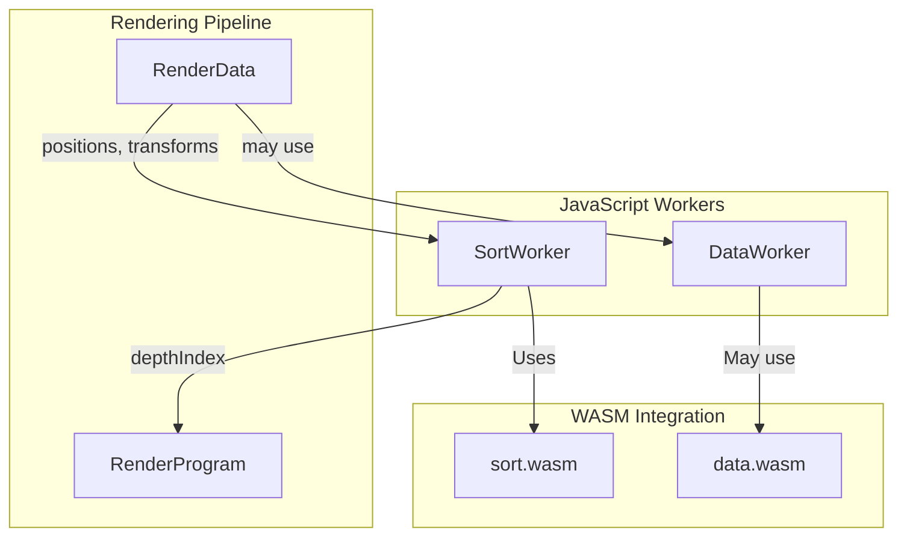
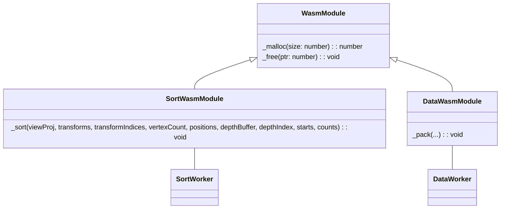
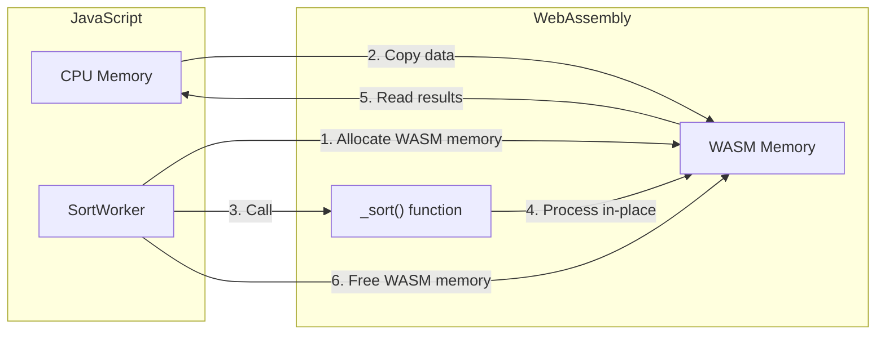
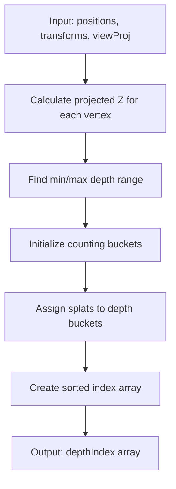
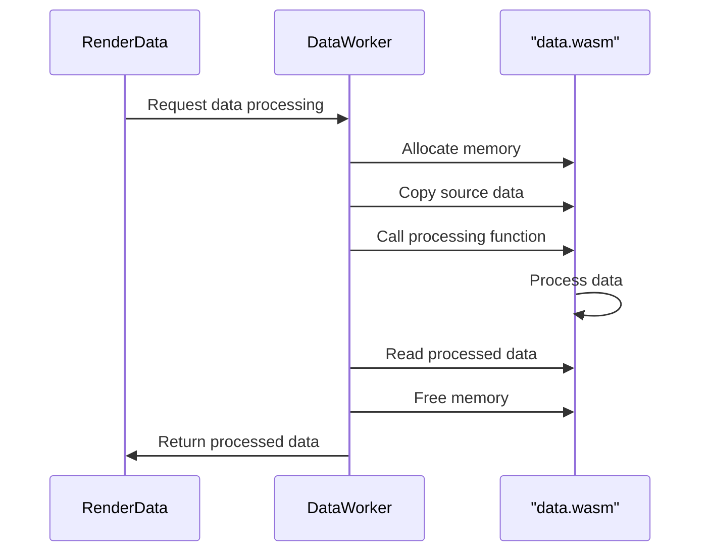
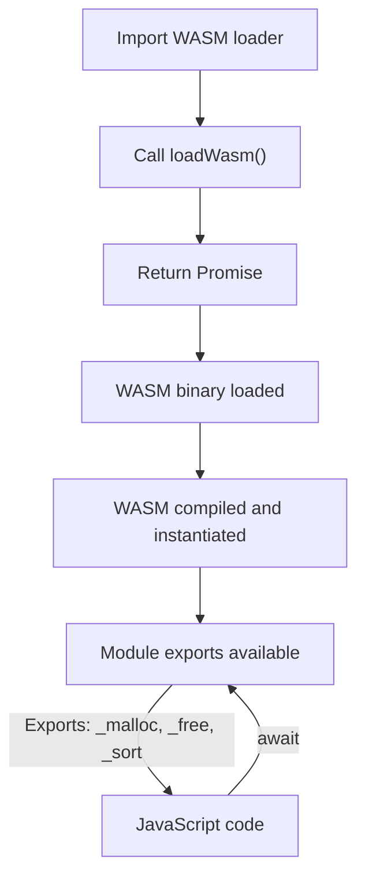
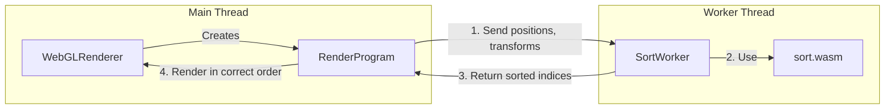
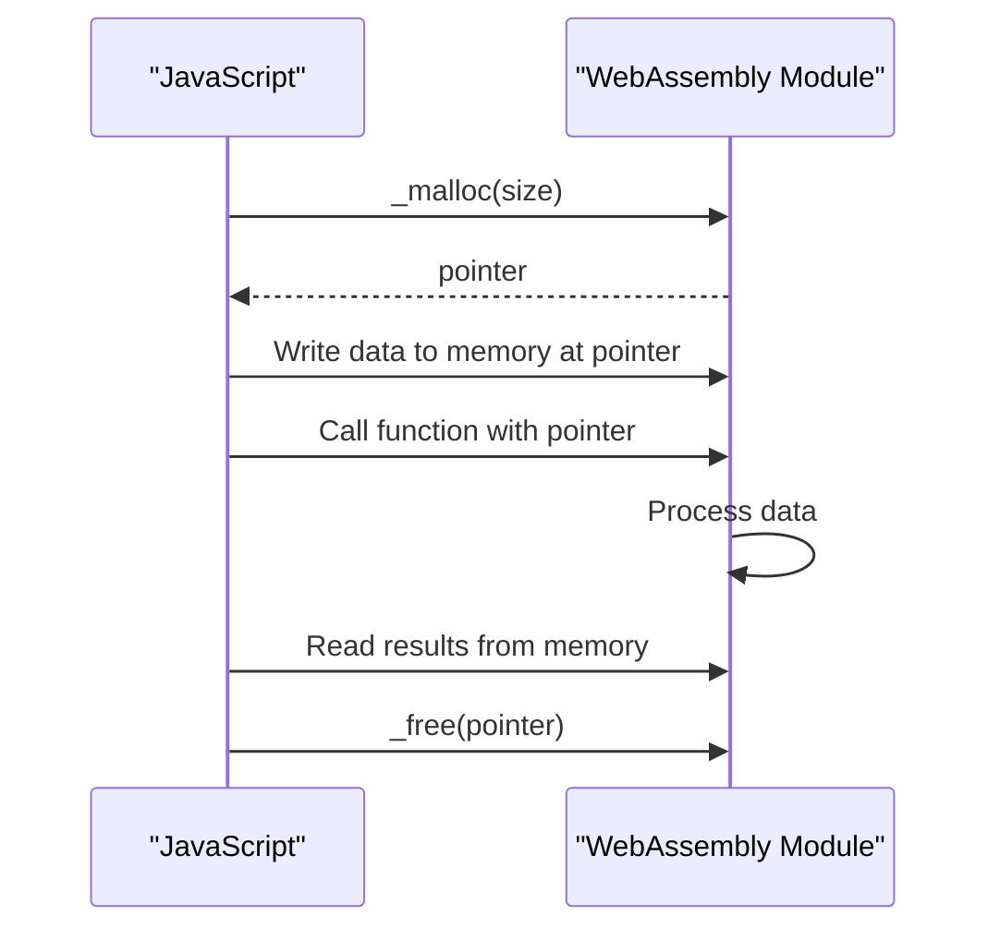

<!-- source: DeepWiki mcp.deepwiki.com · repo huggingface/gsplat.js · page 4.3 WASM Integration · fetched 2026-10-26 -->

# WASM Integration

<details>
<summary>Relevant source files</summary>

The following files were used as context for generating this wiki page:

- [.gitattributes](.gitattributes)
- [src/index.ts](src/index.ts)
- [src/wasm/data.js](src/wasm/data.js)
- [src/wasm/sort.d.ts](src/wasm/sort.d.ts)
- [src/wasm/sort.js](src/wasm/sort.js)
- [wasm/sort.cpp](wasm/sort.cpp)

</details>


This document describes how WebAssembly (WASM) is integrated into gsplat.js to enhance performance for computationally intensive operations. The integration provides significant performance improvements for operations like depth sorting and data transformations that would otherwise be performance bottlenecks if implemented in JavaScript.

For information about how the WASM-powered sorting is used in the rendering pipeline, see [Sort Worker](#4.4).

## Overview of WebAssembly in gsplat.js

WebAssembly is used in gsplat.js to accelerate performance-critical operations by executing compiled C++ code directly in the browser at near-native speed. The library implements two primary WASM modules:

1. **sort.wasm**: Handles depth sorting of Gaussian splats, a critical step for correct rendering
2. **data.wasm**: Manages efficient data packing and processing operations



Sources: [src/wasm/sort.js](), [src/wasm/data.js](), [src/wasm/sort.d.ts]()

## WebAssembly Module Architecture

The WASM modules are designed to provide a clean interface between the high-performance C++ code and the JavaScript runtime environment. Each module exports specific functions that can be called from JavaScript and handles memory management operations.



Sources: [src/wasm/sort.d.ts:1-18]()

## The Sort WASM Module

The `sort.wasm` module is responsible for one of the most performance-critical operations in the rendering pipeline: depth sorting of Gaussian splats. It implements an efficient sorting algorithm that determines the correct rendering order of splats based on their distance from the camera.

### Interface and Memory Management

The module exposes the following key functions:

```
_malloc(size: number): number        // Allocates memory in the WASM heap
_free(ptr: number): void             // Frees previously allocated memory
_sort(...)                           // Performs the actual sorting operation
```

The `_sort` function takes multiple parameters that include view projection matrices, transforms, positions, and buffers for storing results:



Sources: [src/wasm/sort.d.ts:1-18](), [src/wasm/sort.js:1-16]()

### Sort Algorithm Implementation

The sorting algorithm implemented in C++ takes the following steps:

1. Computes the projected depth (z-coordinate) for each splat
2. Determines the minimum and maximum depth values
3. Uses a counting sort algorithm to efficiently sort the splats by depth
4. Returns the sorted indices through the `depthIndex` buffer

The algorithm is implemented in native C++ and compiled to WebAssembly for maximum performance:



Sources: [wasm/sort.cpp:7-59]()

## The Data WASM Module

The `data.wasm` module provides efficient operations for data transformations and packing, which are used during the preparation of splat data for rendering.

### Usage in the Rendering Pipeline

The Data WASM module may be used by the RenderData component when preparing data for rendering. While not always required for every frame, it provides performance benefits for specific data transformation operations.



Sources: [src/wasm/data.js:1-9]()

## WebAssembly Loading and Initialization

Both WASM modules are loaded asynchronously when required. The loading process follows these steps:

1. The JavaScript module creates a Promise to load the WASM binary
2. The binary is either fetched from a URL or loaded from a base64-encoded data URI
3. The WASM module is compiled and instantiated
4. The module's exports (functions and memory) are made available to JavaScript



The WASM modules are embedded directly into the JavaScript files as base64-encoded strings, allowing the library to function without requiring external file loading. This approach simplifies deployment and ensures the WASM code is always available with the JavaScript code.

Sources: [src/wasm/sort.js:2-14](), [src/wasm/data.js:2-14]()

## Integration with WebWorkers

To prevent blocking the main UI thread during intensive computations, the WASM modules are typically used within Web Workers:



The SortWorker loads the sort.wasm module and provides a message-based interface for the main thread to request sorting operations. This parallel processing approach allows the rendering pipeline to maintain high frame rates even with large numbers of splats.

Sources: [src/wasm/sort.js:1-16]()

## Performance Considerations

The WebAssembly integration provides significant performance benefits:

1. **Native-speed execution**: WASM executes at near-native speed, much faster than equivalent JavaScript code
2. **Parallelism**: By running in Web Workers, WASM computations don't block the main thread
3. **Memory efficiency**: The C++ implementation can be more memory-efficient than JavaScript
4. **Predictable performance**: WASM has more consistent performance across browsers

For the sorting operation specifically, using WebAssembly provides a performance improvement of orders of magnitude compared to pure JavaScript implementations, making it possible to render scenes with millions of splats at interactive frame rates.

Sources: [wasm/sort.cpp:7-59](), [src/wasm/sort.js:1-16]()

## Memory Management

Working with WebAssembly requires careful memory management. The process typically follows these steps:

1. Allocate memory in the WASM heap using `_malloc`
2. Copy data from JavaScript to the WASM memory
3. Call WASM functions that operate on this memory
4. Read results back from WASM memory to JavaScript
5. Free the allocated memory using `_free`



Proper memory management is crucial to prevent memory leaks, especially for applications that need to run for extended periods or process large datasets.

Sources: [src/wasm/sort.d.ts:1-18](), [src/wasm/sort.js:1-16]()

---

