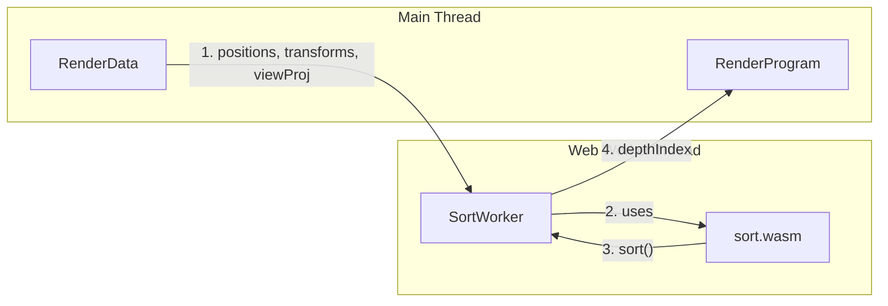
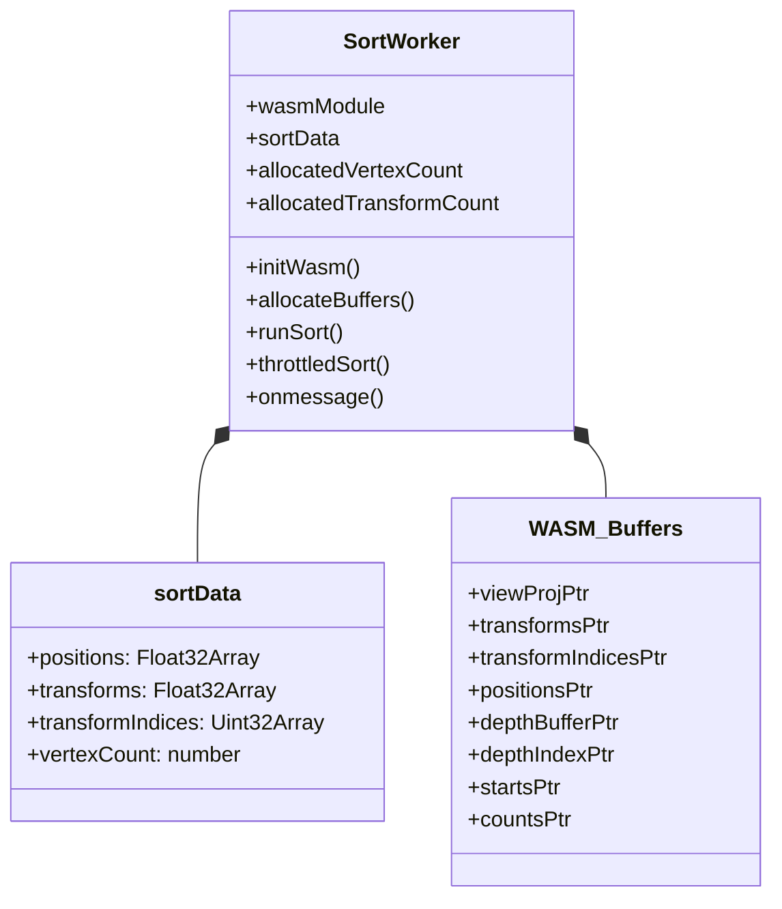
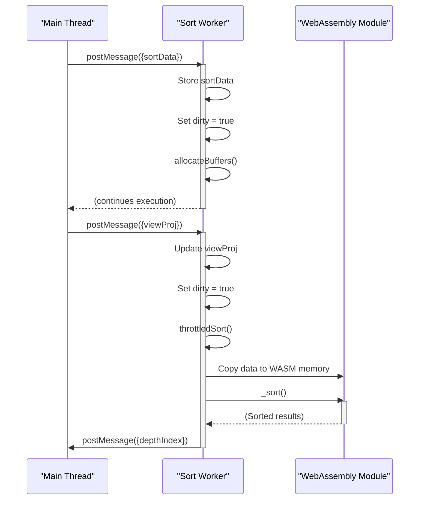
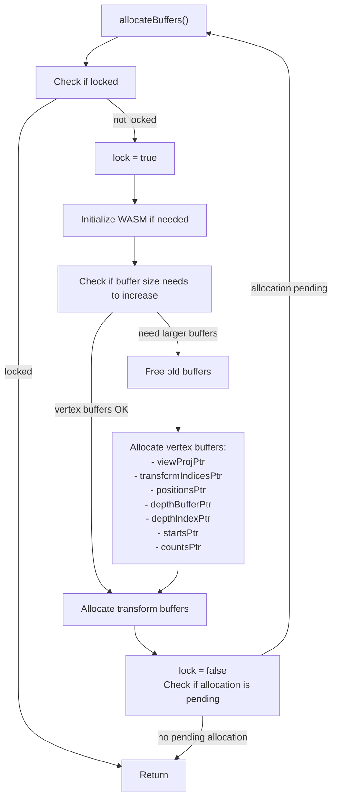

<!-- source: DeepWiki mcp.deepwiki.com · repo huggingface/gsplat.js · page 4.4 Sort Worker · fetched 2026-10-26 -->

# Sort Worker

<details>
<summary>Relevant source files</summary>

The following files were used as context for generating this wiki page:

- [src/renderers/webgl/utils/SortWorker.ts](src/renderers/webgl/utils/SortWorker.ts)

</details>


## Purpose and Scope

The Sort Worker is a critical component of the gsplat.js rendering pipeline that handles depth sorting of Gaussian splats in a separate thread using WebAssembly. This document explains how the Sort Worker functions, its architecture, and how it integrates with the rest of the rendering system. For information about the overall rendering pipeline, see [Rendering System](#4), and for details about WebAssembly integration, see [WASM Integration](#4.3).

Sources: [src/renderers/webgl/utils/SortWorker.ts:1-156]()

## Overview

The Sort Worker implements an efficient, multi-threaded approach to depth-sorting 3D Gaussian splats, which is essential for correct rendering with proper transparency and occlusion. By offloading this computationally intensive task to a Web Worker, the main thread remains responsive while complex scenes are being processed.



Diagram: Sort Worker in the Rendering Pipeline

Sources: [src/renderers/webgl/utils/SortWorker.ts:1-156]()

## Architecture and Components

The Sort Worker consists of several key components that work together to efficiently sort Gaussian splats by depth:



Diagram: Sort Worker Internal Components

Sources: [src/renderers/webgl/utils/SortWorker.ts:3-33]()

### Data Structure

The Sort Worker maintains several data structures:

1. **sortData**: Holds the input data for sorting
   - `positions`: Float32Array of splat 3D positions
   - `transforms`: Float32Array of transformation matrices
   - `transformIndices`: Uint32Array mapping splats to transforms
   - `vertexCount`: Number of vertices (splats) to sort

2. **WASM memory pointers**:
   - Various pointers to memory allocated within the WebAssembly module
   - Used for efficient data transfer between JavaScript and WASM

3. **State variables**:
   - `allocatedVertexCount` and `allocatedTransformCount`: Track current buffer sizes
   - `dirty`, `lock`, `allocationPending`, `sorting`: Control flags for the sorting process

Sources: [src/renderers/webgl/utils/SortWorker.ts:10-33]()

## Communication Flow

The Sort Worker communicates with the main thread using the standard Web Worker messaging API:



Diagram: Sort Worker Communication Flow

Sources: [src/renderers/webgl/utils/SortWorker.ts:127-155]()

## Key Functions

### Message Handler

The worker receives two types of messages from the main thread:

1. **sortData**: Contains the vertex data to be sorted
   - Creates or updates the internal data structures
   - Marks the sorting state as dirty
   - Allocates WebAssembly memory buffers if needed

2. **viewProj**: Contains the view-projection matrix
   - Updates the view projection matrix if it has changed
   - Triggers the throttled sorting process

Sources: [src/renderers/webgl/utils/SortWorker.ts:127-155]()

### WebAssembly Initialization

The Sort Worker loads the WebAssembly module asynchronously during initialization:

```javascript
async function initWasm() {
    wasmModule = await loadWasm();
}
```

Sources: [src/renderers/webgl/utils/SortWorker.ts:6-8]()

### Memory Management

One of the most critical aspects of the Sort Worker is efficient memory management:



Diagram: Buffer Allocation Process

The `allocateBuffers` function:
- Prevents concurrent memory operations using a lock mechanism
- Calculates required buffer sizes based on vertex count
- Frees previously allocated memory when needed
- Allocates appropriately sized buffers in the WebAssembly memory space
- Handles pending allocations that may occur during processing

Sources: [src/renderers/webgl/utils/SortWorker.ts:35-83]()

### Sorting Process

The actual sorting happens in the `runSort` function, which:

1. Checks if the worker is ready to sort
2. Copies data from JavaScript to WebAssembly memory
3. Calls the WebAssembly sorting function
4. Retrieves the sorted indices from WebAssembly memory
5. Posts the sorted indices back to the main thread

```javascript
// Core sorting function call
wasmModule._sort(
    viewProjPtr,
    transformsPtr,
    transformIndicesPtr,
    sortData.vertexCount,
    positionsPtr,
    depthBufferPtr,
    depthIndexPtr,
    startsPtr,
    countsPtr,
);
```

Sources: [src/renderers/webgl/utils/SortWorker.ts:85-113]()

### Throttling Mechanism

The Sort Worker implements a throttling mechanism to prevent excessive sorting operations:

```javascript
const throttledSort = () => {
    if (!sorting) {
        sorting = true;
        if (dirty) runSort();

        setTimeout(() => {
            sorting = false;
            throttledSort();
        });
    }
};
```

This ensures that:
- Sorting only occurs when necessary (`dirty` flag is true)
- Multiple sorting requests are properly handled
- The worker doesn't waste resources on too frequent updates

Sources: [src/renderers/webgl/utils/SortWorker.ts:115-125]()

## Integration with Rendering Pipeline

The Sort Worker integrates with the rendering pipeline as follows:

1. The main thread prepares data in the `RenderData` class
2. The data is sent to the Sort Worker
3. The Sort Worker performs depth sorting using WebAssembly
4. The resulting depth index is sent back to the main thread
5. The `RenderProgram` uses the depth index to render splats in the correct order

This integration enables efficient, properly depth-sorted rendering of Gaussian splats while maintaining good performance and responsiveness.

Sources: [src/renderers/webgl/utils/SortWorker.ts:127-155]()

## Performance Considerations

The Sort Worker employs several strategies to maximize performance:

| Strategy | Implementation | Benefit |
|----------|----------------|---------|
| Multi-threading | Uses a Web Worker | Keeps main thread responsive |
| WebAssembly | Implements sorting in WASM | Achieves near-native speed |
| Memory reuse | Reuses allocated buffers | Reduces garbage collection |
| Power-of-2 sizing | `Math.pow(2, Math.ceil(Math.log2(sortData.vertexCount)))` | Optimizes memory usage |
| Throttling | Limits sort frequency | Prevents unnecessary work |
| Conditional execution | Only sorts when data changes | Avoids redundant calculations |

Sources: [src/renderers/webgl/utils/SortWorker.ts:35-125]()

## Summary

The Sort Worker is a sophisticated component that leverages multi-threading and WebAssembly to efficiently handle the depth sorting requirements of the gsplat.js rendering pipeline. By moving this computationally intensive task off the main thread and implementing it in WebAssembly, the library achieves high performance while maintaining proper rendering order of Gaussian splats.

---

