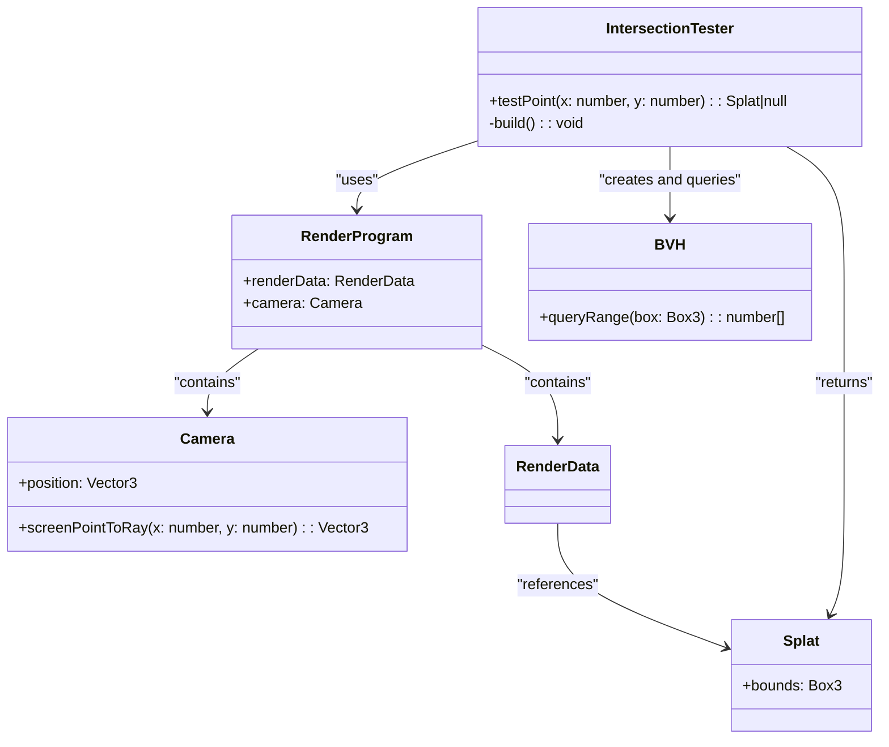
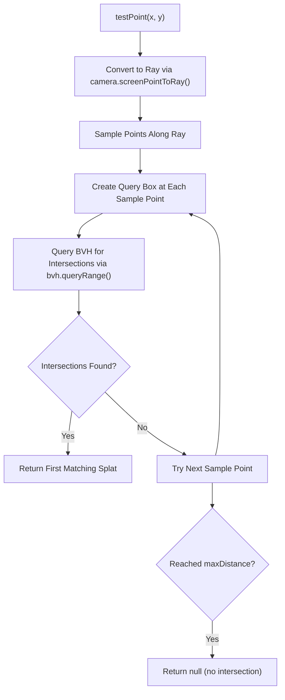
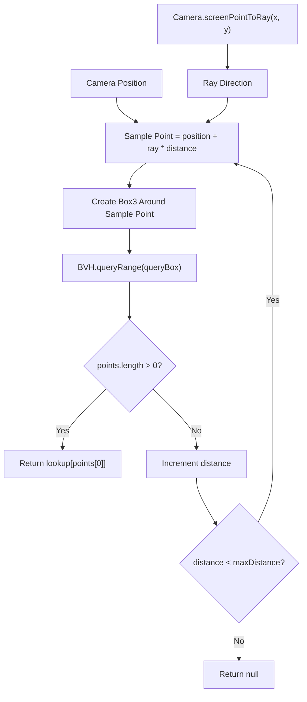
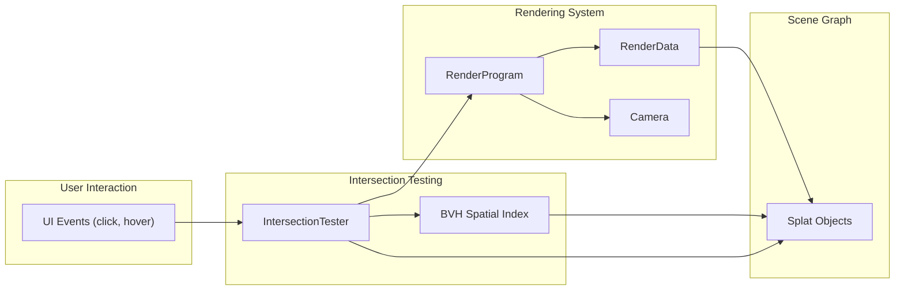

<!-- source: DeepWiki mcp.deepwiki.com · repo huggingface/gsplat.js · page 4.5 Intersection Testing · fetched 2026-10-26 -->

# Intersection Testing

<details>
<summary>Relevant source files</summary>

The following files were used as context for generating this wiki page:

- [src/renderers/webgl/utils/IntersectionTester.ts](src/renderers/webgl/utils/IntersectionTester.ts)

</details>


## Purpose and Scope

The Intersection Testing system in gsplat.js enables applications to detect which 3D Gaussian splat objects intersect with a ray cast from a 2D screen point. This functionality is essential for implementing interactive features such as object selection, clickable elements, and editing operations within a 3D Gaussian Splat scene.

For more information about the broader rendering pipeline, see [Rendering System](#4).

## IntersectionTester Class Overview

The `IntersectionTester` class provides a mechanism to determine which splat is intersected by a ray cast from a screen coordinate. It uses a Bounding Volume Hierarchy (BVH) for efficient spatial querying.



Sources: [src/renderers/webgl/utils/IntersectionTester.ts:9-85]()

## Constructor and Configuration

The `IntersectionTester` constructor accepts the following parameters:

| Parameter | Type | Default | Description |
|-----------|------|---------|-------------|
| renderProgram | RenderProgram | required | The RenderProgram instance containing the splats and camera |
| maxDistance | number | 100 | Maximum distance along the ray to check for intersections |
| resolution | number | 1.0 | The granularity of the ray sampling |

Sources: [src/renderers/webgl/utils/IntersectionTester.ts:12-84]()

## Intersection Testing Process

The intersection testing process combines ray casting with spatial querying to efficiently detect intersections with 3D Gaussian splats:



Sources: [src/renderers/webgl/utils/IntersectionTester.ts:42-83]()

## Ray Casting Implementation

When `testPoint(x, y)` is called, the system performs the following steps:

1. Obtains a ray from the camera via `camera.screenPointToRay(x, y)`
2. Iterates along the ray in steps defined by the `resolution` parameter
3. At each sample point, creates a small bounding box
4. Queries the BVH to find splats that intersect with this box
5. Returns the first intersecting splat or null if none is found within `maxDistance`



Sources: [src/renderers/webgl/utils/IntersectionTester.ts:62-80]()

## BVH Building Process

The Bounding Volume Hierarchy (BVH) is built dynamically when `testPoint` is called:

1. A bounding box is created for each Splat object in the render data
2. An overall bounds is computed that encompasses all splat bounding boxes
3. The BVH is constructed from these boxes to enable efficient spatial queries
4. A lookup array is maintained to map BVH indices back to Splat objects

This approach ensures the BVH always reflects the current state of the scene.

Sources: [src/renderers/webgl/utils/IntersectionTester.ts:17-40]()

## Usage Example

The following code demonstrates how to use the `IntersectionTester` to detect object selection on click:

```javascript
// Create an intersection tester with the render program
const intersectionTester = new IntersectionTester(renderProgram);

// Test intersection at a screen point when canvas is clicked
canvas.addEventListener('click', (event) => {
    // Convert DOM coordinates to normalized device coordinates (-1 to 1)
    const x = (event.clientX / canvas.width) * 2 - 1;
    const y = -(event.clientY / canvas.height) * 2 + 1;
    
    // Perform the intersection test
    const selectedSplat = intersectionTester.testPoint(x, y);
    
    if (selectedSplat) {
        // Handle the selected splat (e.g., highlight it, show details, etc.)
        console.log('Selected splat:', selectedSplat);
    }
});
```

## Performance Considerations

The performance of the intersection testing system is influenced by several factors:

| Factor | Impact |
|--------|--------|
| Resolution parameter | Larger values make testing faster but less precise |
| Maximum distance | Limiting this prevents unnecessary testing of distant objects |
| Scene complexity | More splats increase BVH build time |
| BVH rebuild | The BVH is rebuilt for each `testPoint` call |

For scenes with many splats where frequent intersection testing is needed, consider:
- Using a larger resolution value for faster but less precise testing
- Setting an appropriate maximum distance based on your scene scale
- Being aware that the BVH is rebuilt on each call, which may impact performance in large scenes

Sources: [src/renderers/webgl/utils/IntersectionTester.ts:48-60]()

## Integration with Rendering Pipeline

The intersection testing system integrates with the broader gsplat.js rendering pipeline:



The `IntersectionTester` leverages the existing rendering components:
- It uses the `Camera` from the `RenderProgram` to cast rays
- It accesses splat data from the `RenderData` associated with the `RenderProgram`
- It creates a BVH based on the bounds of all splats in the scene

Sources: [src/renderers/webgl/utils/IntersectionTester.ts:9-85]()

## Limitations and Edge Cases

The intersection testing system has a few limitations to be aware of:

1. It returns the first intersecting splat, not necessarily the closest one to the camera
2. The BVH is rebuilt on each call to `testPoint()`, which could be inefficient for frequent testing
3. It may produce warnings if the scene has changed since the last render
4. If the `renderProgram` is not properly initialized with render data and camera, the system will log errors and return null

Sources: [src/renderers/webgl/utils/IntersectionTester.ts:43-59]()

---

