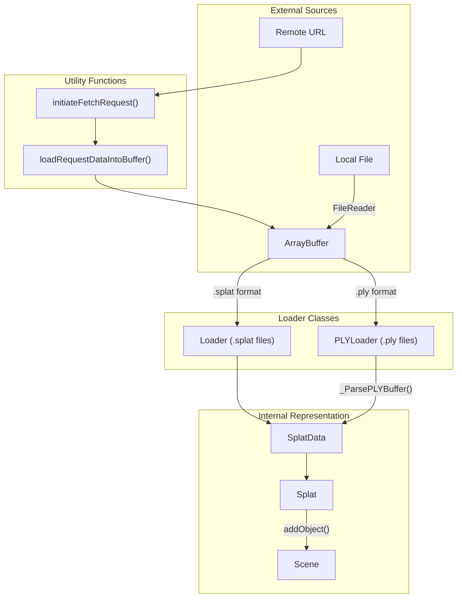
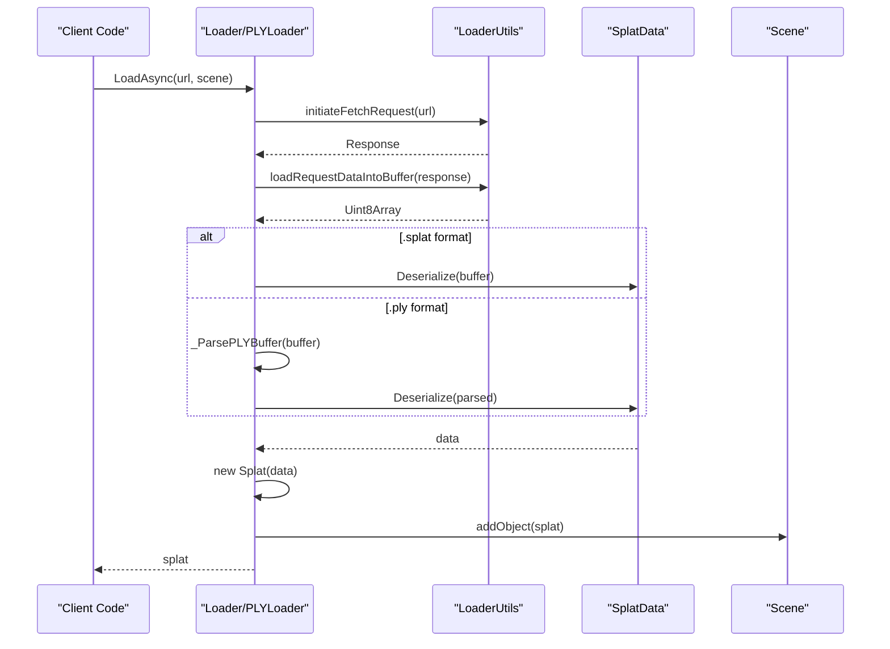
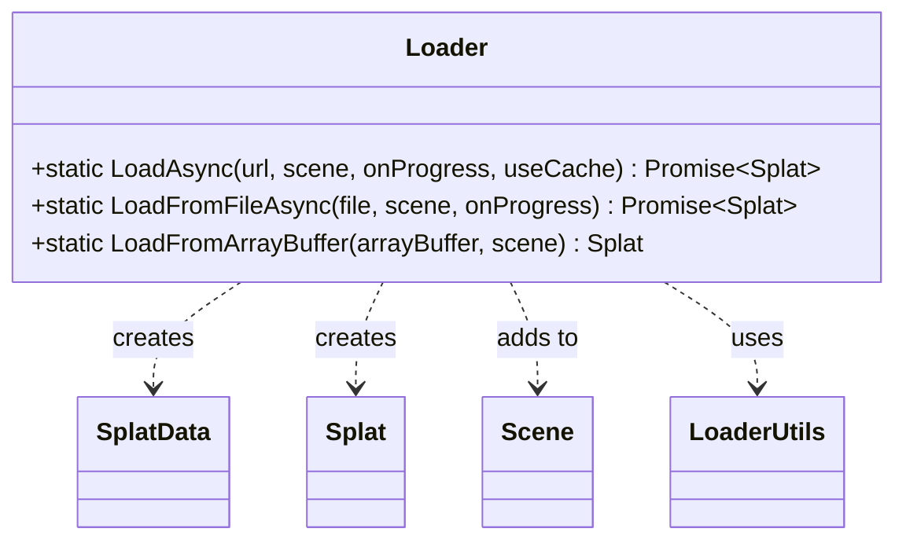
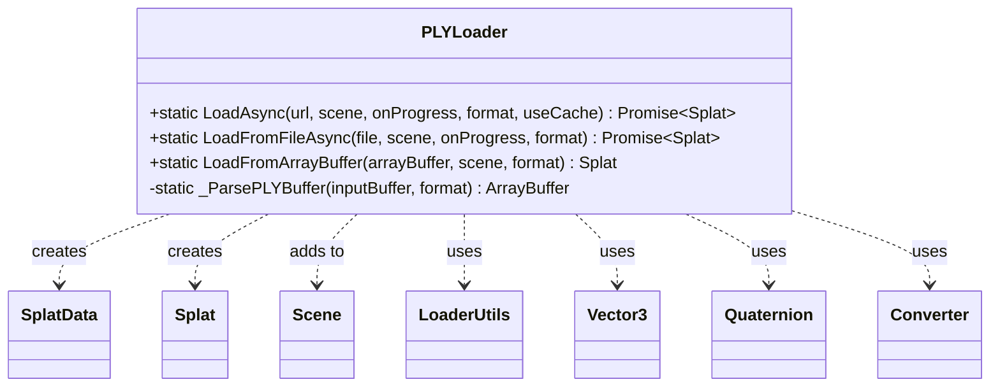
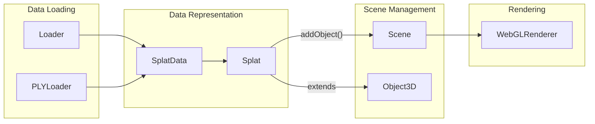

<!-- source: DeepWiki mcp.deepwiki.com · repo huggingface/gsplat.js · page 5 Data Loading · fetched 2026-10-26 -->

# Data Loading

<details>
<summary>Relevant source files</summary>

The following files were used as context for generating this wiki page:

- [src/loaders/Loader.ts](src/loaders/Loader.ts)
- [src/loaders/PLYLoader.ts](src/loaders/PLYLoader.ts)
- [src/utils/LoaderUtils.ts](src/utils/LoaderUtils.ts)

</details>


The Data Loading system in gsplat.js provides robust mechanisms for loading 3D Gaussian Splatting data from various sources and formats into the rendering engine. This page describes the core loading components, supported file formats, and the data loading pipeline.

For information about specific file formats and their conversion, see [File Formats](#5.2).

## Overview

The Data Loading system is responsible for:
1. Loading 3D Gaussian Splatting data from URLs or local files
2. Parsing different file formats (.splat, .ply)
3. Converting external formats into the internal SplatData representation
4. Integrating loaded data into the Scene graph



Sources: [src/loaders/Loader.ts](), [src/loaders/PLYLoader.ts](), [src/utils/LoaderUtils.ts]()

## Loading Interfaces

The Data Loading system provides several interfaces for loading Gaussian Splat data:

| Method | Description | Input | Output |
|--------|-------------|-------|--------|
| `LoadAsync` | Loads data from a URL | URL string | Promise\<Splat\> |
| `LoadFromFileAsync` | Loads data from a local File object | File object | Promise\<Splat\> |
| `LoadFromArrayBuffer` | Loads data directly from an ArrayBuffer | ArrayBuffer | Splat |

Each interface follows a similar pattern but is adapted for different data sources. All methods eventually add the loaded Splat object to the provided Scene.

Sources: [src/loaders/Loader.ts:7-43](), [src/loaders/PLYLoader.ts:10-57]()

## Loading Process



Sources: [src/loaders/Loader.ts:7-43](), [src/loaders/PLYLoader.ts:10-57](), [src/utils/LoaderUtils.ts:1-74]()

### Loading from URLs

The `LoadAsync` method allows loading Gaussian Splat data from remote URLs:

1. The loader initiates a fetch request to the specified URL
2. Data is streamed and loaded into a buffer with optional progress tracking
3. The buffer is parsed according to the file format
4. A Splat object is created and added to the provided Scene

```javascript
// Example usage
const splat = await Loader.LoadAsync('path/to/model.splat', scene, 
  (progress) => console.log(`Loading: ${progress * 100}%`)
);
```

Sources: [src/loaders/Loader.ts:7-17](), [src/loaders/PLYLoader.ts:10-26]()

### Loading from Files

The `LoadFromFileAsync` method handles loading from local File objects (e.g., from file inputs):

1. A FileReader is created to read the file as an ArrayBuffer
2. When loading completes, the buffer is converted to a Splat object
3. Progress can be tracked via the optional callback
4. The Splat object is added to the Scene

Both loader classes implement this method with similar patterns, differing only in how they parse the buffer data.

Sources: [src/loaders/Loader.ts:19-35](), [src/loaders/PLYLoader.ts:28-49]()

### Direct Buffer Loading

The `LoadFromArrayBuffer` method provides a synchronous way to load data from an already available ArrayBuffer:

1. The buffer is parsed according to the file format
2. A SplatData object is created from the parsed data
3. A Splat object is created from the SplatData
4. The Splat is added to the Scene and returned

This method is used internally by the asynchronous methods and can be used directly when the data is already available in memory.

Sources: [src/loaders/Loader.ts:37-43](), [src/loaders/PLYLoader.ts:51-57]()

## Loader Classes

### Loader

The `Loader` class handles the standard `.splat` file format, which is the native format for gsplat.js. It provides a simple loading process where the buffer data is directly deserialized into a SplatData object.



Sources: [src/loaders/Loader.ts:6-46]()

### PLYLoader

The `PLYLoader` class handles loading and parsing of `.ply` files, which require more complex parsing logic. The PLY format is a common 3D model format that can store various properties of 3D points.



The PLYLoader includes specialized parsing logic in the `_ParsePLYBuffer` method, which extracts properties like position, scale, color, and rotation from the PLY file format and converts them to the internal SplatData format.

Sources: [src/loaders/PLYLoader.ts:9-223]()

## PLY Parsing

The PLY format parsing is handled by the `_ParsePLYBuffer` method in the PLYLoader class. This process includes:

1. Parsing the PLY header to identify properties and their types
2. Determining the vertex count
3. Reading binary data according to the property types (float, int, etc.)
4. Mapping properties to the internal SplatData structure
5. Converting values as needed (e.g., exponentiating scale values, normalizing quaternions)
6. Supporting format-specific conversions (e.g., "polycam" format)

The PLYLoader supports various property naming conventions found in different PLY files, such as:
- Position: `x`, `y`, `z`
- Scale: `scale_0/1/2` or `scaling_0/1/2`
- Color: `red`, `green`, `blue` or `f_dc_0/1/2`
- Rotation: `rot_0/1/2/3` or `rotation_0/1/2/3`
- Opacity: `opacity` or `opacity_0`

Sources: [src/loaders/PLYLoader.ts:59-220]()

## Utility Functions

The loading process relies on several utility functions defined in `LoaderUtils.ts`:

### Request Initialization

`initiateFetchRequest` creates and initiates a fetch request with appropriate options for cross-origin requests and caching:

```javascript
async function initiateFetchRequest(url: string, useCache: boolean): Promise<Response>
```

### Buffer Loading

`loadRequestDataIntoBuffer` handles loading response data into a buffer, with support for both:

1. `loadDataIntoBuffer`: Used when content length is known (via headers)
2. `loadChunkedDataIntoBuffer`: Used when content length is unknown (chunked transfer)

Both methods support progress tracking via the optional callback parameter.

Sources: [src/utils/LoaderUtils.ts:1-74]()

## Integration with Scene Management

After loading, Splat objects are automatically added to the Scene through the `addObject` method, making them part of the scene graph and available for rendering.



Sources: [src/loaders/Loader.ts:41-42](), [src/loaders/PLYLoader.ts:55]()

## Summary

The Data Loading system in gsplat.js provides a flexible and efficient way to load Gaussian Splatting data from various sources and formats. By supporting both remote URLs and local files, as well as multiple file formats, the system enables easy integration of 3D data into gsplat.js applications.

The loading process is designed to be both user-friendly (with progress tracking and Promise-based async methods) and efficient (with streaming data loading and optimized buffer parsing). The loaders automatically handle the conversion from external formats to the internal representation and integrate the loaded data into the scene graph for rendering.

---

