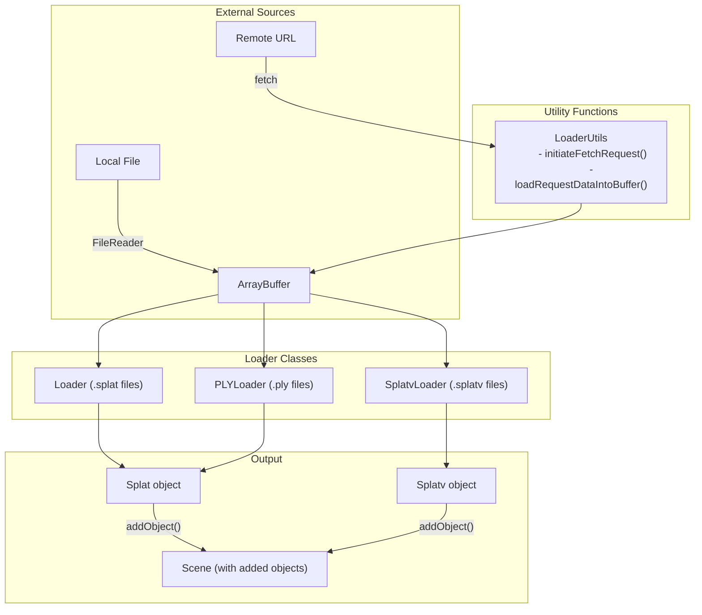
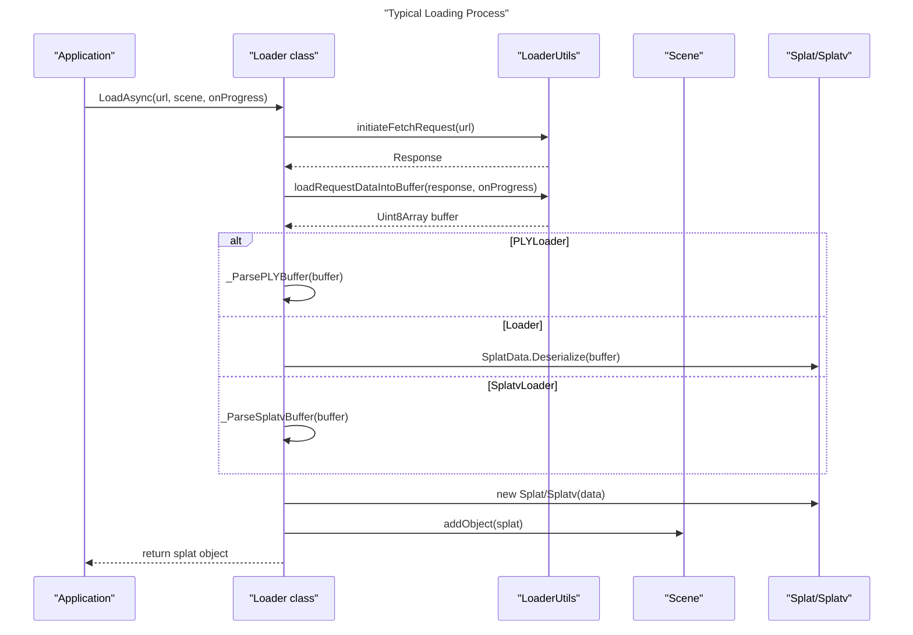
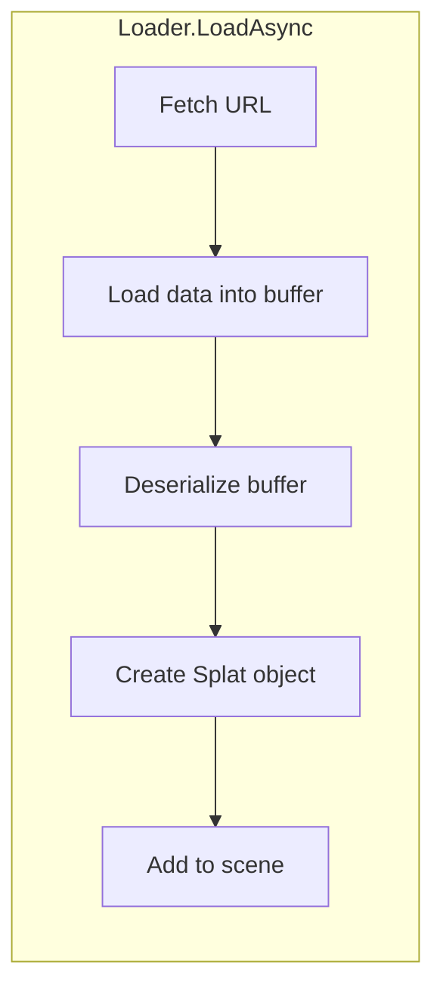
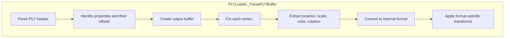
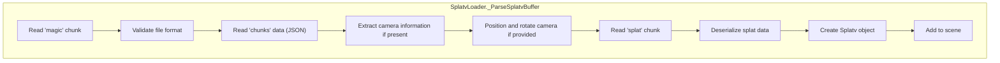
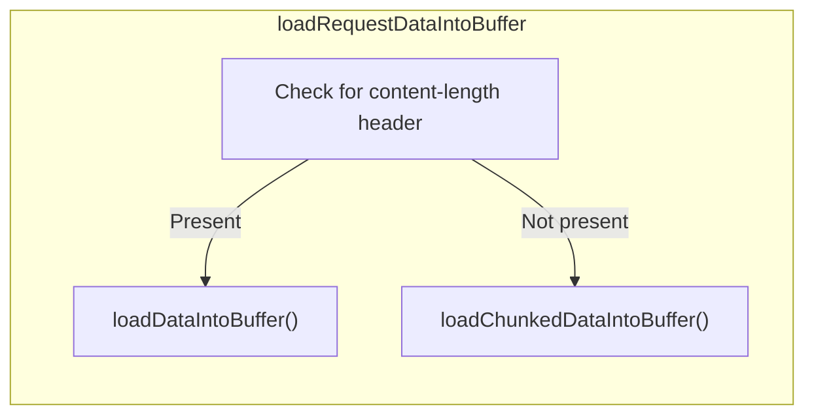
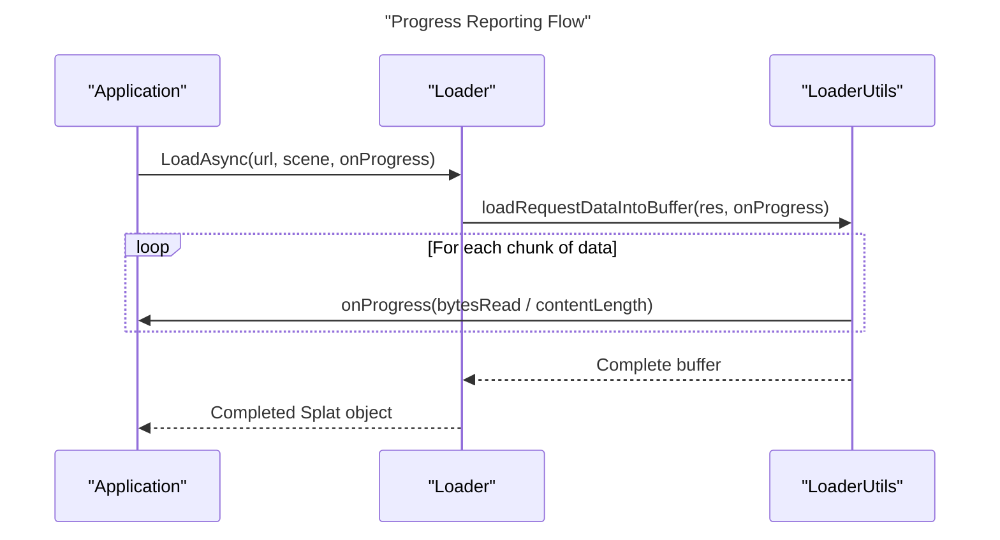

<!-- source: DeepWiki mcp.deepwiki.com · repo huggingface/gsplat.js · page 5.1 File Loaders · fetched 2026-10-26 -->

# File Loaders

<details>
<summary>Relevant source files</summary>

The following files were used as context for generating this wiki page:

- [examples/4d/tsconfig.json](examples/4d/tsconfig.json)
- [src/loaders/Loader.ts](src/loaders/Loader.ts)
- [src/loaders/PLYLoader.ts](src/loaders/PLYLoader.ts)
- [src/loaders/SplatvLoader.ts](src/loaders/SplatvLoader.ts)
- [src/utils/LoaderUtils.ts](src/utils/LoaderUtils.ts)

</details>


## Purpose and Scope

This document describes the file loading system in gsplat.js, which enables loading 3D Gaussian Splatting models from various file formats. The file loaders are responsible for reading data from different sources (URLs, files, or array buffers), parsing the data into the appropriate internal format, and creating splat objects that can be added to a scene.

For information about the file formats supported by gsplat.js, see [File Formats](#5.2).

## Overview

The gsplat.js library provides multiple loaders to support different file formats commonly used for Gaussian Splatting. Each loader follows a similar API pattern but handles the specific parsing requirements of its target format.



Sources: [src/loaders/Loader.ts:1-47](), [src/loaders/PLYLoader.ts:1-223](), [src/loaders/SplatvLoader.ts:1-136](), [src/utils/LoaderUtils.ts:1-75]()

## Common Loading Methods

All loader classes share a similar API with three primary methods:

1. `LoadAsync` - Loads data from a URL
2. `LoadFromFileAsync` - Loads data from a File object
3. `LoadFromArrayBuffer` (or equivalent) - Processes data from an ArrayBuffer



Sources: [src/loaders/Loader.ts:7-17](), [src/loaders/Loader.ts:19-35](), [src/loaders/PLYLoader.ts:10-26](), [src/loaders/PLYLoader.ts:28-49](), [src/loaders/SplatvLoader.ts:11-22](), [src/loaders/SplatvLoader.ts:24-48]()

## Loader Class (for .splat files)

The `Loader` class provides functionality for loading standard `.splat` files, which contain serialized Gaussian Splat data.

### Methods

| Method | Description |
|--------|-------------|
| `LoadAsync(url, scene, onProgress, useCache)` | Loads a splat file from a URL, with optional progress reporting and caching |
| `LoadFromFileAsync(file, scene, onProgress)` | Loads a splat file from a File object with optional progress reporting |
| `LoadFromArrayBuffer(arrayBuffer, scene)` | Creates a Splat object from an ArrayBuffer and adds it to the scene |

Example process flow:



Sources: [src/loaders/Loader.ts:7-43]()

## PLYLoader Class (for .ply files)

The `PLYLoader` class handles loading and parsing of `.ply` files, which are a common 3D model format that can store Gaussian Splatting data.

### Methods

| Method | Description |
|--------|-------------|
| `LoadAsync(url, scene, onProgress, format, useCache)` | Loads a PLY file from a URL, with optional format specification |
| `LoadFromFileAsync(file, scene, onProgress, format)` | Loads a PLY file from a File object |
| `LoadFromArrayBuffer(arrayBuffer, scene, format)` | Processes a PLY file from an ArrayBuffer |
| `_ParsePLYBuffer(inputBuffer, format)` (private) | Parses a PLY file buffer and extracts relevant properties |

The PLY parsing process is more complex because it involves:
1. Reading the PLY header to identify properties
2. Extracting vertex data based on property definitions
3. Converting properties to the internal format used by `SplatData`
4. Applying format-specific transformations (e.g., for Polycam PLY files)



Sources: [src/loaders/PLYLoader.ts:59-220]()

### Property Handling

The PLYLoader supports multiple property naming conventions commonly found in PLY files:

| Property Category | Supported Names |
|-------------------|-----------------|
| Position | `x`, `y`, `z` |
| Scale | `scale_0`/`scaling_0`, `scale_1`/`scaling_1`, `scale_2`/`scaling_2` |
| Color | `red`/`green`/`blue` or `f_dc_0`/`f_dc_1`/`f_dc_2`/`f_dc_3` or `features_0`/`features_1`/`features_2` |
| Opacity | `opacity` or `opacity_0` |
| Rotation | `rot_0`/`rot_1`/`rot_2`/`rot_3` or `rotation_0`/`rotation_1`/`rotation_2`/`rotation_3` |

Sources: [src/loaders/PLYLoader.ts:114-193]()

## SplatvLoader Class (for .splatv files)

The `SplatvLoader` class loads `.splatv` files, which appear to be a specialized format that can include both splat data and camera information.

### Methods

| Method | Description |
|--------|-------------|
| `LoadAsync(url, scene, camera, onProgress, useCache)` | Loads a splatv file from a URL, optionally configuring a camera |
| `LoadFromFileAsync(file, scene, camera, onProgress)` | Loads a splatv file from a File object |
| `_ParseSplatvBuffer(inputBuffer, scene, camera)` (private) | Parses a splatv file buffer with its chunk-based format |

The splatv format uses a chunk-based structure:
1. A "magic" chunk identifies the file format
2. A "chunks" chunk contains metadata including camera information
3. A "splat" chunk contains the actual splat data

If a camera is provided to the loader, it will be positioned and rotated according to the camera information in the file.



Sources: [src/loaders/SplatvLoader.ts:50-132]()

## Loader Utilities

The `LoaderUtils.ts` file provides common utility functions used by all loaders:

| Function | Description |
|----------|-------------|
| `initiateFetchRequest(url, useCache)` | Creates a fetch request with appropriate options |
| `loadDataIntoBuffer(res, onProgress)` | Loads data with known content length into a buffer, reporting progress |
| `loadChunkedDataIntoBuffer(res, onProgress)` | Loads chunked data into a buffer, reporting progress |
| `loadRequestDataIntoBuffer(res, onProgress)` | Selects the appropriate loading method based on headers |



Sources: [src/utils/LoaderUtils.ts:1-74]()

## Progress Reporting

All loaders support progress reporting during loading via an optional `onProgress` callback function. This callback receives a number between 0 and 1 indicating the loading progress.



Sources: [src/utils/LoaderUtils.ts:15-33](), [src/utils/LoaderUtils.ts:36-63]()

## Using Loaders

The loaders are designed to be easy to use. Here's the typical pattern for loading a file:

1. Create a scene
2. Call the appropriate loader's LoadAsync method
3. Wait for the Promise to resolve with the created splat object

For example, to load a PLY file:

```javascript
// Create a scene
const scene = new gsplat.Scene();

// Load a PLY file
const splat = await gsplat.PLYLoader.LoadAsync('model.ply', scene, 
    (progress) => console.log(`Loading: ${Math.round(progress * 100)}%`));
```

The loader automatically adds the loaded splat to the scene, but also returns the splat object for additional manipulation if needed.

Sources: [src/loaders/PLYLoader.ts:10-26](), [src/loaders/Loader.ts:7-17]()

---

