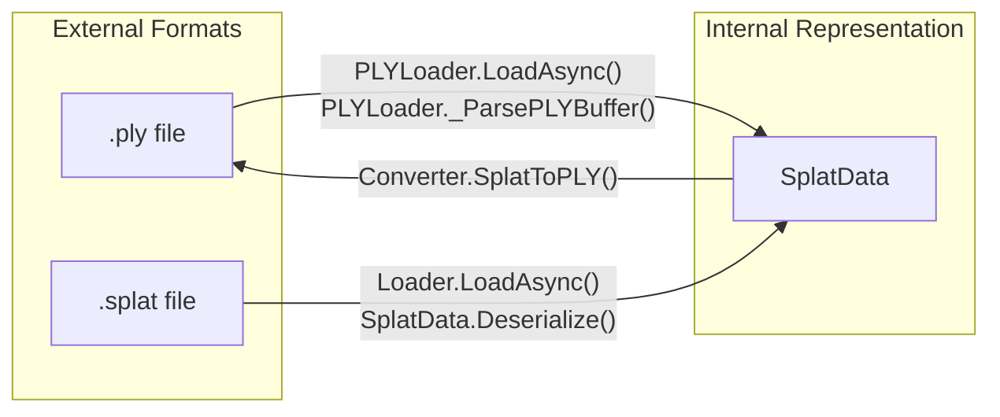
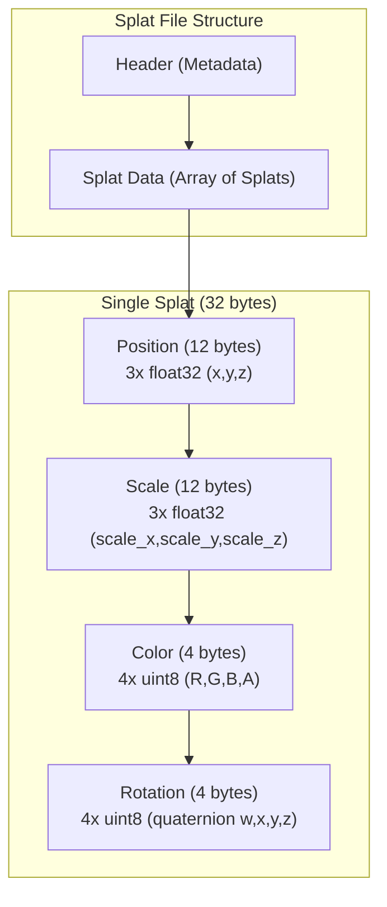
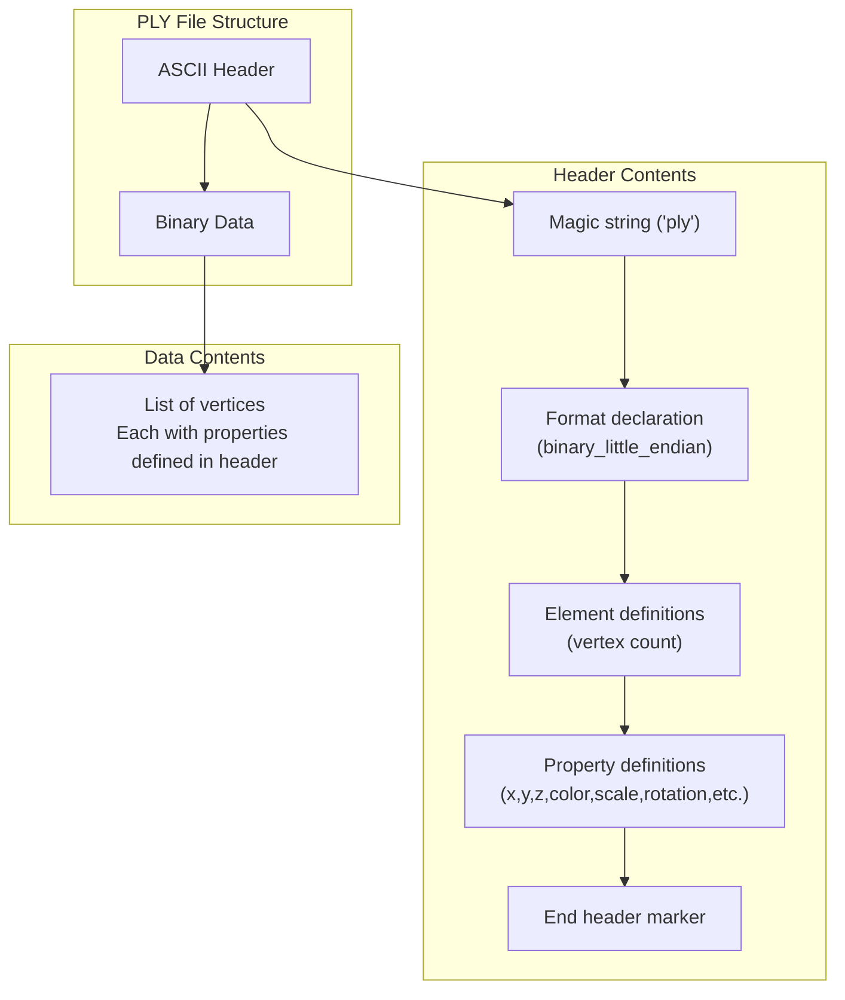
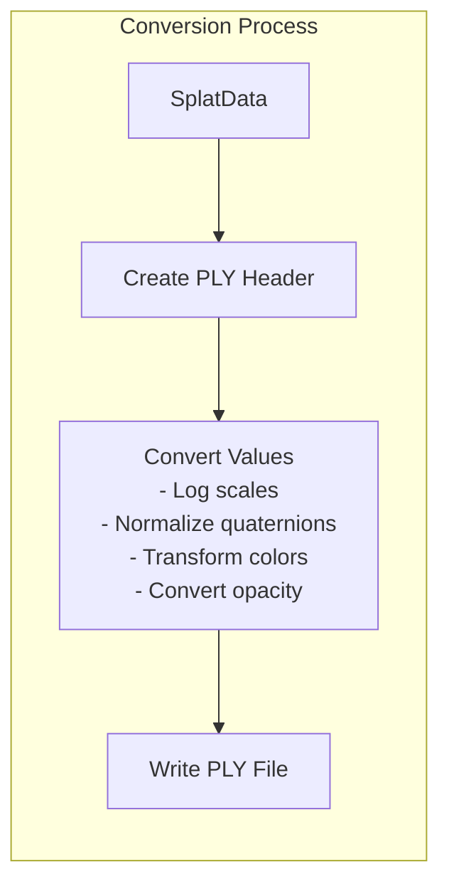

<!-- source: DeepWiki mcp.deepwiki.com · repo huggingface/gsplat.js · page 5.2 File Formats · fetched 2026-10-26 -->

# File Formats

<details>
<summary>Relevant source files</summary>

The following files were used as context for generating this wiki page:

- [examples/file-loader/src/main.ts](examples/file-loader/src/main.ts)
- [examples/ply-converter/src/main.ts](examples/ply-converter/src/main.ts)
- [src/loaders/Loader.ts](src/loaders/Loader.ts)
- [src/loaders/PLYLoader.ts](src/loaders/PLYLoader.ts)
- [src/utils/Converter.ts](src/utils/Converter.ts)
- [src/utils/LoaderUtils.ts](src/utils/LoaderUtils.ts)

</details>


This document describes the file formats supported by gsplat.js and the mechanisms for loading and converting between formats. The library primarily works with two formats: `.splat` (the native format) and `.ply` (a common 3D point cloud format). For information about the loaders themselves, see [File Loaders](#5.1).

## Supported File Formats

gsplat.js supports two primary file formats for representing Gaussian splatting data:

1. **`.splat`** - The native binary format optimized for direct use with gsplat.js
2. **`.ply`** - The Polygon File Format (Stanford Triangle Format), a common 3D point cloud format



Sources: [src/loaders/PLYLoader.ts:9-221](). [src/loaders/Loader.ts:6-44](). [src/utils/Converter.ts:3-94]().

## The .splat Format

The `.splat` format is the native binary format used by gsplat.js. It provides a compact and efficient representation of Gaussian splats for direct loading and rendering.

### Format Structure

The `.splat` format is a binary format that contains the following data for each Gaussian splat:

- **Position**: 3 float32 values (x, y, z)
- **Scale**: 3 float32 values (x, y, z scales)
- **Color**: 4 uint8 values (RGBA)
- **Rotation**: 4 uint8 values (quaternion components)



### Loading .splat Files

The `Loader` class provides methods to load `.splat` files either from URLs or local files. The loading process is straightforward since the format is already optimized for the internal representation:

1. Load the binary data into a buffer
2. Deserialize the buffer using `SplatData.Deserialize()`
3. Create a new `Splat` object with the deserialized data
4. Add the Splat to the scene

Sources: [src/loaders/Loader.ts:6-44]().

## The .ply Format

The Polygon File Format (PLY), also known as the Stanford Triangle Format, is a common format for storing 3D point cloud data. gsplat.js supports loading Gaussian splats from PLY files.

### Format Structure

PLY files contain:

1. A header section that defines the structure of the data
2. The data section containing the actual vertex information



### PLY Properties for Gaussian Splats

The PLY format can store various properties for each vertex. In the context of Gaussian splats, these properties include:

| Property Group | Property Names | Data Type | Description |
|---------------|----------------|-----------|-------------|
| Position | x, y, z | float | 3D coordinates |
| Color | red, green, blue or f_dc_0, f_dc_1, f_dc_2 | float | RGB color values |
| Scale | scale_0, scale_1, scale_2 or scaling_0, scaling_1, scaling_2 | float | Logarithmic scale values |
| Rotation | rot_0, rot_1, rot_2, rot_3 or rotation_0, rotation_1, rotation_2, rotation_3 | float | Quaternion components |
| Opacity | opacity or opacity_0 | float | Logit of alpha value |

Sources: [src/loaders/PLYLoader.ts:59-220]().

### Loading .ply Files

The `PLYLoader` class handles loading PLY files. The process involves:

1. Loading the binary data
2. Parsing the PLY header to understand the structure
3. Mapping the PLY properties to the internal SplatData format
4. Converting values as needed (e.g., exponentiating scale values, converting opacity)
5. Creating a new `Splat` object with the parsed data
6. Adding the Splat to the scene

Sources: [src/loaders/PLYLoader.ts:9-221]().

## Format Variants and Transformations

gsplat.js supports different variants of the PLY format through a format parameter:

### Polycam Format

The "polycam" format requires specific transformations to correctly interpret data from Polycam captures:

```javascript
// Coordinate transformation for polycam format
const temp = position[1];
position[1] = -position[2];
position[2] = temp;
q = q_polycam.multiply(q);
```

This transformation adjusts the coordinate system to match the one expected by gsplat.js.

Sources: [src/loaders/PLYLoader.ts:198-205]().

## Converting Between Formats

gsplat.js provides functionality to convert between the supported formats:

### .splat to .ply Conversion

The `Converter.SplatToPLY()` method converts from the internal SplatData representation to the PLY format:

1. Creates a PLY header with the appropriate properties
2. Converts the internal data representation to the PLY format
   - Positions are copied directly
   - Colors are converted from 8-bit to floating-point representation
   - Scale values are converted from exponential to logarithmic form
   - Rotation quaternions are normalized
   - Opacity is converted from alpha to logit form



Sources: [src/utils/Converter.ts:6-93]().

### .ply to .splat Conversion

Conversion from PLY to splat happens as part of the loading process:

1. Load the PLY file using `PLYLoader`
2. The PLY data is converted to the internal SplatData format
3. Save the scene as a .splat file using `scene.saveToFile("output.splat")`

This process is demonstrated in the PLY converter example:

```javascript
// Load and convert ply from url
await SPLAT.PLYLoader.LoadAsync(url, scene, (progress) => {...}, format);
scene.saveToFile("output.splat");
```

Sources: [examples/ply-converter/src/main.ts:16-21](). [examples/ply-converter/src/main.ts:59]().

## Loading Files in Practice

gsplat.js provides several methods for loading files:

### From URLs

```javascript
// Load .splat file from URL
await SPLAT.Loader.LoadAsync(url, scene, onProgress);

// Load .ply file from URL
await SPLAT.PLYLoader.LoadAsync(url, scene, onProgress, format);
```

### From Local Files

```javascript
// Load .splat file from File object
await SPLAT.Loader.LoadFromFileAsync(file, scene, onProgress);

// Load .ply file from File object
await SPLAT.PLYLoader.LoadFromFileAsync(file, scene, onProgress, format);
```

All loading methods provide progress callbacks for tracking the loading status.

Sources: [examples/file-loader/src/main.ts:10-31](). [examples/ply-converter/src/main.ts:40-61]().

## Summary

gsplat.js supports two primary file formats for Gaussian splats:

1. `.splat` - The native binary format optimized for direct use
2. `.ply` - A standard 3D point cloud format with adjustable property mappings

The library provides comprehensive loading and conversion functionality between these formats, with support for variant formats like "polycam". These capabilities enable users to work with Gaussian splat data from a variety of sources and tools.

---

