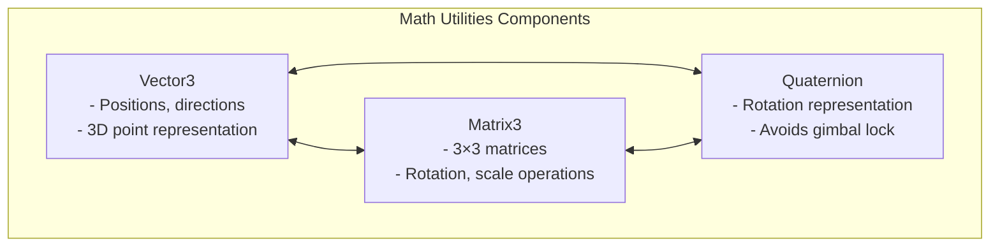
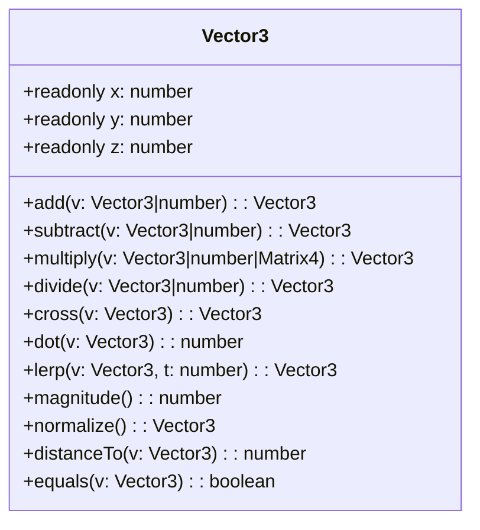
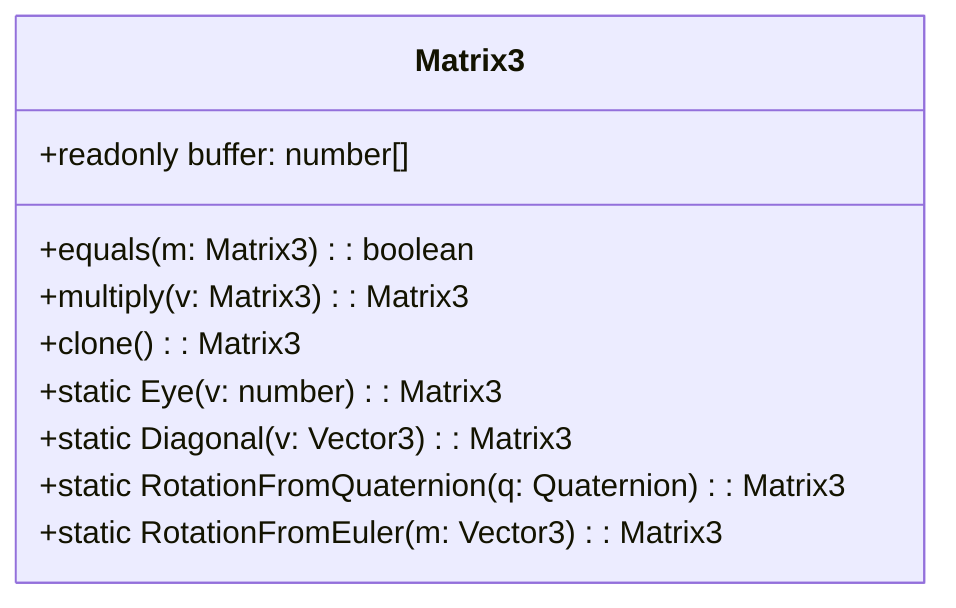
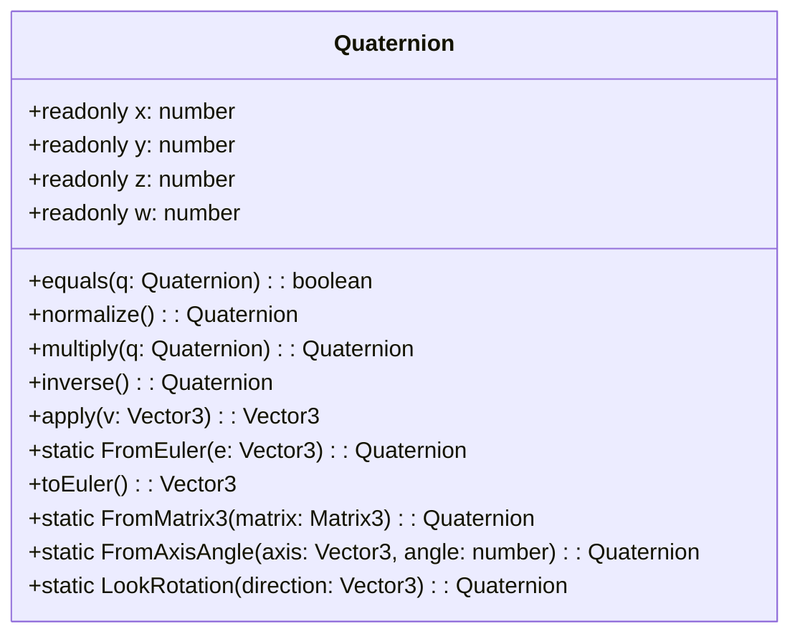
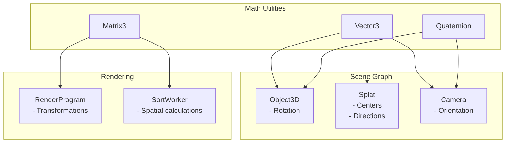
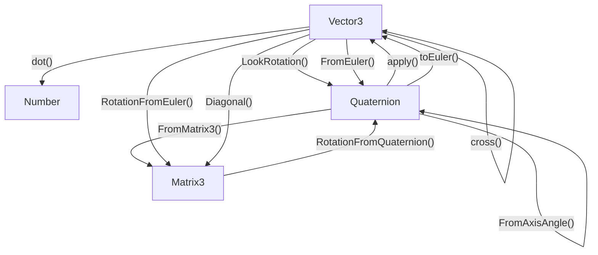

<!-- source: DeepWiki mcp.deepwiki.com · repo huggingface/gsplat.js · page 6 Math Utilities · fetched 2026-10-26 -->

# Math Utilities

Relevant source files

The following files were used as context for generating this wiki page:

- [src/math/Matrix3.ts](src/math/Matrix3.ts)
- [src/math/Quaternion.ts](src/math/Quaternion.ts)
- [src/math/Vector3.ts](src/math/Vector3.ts)

The Math Utilities module provides the mathematical foundation for 3D operations in gsplat.js. These utilities implement vector, matrix, and quaternion operations essential for representing positions, transformations, and rotations of Gaussian splats in 3D space.

For detailed information on specific components, see [Vectors and Matrices](#6.1) and [Quaternions](#6.2).

## Overview

The Math Utilities consist of three primary classes that form the mathematical backbone of the gsplat.js library:

1. **Vector3**: Represents points and directions in 3D space
2. **Matrix3**: Handles 3×3 matrix operations, primarily for rotations and scaling
3. **Quaternion**: Provides efficient and stable representation of rotations

These utilities are designed with immutability in mind - operations create new instances rather than modifying existing ones, promoting predictable behavior and simplifying state management.

Sources: [src/math/Vector3.ts:1-163](), [src/math/Matrix3.ts:1-110](), [src/math/Quaternion.ts:1-177]()

## Vector3 Class

The `Vector3` class represents a point or direction in 3D space with x, y, and z components.

### Key Capabilities

- Basic vector arithmetic (addition, subtraction, multiplication, division)
- Vector products (dot product, cross product)
- Normalization and magnitude calculations
- Vector comparison and component access
- Linear interpolation between vectors

### Implementation Details

The `Vector3` class is implemented with immutable properties:

Sources: [src/math/Vector3.ts:3-161]()

## Matrix3 Class

The `Matrix3` class implements a 3×3 matrix primarily used for rotation and scale transformations.

### Key Capabilities

- Matrix multiplication
- Creation of identity and diagonal matrices
- Generation of rotation matrices from quaternions or Euler angles
- Matrix comparison

### Implementation Details

The `Matrix3` class stores its data in a flat array of 9 elements:

Sources: [src/math/Matrix3.ts:4-110]()

## Quaternion Class

The `Quaternion` class represents rotations in 3D space, providing advantages over Euler angles such as avoiding gimbal lock and enabling smooth interpolation.

### Key Capabilities

- Quaternion normalization and multiplication
- Conversion between different rotation representations (Euler angles, matrices)
- Rotation of vectors through quaternion application
- Creation of quaternions from various inputs (axis-angle, look directions)

### Implementation Details

The `Quaternion` class represents rotations with four components (x, y, z, w):

Sources: [src/math/Quaternion.ts:4-175]()

## Integration with the Rendering Pipeline

The math utilities provide the foundation for various operations in the gsplat.js rendering pipeline:

Sources: [src/math/Vector3.ts:1-163](), [src/math/Matrix3.ts:1-110](), [src/math/Quaternion.ts:1-177]()

## Class Relationships

The three math classes are designed to work together seamlessly, with conversion operations between different representations:

Sources: [src/math/Vector3.ts:75-85](), [src/math/Matrix3.ts:67-104](), [src/math/Quaternion.ts:62-170]()

## Performance Considerations

The math utilities are designed with performance in mind:

1. **Immutability**: While creating new objects for each operation has memory implications, it simplifies usage patterns and avoids unexpected side effects
   
2. **Optimized Methods**: Critical operations like vector normalization and quaternion multiplication are implemented for computational efficiency

3. **Direct Buffer Access**: The `Matrix3` class provides direct access to its internal buffer for performance-critical operations

These mathematical utilities serve as the foundation for all spatial operations in gsplat.js, enabling the accurate representation and rendering of Gaussian splats in 3D space.

---

