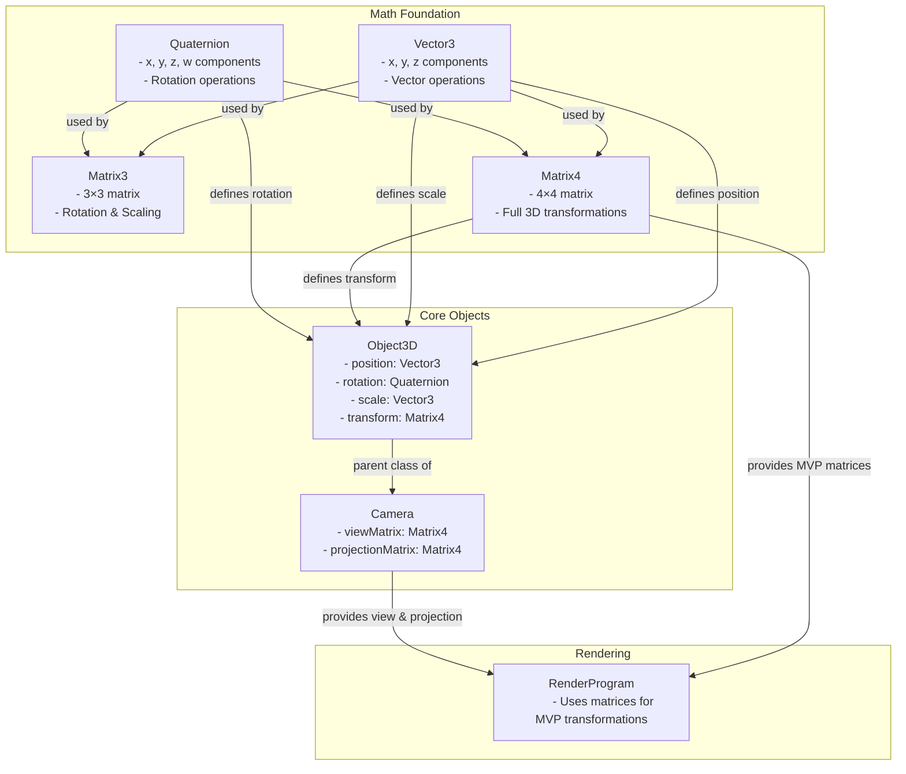
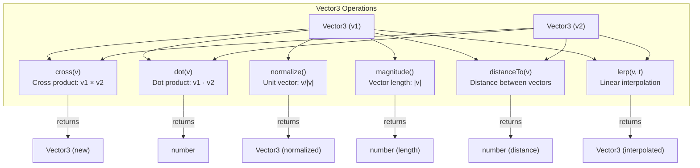
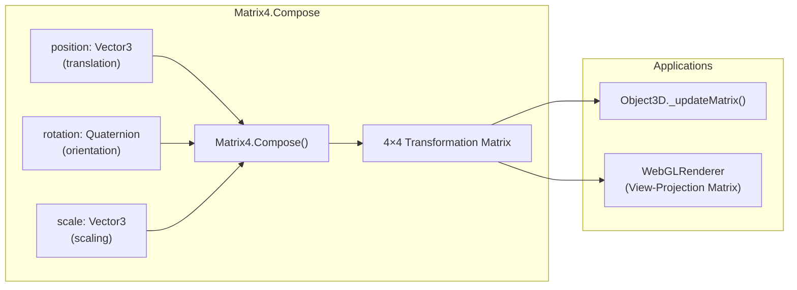

<!-- source: DeepWiki mcp.deepwiki.com · repo huggingface/gsplat.js · page 6.1 Vectors and Matrices · fetched 2026-10-26 -->

# Vectors and Matrices

<details>
<summary>Relevant source files</summary>

The following files were used as context for generating this wiki page:

- [src/cameras/Camera.ts](src/cameras/Camera.ts)
- [src/core/Object3D.ts](src/core/Object3D.ts)
- [src/math/Matrix3.ts](src/math/Matrix3.ts)
- [src/math/Matrix4.ts](src/math/Matrix4.ts)
- [src/math/Quaternion.ts](src/math/Quaternion.ts)
- [src/math/Vector3.ts](src/math/Vector3.ts)

</details>


This document details the vector and matrix mathematical foundations used throughout the gsplat.js library. These math utilities serve as the core building blocks for 3D transformations, spatial operations, and rendering calculations within the Gaussian Splatting implementation. For information about quaternions and rotation operations, see [Quaternions](#6.2).

## Overview

The `gsplat.js` library implements several mathematical classes that provide the foundation for 3D rendering:

- **Vector3**: Three-dimensional vector class with comprehensive vector operations
- **Matrix3**: 3×3 matrix class primarily used for rotation and scaling operations
- **Matrix4**: 4×4 matrix class used for full 3D transformations including translation

These components form a mathematical backbone that enables efficient 3D transformations, camera projections, and Gaussian splat rendering.



Sources: [src/math/Vector3.ts](), [src/math/Matrix3.ts](), [src/math/Matrix4.ts](), [src/math/Quaternion.ts](), [src/core/Object3D.ts](), [src/cameras/Camera.ts]()

## Vector3 Class

The `Vector3` class represents three-dimensional vectors with x, y, and z components. It provides a comprehensive set of methods for vector operations and transformations.

### Properties and Constructor

```typescript
class Vector3 {
    public readonly x: number;
    public readonly y: number;
    public readonly z: number;

    constructor(x: number = 0, y: number = 0, z: number = 0);
}
```

The class has immutable components (x, y, z) and provides a constructor with default values of 0 for each component when not specified.

### Basic Operations

Vector3 implements standard arithmetic operations that can work with both scalar values and other vectors:

| Operation | Method | Description |
|-----------|--------|-------------|
| Addition | `add(v: number \| Vector3): Vector3` | Adds a scalar or another vector |
| Subtraction | `subtract(v: number \| Vector3): Vector3` | Subtracts a scalar or another vector |
| Multiplication | `multiply(v: number \| Vector3 \| Matrix4): Vector3` | Multiplies by a scalar, vector, or transforms by a matrix |
| Division | `divide(v: number \| Vector3): Vector3` | Divides by a scalar or another vector (component-wise) |

All operations return a new `Vector3` instance, preserving the immutability of the original vector.

### Vector-Specific Operations



Sources: [src/math/Vector3.ts:74-144]()

The `Vector3` class implements various vector-specific operations:

- **Cross Product**: `cross(v: Vector3): Vector3` - Computes the cross product of two vectors
- **Dot Product**: `dot(v: Vector3): number` - Computes the dot product of two vectors
- **Normalization**: `normalize(): Vector3` - Returns a unit vector in the same direction
- **Magnitude**: `magnitude(): number` - Computes the length of the vector
- **Distance**: `distanceTo(v: Vector3): number` - Calculates the distance between two vectors
- **Interpolation**: `lerp(v: Vector3, t: number): Vector3` - Linearly interpolates between vectors

### Utility Methods

The `Vector3` class also provides several utility methods:

- **Component Access**: `getComponent(axis: number): number` - Gets component by index (0=x, 1=y, 2=z)
- **Component Analysis**: `minComponent()`, `maxComponent()` - Return the index of smallest/largest component
- **Min/Max**: `min(v: Vector3)`, `max(v: Vector3)` - Return new vector with component-wise minimum/maximum
- **Conversion**: `flat(): number[]` - Returns components as a flat array
- **Cloning**: `clone(): Vector3` - Creates a deep copy of the vector
- **Equality**: `equals(v: Vector3): boolean` - Checks if vectors are identical

Sources: [src/math/Vector3.ts:14-156]()

## Matrix3 Class

The `Matrix3` class represents 3×3 matrices primarily used for rotation and scaling operations in 3D space.

### Properties and Constructor

```typescript
class Matrix3 {
    public readonly buffer: number[];

    constructor(n11: number = 1, n12: number = 0, n13: number = 0,
                n21: number = 0, n22: number = 1, n23: number = 0,
                n31: number = 0, n32: number = 0, n33: number = 1);
}
```

The class stores the matrix values in a flat array `buffer` with nine elements and provides a constructor that initializes to the identity matrix by default.

### Matrix Operations

- **Multiplication**: `multiply(v: Matrix3): Matrix3` - Multiplies two matrices
- **Equality**: `equals(m: Matrix3): boolean` - Checks if matrices are identical
- **Cloning**: `clone(): Matrix3` - Creates a deep copy of the matrix

### Static Factory Methods

The `Matrix3` class provides static methods for creating common matrices:

- **Identity**: `static Eye(v: number = 1): Matrix3` - Creates a scaled identity matrix
- **Diagonal**: `static Diagonal(v: Vector3): Matrix3` - Creates a diagonal matrix from a vector
- **Rotation from Quaternion**: `static RotationFromQuaternion(q: Quaternion): Matrix3` - Creates a rotation matrix
- **Rotation from Euler**: `static RotationFromEuler(m: Vector3): Matrix3` - Creates a rotation matrix from Euler angles

Sources: [src/math/Matrix3.ts:4-108]()

## Matrix4 Class

The `Matrix4` class represents 4×4 matrices used for full 3D transformations including translation, rotation, and scaling.

### Properties and Constructor

```typescript
class Matrix4 {
    public readonly buffer: number[];

    constructor(n11: number = 1, n12: number = 0, n13: number = 0, n14: number = 0,
                n21: number = 0, n22: number = 1, n23: number = 0, n24: number = 0,
                n31: number = 0, n32: number = 0, n33: number = 1, n34: number = 0,
                n41: number = 0, n42: number = 0, n43: number = 0, n44: number = 1);
}
```

The class stores the matrix in a flat array `buffer` with 16 elements and initializes to the identity matrix by default.

### Matrix Operations

- **Multiplication**: `multiply(m: Matrix4): Matrix4` - Multiplies two matrices
- **Equality**: `equals(m: Matrix4): boolean` - Checks if matrices are identical
- **Cloning**: `clone(): Matrix4` - Creates a deep copy of the matrix

### Advanced Operations

- **Determinant**: `determinant(): number` - Calculates the matrix determinant
- **Inversion**: `invert(): Matrix4` - Creates the inverse of the matrix

### Composition Method

A key feature of the `Matrix4` class is its ability to compose transformation matrices from position, rotation, and scale components:



Sources: [src/math/Matrix4.ts:142-169](), [src/core/Object3D.ts:47-49]()

The static `Compose` method creates a complete transformation matrix from:
- Position vector (translation)
- Quaternion (rotation)
- Scale vector (scaling)

This is extensively used in the `Object3D` class to generate transformation matrices for scene objects.

## Integration with Object3D and Camera

The Vector and Matrix classes serve as the foundation for the `Object3D` class, which is the base class for all 3D entities in the scene:

```typescript
abstract class Object3D {
    protected _position: Vector3 = new Vector3();
    protected _rotation: Quaternion = new Quaternion();
    protected _scale: Vector3 = new Vector3(1, 1, 1);
    protected _transform: Matrix4 = new Matrix4();
    
    protected _updateMatrix() {
        this._transform = Matrix4.Compose(this._position, this._rotation, this._scale);
    }
}
```

The `Camera` class extends `Object3D` and uses matrices for view and projection transformations, which are critical for the rendering pipeline.

### Matrix Transformations in the Rendering Pipeline

In the rendering context, matrices are used for:

1. **Model Matrix**: Transforms vertices from object space to world space (derived from the object's position, rotation, and scale)
2. **View Matrix**: Transforms from world space to camera space (derived from the camera's position and orientation)
3. **Projection Matrix**: Transforms from camera space to clip space (derived from the camera's projection parameters)

These matrices are combined to form the Model-View-Projection (MVP) matrix used in the vertex shader to transform Gaussian splats for rendering.

Sources: [src/core/Object3D.ts:7-99](), [src/cameras/Camera.ts:1-42]()

## Summary

The vector and matrix classes in gsplat.js provide a robust mathematical foundation for 3D graphics operations. Key features include:

- Immutable data structures for vectors and matrices
- Comprehensive operations for vector mathematics
- Matrix composition for 3D transformations
- Integration with quaternions for rotation
- Support for the core rendering pipeline

These mathematical utilities are essential for efficiently implementing Gaussian Splatting techniques in a web browser environment.

---

