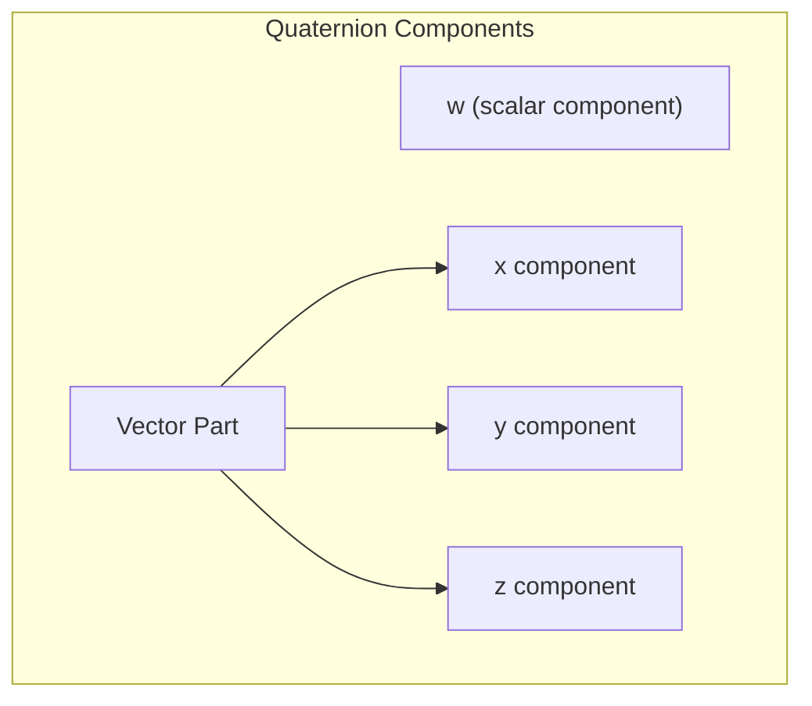
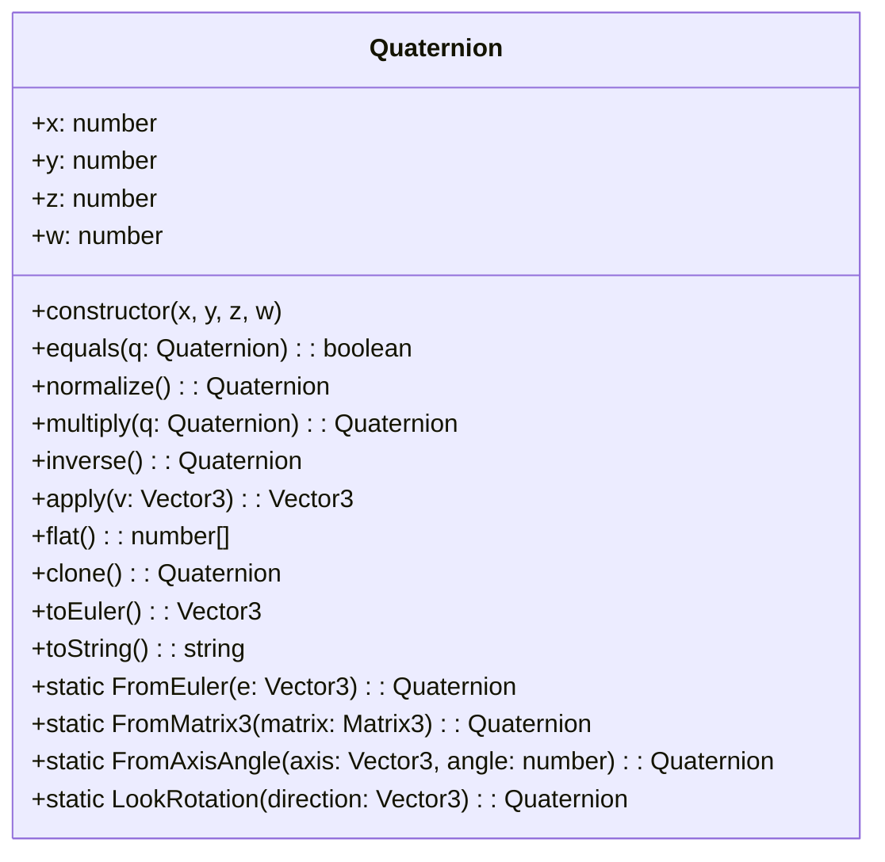
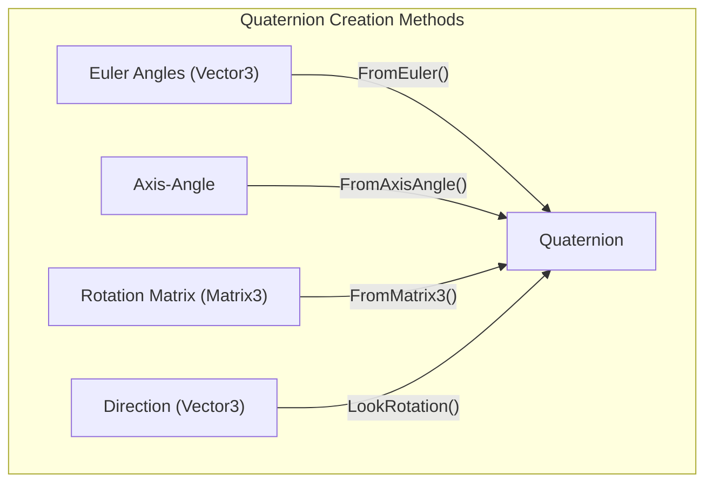
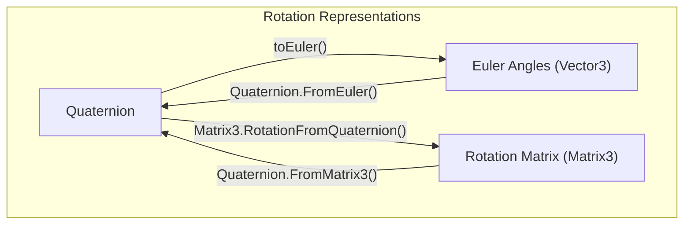

<!-- source: DeepWiki mcp.deepwiki.com · repo huggingface/gsplat.js · page 6.2 Quaternions · fetched 2026-10-26 -->

# Quaternions

<details>
<summary>Relevant source files</summary>

The following files were used as context for generating this wiki page:

- [src/math/Matrix3.ts](src/math/Matrix3.ts)
- [src/math/Quaternion.ts](src/math/Quaternion.ts)

</details>


This page documents the Quaternion implementation in gsplat.js, which provides efficient representation and manipulation of 3D rotations. Quaternions offer advantages over other rotation representations like Euler angles and rotation matrices, including avoiding gimbal lock and enabling smooth interpolation between rotations.

For information about other mathematical utilities like vectors and matrices, see [Vectors and Matrices](#6.1).

## Overview of Quaternions

Quaternions are four-dimensional complex numbers used to represent 3D rotations in a compact and efficient format. In gsplat.js, quaternions are essential for handling object orientations and camera transformations.

A quaternion is represented as:

```
q = x*i + y*j + z*k + w
```

Where:
- `x`, `y`, `z` form the vector part (imaginary components)
- `w` is the scalar part (real component)



Sources: [src/math/Quaternion.ts:4-15]()

## Quaternion Class Implementation

The `Quaternion` class in gsplat.js provides a complete set of operations for working with quaternions.

### Class Structure



The `Quaternion` class is defined with read-only properties to ensure immutability, meaning operations produce new quaternion instances rather than modifying existing ones.

Sources: [src/math/Quaternion.ts:4-175]()

### Basic Operations

#### Initialization

A quaternion can be created with specific components or initialized as the identity quaternion (default):

```javascript
// Identity quaternion (no rotation)
const identityQuat = new Quaternion(); // x=0, y=0, z=0, w=1

// Custom quaternion
const customQuat = new Quaternion(0.5, 0.5, 0.5, 0.5);
```

Sources: [src/math/Quaternion.ts:10-15]()

#### Equality Testing

Quaternions can be compared for equality using the `equals` method:

```javascript
const areEqual = quaternion1.equals(quaternion2);
```

Sources: [src/math/Quaternion.ts:17-32]()

#### Normalization

Quaternions should be normalized (unit quaternions) to properly represent rotations:

```javascript
const normalizedQuat = quaternion.normalize();
```

Sources: [src/math/Quaternion.ts:34-37]()

## Quaternion Operations

### Multiplication

Quaternion multiplication combines rotations. The order of multiplication is important as quaternion multiplication is not commutative:

```javascript
const combinedRotation = quaternion1.multiply(quaternion2);
```

This operation follows the Hamilton product rules for quaternions.

Sources: [src/math/Quaternion.ts:39-55]()

### Inverse

The inverse of a quaternion represents the opposite rotation:

```javascript
const oppositeRotation = quaternion.inverse();
```

Sources: [src/math/Quaternion.ts:57-60]()

### Applying Rotations to Vectors

Quaternions can rotate 3D vectors through the `apply` method:

```javascript
const rotatedVector = quaternion.apply(vector);
```

This operation performs the rotation represented by the quaternion on the given vector.

Sources: [src/math/Quaternion.ts:62-67]()

## Creating Quaternions

The `Quaternion` class provides several static methods to create quaternions from different rotation representations:



Sources: [src/math/Quaternion.ts:77-170]()

### From Euler Angles

Convert Euler angles (rotations around x, y, and z axes) to a quaternion:

```javascript
const eulerAngles = new Vector3(pitch, yaw, roll);
const quaternion = Quaternion.FromEuler(eulerAngles);
```

Sources: [src/math/Quaternion.ts:77-95]()

### From Rotation Matrix

Create a quaternion from a 3×3 rotation matrix:

```javascript
const rotationMatrix = new Matrix3(...);
const quaternion = Quaternion.FromMatrix3(rotationMatrix);
```

Sources: [src/math/Quaternion.ts:117-147]()

### From Axis-Angle

Create a quaternion from an axis of rotation and an angle:

```javascript
const axis = new Vector3(x, y, z).normalize();
const angle = Math.PI / 2; // 90 degrees
const quaternion = Quaternion.FromAxisAngle(axis, angle);
```

Sources: [src/math/Quaternion.ts:149-154]()

### Look Rotation

Create a quaternion that rotates an object to face a specific direction:

```javascript
const direction = new Vector3(x, y, z);
const quaternion = Quaternion.LookRotation(direction);
```

Sources: [src/math/Quaternion.ts:156-170]()

## Converting Quaternions

### To Euler Angles

Convert a quaternion to Euler angles:

```javascript
const eulerAngles = quaternion.toEuler();
```

This conversion is useful for user interfaces where rotation is represented as angles.

Sources: [src/math/Quaternion.ts:97-115]()

### To Flat Array

Convert a quaternion to a flat array of four numbers:

```javascript
const array = quaternion.flat(); // [x, y, z, w]
```

Sources: [src/math/Quaternion.ts:69-71]()

## Integration with Matrix3

The `Matrix3` class provides conversion from quaternions to rotation matrices:

```javascript
const rotationMatrix = Matrix3.RotationFromQuaternion(quaternion);
```

This allows quaternion-based rotations to be used in contexts requiring matrix representations.



Sources: [src/math/Matrix3.ts:67-80](), [src/math/Quaternion.ts:97-147]()

## Use Cases in gsplat.js

Quaternions are used throughout gsplat.js for:

1. **Object Orientation**: Representing the orientation of 3D objects in the scene
2. **Camera Rotation**: Handling camera orientation and movement
3. **Smooth Interpolation**: Enabling smooth transitions between different orientations
4. **Avoiding Gimbal Lock**: Preventing the loss of a degree of freedom that can occur with Euler angles

By using quaternions for rotations, gsplat.js avoids common issues with other rotation representations while maintaining high performance, which is critical for real-time 3D rendering of Gaussian splatting scenes.

Sources: [src/math/Quaternion.ts](), [src/math/Matrix3.ts]()

## Mathematical Properties

Understanding these mathematical properties can help when working with quaternions in gsplat.js:

| Property | Description |
|----------|-------------|
| Unit Quaternion | Represents a pure rotation when normalized (‖q‖ = 1) |
| Conjugate | q* = (-x, -y, -z, w); used for inverse operations |
| Inverse | q⁻¹ = q* / ‖q‖²; represents the opposite rotation |
| Multiplication | Non-commutative; order matters when combining rotations |
| Identity | (0, 0, 0, 1); represents no rotation |

Sources: [src/math/Quaternion.ts:34-67]()

## Summary

The `Quaternion` class in gsplat.js provides a robust implementation for working with rotations in 3D space. With methods for creation, conversion, and application of rotations, it serves as a fundamental component of the library's math utilities, enabling efficient and accurate 3D transformations essential for rendering Gaussian splatting scenes.

---

