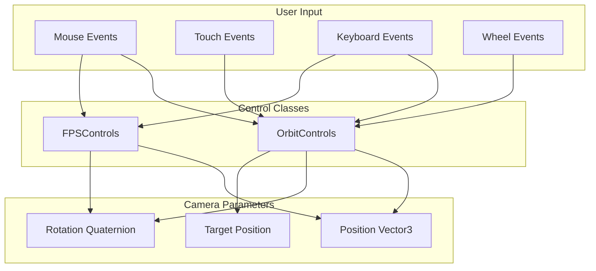
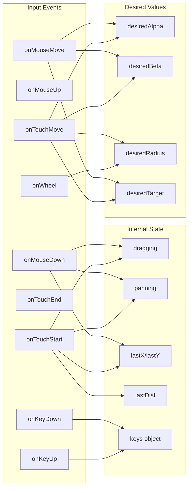
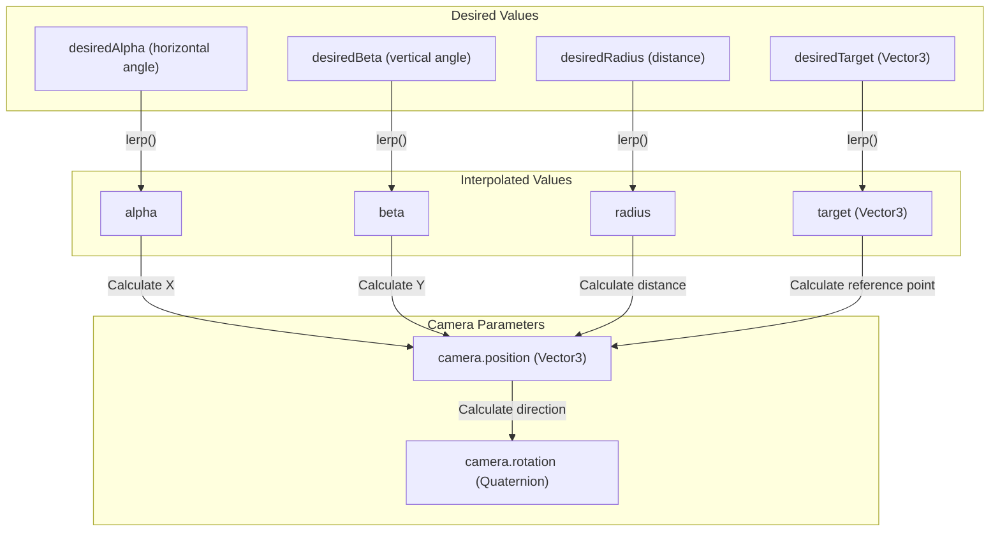
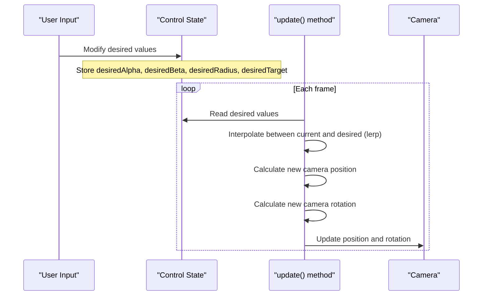

<!-- source: DeepWiki mcp.deepwiki.com · repo huggingface/gsplat.js · page 7 User Interaction · fetched 2026-10-26 -->

# User Interaction

<details>
<summary>Relevant source files</summary>

The following files were used as context for generating this wiki page:

- [src/controls/OrbitControls.ts](src/controls/OrbitControls.ts)

</details>


This document describes the user interaction system in gsplat.js, focusing on how users navigate and manipulate 3D Gaussian Splat scenes. The system provides intuitive camera controls that translate user inputs (mouse, touch, keyboard) into camera movements, enabling smooth exploration of 3D environments.

For specific details about the Camera System itself, see [Camera System](#3.3).

## Overview of User Interaction System

The user interaction system in gsplat.js consists of camera control mechanisms that enable users to navigate through 3D scenes. These controls capture various input events and translate them into camera movements and rotations.



Sources: [src/controls/OrbitControls.ts:1-310]()

## Camera Controls

gsplat.js provides multiple camera control options for different navigation paradigms:

1. **OrbitControls** - Allows orbiting around a target point with pan and zoom capabilities
2. **FPSControls** - First-person shooter style navigation (referenced in the system architecture diagram)

### OrbitControls

The `OrbitControls` class provides an orbital camera system where the camera rotates around a target point. It offers the following features:

- Orbital rotation (horizontally and vertically)
- Camera panning
- Zoom in/out functionality
- Support for mouse, touch, and keyboard inputs
- Configurable speed and boundaries for movement

```mermaid
classDiagram
    class "OrbitControls" {
        +minAngle: number
        +maxAngle: number
        +minZoom: number
        +maxZoom: number
        +orbitSpeed: number
        +panSpeed: number
        +zoomSpeed: number
        +dampening: number
        +setCameraTarget(newTarget: Vector3)
        +update()
        +dispose()
    }
    
    class "Camera" {
        +position: Vector3
        +rotation: Quaternion
    }
    
    "OrbitControls" --> "Camera" : controls
```

Sources: [src/controls/OrbitControls.ts:6-308]()

#### Configuration Parameters

The `OrbitControls` class offers several configurable parameters to customize control behavior:

| Parameter | Default | Description |
|-----------|---------|-------------|
| `minAngle` | -90 | Minimum vertical angle in degrees |
| `maxAngle` | 90 | Maximum vertical angle in degrees |
| `minZoom` | 0.1 | Minimum zoom distance |
| `maxZoom` | 30 | Maximum zoom distance |
| `orbitSpeed` | 1 | Speed multiplier for orbital rotation |
| `panSpeed` | 1 | Speed multiplier for panning movement |
| `zoomSpeed` | 1 | Speed multiplier for zooming |
| `dampening` | 0.12 | Smoothing factor for camera movement |

Sources: [src/controls/OrbitControls.ts:7-14]()

## Input Handling

The user interaction system captures and processes various input events to enable intuitive camera control.



Sources: [src/controls/OrbitControls.ts:75-91](), [src/controls/OrbitControls.ts:92-108](), [src/controls/OrbitControls.ts:110-138](), [src/controls/OrbitControls.ts:140-146](), [src/controls/OrbitControls.ts:148-216]()

### Mouse Interaction

The system responds to the following mouse events:

- **Mouse Down**: Initiates dragging or panning (right-click) mode
- **Mouse Move**: Updates camera orbit or pan position based on cursor movement
- **Mouse Up**: Ends dragging or panning operation
- **Wheel**: Adjusts zoom level (camera distance from target)

Sources: [src/controls/OrbitControls.ts:92-146]()

### Touch Interaction

Touch events are handled to provide a mobile-friendly experience:

- **Single Touch**: Orbital rotation (similar to mouse dragging)
- **Multi-Touch**: Combined panning and pinch-to-zoom functionality

Sources: [src/controls/OrbitControls.ts:148-216]()

### Keyboard Controls

When enabled, keyboard controls provide additional navigation options:

| Key | Function |
|-----|----------|
| W / Arrow Up | Move forward |
| S / Arrow Down | Move backward |
| A / Arrow Left | Move left |
| D / Arrow Right | Move right |
| Q | Rotate left |
| E | Rotate right |
| R | Rotate up |
| F | Rotate down |

Sources: [src/controls/OrbitControls.ts:75-91](), [src/controls/OrbitControls.ts:247-258]()

## Camera Movement Mechanics

The `OrbitControls` system uses a spherical coordinate approach for camera positioning, where:

- **Alpha (α)**: Horizontal rotation angle (azimuth)
- **Beta (β)**: Vertical rotation angle (elevation)
- **Radius**: Distance from target point



Sources: [src/controls/OrbitControls.ts:218-260]()

### Update Process

The camera position and rotation are updated on each frame through the following process:

1. Input events modify the "desired" values (`desiredAlpha`, `desiredBeta`, `desiredRadius`, `desiredTarget`)
2. The `update()` method interpolates between current and desired values using dampening
3. New camera position is calculated using spherical coordinates
4. Camera rotation is computed to look at the target point

The dampening parameter creates smooth transitions between camera positions, avoiding abrupt movements.



Sources: [src/controls/OrbitControls.ts:222-260]()

## Coordinate System and Mathematics

The camera positioning uses the following conversion from spherical to Cartesian coordinates:

```
x = target.x + radius * Math.sin(alpha) * Math.cos(beta)
y = target.y - radius * Math.sin(beta)
z = target.z - radius * Math.cos(alpha) * Math.cos(beta)
```

The camera's rotation is calculated to ensure it always looks at the target point:

```
direction = target.subtract(camera.position).normalize()
rx = Math.asin(-direction.y)
ry = Math.atan2(direction.x, direction.z)
```

Sources: [src/controls/OrbitControls.ts:230-238]()

## Integration with Camera System

The `OrbitControls` class accepts a `Camera` instance in its constructor and directly updates the camera's position and rotation properties. It also listens for camera changes to maintain synchronization when the camera is modified externally.

Sources: [src/controls/OrbitControls.ts:19-59]()

---

