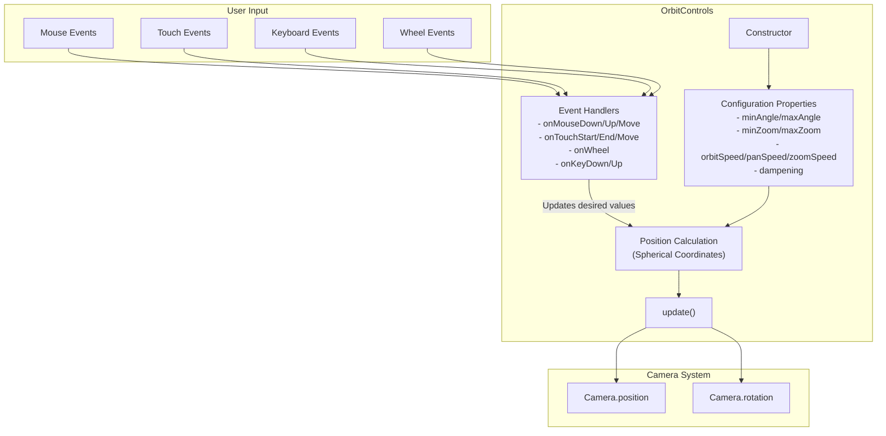
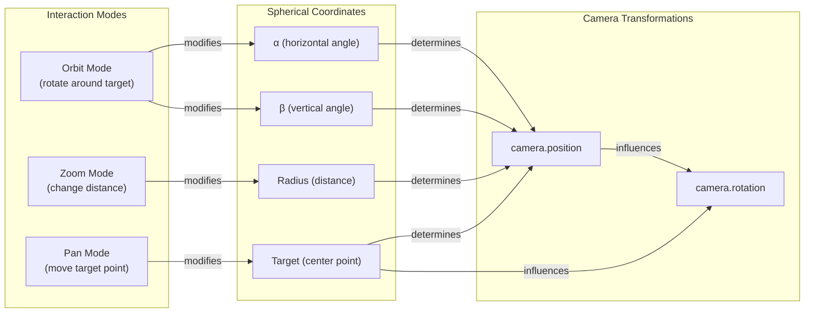
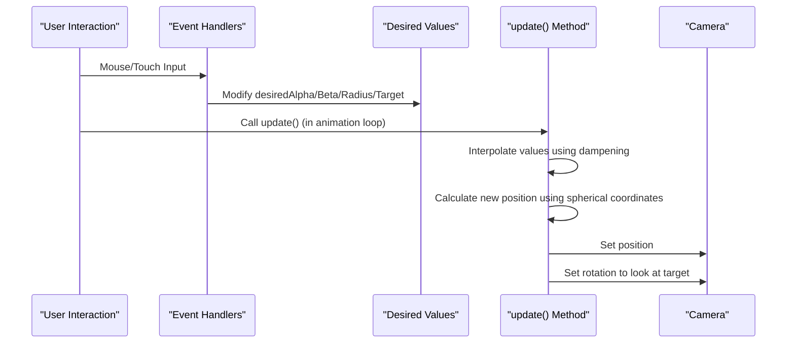
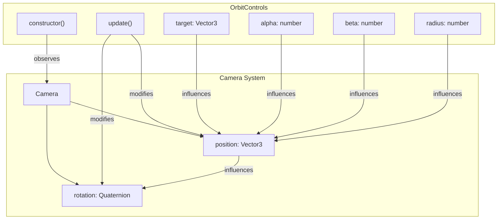

<!-- source: DeepWiki mcp.deepwiki.com · repo huggingface/gsplat.js · page 7.1 Camera Controls · fetched 2026-10-26 -->

# Camera Controls

<details>
<summary>Relevant source files</summary>

The following files were used as context for generating this wiki page:

- [examples/editor/src/Controls.ts](examples/editor/src/Controls.ts)
- [examples/editor/src/DefaultMode.ts](examples/editor/src/DefaultMode.ts)
- [examples/editor/src/OrbitControls.ts](examples/editor/src/OrbitControls.ts)
- [examples/editor/tsconfig.json](examples/editor/tsconfig.json)
- [src/controls/OrbitControls.ts](src/controls/OrbitControls.ts)

</details>


## Purpose and Scope

This document provides a detailed overview of the camera control systems in gsplat.js, which allow users to navigate and interact with 3D Gaussian Splatting scenes. The camera controls handle user input (mouse, touch, keyboard) and translate these into camera movements, enabling intuitive navigation of 3D space.

The primary camera control system currently implemented in gsplat.js is `OrbitControls`, which provides orbit, pan, and zoom functionality. While the architecture also defines an `FPSControls` component, this document focuses on the implemented `OrbitControls` system.

## Camera Control Architecture



Sources: [src/controls/OrbitControls.ts:6-308]()

## OrbitControls in Detail

The `OrbitControls` class provides a camera control system that orbits around a target point, similar to controls found in many 3D applications. It uses spherical coordinates (alpha, beta, radius) to calculate the camera's position relative to a target point.

### Core Concepts



Sources: [src/controls/OrbitControls.ts:19-27](), [src/controls/OrbitControls.ts:223-238]()

### Configuration Properties

The `OrbitControls` class provides several properties to customize its behavior:

| Property | Default | Description |
|----------|---------|-------------|
| `minAngle` | -90 | Minimum vertical angle (degrees) |
| `maxAngle` | 90 | Maximum vertical angle (degrees) |
| `minZoom` | 0.1 | Minimum zoom distance |
| `maxZoom` | 30 | Maximum zoom distance |
| `orbitSpeed` | 1 | Speed of orbital rotation |
| `panSpeed` | 1 | Speed of panning movement |
| `zoomSpeed` | 1 | Speed of zooming in/out |
| `dampening` | 0.12 | Smoothing factor for camera movement (0-1) |

Sources: [src/controls/OrbitControls.ts:7-14]()

### Initialization

The `OrbitControls` constructor initializes the control system with the following parameters:

```typescript
constructor(
    camera: Camera,
    canvas: HTMLElement,
    alpha: number = 0.5,
    beta: number = 0.5,
    radius: number = 5,
    enableKeyboardControls: boolean = true,
    inputTarget: Vector3 = new Vector3(),
)
```

- `camera`: The camera to control
- `canvas`: The HTML element that receives input events
- `alpha`: Initial horizontal angle (in radians)
- `beta`: Initial vertical angle (in radians)
- `radius`: Initial distance from target
- `enableKeyboardControls`: Whether to enable keyboard navigation
- `inputTarget`: Initial target position

Sources: [src/controls/OrbitControls.ts:19-27]()

### Interaction Modes

The `OrbitControls` class supports three primary interaction modes:

1. **Orbit**: Rotate the camera around the target point (default with left mouse button)
2. **Pan**: Move the target point (with right mouse button)
3. **Zoom**: Change the distance from the target (with mouse wheel or pinch gesture)

The controls also support keyboard navigation when enabled:
- WASD/Arrow keys: Move the target point
- Q/E: Rotate horizontally
- R/F: Rotate vertically

Sources: [src/controls/OrbitControls.ts:91-108](), [src/controls/OrbitControls.ts:110-138](), [src/controls/OrbitControls.ts:140-146](), [src/controls/OrbitControls.ts:246-259]()

### Update Mechanism

The `OrbitControls` class uses a smooth interpolation system to update the camera position and rotation:

1. Event handlers modify "desired" values (desiredAlpha, desiredBeta, desiredRadius, desiredTarget)
2. The `update()` method interpolates between current and desired values using the dampening factor
3. New camera position is calculated using spherical coordinates
4. Camera rotation is updated to look at the target point



Sources: [src/controls/OrbitControls.ts:217-261]()

## Touch Support

The `OrbitControls` class provides comprehensive touch support for mobile devices:

- Single-finger drag: Orbit around target
- Two-finger pinch: Zoom in/out
- Two-finger drag: Pan the view

This allows for intuitive navigation on touch-enabled devices.

Sources: [src/controls/OrbitControls.ts:148-216]()

## Integration with Camera System

The `OrbitControls` class works directly with the camera system in gsplat.js:



Sources: [src/controls/OrbitControls.ts:45-57](), [src/controls/OrbitControls.ts:223-238]()

## Usage Example

To use `OrbitControls` in your application:

1. Create a camera
2. Create an instance of `OrbitControls`
3. Call the `update()` method in your animation loop

```javascript
// Create camera and renderer
const camera = new SPLAT.Camera();
const renderer = new SPLAT.WebGLRenderer();

// Create orbit controls
const controls = new SPLAT.OrbitControls(
    camera,             // Camera to control
    renderer.domElement, // Canvas element for input
    0,                  // Initial horizontal angle
    0.5,                // Initial vertical angle
    5                   // Initial distance
);

// Animation loop
function animate() {
    requestAnimationFrame(animate);
    
    // Update controls
    controls.update();
    
    // Render scene
    renderer.render(scene, camera);
}
animate();
```

The `OrbitControls` class also provides methods to programmatically control the camera:

- `setCameraTarget(target: Vector3)`: Focus the camera on a new target point

Sources: [src/controls/OrbitControls.ts:57-69]()

## Cleanup

When you're done with the controls, call the `dispose()` method to remove all event listeners:

```javascript
controls.dispose();
```

This prevents memory leaks and ensures proper cleanup.

Sources: [src/controls/OrbitControls.ts:268-286]()

## Editor Example Implementation

The examples/editor implementation of `OrbitControls` extends the core functionality with additional features, such as:

- An `enabled` property to toggle control functionality
- Modified mouse button handling for editor-specific interactions
- Alternative control schemes with Alt key modifiers

The editor example demonstrates how the camera controls can be integrated into a more complex application while maintaining the same underlying control model.

Sources: [examples/editor/src/OrbitControls.ts:4-16](), [examples/editor/src/OrbitControls.ts:71-91]()

---

