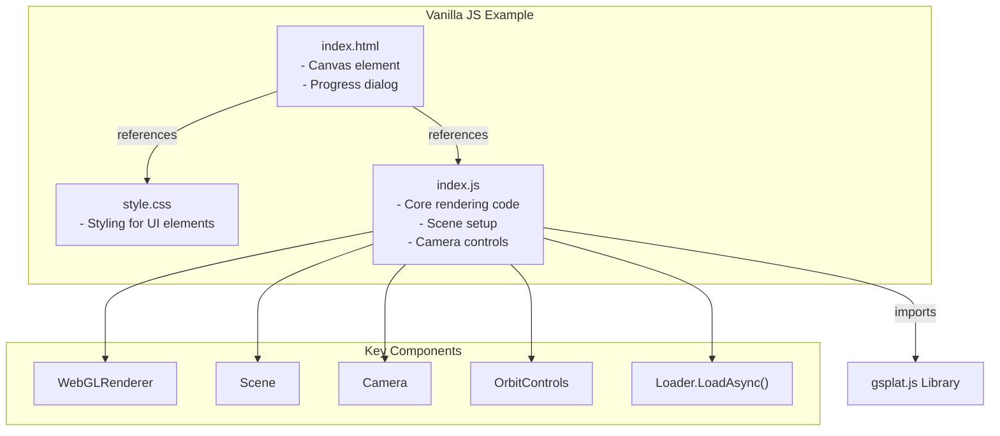
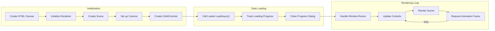
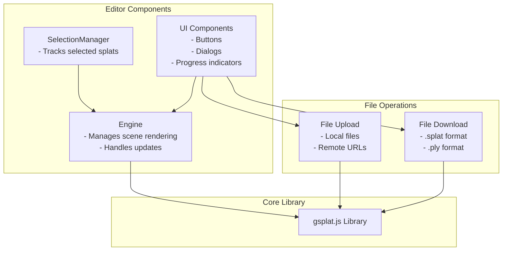
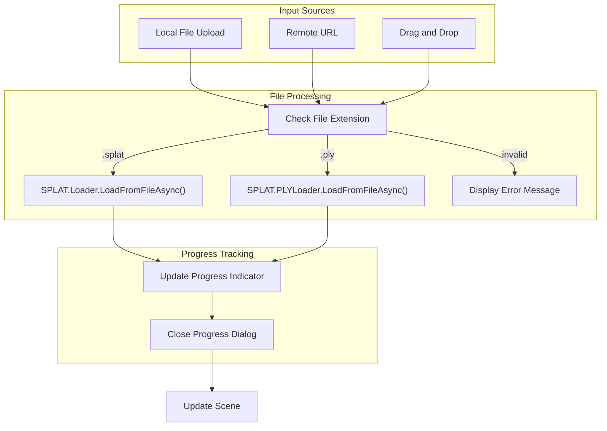

<!-- source: DeepWiki mcp.deepwiki.com · repo huggingface/gsplat.js · page 8 Examples · fetched 2026-10-26 -->

# Examples

<details>
<summary>Relevant source files</summary>

The following files were used as context for generating this wiki page:

- [examples/editor/src/main.ts](examples/editor/src/main.ts)
- [examples/simple-server/index.html](examples/simple-server/index.html)
- [examples/simple-server/style.css](examples/simple-server/style.css)
- [examples/vanilla-js/index.html](examples/vanilla-js/index.html)
- [examples/vanilla-js/index.js](examples/vanilla-js/index.js)
- [examples/vanilla-js/style.css](examples/vanilla-js/style.css)

</details>


This page provides an overview of the example applications included with gsplat.js, demonstrating how to use the library for rendering 3D Gaussian Splatting scenes in web browsers. These examples range from simple renderers to more complex editors with interactive capabilities. For information about the library's core architecture, see [Architecture](#2).

## Basic Usage Example

The gsplat.js library includes a simple vanilla JavaScript example that demonstrates the fundamental setup for rendering a 3D Gaussian Splatting scene.

### Example Structure



Sources: [examples/vanilla-js/index.js](), [examples/vanilla-js/index.html](), [examples/vanilla-js/style.css]()

### Basic Rendering Pipeline



Sources: [examples/vanilla-js/index.js]()

### Implementation Details

The basic example demonstrates the minimal code required to render a Gaussian splatting scene:

1. **Setup and Initialization**:
   - Creates a WebGL renderer attached to a canvas
   - Sets up a scene to hold 3D objects
   - Configures a camera and orbit controls for navigation

2. **Loading a 3D Model**:
   - Uses `SPLAT.Loader.LoadAsync()` to load a .splat file from a URL
   - Displays a progress indicator during loading
   - Closes the progress dialog when loading completes

3. **Rendering Loop**:
   - Handles window resize events to adjust the renderer size
   - Updates the camera controls to respond to user input
   - Renders the scene with the current camera view
   - Uses `requestAnimationFrame` for continuous rendering

The core rendering code is concise:

```
const renderer = new SPLAT.WebGLRenderer(canvas);
const scene = new SPLAT.Scene();
const camera = new SPLAT.Camera();
const controls = new SPLAT.OrbitControls(camera, canvas);
```

Sources: [examples/vanilla-js/index.js:7-10]()

## Editor Example

The editor example demonstrates a more advanced implementation with interactive capabilities for manipulating Gaussian splatting scenes.

### Editor Architecture



Sources: [examples/editor/src/main.ts]()

### File Loading Flow



Sources: [examples/editor/src/main.ts:27-58](), [examples/editor/src/main.ts:117-141]()

### Features and Capabilities

The editor example includes several advanced features:

1. **Multiple Input Methods**:
   - File uploading through dialog
   - URL loading for remote files
   - Drag-and-drop file support

2. **Format Support**:
   - Loading .splat files with `SPLAT.Loader`
   - Loading .ply files with `SPLAT.PLYLoader`
   - Conversion between formats

3. **Scene Management**:
   - Selection of individual splats
   - Scene transformations
   - Background color customization

4. **Export Capabilities**:
   - Exporting the entire scene
   - Exporting only selected splats
   - Multiple export formats (.splat, .ply)

Sources: [examples/editor/src/main.ts]()

### UI Components and Interactions

The editor interface includes:

- Canvas for 3D rendering
- Progress dialog with indicator
- Upload and download buttons
- Controls display toggle
- File upload modal with local and URL inputs
- Download modal with format selection
- Error displays for invalid operations

Key interaction handlers include:

1. **File Selection and Loading**:
   - File input change event [examples/editor/src/main.ts:111-115]()
   - URL input submission [examples/editor/src/main.ts:117-141]()
   - Drag and drop handling [examples/editor/src/main.ts:81-88]()

2. **Scene Export**:
   - Format selection through radio buttons
   - Export entire scene or just selected splats [examples/editor/src/main.ts:143-159]()

3. **User Interface Controls**:
   - Toggle controls display [examples/editor/src/main.ts:106-109]()
   - Modal dialogs for file operations

Sources: [examples/editor/src/main.ts]()

## Comparing the Examples

The following table compares the features of the different examples included with gsplat.js:

| Feature | Vanilla JS Example | Editor Example |
|---------|-------------------|---------------|
| Rendering | Basic scene rendering | Advanced rendering with selection |
| Camera Controls | OrbitControls | Custom Engine controls |
| File Loading | Remote URL only | Local files, URLs, drag-and-drop |
| File Formats | .splat only | .splat and .ply |
| UI Components | Progress indicator only | Multiple dialogs and controls |
| Export | No export capability | Multiple format export |
| Selection | No selection capability | Select and manipulate splats |
| Background | Default | Customizable |

## Running the Examples

To run the examples:

1. **Vanilla JS Example**:
   - Serve the contents of the `examples/vanilla-js` directory with any static file server
   - Open the served index.html in a browser

2. **Simple Server Example**:
   - Uses the same core functionality as the vanilla example
   - Requires a build step for TypeScript compilation

3. **Editor Example**:
   - Requires building with appropriate bundler (e.g., Vite, Webpack)
   - More complex setup with TypeScript and additional components

The examples demonstrate a progression from basic usage to more complex applications, serving as reference implementations for developers building applications with gsplat.js.

Sources: [examples/vanilla-js/index.html](), [examples/simple-server/index.html](), [examples/editor/src/main.ts]()

---

