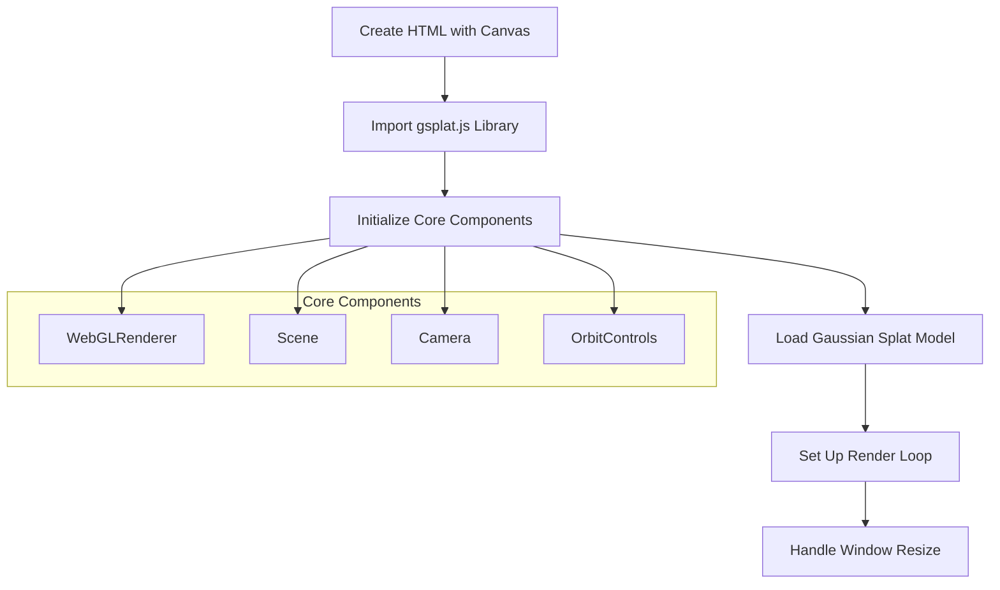
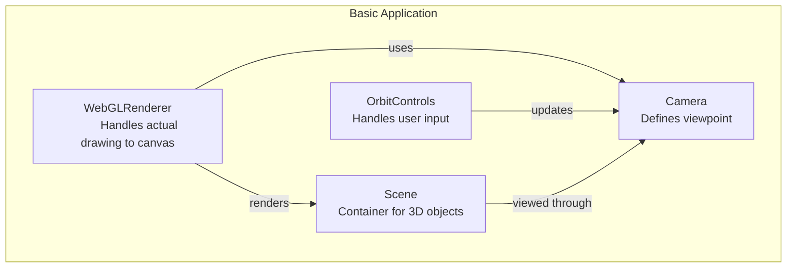
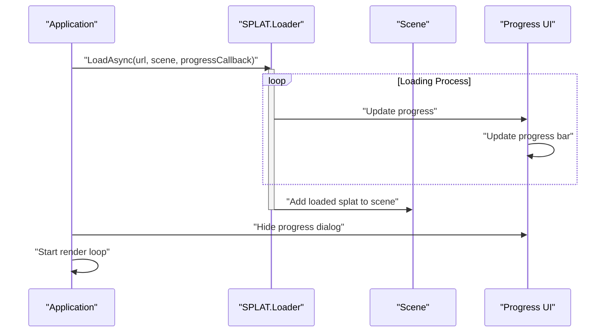
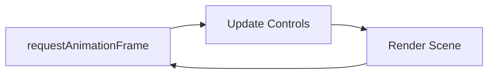
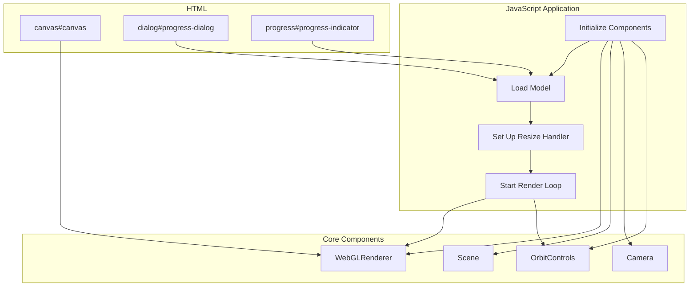

<!-- source: DeepWiki mcp.deepwiki.com · repo huggingface/gsplat.js · page 8.1 Basic Usage · fetched 2026-10-26 -->

# Basic Usage

<details>
<summary>Relevant source files</summary>

The following files were used as context for generating this wiki page:

- [examples/ply-converter/index.html](examples/ply-converter/index.html)
- [examples/simple-server/index.html](examples/simple-server/index.html)
- [examples/simple-server/src/main.ts](examples/simple-server/src/main.ts)
- [examples/simple-server/style.css](examples/simple-server/style.css)
- [examples/vanilla-js/index.html](examples/vanilla-js/index.html)
- [examples/vanilla-js/index.js](examples/vanilla-js/index.js)
- [examples/vanilla-js/style.css](examples/vanilla-js/style.css)

</details>


This document provides a step-by-step guide for setting up a basic application with gsplat.js, a JavaScript library for rendering 3D Gaussian Splatting scenes in web browsers. This page covers the essential components and patterns needed to get started with the library, focusing on the minimal code required to load and display 3D Gaussian splat models.

For information about transforming objects in a scene, see [Scene Transformations](#8.2). For more advanced usage with UI controls and interaction modes, see [Editor Example](#8.3).

## Getting Started

The basic workflow for creating a gsplat.js application involves setting up HTML, importing the library, initializing core components, loading a model, and setting up the render loop.



Sources: [examples/simple-server/src/main.ts](), [examples/vanilla-js/index.js]()

### HTML Structure

A basic gsplat.js application requires at minimum:
1. A canvas element for rendering
2. Optional UI elements for showing loading progress

```html
<canvas id="canvas"></canvas>
<dialog open id="progress-dialog">
    <progress max="100" id="progress-indicator"></progress>
</dialog>
```

Sources: [examples/simple-server/index.html](), [examples/vanilla-js/index.html]()

### Importing the Library

You can import gsplat.js in two ways:

1. Through npm/yarn installation:
```javascript
import * as SPLAT from "gsplat";
```

2. Directly from a CDN for vanilla JavaScript:
```javascript
import * as SPLAT from "https://cdn.jsdelivr.net/npm/gsplat@latest";
```

Sources: [examples/simple-server/src/main.ts:1](), [examples/vanilla-js/index.js:1]()

## Core Components

A basic gsplat.js application requires four essential components:



Sources: [examples/simple-server/src/main.ts:7-10](), [examples/vanilla-js/index.js:7-10]()

### Initializing Components

```javascript
// Get reference to canvas element
const canvas = document.getElementById("canvas");

// Initialize renderer
const renderer = new SPLAT.WebGLRenderer(canvas);

// Create scene to hold 3D objects
const scene = new SPLAT.Scene();

// Set up camera for viewing the scene
const camera = new SPLAT.Camera();

// Add controls for user interaction
const controls = new SPLAT.OrbitControls(camera, canvas);
```

Sources: [examples/simple-server/src/main.ts:3-10](), [examples/vanilla-js/index.js:3-10]()

## Loading Models

gsplat.js supports loading Gaussian splat models primarily from `.splat` files. The `Loader` class provides an asynchronous method for loading models with progress tracking.



Sources: [examples/simple-server/src/main.ts:12-15](), [examples/vanilla-js/index.js:12-15]()

### Loading Example

```javascript
// Reference to progress UI elements
const progressDialog = document.getElementById("progress-dialog");
const progressIndicator = document.getElementById("progress-indicator");

// URL to a .splat file
const url = "https://huggingface.co/datasets/dylanebert/3dgs/resolve/main/bonsai/bonsai-7k-mini.splat";

// Load the model asynchronously
await SPLAT.Loader.LoadAsync(url, scene, (progress) => {
    // Update progress bar (0-100)
    progressIndicator.value = progress * 100;
});

// Hide progress dialog when loading is complete
progressDialog.close();
```

Sources: [examples/simple-server/src/main.ts:4-15](), [examples/vanilla-js/index.js:4-15]()

## Handling Window Resize

To ensure the canvas properly fills the browser window and maintains the correct aspect ratio, implement a resize handler:

```javascript
const handleResize = () => {
    renderer.setSize(canvas.clientWidth, canvas.clientHeight);
};

// Call once at initialization
handleResize();

// Add event listener for window resizing
window.addEventListener("resize", handleResize);
```

Sources: [examples/simple-server/src/main.ts:17-19](), [examples/simple-server/src/main.ts:28-29](), [examples/vanilla-js/index.js:17-19](), [examples/vanilla-js/index.js:28-29]()

## Render Loop

The render loop is responsible for continuously updating the scene and displaying it on the canvas. This is typically implemented using `requestAnimationFrame` for optimal performance:



Sources: [examples/simple-server/src/main.ts:21-26](), [examples/vanilla-js/index.js:21-26]()

### Implementing the Render Loop

```javascript
const frame = () => {
    // Update camera position based on user input
    controls.update();
    
    // Render the current state of the scene
    renderer.render(scene, camera);
    
    // Schedule the next frame
    requestAnimationFrame(frame);
};

// Start the render loop
requestAnimationFrame(frame);
```

Sources: [examples/simple-server/src/main.ts:21-31](), [examples/vanilla-js/index.js:21-31]()

## Complete Example

Here's how all the components work together in a complete example:



Sources: [examples/simple-server/src/main.ts](), [examples/vanilla-js/index.js]()

The `main()` function encapsulates the entire workflow:

1. Initialize UI references and core components
2. Load the model asynchronously with progress tracking
3. Set up window resize handling
4. Create and start the render loop

Sources: [examples/simple-server/src/main.ts:12-34](), [examples/vanilla-js/index.js:12-34]()

## CSS Styling

For optimal viewing experience, consider adding the following CSS:

| CSS Property | Recommended Value | Purpose |
|--------------|-------------------|---------|
| `body, html { margin, padding }` | `0` | Remove default margins |
| `body, html { overflow }` | `hidden` | Prevent scrollbars |
| `canvas { width, height }` | `100vw, 100vh` | Make canvas full viewport size |
| Progress dialog styling | Custom | Create a centered, visually distinct loading indicator |

Sources: [examples/simple-server/style.css](), [examples/vanilla-js/style.css]()

## Next Steps

After implementing this basic setup, you can:

1. Explore more complex scene manipulations (see [Scene Transformations](#8.2))
2. Implement custom UI controls for interacting with the scene
3. Load different models or convert PLY files to the SPLAT format (see [File Conversion](#8.4))
4. Customize the rendering parameters for different visual effects

The examples provided in this guide represent the minimal implementation needed to get started with gsplat.js. This foundation can be extended to create more complex applications with additional controls, multiple models, and custom rendering effects.

---

