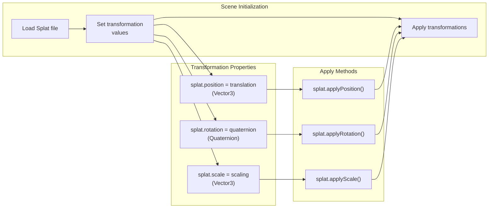
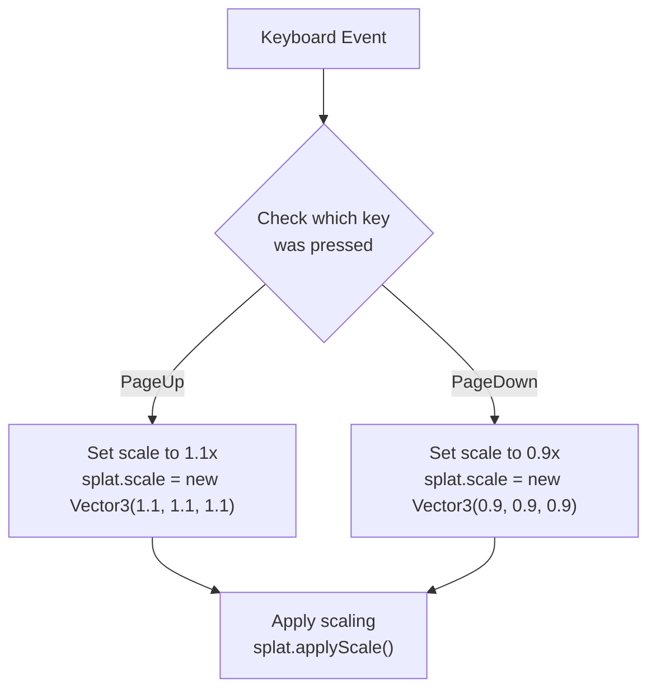
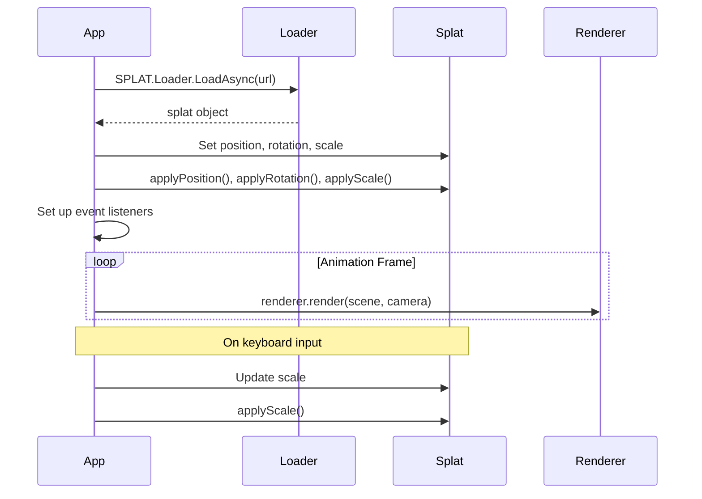

<!-- source: DeepWiki mcp.deepwiki.com · repo huggingface/gsplat.js · page 8.2 Scene Transformations · fetched 2026-10-26 -->

# Scene Transformations

<details>
<summary>Relevant source files</summary>

The following files were used as context for generating this wiki page:

- [examples/scene-transformations/src/main.ts](examples/scene-transformations/src/main.ts)

</details>


This page explains how to apply transformations such as translation, rotation, and scaling to objects in a gsplat.js scene. It demonstrates both static transformations that can be set during scene initialization and dynamic transformations that can be updated during runtime. For information about the core Scene management system, see [Scene Management](#3.1).

## Transformation Fundamentals

In gsplat.js, objects in a scene can be transformed in three fundamental ways:

1. **Translation (Position)** - Moving an object in 3D space
2. **Rotation** - Rotating an object around its center
3. **Scale** - Changing the size of an object

These transformations are applied to objects derived from the `Object3D` class, including `Splat` objects which represent Gaussian splats in the scene.

```mermaid
classDiagram
    class "Object3D" {
        +Vector3 position
        +Quaternion rotation
        +Vector3 scale
        +applyPosition()
        +applyRotation()
        +applyScale()
    }
    
    class "Splat" {
        +SplatData splatData
    }
    
    "Object3D" <|-- "Splat"
```

Sources: [examples/scene-transformations/src/main.ts:19-28]()

## Basic Transformation Example

The following diagram illustrates the basic process of applying transformations to a Splat object:



Sources: [examples/scene-transformations/src/main.ts:19-28]()

## Setting Up Transformations

To transform a Splat object, you first set the transformation properties and then apply them:

### 1. Setting Transformation Values

```
// Define transformation values
const rotation = new SPLAT.Vector3(0, 0, 0);          // Euler angles in radians
const translation = new SPLAT.Vector3(-0.2, 0.2, 0);  // x, y, z position
const scaling = new SPLAT.Vector3(1.5, 1.5, 1.5);     // scale factors

// Set the properties on the splat object
splat.rotation = SPLAT.Quaternion.FromEuler(rotation); // Convert Euler angles to Quaternion
splat.position = translation;
splat.scale = scaling;
```

Note that rotations are internally represented as quaternions, not Euler angles. The `Quaternion.FromEuler()` method is used to convert from Euler angles to a quaternion.

### 2. Applying Transformations

After setting the transformation values, you need to apply them for the changes to take effect:

```
// Apply transformations
splat.applyPosition();
splat.applyRotation();
splat.applyScale();
```

These methods update the internal representation of the Splat object, modifying the underlying Gaussian splats accordingly.

Sources: [examples/scene-transformations/src/main.ts:19-28]()

## Dynamic Transformations

Transformations can also be applied dynamically during runtime. This is useful for animations, interactive controls, or responding to user input.

### Example: Scaling with Keyboard Input



The following code shows how to implement dynamic scaling in response to keyboard events:

```
const onKeyDown = (e: KeyboardEvent) => {
    if (e.key === "PageUp") {
        splat.scale = new SPLAT.Vector3(1.1, 1.1, 1.1);
        splat.applyScale();
    } else if (e.key === "PageDown") {
        splat.scale = new SPLAT.Vector3(0.9, 0.9, 0.9);
        splat.applyScale();
    }
};

window.addEventListener("keydown", onKeyDown);
```

This event handler scales the object up by 10% when the "PageUp" key is pressed and down by 10% when the "PageDown" key is pressed.

Sources: [examples/scene-transformations/src/main.ts:41-54]()

## Complete Transformation Example

Here's a complete example that loads a Gaussian splat model, applies initial transformations, and sets up dynamic scaling:



The file `examples/scene-transformations/src/main.ts` provides a comprehensive example of how to load a 3D Gaussian splat model, apply initial transformations, and implement dynamic transformations in response to user input.

Sources: [examples/scene-transformations/src/main.ts:12-58]()

## Implementation Details

### Transformation Order

The order in which transformations are applied matters in 3D graphics. In gsplat.js, the transformation order is:

1. Scale
2. Rotation
3. Translation

This means that an object is first scaled, then rotated, and finally translated to its final position.

### Math Utilities

Transformations in gsplat.js rely on several mathematical utilities:

| Utility Class | Description | Used For |
|--------------|-------------|----------|
| `Vector3` | Represents a 3D vector with x, y, z components | Position and scale values |
| `Quaternion` | Represents a rotation in 3D space | Rotation values |
| `Matrix3` | 3×3 matrix used for transformations | Internal calculations |
| `Matrix4` | 4×4 matrix used for transformations | Internal calculations |

For more information about these mathematical utilities, see [Math Utilities](#6).

### Performance Considerations

When applying multiple transformations to the same object, it's more efficient to set all the transformation properties first and then apply them all at once, rather than applying each transformation individually.

```
// More efficient:
splat.position = new SPLAT.Vector3(x, y, z);
splat.rotation = SPLAT.Quaternion.FromEuler(new SPLAT.Vector3(rx, ry, rz));
splat.scale = new SPLAT.Vector3(sx, sy, sz);
splat.applyPosition();
splat.applyRotation();
splat.applyScale();

// Less efficient:
splat.position = new SPLAT.Vector3(x, y, z);
splat.applyPosition();
splat.rotation = SPLAT.Quaternion.FromEuler(new SPLAT.Vector3(rx, ry, rz));
splat.applyRotation();
splat.scale = new SPLAT.Vector3(sx, sy, sz);
splat.applyScale();
```

This is because each `apply` method may trigger internal recalculations, so minimizing the number of these operations can improve performance.

---

