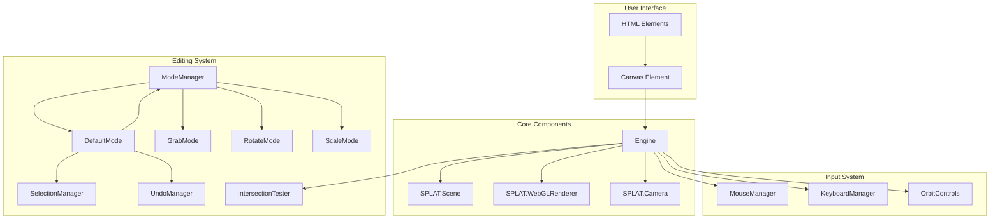
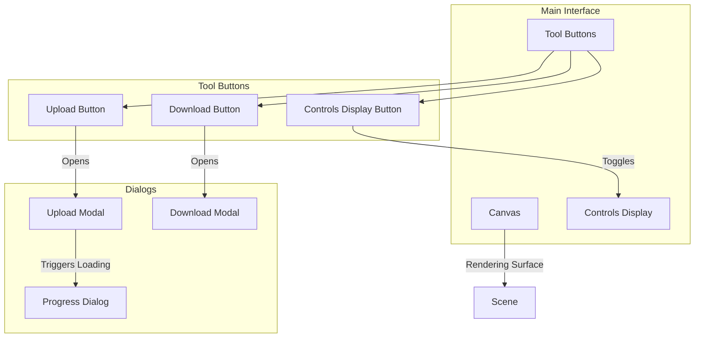
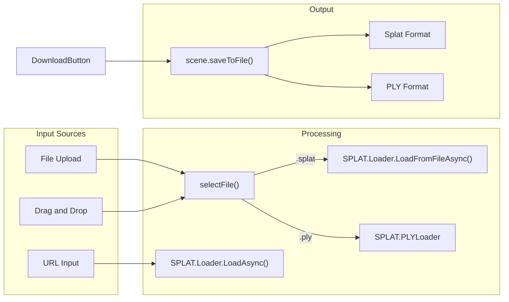
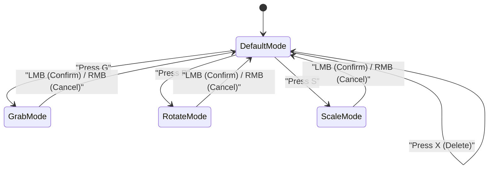
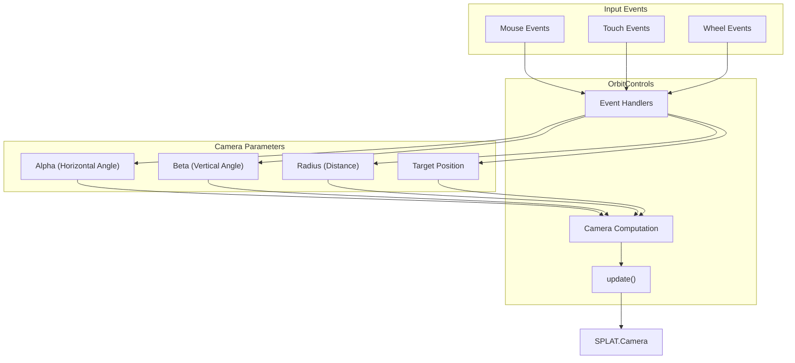
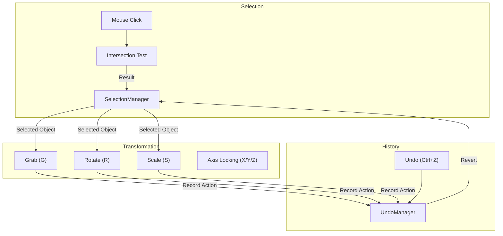
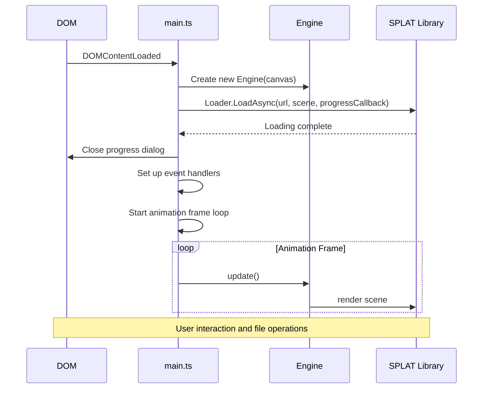

<!-- source: DeepWiki mcp.deepwiki.com · repo huggingface/gsplat.js · page 8.3 Editor Example · fetched 2026-10-26 -->

# Editor Example

Relevant source files

The following files were used as context for generating this wiki page:

- [examples/editor/index.html](examples/editor/index.html)
- [examples/editor/src/Controls.ts](examples/editor/src/Controls.ts)
- [examples/editor/src/DefaultMode.ts](examples/editor/src/DefaultMode.ts)
- [examples/editor/src/OrbitControls.ts](examples/editor/src/OrbitControls.ts)
- [examples/editor/src/main.ts](examples/editor/src/main.ts)
- [examples/editor/style.css](examples/editor/style.css)
- [examples/editor/tsconfig.json](examples/editor/tsconfig.json)

This document explores the Editor Example that showcases a more complex application of gsplat.js. The Editor Example provides a user interface for manipulating 3D Gaussian splats with capabilities for loading, saving, selecting, and transforming objects in a 3D scene. For basic usage of gsplat.js, see [Basic Usage](#8.1), and for specific information about scene transformations, see [Scene Transformations](#8.2).

## Overview

The Editor Example demonstrates how to create an interactive editor for 3D Gaussian splats. It includes the following key features:

- Loading and saving splat files (.splat or .ply formats)
- Camera controls for navigating the 3D scene
- Selection of individual splat objects
- Transformation controls (grab, rotate, scale)
- Undo functionality

Sources: [examples/editor/src/main.ts:1-170](), [examples/editor/index.html:1-173]()

## Architecture

The Editor Example is built with a modular architecture that separates concerns across several components:

Sources: [examples/editor/src/main.ts:25-25](), [examples/editor/src/DefaultMode.ts:1-89](), [examples/editor/src/OrbitControls.ts:1-276]()

## User Interface

The Editor Example provides a clean, minimal interface with the following elements:

The UI elements are defined in the HTML file and styled with CSS:

- **Canvas**: Main rendering surface for the 3D scene
- **Tool Buttons**: Interface for file operations and controls display
- **Modals**: Dialog boxes for file upload/download operations
- **Progress Dialog**: Shows loading progress for splat files

Sources: [examples/editor/index.html:10-170](), [examples/editor/style.css:1-265]()

## File Operations

The Editor Example provides comprehensive file handling capabilities:

The main file operations include:

1. **Loading Files**:
   - Upload local .splat or .ply files
   - Load from URL
   - Drag and drop files

2. **Saving Files**:
   - Save entire scene or selected splat
   - Export as .splat or .ply format

Sources: [examples/editor/src/main.ts:28-58](), [examples/editor/src/main.ts:111-141](), [examples/editor/src/main.ts:143-159]()

## Interaction Modes

The Editor Example implements different interaction modes to handle user input:

| Mode | Activation | Description |
|------|------------|-------------|
| Default | Initial state | Handles selection, initiates transformations |
| Grab | Press 'G' key | Moves the selected splat in 3D space |
| Rotate | Press 'R' key | Rotates the selected splat |
| Scale | Press 'S' key | Resizes the selected splat |

The mode system is managed by the `ModeManager` class, which ensures that only one mode is active at a time:

Sources: [examples/editor/src/DefaultMode.ts:8-86]()

## Camera Controls

The Editor Example implements orbit controls for navigating the 3D scene:

The `OrbitControls` class provides the following functionality:

- **Orbit**: Rotate the camera around a target point (MMB or Alt+LMB)
- **Pan**: Move the target point (Shift+MMB or Alt+RMB)
- **Zoom**: Adjust distance to target (Mouse wheel)
- **Touch Support**: Multi-touch gestures for mobile devices

Sources: [examples/editor/src/OrbitControls.ts:3-274](), [examples/editor/index.html:106-117]()

## Selection and Transformation

Object selection and transformation are core features of the Editor:

The key components involved in selection and transformation are:

1. **SelectionManager**: Keeps track of the currently selected splat object
2. **IntersectionTester**: Tests for intersection between mouse position and splats in the scene
3. **Transformation Modes**: Implement different transformation types (grab, rotate, scale)
4. **UndoManager**: Maintains a history of actions for undo functionality

Sources: [examples/editor/src/DefaultMode.ts:30-62]()

## Main Initialization and Execution Flow

The Editor Example follows a clear initialization and execution flow:

The main file initializes the application, sets up event listeners, loads an initial model, and starts the rendering loop.

Sources: [examples/editor/src/main.ts:60-170]()

## Conclusion

The Editor Example demonstrates how to build a comprehensive editing application using gsplat.js. It showcases integration of various gsplat.js components to create an interactive 3D editing experience. The modular architecture separates UI, rendering, input handling, and editing systems, making it a good reference for developers building their own applications with gsplat.js.

For exploring file format conversion capabilities, see [File Conversion](#8.4).

---

