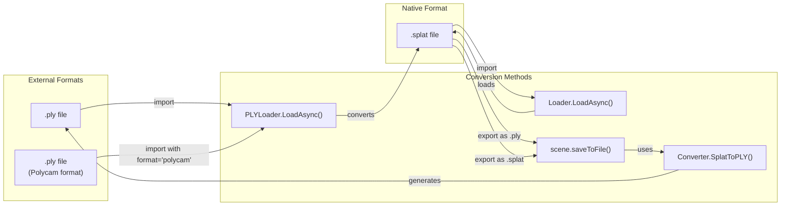
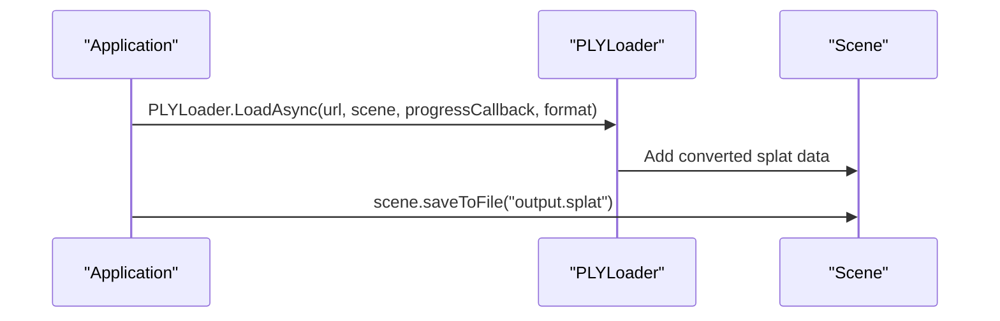
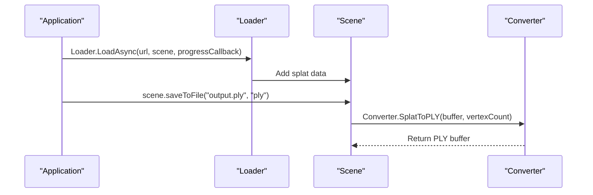
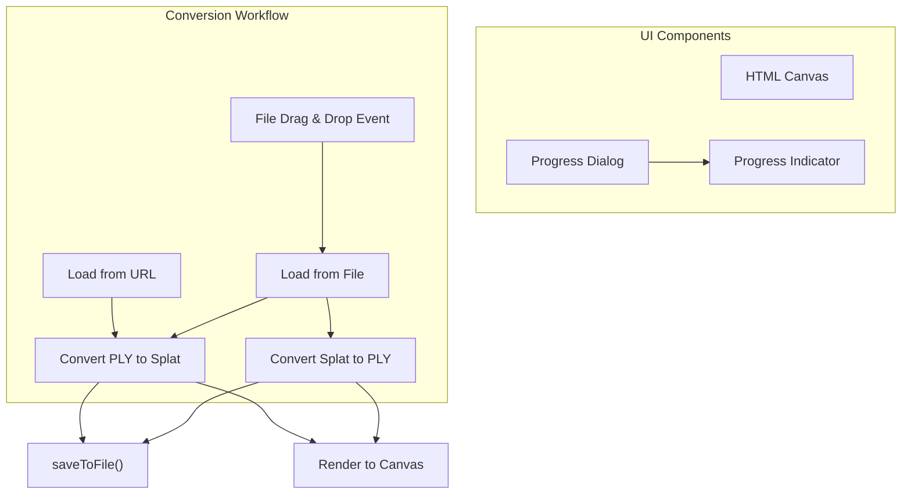

<!-- source: DeepWiki mcp.deepwiki.com · repo huggingface/gsplat.js · page 8.4 File Conversion · fetched 2026-10-26 -->

# File Conversion

<details>
<summary>Relevant source files</summary>

The following files were used as context for generating this wiki page:

- [examples/file-loader/src/main.ts](examples/file-loader/src/main.ts)
- [examples/ply-converter/src/main.ts](examples/ply-converter/src/main.ts)
- [src/utils/Converter.ts](src/utils/Converter.ts)

</details>


This page documents the file conversion capabilities in gsplat.js, including how to convert between different 3D Gaussian Splatting file formats, the underlying conversion mechanisms, and practical examples of file conversion workflows.

## Purpose and Scope

The gsplat.js library supports loading and converting between different file formats for 3D Gaussian Splatting. This document covers:

- Supported file formats (PLY and Splat)
- Conversion methods between formats
- Data preservation considerations when converting
- Example conversion workflows
- API usage for file conversion

For information about loading files without conversion, see [File Loaders](#5.1).

## Supported File Formats

gsplat.js primarily works with two file formats:

| Format | File Extension | Description | Notes |
|--------|----------------|-------------|-------|
| Splat | `.splat` | Binary format optimized for Gaussian Splatting | Native format for gsplat.js |
| PLY | `.ply` | Point cloud format used by many 3D applications | Imported/exported with some data transformation |

Sources: [examples/ply-converter/src/main.ts:17-28](), [examples/file-loader/src/main.ts:14-29]()

## Conversion Workflow

The following diagram illustrates the conversion paths between supported file formats:



Sources: [examples/ply-converter/src/main.ts:16-28](), [src/utils/Converter.ts:6-93]()

## Data Representation and Preservation

When converting between formats, it's important to understand data preservation considerations:

### Conversion from PLY to Splat

- Position data (x, y, z) is preserved
- Color information is encoded as spherical harmonics in Splat format
- Scale and rotation information is preserved but stored differently
- Normal information may be transformed

### Conversion from Splat to PLY

- **Note: Data loss occurs when converting Splat → PLY → Splat**
- Spherical harmonic coefficients beyond DC components may be lost
- The PLY format includes the following properties:
  - Position (x, y, z)
  - Normal vectors (nx, ny, nz)
  - Color DC components (f_dc_0, f_dc_1, f_dc_2)
  - Additional spherical harmonic coefficients (f_rest_0 to f_rest_44)
  - Opacity
  - Scale (scale_0, scale_1, scale_2)
  - Rotation quaternion (rot_0, rot_1, rot_2, rot_3)

Sources: [src/utils/Converter.ts:6-93](), [examples/ply-converter/src/main.ts:24-25]()

## Using the Conversion API

The following sections demonstrate how to use the file conversion API in common scenarios.

### Converting PLY to Splat



Sample code to convert a PLY file to Splat format:

```javascript
// From URL
await SPLAT.PLYLoader.LoadAsync(
    "https://example.com/model.ply", 
    scene, 
    (progress) => console.log(`Loading: ${progress * 100}%`),
    "" // Optional format string (e.g., "polycam")
);
scene.saveToFile("model.splat");

// From File object
const file = fileInput.files[0]; // From an <input type="file"> element
await SPLAT.PLYLoader.LoadFromFileAsync(
    file,
    scene,
    (progress) => console.log(`Loading: ${progress * 100}%`),
    "" // Optional format string
);
scene.saveToFile("model.splat");
```

Sources: [examples/ply-converter/src/main.ts:16-21](), [examples/ply-converter/src/main.ts:49-59]()

### Converting Splat to PLY



Sample code to convert a Splat file to PLY format:

```javascript
// From URL
await SPLAT.Loader.LoadAsync(
    "https://example.com/model.splat", 
    scene, 
    (progress) => console.log(`Loading: ${progress * 100}%`)
);
scene.saveToFile("model.ply", "ply");

// From File object
const file = fileInput.files[0]; // From an <input type="file"> element
await SPLAT.Loader.LoadFromFileAsync(
    file,
    scene,
    (progress) => console.log(`Loading: ${progress * 100}%`)
);
scene.saveToFile("model.ply", "ply");
```

Sources: [examples/ply-converter/src/main.ts:25-28](), [src/utils/Converter.ts:6-93]()

### Handling Special PLY Formats

The PLYLoader supports different PLY formats through an optional format parameter:

```javascript
// Load a standard PLY file
await SPLAT.PLYLoader.LoadAsync(url, scene, progressCallback, "");

// Load a PLY file in Polycam format
await SPLAT.PLYLoader.LoadAsync(url, scene, progressCallback, "polycam");
```

Sources: [examples/ply-converter/src/main.ts:12-13](), [examples/file-loader/src/main.ts:19-20]()

## Example: PLY Converter Application

The gsplat.js repository includes a complete example application demonstrating file conversion:



The example provides:

1. A drag-and-drop interface for file conversion
2. Progress reporting during conversion
3. Automatic rendering of the converted model
4. File saving capability for the converted format

Sources: [examples/ply-converter/src/main.ts:1-73]()

## Low-Level Conversion Implementation

The `Converter.SplatToPLY` method handles the complex transformation from Splat's binary format to PLY format:

1. Generates a PLY header with property definitions
2. Allocates a buffer for the output data
3. Processes each Gaussian splat, converting:
   - Position coordinates
   - DC color components (with spherical harmonic normalization)
   - Opacity (with logit transformation)
   - Scale parameters (with logarithmic transformation)
   - Rotation quaternion (with normalization)
4. Writes the converted data to the output buffer

This conversion process involves several mathematical transformations to properly represent the Gaussian splats in the PLY format's property structure.

Sources: [src/utils/Converter.ts:6-93]()

---

