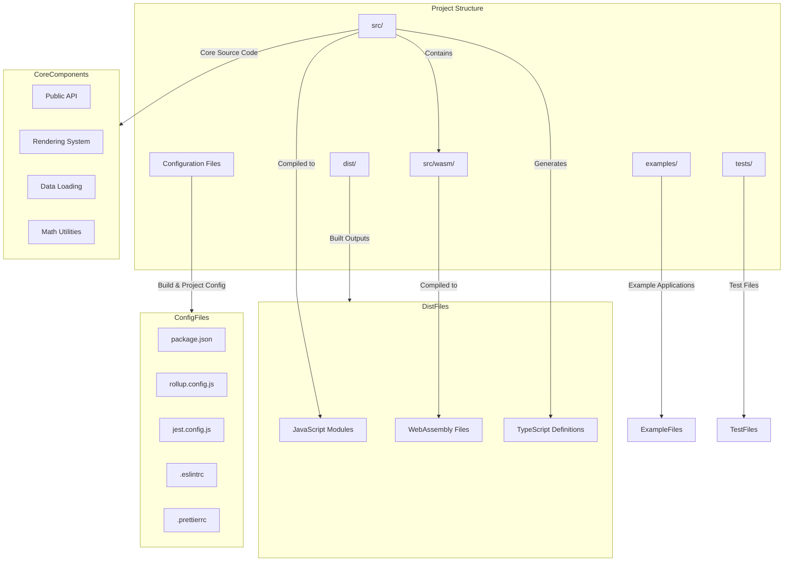
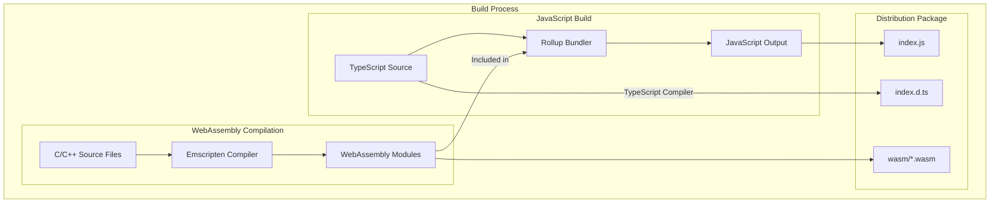
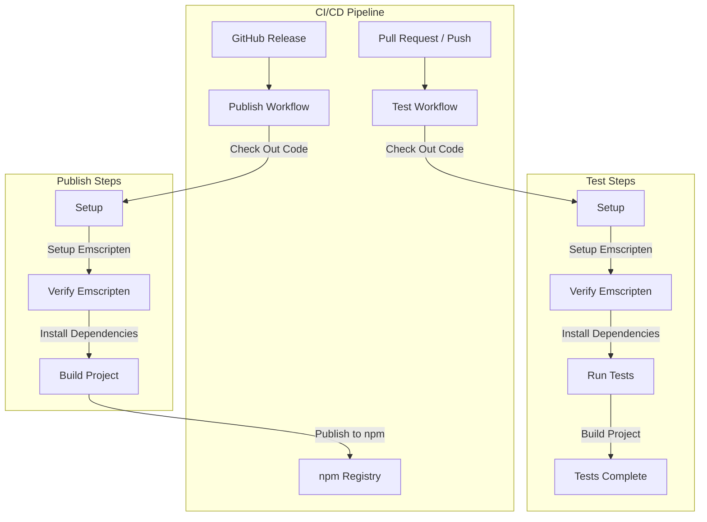
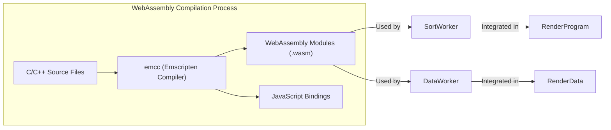

<!-- source: DeepWiki mcp.deepwiki.com · repo huggingface/gsplat.js · page 9 Development Guide · fetched 2026-10-26 -->

# Development Guide

<details>
<summary>Relevant source files</summary>

The following files were used as context for generating this wiki page:

- [.github/workflows/publish.yml](.github/workflows/publish.yml)
- [.github/workflows/test.yml](.github/workflows/test.yml)
- [jest.config.js](jest.config.js)
- [package-lock.json](package-lock.json)
- [package.json](package.json)
- [rollup.config.js](rollup.config.js)

</details>


This guide is intended for developers who want to contribute to the gsplat.js library or build it from source. It covers setting up your development environment, building the library, running tests, and guidelines for contributing.

## Prerequisites

Before you begin development on gsplat.js, you need to have the following installed:

- [Node.js](https://nodejs.org/) (LTS version recommended)
- [npm](https://www.npmjs.com/) (comes with Node.js)
- [Emscripten](https://emscripten.org/) - Required for WebAssembly compilation

Sources: [package.json:1-58](), [.github/workflows/test.yml:1-15]()

## Development Workflow

```mermaid
flowchart TD
    subgraph "Development Process"
        Setup["Setup Environment"]
        Clone["Clone Repository"]
        Install["Install Dependencies"]
        Develop["Develop Changes"]
        subgraph "Build & Test"
            BuildWasm["Build WebAssembly"]
            BuildJS["Build JavaScript"]
            Test["Run Tests"]
            Lint["Lint & Format Code"]
        end
        PR["Create Pull Request"]
        Review["Code Review"]
        Merge["Merge"]
        Release["Release"]
    end

    Setup --> Clone
    Clone --> Install
    Install --> Develop
    Develop --> BuildWasm
    BuildWasm --> BuildJS
    BuildJS --> Test
    Test --> Lint
    Lint --> PR
    PR --> Review
    Review --> Merge
    Merge --> Release
```



Sources: [.github/workflows/test.yml:1-15](), [.github/workflows/publish.yml:1-23](), [package.json:1-58]()

## Setting Up Your Development Environment

1. Clone the repository:
   ```bash
   git clone https://github.com/huggingface/gsplat.js.git
   cd gsplat.js
   ```

2. Install dependencies:
   ```bash
   npm install
   ```

3. Verify that Emscripten is installed and working:
   ```bash
   emcc --version
   ```

Sources: [.github/workflows/test.yml:9-11]()

## Project Structure

The gsplat.js codebase is organized into several key components as illustrated below:



Sources: [package.json:1-58](), [rollup.config.js:1-28]()

## Building the Project

The build process for gsplat.js involves two main steps:

1. Compiling WebAssembly modules from C/C++ code
2. Building the TypeScript modules into JavaScript



### Build Commands

To build the project, you can use the following npm scripts:

1. Build WebAssembly modules:
   ```bash
   npm run build:wasm
   ```

2. Copy WebAssembly files to the distribution folder:
   ```bash
   npm run copy:wasm
   ```

3. Build the entire project (WebAssembly + JavaScript):
   ```bash
   npm run build
   ```

Sources: [package.json:8-14](), [rollup.config.js:1-28](), [.github/workflows/publish.yml:13-19]()

## Testing

gsplat.js uses Jest for unit testing. The testing infrastructure is configured to run TypeScript tests directly.

### Running Tests

To execute the test suite, run:

```bash
npm test
```

### Test Configuration

Jest is configured to use the TypeScript preset. The configuration is minimal, as seen in the Jest config file.

Sources: [jest.config.js:1-6](), [package.json:12]()

## Code Style and Linting

gsplat.js uses ESLint for linting and Prettier for code formatting.

### Linting

To check your code for style issues:

```bash
npm run lint
```

### Formatting

To automatically format your code according to the project's style guidelines:

```bash
npm run format
```

Sources: [package.json:13-14]()

## Continuous Integration

The project uses GitHub Actions for continuous integration:

1. **Test Workflow**: Runs on pull requests and pushes to verify that tests pass and the project builds correctly.
2. **Publish Workflow**: Automatically publishes new releases to npm when a new release is created on GitHub.



Sources: [.github/workflows/test.yml:1-15](), [.github/workflows/publish.yml:1-23]()

## WebAssembly Compilation

gsplat.js relies on WebAssembly for performance-critical operations such as sorting and data processing. The WebAssembly modules are built using Emscripten.

### Compilation Process

The WebAssembly compilation is handled by the `compile_wasm.sh` script, which is invoked by the `build:wasm` npm script. This script uses Emscripten to compile C/C++ code into WebAssembly modules.



Sources: [package.json:9]()

## Contributing Guidelines

When contributing to gsplat.js, please follow these guidelines:

### Pull Request Process

1. Fork the repository and create a feature branch
2. Make your changes, ensuring they follow the code style guidelines
3. Add tests for any new functionality
4. Ensure all tests pass
5. Submit a pull request

### Code Standards

- Follow the TypeScript coding style enforced by ESLint and Prettier
- Maintain appropriate test coverage for your changes
- Document public APIs using JSDoc comments
- Keep dependencies to a minimum

## Troubleshooting Common Issues

| Issue | Solution |
|-------|----------|
| WebAssembly compilation failures | Ensure Emscripten is correctly installed and in your PATH |
| Build errors related to web workers | Check for syntax issues in worker files or issues with the worker loader plugin |
| Type errors | Make sure your TypeScript code adheres to the type definitions |
| Test failures | Ensure your changes don't break existing functionality |

## Release Process

The release process for gsplat.js is automated through GitHub Actions:

1. Update the version in `package.json`
2. Create a new release on GitHub with appropriate release notes
3. The publish workflow will automatically build and publish the package to npm

Sources: [package.json:3](), [.github/workflows/publish.yml:1-23]()

## Project Integration

If you're developing with gsplat.js as a dependency in your project, but need to make modifications, you can use npm's link feature:

```bash
# In the gsplat.js directory
npm run build
npm link

# In your project directory
npm link gsplat
```

This creates a symbolic link, allowing you to test changes to gsplat.js in your project without publishing.

## References

For more detailed information about specific components in the system, refer to these related wiki pages:

- [Rendering System](#4) - Details on the rendering pipeline
- [WASM Integration](#4.3) - More information about WebAssembly usage
- [File Formats](#5.2) - Information about supported file formats

---

