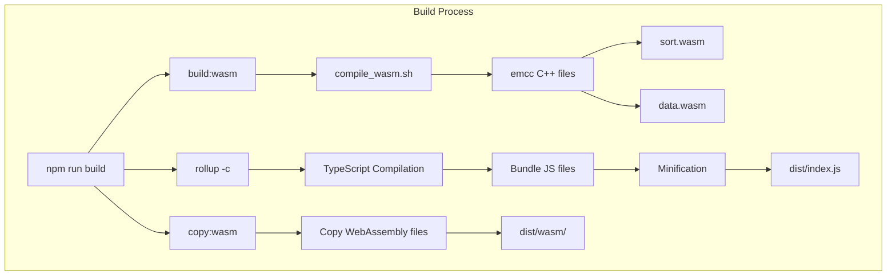
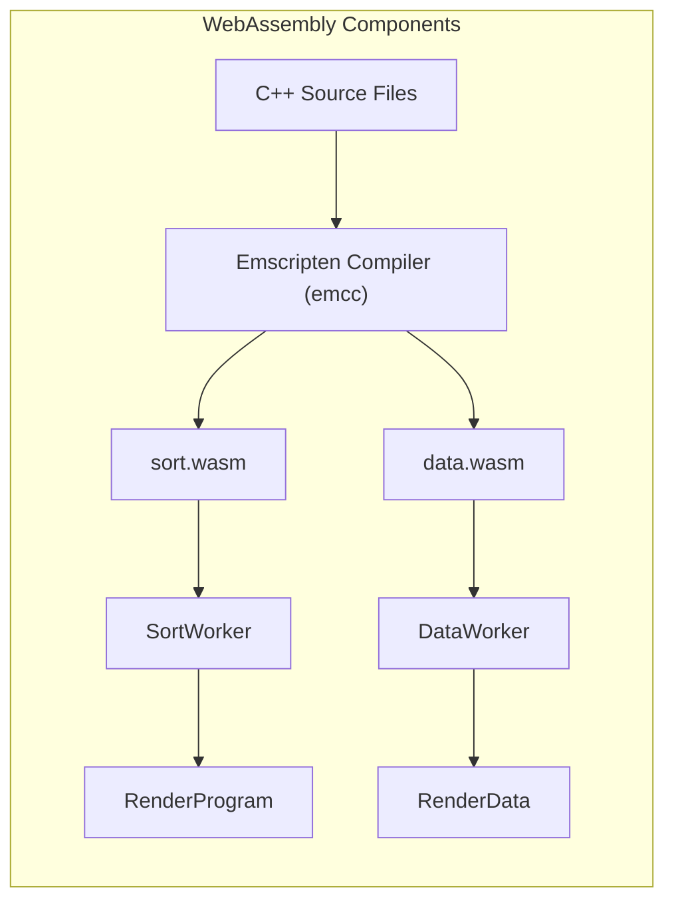
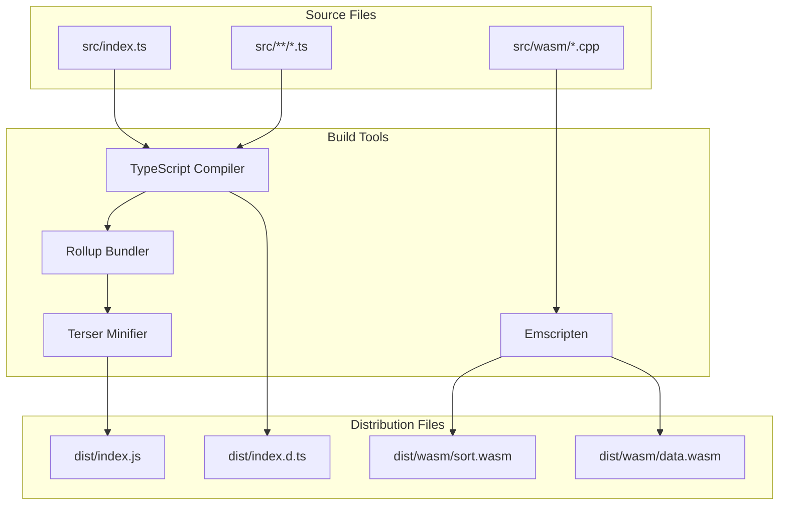
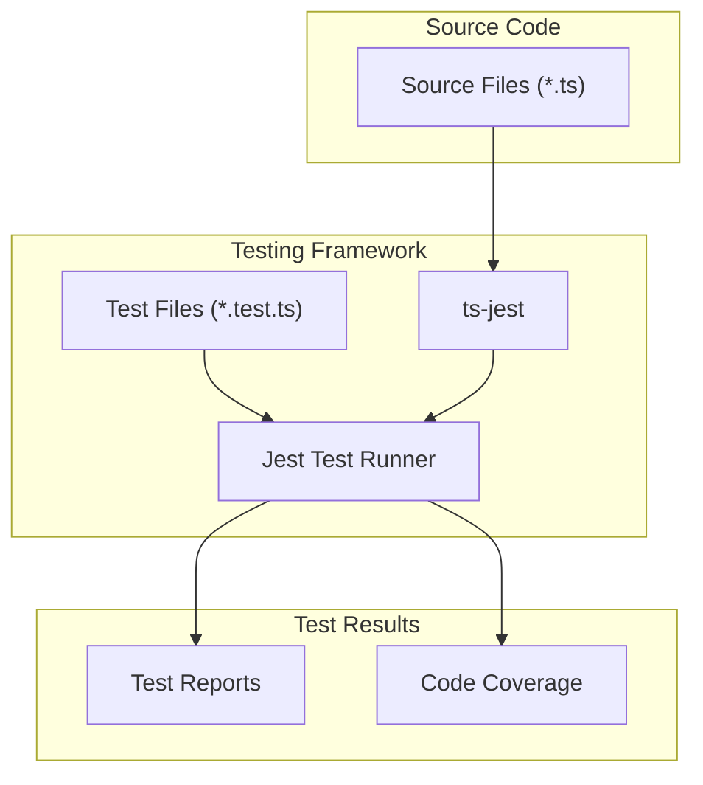
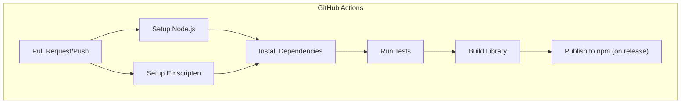
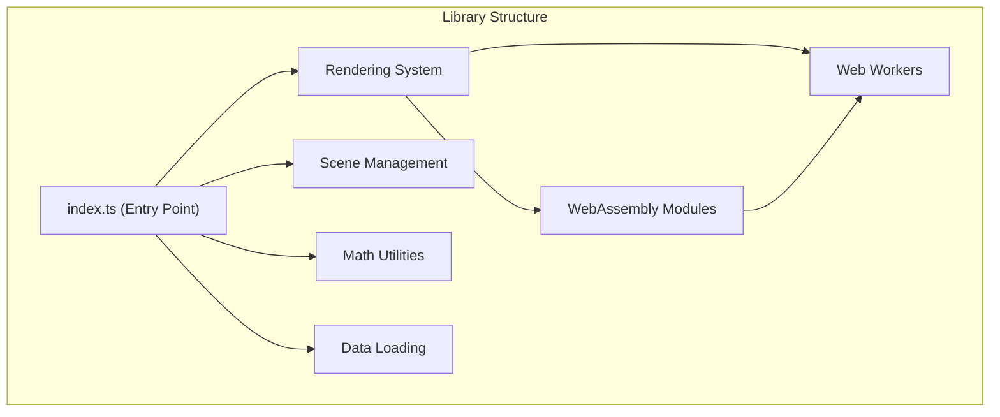

<!-- source: DeepWiki mcp.deepwiki.com · repo huggingface/gsplat.js · page 9.1 Building and Testing · fetched 2026-10-26 -->

# Building and Testing

<details>
<summary>Relevant source files</summary>

The following files were used as context for generating this wiki page:

- [.github/workflows/publish.yml](.github/workflows/publish.yml)
- [.github/workflows/test.yml](.github/workflows/test.yml)
- [jest.config.js](jest.config.js)
- [package-lock.json](package-lock.json)
- [package.json](package.json)
- [rollup.config.js](rollup.config.js)

</details>


This document provides a comprehensive guide for developers who want to build and test the gsplat.js library. It covers the development environment setup, build process, WebAssembly compilation, testing procedures, and continuous integration workflow. For contribution guidelines, please see [Contributing](#9.2).

## Development Environment Setup

Before you can build and test gsplat.js, you need to set up your development environment with the following prerequisites:

1. **Node.js and npm**: Latest stable version recommended
2. **Emscripten**: Required for compiling C++ code to WebAssembly
3. **Git**: For version control

### Installing Prerequisites

```bash
# Install Emscripten (example for Unix-based systems)
git clone https://github.com/emscripten-core/emsdk.git
cd emsdk
./emsdk install latest
./emsdk activate latest
source ./emsdk_env.sh

# Clone the repository
git clone https://github.com/huggingface/gsplat.js.git
cd gsplat.js

# Install dependencies
npm install
```

Sources: [package.json:1-58](), [.github/workflows/test.yml:1-15]()

## Building the Library

The build process for gsplat.js consists of three main steps:

1. Compiling WebAssembly modules
2. Bundling TypeScript code with Rollup
3. Copying WebAssembly modules to the distribution folder

### Build Commands

The main build commands are defined in `package.json`:

| Command | Description |
|---------|-------------|
| `npm run build:wasm` | Compiles C++ code to WebAssembly using Emscripten |
| `npm run copy:wasm` | Copies the compiled WebAssembly files to the distribution folder |
| `npm run build` | Runs all build steps in sequence |
| `npm run lint` | Runs ESLint on TypeScript source files |
| `npm run format` | Runs Prettier to format TypeScript source files |

To build the library, simply run:

```bash
npm run build
```

Sources: [package.json:8-14]()

### Build Process Flow



Sources: [package.json:8-14](), [rollup.config.js:1-27]()

## WebAssembly Compilation

gsplat.js leverages WebAssembly for performance-critical operations like depth sorting and data processing. The WebAssembly modules are compiled from C++ code using Emscripten.

### WebAssembly Modules

The library includes two primary WebAssembly modules:

1. **sort.wasm**: Handles efficient depth sorting of Gaussian splats
2. **data.wasm**: Manages data processing tasks

### Compilation Process

The WebAssembly compilation is handled by the `compile_wasm.sh` script, which uses Emscripten to compile C++ code to WebAssembly. The process is automated in the build pipeline.



Sources: [package.json:9](), [rollup.config.js:21-24]()

## Relationship Between Source and Distribution Files

The build process transforms the TypeScript source files and WebAssembly modules into a distribution package:



Sources: [package.json:1-58](), [rollup.config.js:1-27]()

## Testing

gsplat.js uses Jest for unit testing. The tests are written in TypeScript and run in a Node.js environment.

### Running Tests

To run the tests, use the following command:

```bash
npm test
```

This will execute all test files with the Jest test runner.

### Test Configuration

The Jest configuration is defined in `jest.config.js`:

```javascript
export default {
    preset: "ts-jest",
    testEnvironment: "node",
};
```

This configures Jest to use the ts-jest preset for TypeScript support and run tests in a Node.js environment.

### Testing Architecture



Sources: [package.json:12](), [jest.config.js:1-6]()

## Continuous Integration

gsplat.js uses GitHub Actions for continuous integration, automatically running tests and builds on pull requests and pushes to the repository.

### CI Workflow



The CI workflow performs the following steps:

1. Sets up the Node.js environment
2. Sets up Emscripten for WebAssembly compilation
3. Installs dependencies with `npm ci`
4. Runs tests with `npm test`
5. Builds the library with `npm run build`
6. Optionally publishes to npm if the event is a release

Sources: [.github/workflows/test.yml:1-15](), [.github/workflows/publish.yml:1-23]()

## Troubleshooting Common Issues

Below are solutions to common issues encountered during building and testing:

| Issue | Solution |
|-------|----------|
| Emscripten compilation errors | Ensure Emscripten is properly installed and activated. Check for compatible versions. |
| Missing dependencies | Run `npm install` or `npm ci` to ensure all dependencies are installed. |
| Test failures | Check test output for specific failures. Update tests if API changes have been made. |
| WebAssembly not loading | Ensure the WebAssembly files are properly copied to the distribution folder. |
| Build process hangs | Check system memory usage. The build process may require significant memory, especially for WebAssembly compilation. |

Sources: [package.json:1-58](), [.github/workflows/test.yml:1-15]()

## Module Structure and Dependencies

Understanding the module structure is important for effective building and testing:



Sources: [rollup.config.js:8-16]()

This structure informs how you might approach testing different components and how the build process assembles these components into the final library.

---

