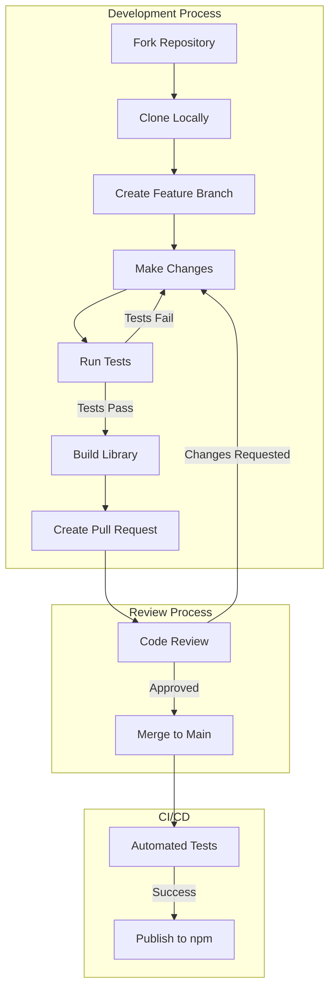
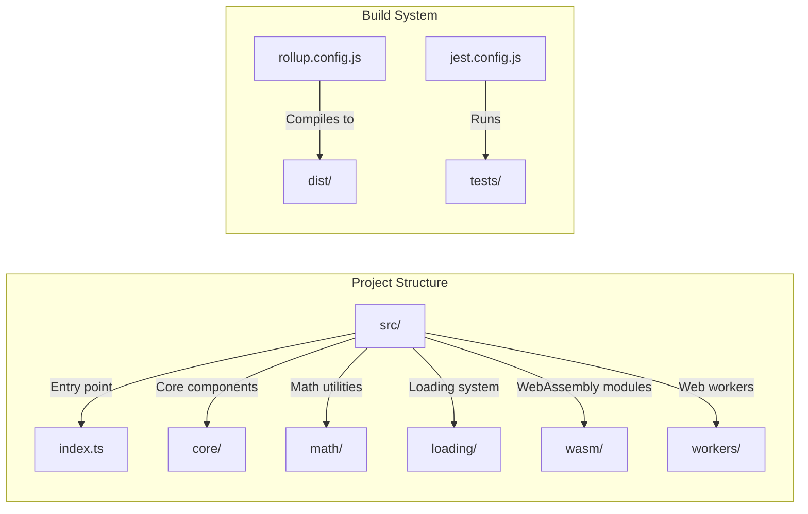
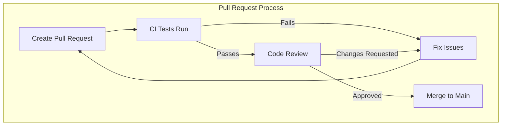
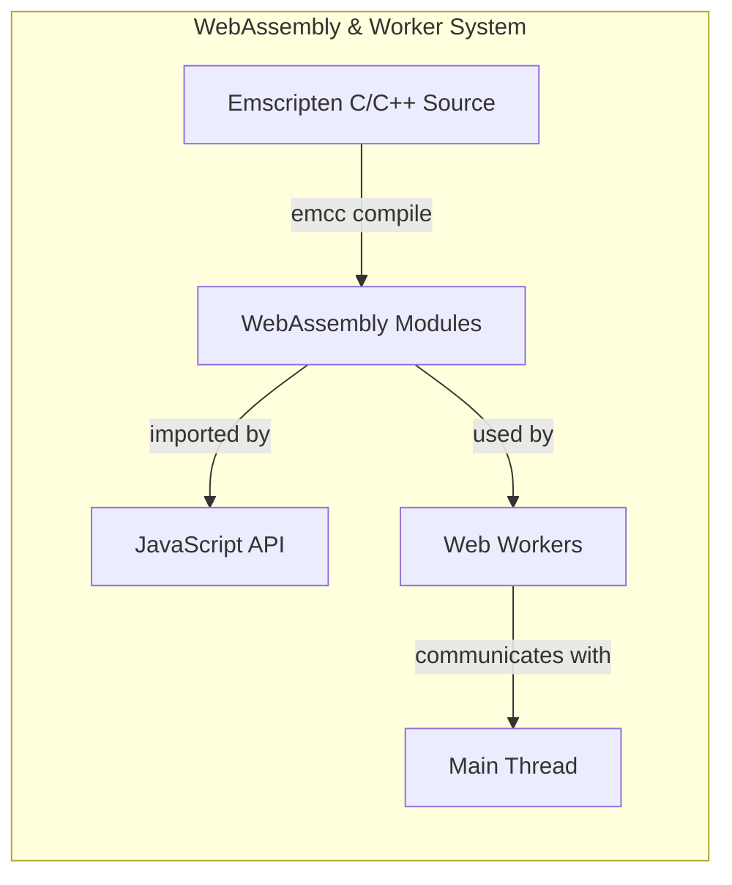
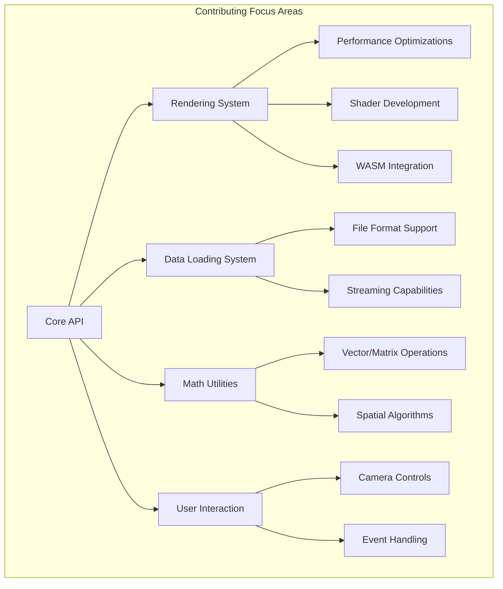

<!-- source: DeepWiki mcp.deepwiki.com · repo huggingface/gsplat.js · page 9.2 Contributing · fetched 2026-10-26 -->

# Contributing

<details>
<summary>Relevant source files</summary>

The following files were used as context for generating this wiki page:

- [.github/workflows/publish.yml](.github/workflows/publish.yml)
- [.github/workflows/test.yml](.github/workflows/test.yml)
- [README.md](README.md)
- [jest.config.js](jest.config.js)
- [package-lock.json](package-lock.json)
- [rollup.config.js](rollup.config.js)

</details>


This document provides guidelines and procedures for contributing to the gsplat.js project. It covers the development environment setup, workflow processes, coding standards, and testing requirements for developers who want to contribute to the library. For information about building and testing the library, see [Building and Testing](#9.1).

## Setting Up the Development Environment

To start contributing to gsplat.js, you'll need to set up your development environment with the necessary tools and dependencies.

### Prerequisites

- **Node.js and npm**: Latest stable version recommended
- **Emscripten**: Required for compiling WebAssembly modules
- **Git**: For version control

### Setup Process

1. Clone the repository:
   ```bash
   git clone https://github.com/huggingface/gsplat.js.git
   cd gsplat.js
   ```

2. Install dependencies:
   ```bash
   npm ci --legacy-peer-deps
   ```

3. Build the project to verify your setup:
   ```bash
   npm run build
   ```

Sources: [README.md:13-37](), [.github/workflows/test.yml:9-14]()

## Development Workflow



### Branch Naming Convention

- Use descriptive names that reflect the purpose of your changes
- Format: `feature/description`, `bugfix/issue-number`, or `improvement/description`

### Development Cycle

1. Create a feature branch from the main branch
2. Make your changes with atomic, well-documented commits
3. Run tests to ensure no regressions
4. Build the library to verify compilation
5. Submit a pull request with a detailed description of changes

Sources: [.github/workflows/publish.yml:1-23](), [.github/workflows/test.yml:1-15]()

## Code Organization



The codebase follows a modular structure organized by functionality:

| Directory | Purpose |
|-----------|---------|
| `src/` | Source code for the library |
| `examples/` | Example applications demonstrating usage |
| `tests/` | Test suite for ensuring code quality |
| `dist/` | Compiled distribution files (generated) |
| `wasm/` | WebAssembly source code |

Sources: [rollup.config.js:8-27]()

## Building and Testing

### Building the Library

The project uses Rollup for bundling. The configuration handles TypeScript compilation, WebAssembly integration, and optimization.

```bash
npm run build
```

This command compiles the TypeScript source, bundles WebAssembly modules, and creates optimized distribution files in the `dist/` directory.

### Running Tests

The project uses Jest for testing. To run the test suite:

```bash
npm run test
```

Sources: [rollup.config.js:8-27](), [jest.config.js:1-5](), [.github/workflows/test.yml:13-14]()

## Pull Request Guidelines



### Pull Request Requirements

1. **Code Quality**: Follow the codebase's style and formatting conventions
2. **Tests**: Include tests for new features or bug fixes
3. **Documentation**: Update relevant documentation
4. **Focused Changes**: Keep PRs focused on a single issue or feature
5. **CI Checks**: Ensure all CI checks pass

### PR Description Template

```
## Description
[Describe your changes here]

## Related Issue
[Link to relevant issue if applicable]

## Type of Change
- [ ] Bug fix
- [ ] New feature
- [ ] Breaking change
- [ ] Documentation update

## Testing
[Describe how you tested your changes]

## Checklist
- [ ] My code follows the project's style guidelines
- [ ] I have added tests that prove my fix/feature works
- [ ] All new and existing tests pass
- [ ] I have updated documentation as needed
```

Sources: [.github/workflows/test.yml:1-15]()

## WebAssembly and Worker Contributions



### WebAssembly Development

The project uses WebAssembly for performance-critical operations like sorting. When contributing to WebAssembly components:

1. Ensure Emscripten is properly set up in your development environment
2. Make changes to the C/C++ source files in the appropriate directories
3. Build with the WebAssembly compilation scripts
4. Test both functionality and performance

### Web Worker Contributions

When working with web workers:

1. Consider thread communication overhead
2. Keep worker code focused on computationally intensive tasks
3. Implement proper error handling for worker communication

Sources: [.github/workflows/test.yml:9-11](), [rollup.config.js:22-23]()

## Release Process

The project uses GitHub Actions for automated releases to npm. When a new release is published on GitHub:

1. The CI workflow builds the project
2. Tests are run to ensure quality
3. The package is published to npm

Key aspects of the release process:

| Step | Description |
|------|-------------|
| Version Bump | Update version in package.json |
| Changelog | Document changes in the release notes |
| Tag | Create a new tag matching the version |
| Release | Create a GitHub release with the new tag |
| Publish | Automatic npm publish via GitHub Actions |

Sources: [.github/workflows/publish.yml:1-23]()

## Code Style and Standards

The project uses TypeScript and follows specific code style guidelines:

1. **TypeScript Features**: Use TypeScript's type system effectively
2. **Documentation**: Document public APIs with JSDoc comments
3. **Testing**: Write unit tests for new functionality
4. **Modularity**: Follow the established module structure
5. **Performance**: Consider performance impacts, especially for rendering code

The project uses ESLint and Prettier for code formatting and style enforcement.

Sources: [package-lock.json:19-31]()

## Library Architecture Overview

Understanding the architecture helps with making contributions that align with the project's design principles.



When contributing, consider which subsystem your changes affect and ensure they integrate properly with the overall architecture.

Sources: [README.md:1-13]()

## Community Guidelines

1. **Be Respectful**: Treat all contributors with respect
2. **Be Patient**: Not all PRs can be reviewed immediately
3. **Be Clear**: Communicate your intentions and implementation details clearly
4. **Be Collaborative**: Work with maintainers to address feedback
5. **Be Focused**: Keep contributions focused on specific improvements

## Getting Help

If you need assistance while contributing:

- Open an issue for technical questions
- Join the Hugging Face Discord for community support
- Email the maintainers for more complex inquiries

Sources: [README.md:104-106]()