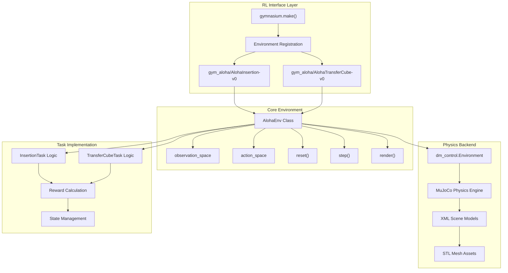
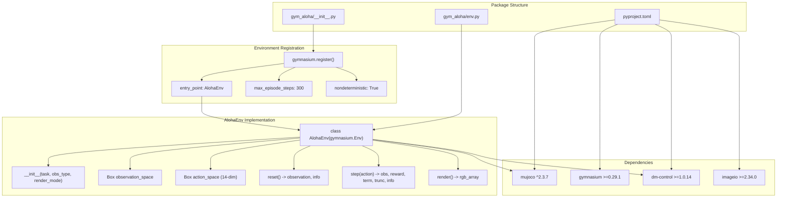

<!-- source: DeepWiki mcp.deepwiki.com · repo huggingface/gym-aloha · page 1 Overview · fetched 2026-10-26 -->

# Overview

Relevant source files

The following files were used as context for generating this wiki page:

- [README.md](README.md)
- [pyproject.toml](pyproject.toml)

This document provides a comprehensive introduction to the gym-aloha repository, explaining its purpose as a Gymnasium environment for ALOHA bimanual robotics simulation, key architectural components, and available features. For detailed installation instructions, see [Installation and Setup](#1.1). For hands-on usage examples, see [Quick Start Guide](#1.2).

## Purpose and Scope

The `gym-aloha` repository implements a Gymnasium-compatible reinforcement learning environment for simulating ALOHA bimanual robot manipulation tasks. This environment enables researchers and developers to train and evaluate robotic policies on complex bimanual manipulation scenarios using MuJoCo physics simulation.

**Sources:** [README.md:1-3](), [pyproject.toml:2-4]()

## System Overview

gym-aloha is designed as a modular robotics simulation environment that integrates multiple open-source components to provide a comprehensive bimanual manipulation platform. The system serves as a bridge between high-level reinforcement learning frameworks and detailed physics simulation.

### Primary Components

The system consists of several key components:

- **Environment Interface**: Gymnasium-compatible API for reinforcement learning integration
- **Physics Simulation**: MuJoCo-based realistic physics and rendering
- **Robot Models**: Detailed ViperX 300S bimanual robot configurations  
- **Task Definitions**: Structured manipulation tasks with reward systems
- **Asset Management**: 3D models, textures, and scene configurations

**Sources:** [README.md:48-66](), [pyproject.toml:24-29]()

## High-Level Architecture

The following diagram illustrates the system's main architectural components and their relationships:

### System Architecture Overview

**Sources:** [README.md:23-45](), [pyproject.toml:24-29]()

### Core Implementation Structure

The following diagram shows the specific code entities and their relationships within the implementation:

**Sources:** [pyproject.toml:21-38](), [README.md:87-93]()

## Available Tasks

The environment provides two primary bimanual manipulation tasks:

| Task Name | Environment ID | Description | Max Reward |
|-----------|---------------|-------------|------------|
| **Insertion Task** | `gym_aloha/AlohaInsertion-v0` | Insert peg into socket using coordinated bimanual manipulation | 4 points |
| **Transfer Cube Task** | `gym_aloha/AlohaTransferCube-v0` | Transfer cube from right gripper to left gripper | 4 points |

### Task Characteristics

Both tasks feature:
- **Randomized initial states** for arms and objects
- **Progressive reward structure** encouraging proper manipulation sequences  
- **Success criteria** based on achieving maximum reward
- **300-step episode limit** with early termination on success

For detailed task mechanics and reward structures, see [Tasks and Simulations](#3).

**Sources:** [README.md:51-84]()

## Key Features

The gym-aloha environment provides several important capabilities:

### Observation Modes
- **`pixels`**: RGB camera observations from multiple viewpoints
- **`pixels_agent_pos`**: Combined visual and proprioceptive observations
- **Configurable resolution**: Customizable observation and visualization dimensions

### Action Interface  
- **14-dimensional continuous action space**: 12 joint positions + 2 gripper controls
- **Absolute joint positioning**: Direct joint angle control for precise manipulation
- **Normalized gripper control**: 0 (closed) to 1 (open) gripper positions

### Rendering Capabilities
- **RGB array output**: Compatible with video recording and visualization
- **Multiple camera angles**: Various viewpoints for comprehensive observation
- **GPU acceleration support**: EGL-based GPU rendering for performance

**Sources:** [README.md:55-66](), [README.md:87-106]()

## Technical Dependencies

The system is built on a foundation of established robotics and machine learning libraries:

### Core Dependencies
- **Python 3.10+**: Modern Python features and performance
- **MuJoCo 2.3.7+**: Physics simulation and rendering engine  
- **Gymnasium 0.29.1+**: Standard RL environment interface
- **dm-control 1.0.14+**: DeepMind's control suite utilities
- **ImageIO 2.34.0+**: Video recording and image processing

### Development Infrastructure
- **Poetry**: Dependency management and packaging
- **Ruff**: Code formatting and linting  
- **Pre-commit hooks**: Automated code quality checks
- **pytest**: Testing framework with coverage reporting

**Sources:** [pyproject.toml:24-33](), [pyproject.toml:41-77]()

## Next Steps

- For installation instructions and environment setup, see [Installation and Setup](#1.1)
- For basic usage examples and API introduction, see [Quick Start Guide](#1.2)  
- For detailed environment implementation, see [Core Environment Implementation](#2)
- For task-specific information, see [Tasks and Simulations](#3)
- For contributing guidelines, see [Development Workflow](#5)

---

