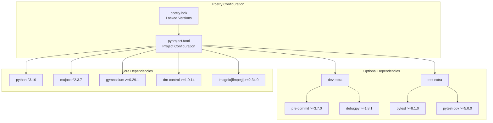
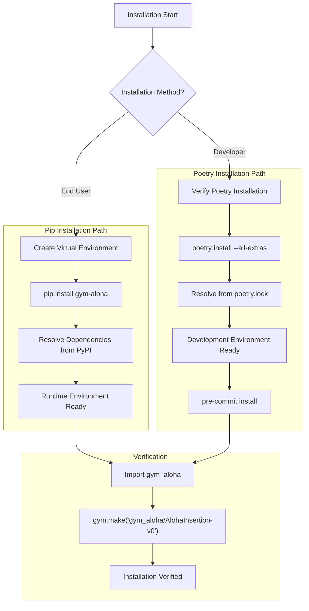

<!-- source: DeepWiki mcp.deepwiki.com · repo huggingface/gym-aloha · page 1.1 Installation and Setup · fetched 2026-10-26 -->

# Installation and Setup

<details>
<summary>Relevant source files</summary>

The following files were used as context for generating this wiki page:

- [README.md](README.md)
- [poetry.lock](poetry.lock)
- [pyproject.toml](pyproject.toml)

</details>


This document covers the installation procedures, dependency requirements, and environment setup for the gym-aloha project. It provides detailed instructions for both end users and developers, with specific guidance on using Poetry for dependency management.

For information about basic usage and quick start examples, see [Quick Start Guide](#1.2). For development-specific setup including testing and code quality tools, see [Development Environment Setup](#5.1).

## System Requirements

The gym-aloha project requires Python 3.10 or higher and is compatible with modern operating systems. The core system dependencies are managed through Poetry and include several heavyweight packages for robotics simulation.

**Minimum Requirements:**
- Python 3.10+
- 4GB RAM (8GB+ recommended for MuJoCo rendering)
- GPU support recommended for hardware-accelerated rendering

Sources: [pyproject.toml:19](), [pyproject.toml:25]()

## Installation Methods

### Method 1: Pip Installation (End Users)

For users who want to use gym-aloha in their projects without contributing to development:

```bash
# Create and activate virtual environment
conda create -y -n aloha python=3.10 && conda activate aloha

# Install gym-aloha
pip install gym-aloha
```

This method installs the package from PyPI with all required runtime dependencies.

Sources: [README.md:10-18]()

### Method 2: Poetry Installation (Development)

For developers contributing to the project or requiring development tools:

```bash
# Install Poetry (if not already installed)
# Follow instructions at https://python-poetry.org/docs/#installation

# Clone repository and install with all extras
poetry install --all-extras
```

The `--all-extras` flag includes optional dependency groups for development and testing.

Sources: [README.md:166-169](), [pyproject.toml:36-38]()

## Dependency Architecture

The project uses a hierarchical dependency structure managed through Poetry's extras system:



**Dependency Groups:**

| Group | Purpose | Key Packages |
|-------|---------|--------------|
| Core | Runtime execution | `mujoco`, `gymnasium`, `dm-control`, `imageio` |
| dev | Development tools | `pre-commit`, `debugpy` |
| test | Testing framework | `pytest`, `pytest-cov` |

Sources: [pyproject.toml:24-38]()

## Installation Workflow

The installation process varies depending on the chosen method and involves different dependency resolution paths:



Sources: [README.md:10-18](), [README.md:166-169](), [README.md:175-176]()

## Core Dependency Details

### MuJoCo Physics Engine

The project depends on MuJoCo 2.3.7+ for physics simulation:

```bash
mujoco = "^2.3.7"
```

MuJoCo provides the underlying physics simulation and rendering capabilities. The package includes:
- Physics simulation engine
- OpenGL rendering support
- Python bindings for control

Sources: [pyproject.toml:26]()

### Gymnasium Interface

Gymnasium provides the reinforcement learning environment interface:

```bash
gymnasium = ">=0.29.1"
```

This ensures compatibility with the latest Gymnasium API standards for environment registration and interaction.

Sources: [pyproject.toml:27]()

### dm-control Integration

The DeepMind Control Suite provides robotics-specific abstractions:

```bash
dm-control = ">=1.0.14"
```

dm-control offers high-level robotics primitives and utilities built on top of MuJoCo.

Sources: [pyproject.toml:28]()

## Environment Setup and Verification

After installation, verify the setup works correctly:

### Basic Import Test

```python
import gymnasium as gym
import gym_aloha

# This should work without errors
env = gym.make("gym_aloha/AlohaInsertion-v0")
print("Installation successful!")
```

### Full Environment Test

```python
import imageio
import gymnasium as gym
import numpy as np
import gym_aloha

env = gym.make("gym_aloha/AlohaInsertion-v0")
observation, info = env.reset()

# Test basic environment interaction
action = env.action_space.sample()
observation, reward, terminated, truncated, info = env.step(action)
image = env.render()

env.close()
print("Environment test successful!")
```

Sources: [README.md:23-45]()

## Troubleshooting Common Issues

### GPU Rendering Setup

For optimal performance, configure GPU rendering with EGL support. This requires additional system-level configuration on some platforms.

### Dependency Conflicts

If experiencing dependency conflicts, ensure you're using a clean virtual environment and the correct Python version (3.10+).

### Poetry Cache Issues

Clear Poetry cache if encountering installation problems:

```bash
poetry cache clear pypi --all
poetry install --all-extras
```

Sources: [README.md:108-158](), [pyproject.toml:25]()

---

