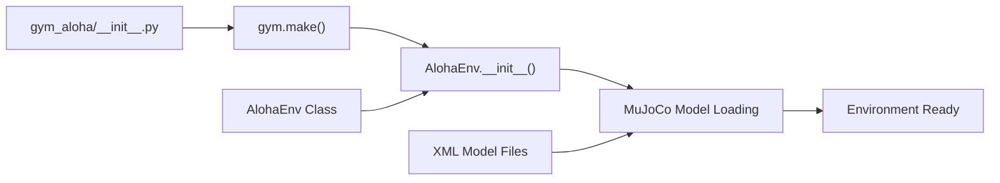
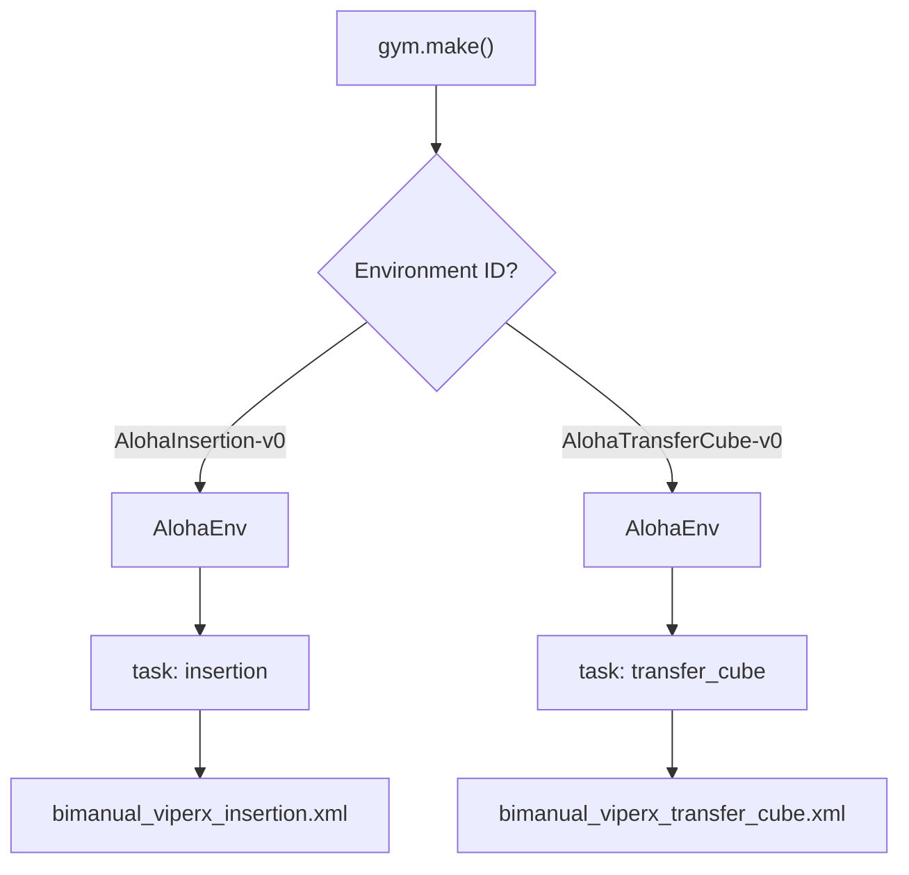
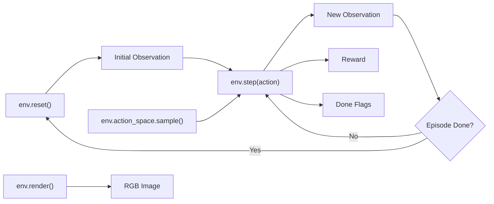
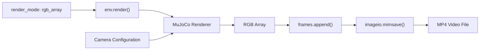

<!-- source: DeepWiki mcp.deepwiki.com · repo huggingface/gym-aloha · page 1.2 Quick Start Guide · fetched 2026-10-26 -->

# Quick Start Guide

<details>
<summary>Relevant source files</summary>

The following files were used as context for generating this wiki page:

- [README.md](README.md)
- [example.py](example.py)
- [gym_aloha/__init__.py](gym_aloha/__init__.py)

</details>


This guide provides the essential steps to get started with gym-aloha, demonstrating how to create environments, run simulations, and understand the basic workflow. It covers the minimal code needed to begin working with ALOHA robotic tasks.

For detailed installation instructions, see [Installation and Setup](#1.1). For comprehensive information about task-specific configurations and reward systems, see [Tasks and Simulations](#3).

## Creating Your First Environment

The gym-aloha package provides two main robotic tasks through Gymnasium-compatible environments. The basic pattern follows the standard Gymnasium interface:

```python
import gymnasium as gym
import gym_aloha

env = gym.make("gym_aloha/AlohaInsertion-v0")
observation, info = env.reset()
```

The environment creation process follows this workflow:



**Environment Registration Flow**

Sources: [gym_aloha/__init__.py:1-22](), [README.md:23-45]()

## Available Environments

Two pre-registered environments are available for immediate use:

| Environment ID | Task | Description | Max Steps |
|----------------|------|-------------|-----------|
| `gym_aloha/AlohaInsertion-v0` | Insertion | Peg-in-hole insertion task | 300 |
| `gym_aloha/AlohaTransferCube-v0` | Transfer Cube | Bimanual cube transfer | 300 |

Both environments use the same `AlohaEnv` class with different task parameters configured during registration.



**Environment Selection and Configuration**

Sources: [gym_aloha/__init__.py:3-21]()

## Basic Simulation Loop

The core simulation follows the standard Gymnasium pattern of reset, step, and render:

```python
env = gym.make("gym_aloha/AlohaInsertion-v0")
observation, info = env.reset()

for _ in range(1000):
    action = env.action_space.sample()  # Random action
    observation, reward, terminated, truncated, info = env.step(action)
    
    if terminated or truncated:
        observation, info = env.reset()

env.close()
```

The simulation loop involves these key components:



**Core Simulation Components**

Sources: [example.py:6-17](), [README.md:30-42]()

## Action and Observation Spaces

The environment provides a 14-dimensional continuous action space controlling both robot arms and grippers:

- **Action Space**: 14D continuous vector
  - 6 joint positions per arm (12 total)
  - 1 gripper position per arm (2 total)
  - Gripper values normalized between 0 (closed) and 1 (open)

- **Observation Space**: Dictionary containing:
  - `pixels`: Camera images from multiple viewpoints
  - `agent_pos`: Robot joint positions and velocities
  - `env_state`: Task-specific state information

```python
# Check action and observation spaces
print(f"Action space: {env.action_space}")
print(f"Observation space: {env.observation_space}")

# Sample random action
action = env.action_space.sample()
print(f"Action shape: {action.shape}")  # (14,)
```

Sources: [README.md:55-66]()

## Video Recording

A common workflow includes recording simulation videos for analysis or demonstration:

```python
import imageio
import numpy as np

env = gym.make("gym_aloha/AlohaInsertion-v0")
observation, info = env.reset()
frames = []

for _ in range(100):
    action = env.action_space.sample()
    observation, reward, terminated, truncated, info = env.step(action)
    image = env.render()  # Returns RGB array
    frames.append(image)
    
    if terminated or truncated:
        break

# Save as MP4 video
imageio.mimsave("simulation.mp4", np.stack(frames), fps=25)
```

The rendering pipeline works as follows:



**Video Recording Workflow**

Sources: [example.py:8-20](), [README.md:32-44]()

## Environment Configuration

Environments accept several configuration parameters during creation:

```python
env = gym.make(
    "gym_aloha/AlohaInsertion-v0",
    obs_type="pixels",           # or "pixels_agent_pos"
    render_mode="rgb_array",     # Required for rendering
    observation_width=640,       # Image width
    observation_height=480,      # Image height
    visualization_width=640,     # Render width
    visualization_height=480     # Render height
)
```

| Parameter | Default | Description |
|-----------|---------|-------------|
| `obs_type` | `"pixels"` | Observation format |
| `render_mode` | `None` | Must be `"rgb_array"` for rendering |
| `observation_width` | `640` | Observation image width |
| `observation_height` | `480` | Observation image height |
| `visualization_width` | `640` | Render image width |
| `visualization_height` | `480` | Render image height |

Sources: [README.md:87-106]()

## Next Steps

With the basic simulation running, you can:

1. **Explore different tasks**: Try both `AlohaInsertion-v0` and `AlohaTransferCube-v0`
2. **Understand observations**: Learn about the observation dictionary structure in [Observation and Action Spaces](#2.2)
3. **Implement custom policies**: Replace `env.action_space.sample()` with your own control logic
4. **Analyze rewards**: Study the reward systems described in [Tasks and Simulations](#3)
5. **GPU acceleration**: Set up EGL rendering for faster simulation as shown in the README

The environment is now ready for reinforcement learning experiments, policy development, or robotic task analysis.

Sources: [README.md:48-81](), [example.py:1-21]()

---

