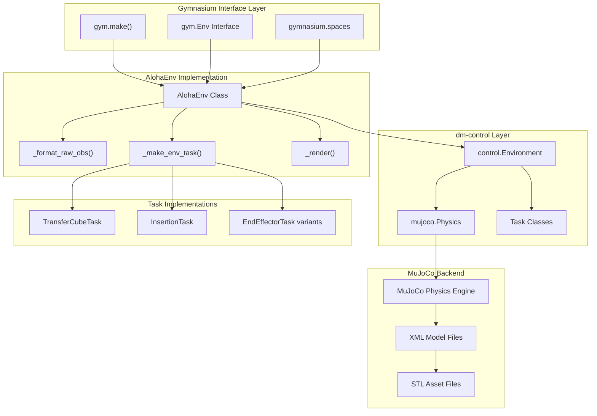
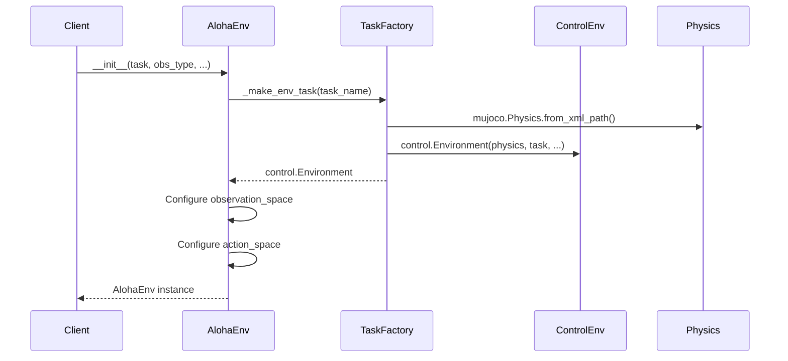
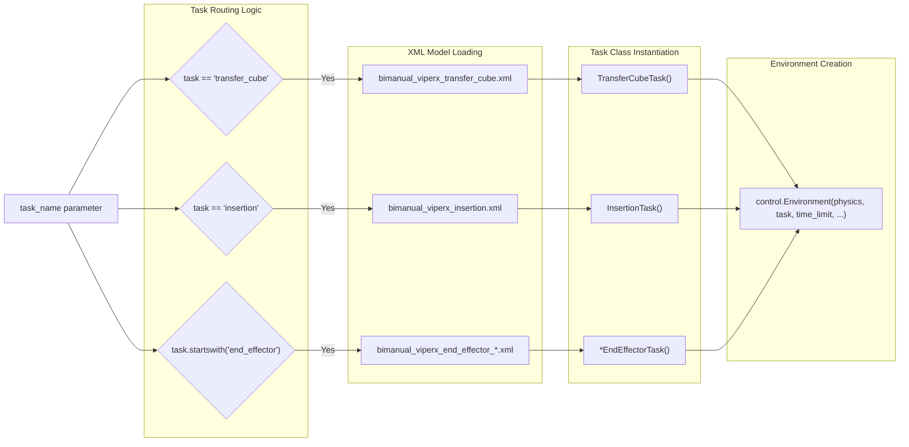
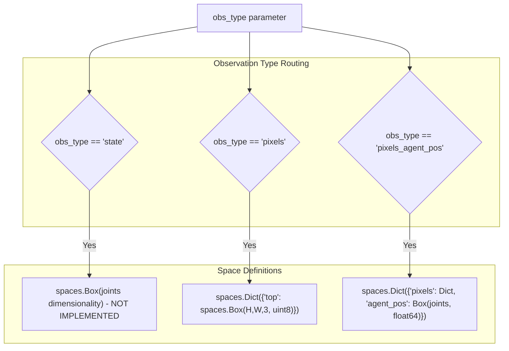
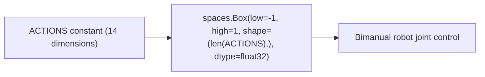
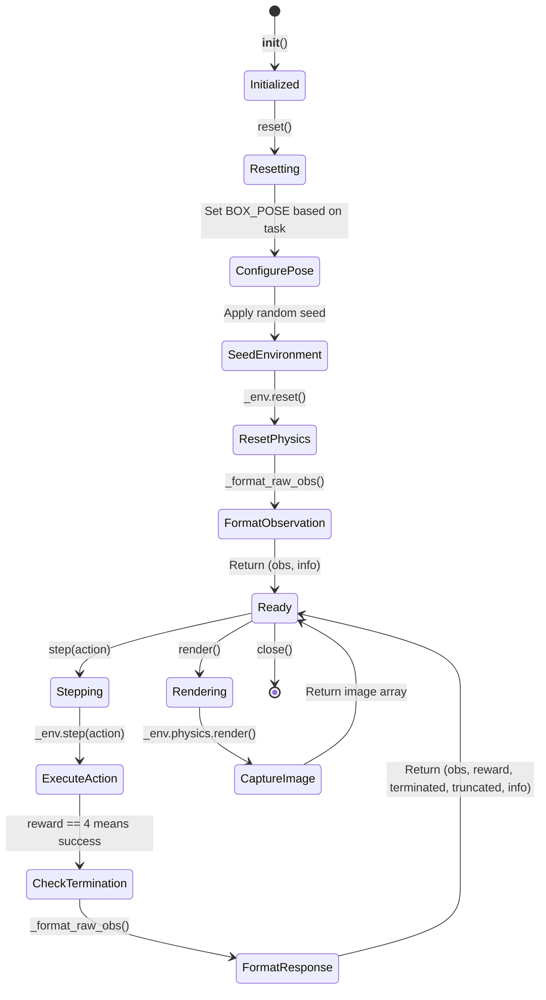
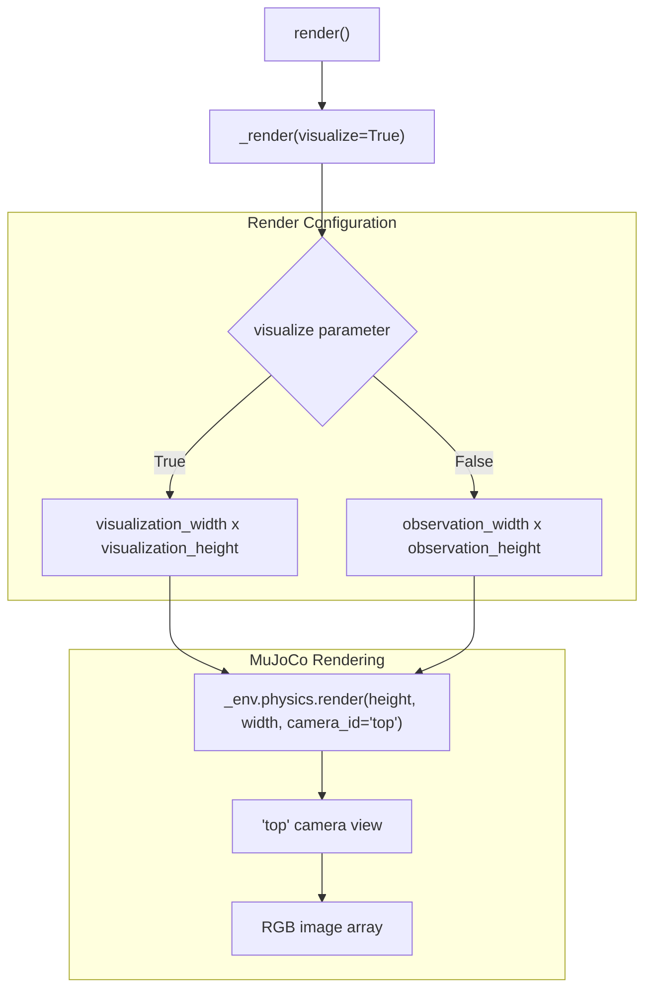

<!-- source: DeepWiki mcp.deepwiki.com · repo huggingface/gym-aloha · page 2 Core Environment Implementation · fetched 2026-10-26 -->

# Core Environment Implementation

<details>
<summary>Relevant source files</summary>

The following files were used as context for generating this wiki page:

- [gym_aloha/env.py](gym_aloha/env.py)

</details>


This document covers the implementation of the `AlohaEnv` class, which serves as the primary Gymnasium-compatible environment interface for ALOHA bimanual robotics simulations. The `AlohaEnv` class integrates MuJoCo physics simulation through dm-control with the standard Gymnasium API, providing a unified interface for reinforcement learning applications.

For information about environment registration and available variants, see [Environment Registration](#2.1). For details about observation and action space configurations, see [Observation and Action Spaces](#2.2). For specific task implementations, see [Tasks and Simulations](#3).

## Architecture Overview

The `AlohaEnv` class follows a layered architecture that bridges the Gymnasium RL interface with MuJoCo physics simulation through dm-control middleware.

### Core Class Structure

```mermaid
classDiagram
    class AlohaEnv {
        +task: str
        +obs_type: str
        +render_mode: str
        +observation_width: int
        +observation_height: int
        +_env: control.Environment
        +observation_space: spaces.Space
        +action_space: spaces.Box
        +__init__(task, obs_type, render_mode, ...)
        +reset(seed, options) tuple
        +step(action) tuple
        +render() ndarray
        +_make_env_task(task_name) control.Environment
        +_format_raw_obs(raw_obs) dict
        +_render(visualize) ndarray
    }
    
    class Environment {
        +physics: mujoco.Physics
        +task: Task
        +reset() TimeStep
        +step(action) TimeStep
    }
    
    class Task {
        +get_observation(physics) dict
        +get_reward(physics) float
        +initialize_episode(physics) void
    }
    
    class Physics {
        +render(height, width, camera_id) ndarray
        +from_xml_path(xml_path) Physics
    }
    
    AlohaEnv --> Environment : "_env"
    Environment --> Physics : "physics"
    Environment --> Task : "task"
    AlohaEnv --|> "gym.Env" : inherits
```

Sources: [gym_aloha/env.py:21-191]()

### System Integration Architecture



Sources: [gym_aloha/env.py:1-19](), [gym_aloha/env.py:108-136]()

## Core Components

### AlohaEnv Class Initialization

The `AlohaEnv` constructor configures the environment based on the specified task and observation type. The class accepts several key parameters that determine the simulation behavior:

| Parameter | Type | Default | Description |
|-----------|------|---------|-------------|
| `task` | str | Required | Task variant ("transfer_cube", "insertion", etc.) |
| `obs_type` | str | "pixels" | Observation format ("pixels", "pixels_agent_pos", "state") |
| `render_mode` | str | "rgb_array" | Rendering output format |
| `observation_width` | int | 640 | Width for observation images |
| `observation_height` | int | 480 | Height for observation images |

The initialization process follows this sequence:



Sources: [gym_aloha/env.py:25-44](), [gym_aloha/env.py:108-136]()

### Task Integration System

The `_make_env_task` method serves as a factory for creating task-specific environments. It maps task names to their corresponding XML models and task implementations:



Sources: [gym_aloha/env.py:108-136]()

### Observation Space Configuration

The environment supports three observation types, each with different space configurations:



The action space is consistently defined as a 14-dimensional continuous space with bounds [-1, 1], corresponding to the joints defined in `ACTIONS`:



Sources: [gym_aloha/env.py:46-86]()

### Environment Lifecycle

The environment follows the standard Gymnasium lifecycle with custom implementations for reset and step operations:



Key implementation details:

- **Reset Process**: [gym_aloha/env.py:150-171]() handles seeding, pose sampling, and observation formatting
- **Step Process**: [gym_aloha/env.py:173-187]() processes actions, determines termination, and formats responses  
- **Termination Logic**: Success is determined by `reward == 4`, setting both `terminated` and `is_success` flags
- **Pose Sampling**: Task-specific pose sampling using `sample_box_pose()` or `sample_insertion_pose()` functions

Sources: [gym_aloha/env.py:150-191]()

### Rendering System

The rendering system provides RGB array output through MuJoCo's physics engine:



The system currently supports only the "top" camera view, with plans for additional camera angles noted in the code comments.

Sources: [gym_aloha/env.py:88-106]()

---

