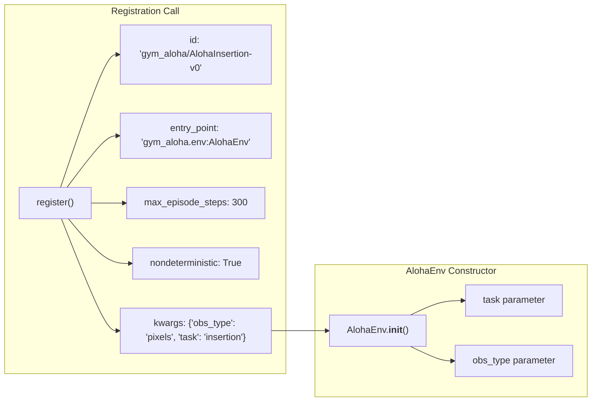

<!-- source: DeepWiki mcp.deepwiki.com · repo huggingface/gym-aloha · page 2.1 Environment Registration · fetched 2026-10-26 -->

# Environment Registration

<details>
<summary>Relevant source files</summary>

The following files were used as context for generating this wiki page:

- [gym_aloha/__init__.py](gym_aloha/__init__.py)
- [gym_aloha/env.py](gym_aloha/env.py)

</details>


This document explains how environments are registered with the Gymnasium framework in the gym-aloha repository. It covers the registration mechanism, available environment variants, and how registration parameters map to the underlying `AlohaEnv` implementation.

For details about the `AlohaEnv` class implementation itself, see [Core Environment Implementation](#2). For information about specific tasks and their configurations, see [Tasks and Simulations](#3).

## Registration Overview

Environment registration in gym-aloha follows the standard Gymnasium pattern using the `register()` function. All registration logic is centralized in the package's `__init__.py` file, which automatically executes when the package is imported.

```mermaid
graph TD
    IMPORT["`Package Import`<br/>`import gym_aloha`"]
    INIT["`__init__.py`<br/>`Registration Logic`"]
    REGISTER["`gymnasium.envs.registration.register()`<br/>`Gymnasium Registration`"]
    REGISTRY["`Gymnasium Environment Registry`<br/>`Global Registry`"]
    
    IMPORT --> INIT
    INIT --> REGISTER
    REGISTER --> REGISTRY
    
    subgraph "Registered Environments"
        INS_ENV["`gym_aloha/AlohaInsertion-v0`"]
        TRANS_ENV["`gym_aloha/AlohaTransferCube-v0`"]
    end
    
    REGISTRY --> INS_ENV
    REGISTRY --> TRANS_ENV
```

**Registration Flow from Import to Available Environments**

Sources: [gym_aloha/__init__.py:1-21]()

## Available Environments

The gym-aloha package registers two primary environment variants, each configured for a specific robotic task:

| Environment ID | Task Type | Max Episodes | Observation Type |
|---|---|---|---|
| `gym_aloha/AlohaInsertion-v0` | Peg-in-hole insertion | 300 | pixels |
| `gym_aloha/AlohaTransferCube-v0` | Bimanual cube transfer | 300 | pixels |

Both environments share the same entry point (`gym_aloha.env:AlohaEnv`) but differ in their `task` parameter, which determines the specific robotic task implementation.

```mermaid
graph TD
    subgraph "Environment Registration"
        REG_INS["`register()`<br/>`AlohaInsertion-v0`"]
        REG_TRANS["`register()`<br/>`AlohaTransferCube-v0`"]
    end
    
    subgraph "Entry Point"
        ENTRY["`gym_aloha.env:AlohaEnv`<br/>`Common Entry Point`"]
    end
    
    subgraph "Task Configuration"
        TASK_INS["`kwargs: {'task': 'insertion'}`"]
        TASK_TRANS["`kwargs: {'task': 'transfer_cube'}`"]
    end
    
    subgraph "Task Implementation"
        XML_INS["`bimanual_viperx_insertion.xml`"]
        XML_TRANS["`bimanual_viperx_transfer_cube.xml`"]
        TASK_CLASS_INS["`InsertionTask`"]
        TASK_CLASS_TRANS["`TransferCubeTask`"]
    end
    
    REG_INS --> ENTRY
    REG_TRANS --> ENTRY
    REG_INS --> TASK_INS
    REG_TRANS --> TASK_TRANS
    
    TASK_INS --> XML_INS
    TASK_INS --> TASK_CLASS_INS
    TASK_TRANS --> XML_TRANS
    TASK_TRANS --> TASK_CLASS_TRANS
```

**Environment Registration to Task Implementation Mapping**

Sources: [gym_aloha/__init__.py:3-21](), [gym_aloha/env.py:112-131]()

## Registration Parameters

Each environment registration includes several common configuration parameters:

### Common Parameters

- **`entry_point`**: `"gym_aloha.env:AlohaEnv"` - Points to the `AlohaEnv` class constructor
- **`max_episode_steps`**: `300` - Enforces episode termination after 300 steps
- **`nondeterministic`**: `True` - Required for Gymnasium compliance testing due to slight rendering variations

### Task-Specific Parameters

The `kwargs` parameter passes task-specific configuration to the `AlohaEnv` constructor:

- **`obs_type`**: `"pixels"` - Configures pixel-based observations
- **`task`**: Task identifier (`"insertion"` or `"transfer_cube"`)



**Registration Parameter Flow to Constructor**

Sources: [gym_aloha/__init__.py:3-11](), [gym_aloha/env.py:25-44]()

## Task Routing Mechanism

The `task` parameter passed through registration `kwargs` determines which MuJoCo XML file and task class implementation are loaded. This routing is handled by the `_make_env_task()` method in the `AlohaEnv` class.

### Task Resolution Process

1. **Parameter Reception**: The `task` parameter is passed from registration `kwargs` to `AlohaEnv.__init__()`
2. **Environment Creation**: `_make_env_task()` method maps task names to specific implementations
3. **XML Loading**: Appropriate MuJoCo XML model file is loaded based on task type
4. **Task Class Instantiation**: Corresponding task class is instantiated for reward and logic handling

```mermaid
graph TD
    subgraph "Registration Layer"
        KWARGS["`registration kwargs`<br/>`{'task': 'insertion'}`"]
    end
    
    subgraph "AlohaEnv.__init__()"
        INIT_TASK["`self.task = task`"]
        MAKE_ENV["`self._make_env_task(self.task)`"]
    end
    
    subgraph "_make_env_task() Logic"
        TASK_SWITCH{"`task_name switch`"}
        INS_BRANCH["`task_name == 'insertion'`"]
        TRANS_BRANCH["`task_name == 'transfer_cube'`"]
    end
    
    subgraph "Insertion Task Setup"
        INS_XML["`xml_path = bimanual_viperx_insertion.xml`"]
        INS_PHYSICS["`mujoco.Physics.from_xml_path()`"]
        INS_TASK["`task = InsertionTask()`"]
    end
    
    subgraph "Transfer Cube Task Setup"
        TRANS_XML["`xml_path = bimanual_viperx_transfer_cube.xml`"]
        TRANS_PHYSICS["`mujoco.Physics.from_xml_path()`"]
        TRANS_TASK["`task = TransferCubeTask()`"]
    end
    
    subgraph "Environment Assembly"
        CONTROL_ENV["`control.Environment(physics, task, ...)`"]
    end
    
    KWARGS --> INIT_TASK
    INIT_TASK --> MAKE_ENV
    MAKE_ENV --> TASK_SWITCH
    
    TASK_SWITCH --> INS_BRANCH
    TASK_SWITCH --> TRANS_BRANCH
    
    INS_BRANCH --> INS_XML
    INS_XML --> INS_PHYSICS
    INS_BRANCH --> INS_TASK
    INS_PHYSICS --> CONTROL_ENV
    INS_TASK --> CONTROL_ENV
    
    TRANS_BRANCH --> TRANS_XML
    TRANS_XML --> TRANS_PHYSICS
    TRANS_BRANCH --> TRANS_TASK
    TRANS_PHYSICS --> CONTROL_ENV
    TRANS_TASK --> CONTROL_ENV
```

**Task Parameter Routing from Registration to Implementation**

### End-Effector Task Variants

The codebase also includes placeholder registrations for end-effector control variants, though these are currently marked as `NotImplementedError`:

- `end_effector_transfer_cube` → `TransferCubeEndEffectorTask`
- `end_effector_insertion` → `InsertionEndEffectorTask`

These variants would use different XML models (`bimanual_viperx_end_effector_*.xml`) and specialized end-effector control task classes.

Sources: [gym_aloha/env.py:108-136](), [gym_aloha/env.py:120-129]()

## Usage with Gymnasium

Once registered, environments can be instantiated using the standard Gymnasium `make()` interface:

```python
import gym_aloha  # Triggers registration
import gymnasium as gym

env = gym.make("gym_aloha/AlohaInsertion-v0")
```

The registration system ensures that all configuration parameters are automatically applied when the environment is created, providing a clean interface that hides the complexity of task-specific setup.

Sources: [gym_aloha/__init__.py:1-21](), [gym_aloha/env.py:21-44]()

---

