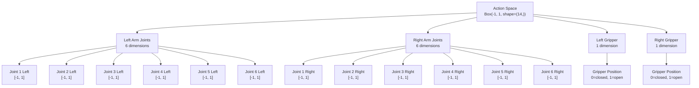
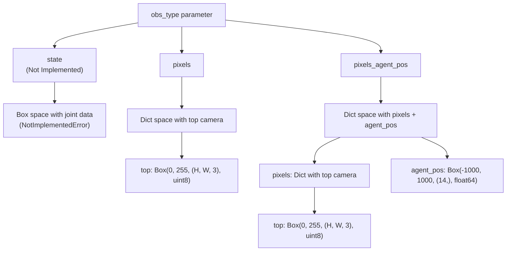
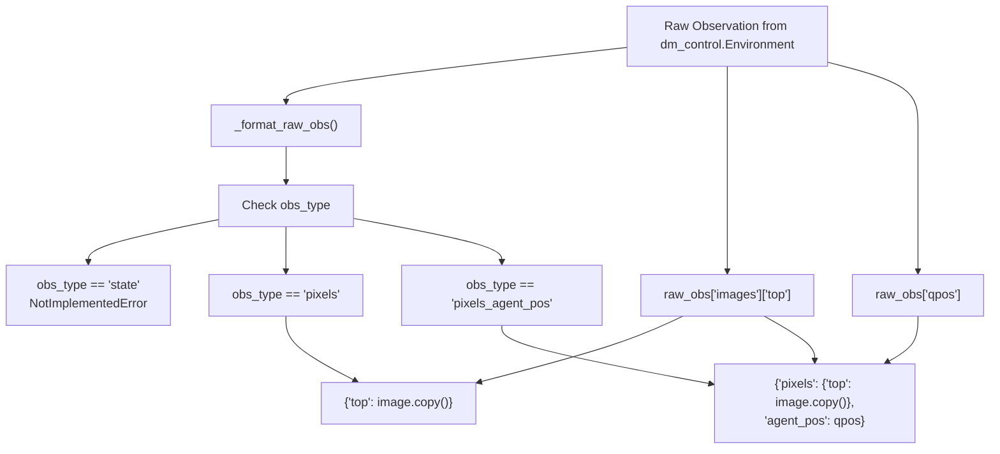

<!-- source: DeepWiki mcp.deepwiki.com · repo huggingface/gym-aloha · page 2.2 Observation and Action Spaces · fetched 2026-10-26 -->

# Observation and Action Spaces

<details>
<summary>Relevant source files</summary>

The following files were used as context for generating this wiki page:

- [README.md](README.md)
- [gym_aloha/env.py](gym_aloha/env.py)

</details>


This document describes the observation and action spaces implemented in the `AlohaEnv` class, including the different observation types, data formats, and how they map to the underlying MuJoCo simulation. This covers the interface between reinforcement learning agents and the ALOHA robotics simulation.

For information about environment registration and available variants, see [Environment Registration](#2.1). For details about specific tasks and their reward structures, see [Tasks and Simulations](#3).

## Action Space

The ALOHA environment uses a continuous action space representing joint-level control commands for both robot arms and their grippers.

### Action Space Structure



The action space is defined as a 14-dimensional continuous Box space with values normalized between -1 and 1. The action vector contains absolute joint position commands for both arms plus gripper positions.

| Component | Dimensions | Range | Description |
|-----------|------------|-------|-------------|
| Left Arm | 6 | [-1, 1] | Joint positions for left ViperX arm |
| Right Arm | 6 | [-1, 1] | Joint positions for right ViperX arm |
| Left Gripper | 1 | [0, 1] | Gripper position (0=closed, 1=open) |
| Right Gripper | 1 | [0, 1] | Gripper position (0=closed, 1=open) |

**Sources:** [gym_aloha/env.py:86](), [README.md:55-58]()

## Observation Space Types

The ALOHA environment supports multiple observation types that can be configured when creating the environment. The observation type determines what data is included in the observation dictionary returned by `reset()` and `step()`.

### Observation Type Configuration



**Sources:** [gym_aloha/env.py:46-84]()

### Pixels Observation Type

When `obs_type="pixels"`, observations contain only visual data from the top-down camera:

```python
observation_space = spaces.Dict({
    "top": spaces.Box(
        low=0, high=255,
        shape=(observation_height, observation_width, 3),
        dtype=np.uint8
    )
})
```

The observation dictionary contains:
- `"top"`: RGB image from the top-down camera view

**Sources:** [gym_aloha/env.py:53-63](), [gym_aloha/env.py:142]()

### Pixels + Agent Position Observation Type

When `obs_type="pixels_agent_pos"`, observations include both visual and proprioceptive data:

```python
observation_space = spaces.Dict({
    "pixels": spaces.Dict({
        "top": spaces.Box(
            low=0, high=255,
            shape=(observation_height, observation_width, 3),
            dtype=np.uint8
        )
    }),
    "agent_pos": spaces.Box(
        low=-1000.0, high=1000.0,
        shape=(len(JOINTS),),
        dtype=np.float64
    )
})
```

The observation dictionary contains:
- `"pixels"`: Dictionary with `"top"` camera image
- `"agent_pos"`: Joint positions (`qpos`) for all robot joints

**Sources:** [gym_aloha/env.py:64-84](), [gym_aloha/env.py:144-147]()

## Observation Data Flow

The following diagram shows how raw observations from the MuJoCo simulation are processed and formatted based on the selected observation type:



**Sources:** [gym_aloha/env.py:138-148]()

## Image Rendering Configuration

The environment supports separate resolution settings for observations and visualization:

| Parameter | Default | Description |
|-----------|---------|-------------|
| `observation_width` | 640 | Width of observation images |
| `observation_height` | 480 | Height of observation images |
| `visualization_width` | 640 | Width of rendered images for display |
| `visualization_height` | 480 | Height of rendered images for display |

The `_render()` method uses different resolutions depending on whether the image is for observation or visualization purposes.

**Sources:** [gym_aloha/env.py:30-42](), [gym_aloha/env.py:91-106]()

## State Observation Type

The `"state"` observation type is declared but not implemented. If implemented, it would provide direct access to joint positions and velocities without visual data:

```python
# Placeholder implementation (raises NotImplementedError)
self.observation_space = spaces.Box(
    low=np.array([0] * len(JOINTS)),
    high=np.array([255] * len(JOINTS)),
    dtype=np.float64,
)
```

This observation type would be useful for training policies that don't require visual input, potentially enabling faster training and smaller neural network architectures.

**Sources:** [gym_aloha/env.py:46-52]()

---

