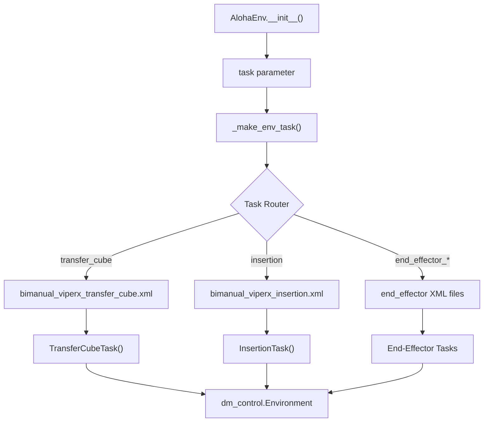
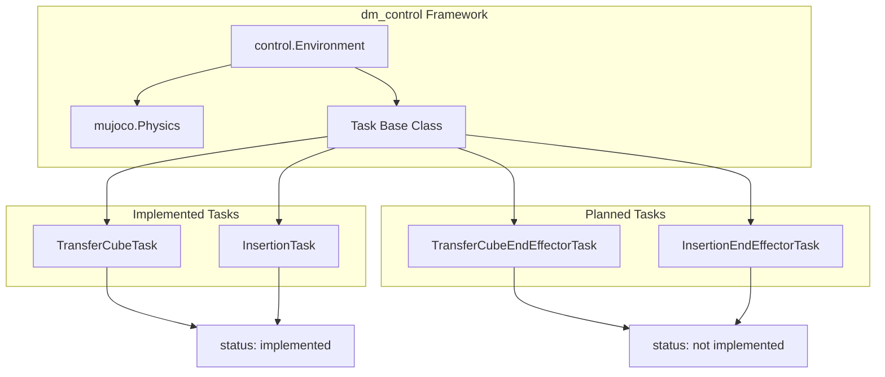
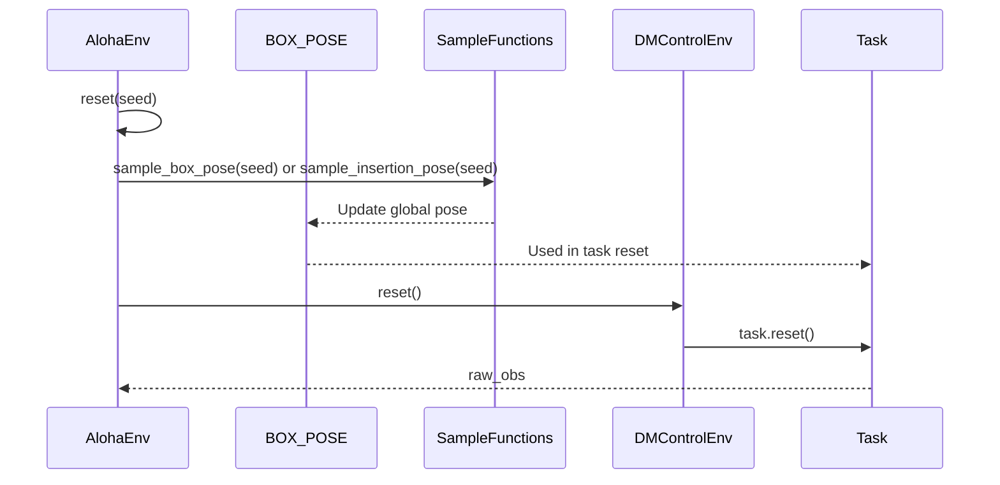
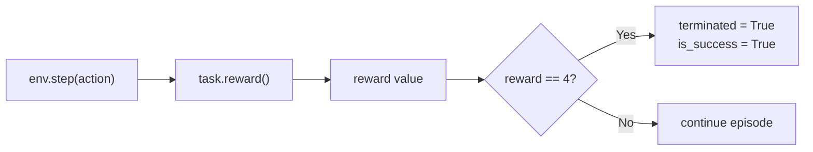
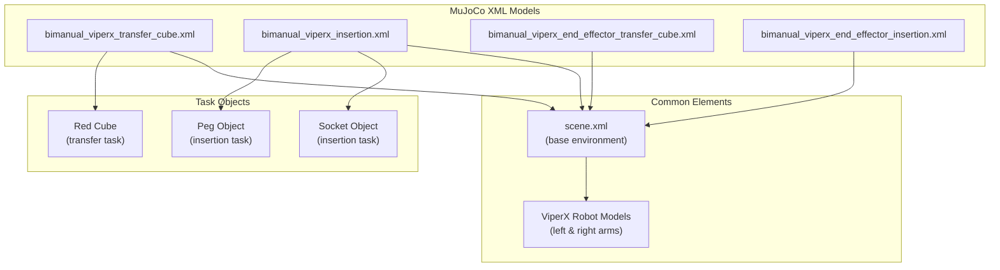

<!-- source: DeepWiki mcp.deepwiki.com · repo huggingface/gym-aloha · page 3 Tasks and Simulations · fetched 2026-10-26 -->

# Tasks and Simulations

Relevant source files

The following files were used as context for generating this wiki page:

- [README.md](README.md)
- [gym_aloha/env.py](gym_aloha/env.py)

This document provides an overview of the robotic tasks and simulation environments available in the gym-aloha system. It covers the task architecture, available task types, and their integration with the MuJoCo physics simulation. For detailed implementation of specific tasks, see [Insertion Task](#3.1), [Transfer Cube Task](#3.2), and [End-Effector Control Tasks](#3.3). For information about the core environment implementation that executes these tasks, see [Core Environment Implementation](#2).

## Task System Architecture

The gym-aloha system implements a modular task architecture where different robotic manipulation tasks are defined as separate classes that integrate with the main `AlohaEnv` environment. Each task defines its own objectives, reward structure, and simulation setup while sharing common infrastructure.

### Task Selection and Creation

The task system uses a string-based identifier to select and instantiate the appropriate task class. The `AlohaEnv` class routes task creation through the `_make_env_task` method:

*Sources: [gym_aloha/env.py:108-136]()*

### Available Task Types

The system currently supports four task categories, though not all are fully implemented:

| Task Name | Status | XML Model | Task Class | Description |
|-----------|--------|-----------|------------|-------------|
| `transfer_cube` | ✅ Implemented | `bimanual_viperx_transfer_cube.xml` | `TransferCubeTask` | Bimanual cube handoff |
| `insertion` | ✅ Implemented | `bimanual_viperx_insertion.xml` | `InsertionTask` | Peg-in-hole insertion |
| `end_effector_transfer_cube` | ❌ Not Implemented | `bimanual_viperx_end_effector_transfer_cube.xml` | `TransferCubeEndEffectorTask` | End-effector cube transfer |
| `end_effector_insertion` | ❌ Not Implemented | `bimanual_viperx_end_effector_insertion.xml` | `InsertionEndEffectorTask` | End-effector insertion |

*Sources: [gym_aloha/env.py:112-131](), [gym_aloha/env.py:13-17]()*

## Task Implementation Framework

### Task Class Structure

All tasks inherit from a common base structure provided by the dm-control framework. Each task implements specific methods for:

- Environment initialization and reset
- Reward calculation
- Success criteria evaluation
- Object pose sampling

*Sources: [gym_aloha/env.py:133-135](), [gym_aloha/tasks/sim.py](), [gym_aloha/tasks/sim_end_effector.py]()*

### Environment Reset and Pose Sampling

Tasks utilize randomized initial conditions through pose sampling functions. The environment reset process coordinates between task-specific setup and global pose variables:

*Sources: [gym_aloha/env.py:158-165](), [gym_aloha/utils.py]()*

## Reward Structure Overview

Both implemented tasks use a progressive 4-point reward structure that encourages step-by-step task completion:

### Common Reward Pattern

| Reward Level | Meaning | Transfer Cube Criteria | Insertion Criteria |
|--------------|---------|------------------------|-------------------|
| 1 | Initial Contact | Holding cube with right gripper | Touching peg and socket |
| 2 | Secure Grasp | Cube lifted by right gripper | Grasping both objects |
| 3 | Progress Toward Goal | Cube transferred to left gripper | Peg aligned with socket |
| 4 | Task Success | Successful transfer without table contact | Successful peg insertion |

*Sources: [README.md:67-77]()*

### Success Detection

The environment determines task completion when the reward reaches the maximum value of 4:

*Sources: [gym_aloha/env.py:177-182]()*

## Task-Specific XML Models

Each task requires a specific MuJoCo XML model file that defines the scene layout, object positions, and physical properties:

### Model File Organization

*Sources: [gym_aloha/env.py:113-129](), [gym_aloha/constants.py]()*

The XML model files are loaded from the `ASSETS_DIR` and used to create the MuJoCo physics simulation that underlies each task environment.

*Sources: [gym_aloha/env.py:113-118](), [gym_aloha/constants.py:ASSETS_DIR]()*

---

