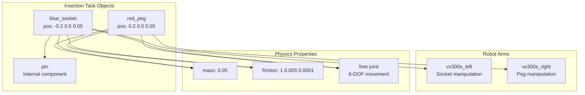
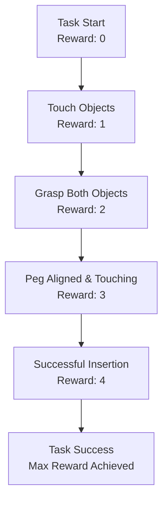
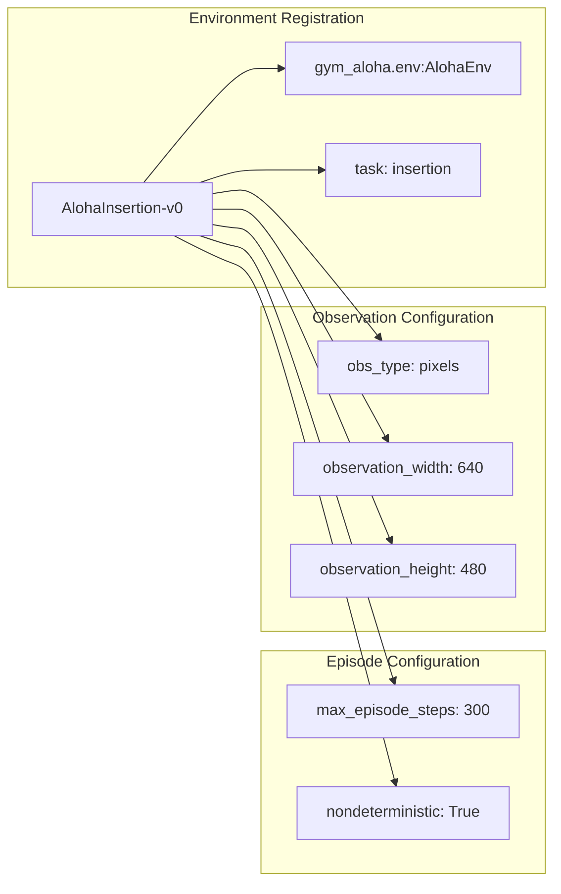

<!-- source: DeepWiki mcp.deepwiki.com · repo huggingface/gym-aloha · page 3.1 Insertion Task · fetched 2026-10-26 -->

# Insertion Task

Relevant source files

The following files were used as context for generating this wiki page:

- [README.md](README.md)
- [gym_aloha/assets/bimanual_viperx_insertion.xml](gym_aloha/assets/bimanual_viperx_insertion.xml)

This document describes the insertion task implementation in gym-aloha, which simulates a bimanual peg-in-hole operation using two ViperX robot arms. The task requires coordinated manipulation to grasp, align, and insert a peg into a socket in mid-air. For information about the cube transfer task, see [Transfer Cube Task](#3.2). For details about the overall environment architecture, see [Core Environment Implementation](#2).

## Task Overview

The insertion task (`AlohaInsertion-v0`) presents a classic robotics challenge where dual robot arms must perform a coordinated manipulation sequence. The left arm manipulates a blue socket while the right arm controls a red peg, with the objective of achieving precise insertion in mid-air without table support.

### Objective

The primary goal is to insert the red peg into the blue socket such that the peg makes contact with the internal pins. This requires:

- **Grasping**: Both arms must successfully grasp their respective objects
- **Coordination**: Arms must work together to align the objects in 3D space  
- **Precision**: Final insertion requires millimeter-level accuracy
- **Stability**: Maintain control throughout the manipulation sequence

Sources: [README.md:52-54](), [README.md:73-78]()

## Physical Setup and Components

The insertion task environment consists of several key physical components defined in the MuJoCo simulation model.

### Object Configuration

**Peg Specifications**: The red peg is defined as a rectangular box with dimensions 0.06 × 0.01 × 0.01 meters, positioned initially at coordinates (0.2, 0.5, 0.05) in the workspace.

**Socket Specifications**: The blue socket consists of four wall components (`socket-1` through `socket-4`) forming a hollow rectangular structure, with an internal red pin that serves as the insertion target.

Sources: [gym_aloha/assets/bimanual_viperx_insertion.xml:8-23]()

### Robot Configuration

Both robot arms use identical actuator configurations with position control for six joints plus gripper control:

| Joint | Control Range | Proportional Gain | Force Limit |
|-------|---------------|-------------------|-------------|
| `waist` | -3.14 to 3.14 | 800 | ±150 N |
| `shoulder` | -1.85 to 1.26 | 1600 | ±300 N |
| `elbow` | -1.76 to 1.61 | 800 | ±100 N |
| `forearm_roll` | -3.14 to 3.14 | 10 | ±100 N |
| `wrist_angle` | -1.87 to 2.23 | 50 | N/A |
| `wrist_rotate` | -3.14 to 3.14 | 20 | N/A |
| `left_finger` | 0.021 to 0.057 | 200 | N/A |
| `right_finger` | -0.057 to -0.021 | 200 | N/A |

Sources: [gym_aloha/assets/bimanual_viperx_insertion.xml:27-45]()

## Reward Structure and Success Criteria

The insertion task implements a four-level progressive reward system that guides the learning process from basic object interaction to successful insertion.

### Reward Levels

**Level 1 (1 point)**: Contact detection between grippers and target objects. Achieved when both the peg and socket are touched by their respective robot grippers.

**Level 2 (2 points)**: Stable grasping of both objects without dropping. This requires maintaining sufficient grip force and stable contact.

**Level 3 (3 points)**: Spatial alignment where the peg is positioned correctly relative to the socket opening and makes initial contact.

**Level 4 (4 points)**: Complete insertion where the peg successfully enters the socket and makes contact with the internal pins.

**Success Criteria**: The task is considered successfully completed when the maximum reward of 4 points is achieved, indicating full peg insertion.

Sources: [README.md:73-78](), [README.md:79-80]()

## Environment Configuration

The insertion task is registered as `gym_aloha/AlohaInsertion-v0` with specific configuration parameters that define the simulation behavior.

### Registration Parameters

### Action Space

The action space consists of a 14-dimensional continuous vector controlling both robot arms:

- **Joints 0-5**: Left arm joint positions (absolute values)
- **Joint 6**: Left gripper position (0=closed, 1=open)  
- **Joints 7-12**: Right arm joint positions (absolute values)
- **Joint 13**: Right gripper position (0=closed, 1=open)

### Observation Space

Observations are provided as a dictionary containing:

- **`qpos` and `qvel`**: Joint positions and velocities for both arms and grippers
- **`images`**: Multi-camera visual feeds from different viewpoints
- **`env_state`**: Environment state information including peg and socket positions

Sources: [README.md:55-66](), [README.md:87-106]()

### Initial State Configuration

The environment uses a predefined keyframe for consistent initialization, with both arms positioned in a neutral configuration and objects placed at their starting locations. The `nondeterministic: True` setting introduces randomization in object placement and orientation to increase task diversity.

Default keyframe joint positions: `[0 -0.96 1.16 0 -0.3 0 0.024 -0.024 0 -0.96 1.16 0 -0.3 0 0.024 -0.024 0.2 0.5 0.05 1 0 0 0 -0.2 0.5 0.05 1 0 0 0]`

Sources: [gym_aloha/assets/bimanual_viperx_insertion.xml:48-50](), [README.md:82-83]()

---

