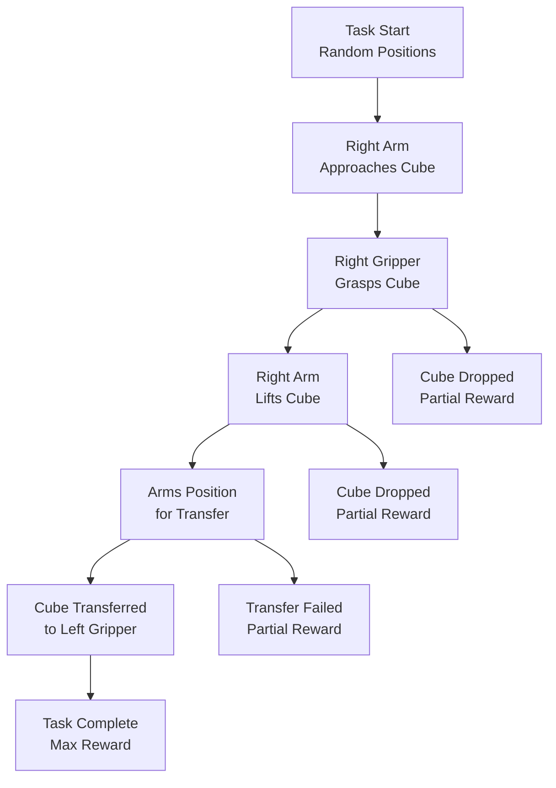
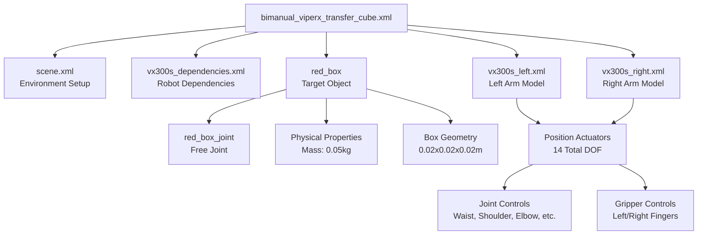
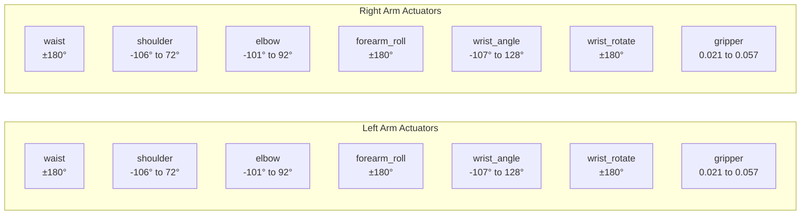
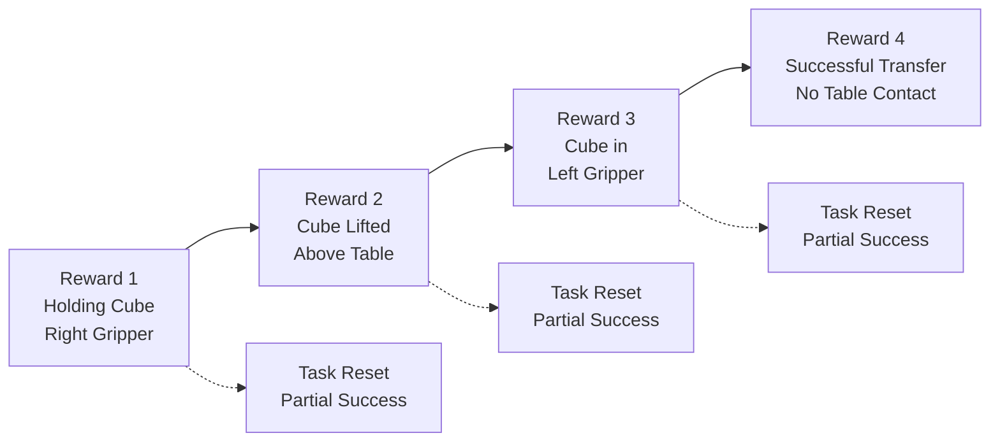
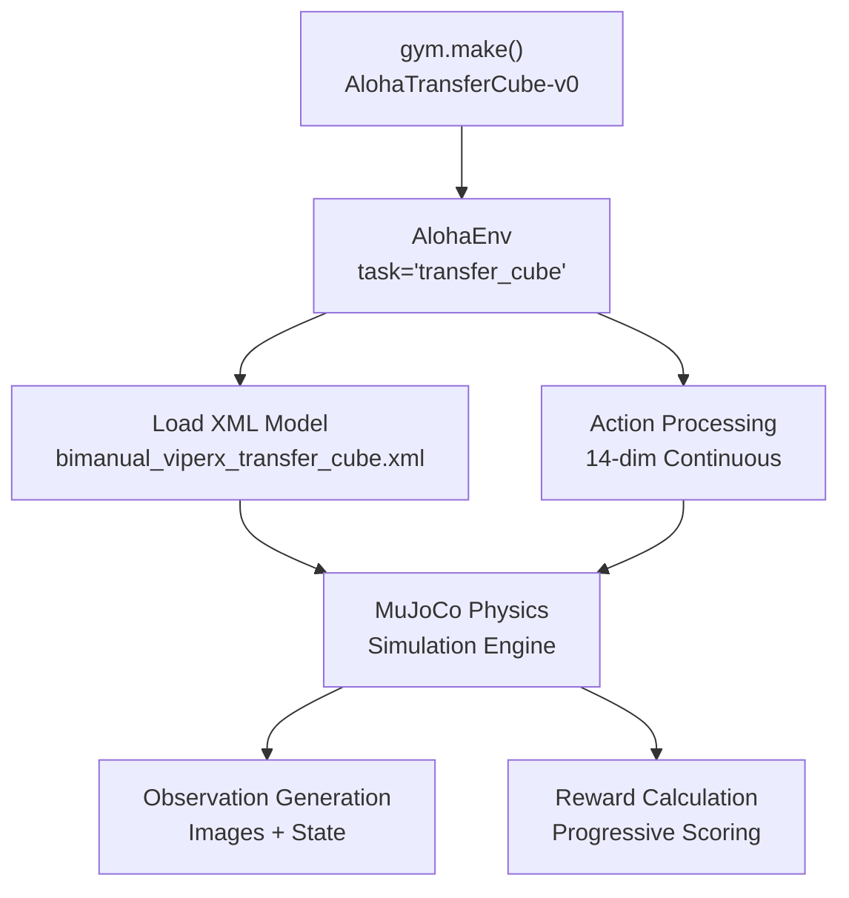

<!-- source: DeepWiki mcp.deepwiki.com · repo huggingface/gym-aloha · page 3.2 Transfer Cube Task · fetched 2026-10-26 -->

# Transfer Cube Task

<details>
<summary>Relevant source files</summary>

The following files were used as context for generating this wiki page:

- [README.md](README.md)
- [gym_aloha/assets/bimanual_viperx_transfer_cube.xml](gym_aloha/assets/bimanual_viperx_transfer_cube.xml)

</details>


This document covers the Transfer Cube Task implementation in gym-aloha, focusing on task mechanics, reward structure, and MuJoCo model configuration. This is one of the two primary robotic manipulation tasks available in the environment.

For information about the Insertion Task, see [Insertion Task](#3.1). For details about environment registration and task routing, see [Environment Registration](#2.1). For MuJoCo model assets and scene configuration, see [MuJoCo Models and Assets](#4).

## Task Overview and Objectives

The Transfer Cube Task is a bimanual manipulation challenge where two robot arms must coordinate to transfer a red cube from one arm to the other. The task requires the right arm to pick up a cube from the table and successfully hand it off to the left arm's gripper.



**Transfer Cube Task State Flow**

The primary objective is achieving coordinated bimanual manipulation where both arms work together to complete the handoff without dropping the cube or touching the table surface during transfer.

Sources: [README.md:52-53](), [README.md:68-72]()

## MuJoCo Model Configuration

The Transfer Cube Task uses a dedicated MuJoCo XML model that defines the scene, robot arms, and the target cube object.



**MuJoCo Model Structure for Transfer Cube Task**

The model file defines a complete bimanual setup with specific control parameters and physical properties optimized for cube manipulation tasks.

Sources: [gym_aloha/assets/bimanual_viperx_transfer_cube.xml:1-14]()

## Physical Object Properties

The red cube object has carefully tuned physical properties to provide realistic manipulation dynamics while maintaining task feasibility.

| Property | Value | Purpose |
|----------|-------|---------|
| Position | `(0.2, 0.5, 0.05)` | Initial spawn location on table |
| Mass | `0.05 kg` | Lightweight for easy manipulation |
| Size | `0.02 × 0.02 × 0.02 m` | Grippable cube dimensions |
| Joint Type | `free` | 6-DOF movement capability |
| Friction Loss | `0.01` | Minimal joint friction |
| Material Friction | `1 0.005 0.0001` | Surface interaction properties |
| Color | `rgba="1 0 0 1"` | Red color for visual identification |

The cube uses a `free` joint type, allowing full 6-DOF movement in the simulation environment. The collision detection system uses `condim="4"` for accurate contact modeling between the cube and robot grippers.

Sources: [gym_aloha/assets/bimanual_viperx_transfer_cube.xml:8-12]()

## Robot Arm Configuration

Both arms use identical actuator configurations with position control and force limiting for safe manipulation.



**Actuator Configuration for Both Arms**

Each arm has 7 degrees of freedom: 6 joint positions plus 1 gripper control. The actuators use position control with proportional gains (`kp`) ranging from 10 to 1600, and force limits to prevent damage.

Sources: [gym_aloha/assets/bimanual_viperx_transfer_cube.xml:16-35]()

## Reward Structure

The Transfer Cube Task implements a progressive reward system that encourages proper task execution through intermediate milestones.



**Progressive Reward Structure**

| Reward Level | Points | Criteria | Description |
|-------------|--------|----------|-------------|
| Level 1 | 1 point | Cube grasped | Right gripper successfully holds the cube |
| Level 2 | 2 points | Cube lifted | Cube elevated above table surface |
| Level 3 | 3 points | Transfer initiated | Cube moved to left gripper |
| Level 4 | 4 points | Transfer completed | Successful handoff without table contact |

The maximum reward of 4 points indicates complete task success and serves as the primary success criterion for evaluation.

Sources: [README.md:68-72](), [README.md:79-80]()

## Initial State Configuration

The task uses randomized initial conditions to ensure robust policy learning and prevent overfitting to specific configurations.

The keyframe in the MuJoCo model defines a reference starting position:

```
qpos="0 -0.96 1.16 0 -0.3 0 0.024 -0.024  0 -0.96 1.16 0 -0.3 0 0.024 -0.024  0.2 0.5 0.05 1 0 0 0"
```

This represents:
- Left arm: 6 joint positions + 2 gripper values
- Right arm: 6 joint positions + 2 gripper values  
- Cube position: `(0.2, 0.5, 0.05)` with quaternion `(1, 0, 0, 0)`

The environment applies randomization around these reference values to create varied starting conditions for each episode.

Sources: [gym_aloha/assets/bimanual_viperx_transfer_cube.xml:37-39](), [README.md:82-83]()

## Implementation Integration

The Transfer Cube Task integrates with the broader gym-aloha environment system through task-specific routing and model loading.



**Task Integration Architecture**

The task is registered as `AlohaTransferCube-v0` in the Gymnasium environment registry and automatically loads the appropriate MuJoCo model file when instantiated.

Sources: [README.md:52-53](), [gym_aloha/assets/bimanual_viperx_transfer_cube.xml:1-42]()

---

