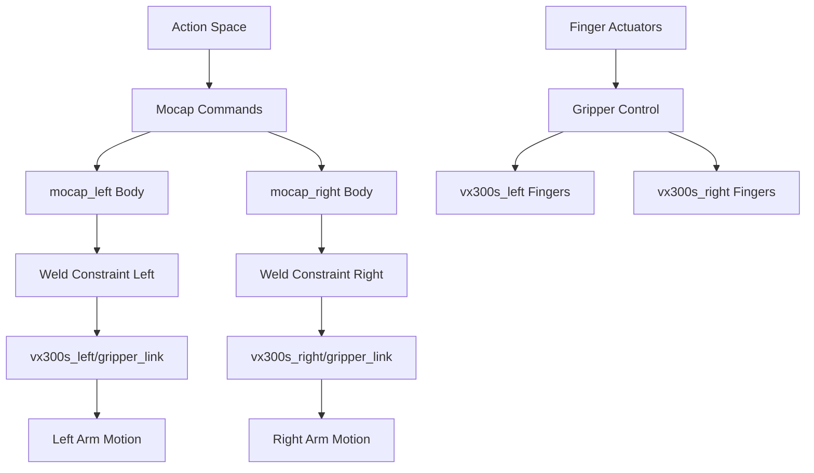
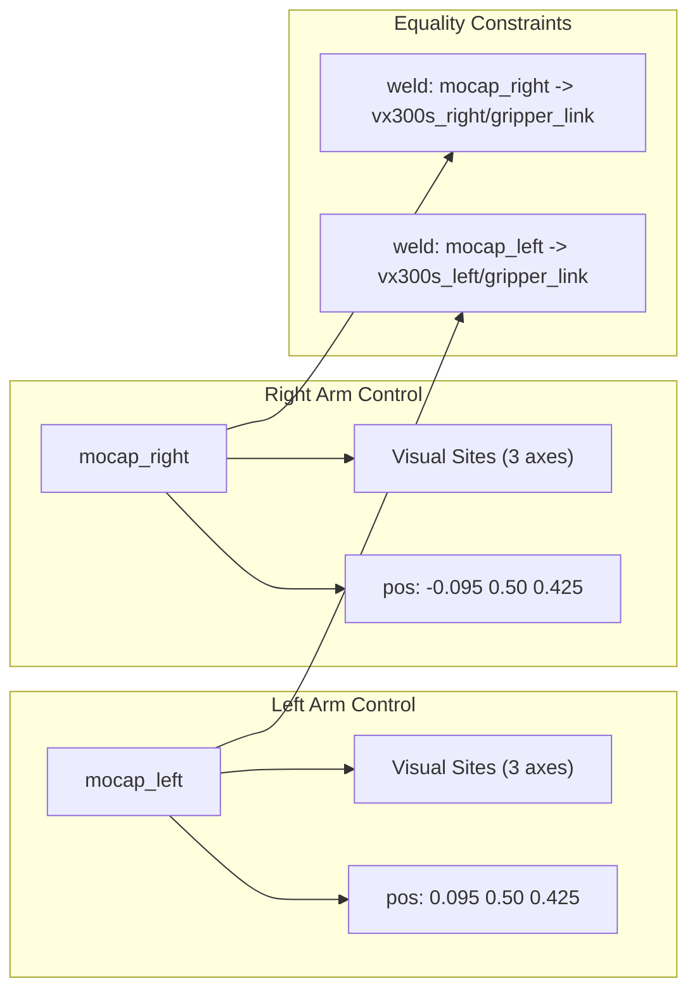

<!-- source: DeepWiki mcp.deepwiki.com · repo huggingface/gym-aloha · page 3.3 End-Effector Control Tasks · fetched 2026-10-26 -->

# End-Effector Control Tasks

<details>
<summary>Relevant source files</summary>

The following files were used as context for generating this wiki page:

- [gym_aloha/assets/bimanual_viperx_end_effector_insertion.xml](gym_aloha/assets/bimanual_viperx_end_effector_insertion.xml)
- [gym_aloha/assets/bimanual_viperx_end_effector_transfer_cube.xml](gym_aloha/assets/bimanual_viperx_end_effector_transfer_cube.xml)

</details>


This section describes the end-effector control variants of the robotic manipulation tasks in the gym-aloha environment. These tasks use Cartesian position control of the robot end-effectors instead of direct joint angle control, providing an alternative control interface for manipulation research.

For information about the underlying task objectives and reward structures, see [Insertion Task](#3.1) and [Transfer Cube Task](#3.2). For details about the core environment implementation, see [Core Environment Implementation](#2).

## Overview

End-effector control tasks provide a higher-level control interface compared to the standard joint-controlled variants. Instead of specifying target joint angles, these tasks accept 6-DOF Cartesian pose commands (position and orientation) for each robot arm's end-effector. The MuJoCo simulation handles the inverse kinematics and low-level control internally using mocap (motion capture) bodies and equality constraints.

### Available Task Variants

The gym-aloha environment provides end-effector control variants for both primary manipulation tasks:

| Task Variant | Environment ID | Control Type | Task Objects |
|--------------|----------------|--------------|--------------|
| End-Effector Insertion | `AlohaInsertionEndEffector-v0` | 6-DOF Cartesian | Peg and Socket |
| End-Effector Transfer Cube | `AlohaTransferCubeEndEffector-v0` | 6-DOF Cartesian | Red Cube |

*Sources: [gym_aloha/assets/bimanual_viperx_end_effector_insertion.xml:1-59](), [gym_aloha/assets/bimanual_viperx_end_effector_transfer_cube.xml:1-48]()*

## Control Mechanism Architecture

End-effector control tasks utilize MuJoCo's mocap body system to implement Cartesian control. The following diagram illustrates the control flow from action commands to robot motion:



*Sources: [gym_aloha/assets/bimanual_viperx_end_effector_insertion.xml:5-8](), [gym_aloha/assets/bimanual_viperx_end_effector_insertion.xml:15-24]()*

## MuJoCo Model Configuration

### Mocap Body Setup

Each end-effector control model defines two mocap bodies that serve as control targets for the robot end-effectors:



The mocap bodies include visual sites for debugging and visualization, with each site representing one axis of the coordinate frame (red markers in the simulation).

*Sources: [gym_aloha/assets/bimanual_viperx_end_effector_insertion.xml:15-24](), [gym_aloha/assets/bimanual_viperx_end_effector_transfer_cube.xml:15-24]()*

### Equality Constraints

The end-effector control is implemented through MuJoCo's weld equality constraints that rigidly connect the mocap bodies to the robot gripper links:

```xml
<equality>
    <weld body1="mocap_left" body2="vx300s_left/gripper_link" solref="0.01 1" solimp=".25 .25 0.001" />
    <weld body1="mocap_right" body2="vx300s_right/gripper_link" solref="0.01 1" solimp=".25 .25 0.001" />
</equality>
```

The `solref` and `solimp` parameters control the constraint solver behavior, balancing stability and responsiveness.

*Sources: [gym_aloha/assets/bimanual_viperx_end_effector_insertion.xml:5-8](), [gym_aloha/assets/bimanual_viperx_end_effector_transfer_cube.xml:5-8]()*

### Actuator Configuration

End-effector control models only include actuators for the gripper fingers, as the arm joints are controlled implicitly through the mocap constraint system:

| Actuator | Joint | Control Range | Gain |
|----------|-------|---------------|------|
| Left Gripper (Open) | `vx300s_left/left_finger` | 0.021 to 0.057 | 200 |
| Left Gripper (Close) | `vx300s_left/right_finger` | -0.057 to -0.021 | 200 |
| Right Gripper (Open) | `vx300s_right/left_finger` | 0.021 to 0.057 | 200 |
| Right Gripper (Close) | `vx300s_right/right_finger` | -0.057 to -0.021 | 200 |

*Sources: [gym_aloha/assets/bimanual_viperx_end_effector_insertion.xml:45-51](), [gym_aloha/assets/bimanual_viperx_end_effector_transfer_cube.xml:34-40]()*

## Task-Specific Configurations

### End-Effector Insertion Task

The end-effector insertion task model includes the same peg-in-hole setup as the joint-controlled version, with a red peg object and blue socket assembly:

- **Peg Object**: `red_peg` geometry at position (0.2, 0.5, 0.05)
- **Socket Assembly**: Four-sided socket with internal pin at position (-0.2, 0.5, 0.05)
- **Initial State**: Keyframe with arms in neutral position and objects at starting locations

*Sources: [gym_aloha/assets/bimanual_viperx_end_effector_insertion.xml:26-41](), [gym_aloha/assets/bimanual_viperx_end_effector_insertion.xml:54-56]()*

### End-Effector Transfer Cube Task

The end-effector transfer cube task model contains a single red cube object for bimanual manipulation:

- **Cube Object**: `red_box` geometry (0.02 × 0.02 × 0.02) at position (0.2, 0.5, 0.05)
- **Material Properties**: Mass 0.05 kg, moderate friction for grasping
- **Initial State**: Cube positioned for pickup by right arm

*Sources: [gym_aloha/assets/bimanual_viperx_end_effector_transfer_cube.xml:26-30](), [gym_aloha/assets/bimanual_viperx_end_effector_transfer_cube.xml:43-45]()*

## Action Space and Control Interface

End-effector control tasks modify the standard action space to accept Cartesian pose commands instead of joint angle targets. The action space typically includes:

- **Left End-Effector Pose**: 6-DOF (position + orientation)
- **Right End-Effector Pose**: 6-DOF (position + orientation)  
- **Gripper Commands**: Binary or continuous gripper control for both arms

This control interface abstracts away the complexity of inverse kinematics and joint-level control, making it easier to implement high-level manipulation policies that reason about end-effector trajectories and contact interactions.

*Sources: [gym_aloha/assets/bimanual_viperx_end_effector_insertion.xml:1-59](), [gym_aloha/assets/bimanual_viperx_end_effector_transfer_cube.xml:1-48]()*

---

