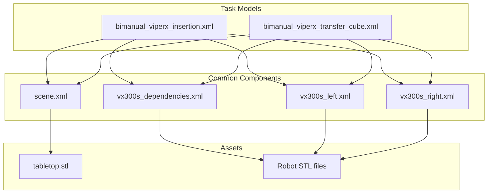
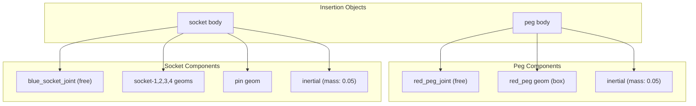
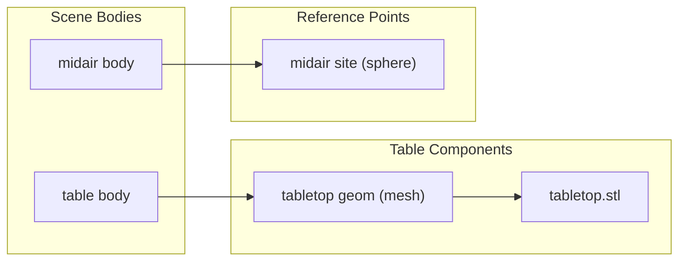
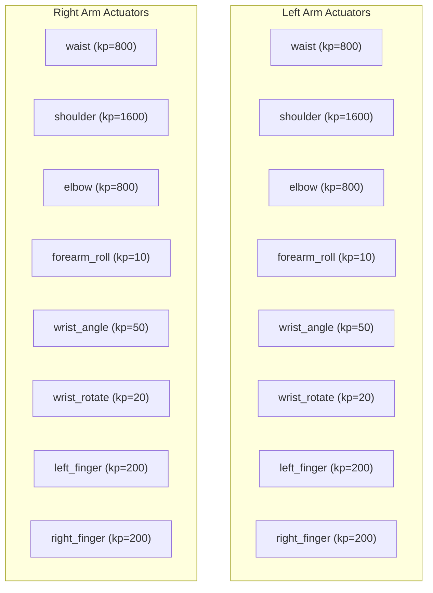

<!-- source: DeepWiki mcp.deepwiki.com · repo huggingface/gym-aloha · page 4 MuJoCo Models and Assets · fetched 2026-10-26 -->

# MuJoCo Models and Assets

<details>
<summary>Relevant source files</summary>

The following files were used as context for generating this wiki page:

- [gym_aloha/assets/bimanual_viperx_insertion.xml](gym_aloha/assets/bimanual_viperx_insertion.xml)
- [gym_aloha/assets/scene.xml](gym_aloha/assets/scene.xml)

</details>


This document covers the MuJoCo simulation models, XML scene definitions, and 3D assets that define the physical environments for ALOHA robotic tasks. The MuJoCo models specify robot configurations, task objects, scene lighting, cameras, and physics parameters used in the gym-aloha environments.

For information about how these models are used within the environment implementation, see [Core Environment Implementation](#2). For details about specific task configurations, see [Tasks and Simulations](#3).

## MuJoCo Model Architecture

The MuJoCo models follow a hierarchical inclusion structure where task-specific XML files build upon common scene components and robot definitions.

### XML File Inclusion Hierarchy



**Sources:** [gym_aloha/assets/bimanual_viperx_insertion.xml:1-6](), [gym_aloha/assets/scene.xml:1-38]()

### Task-Specific Models

Each robotic task has its own MuJoCo XML file that defines the specific objects and scenario configuration:

| Task | XML File | Key Objects | Description |
|------|----------|-------------|-------------|
| Insertion | `bimanual_viperx_insertion.xml` | `peg`, `socket` | Peg-in-hole task with red peg and blue socket |
| Transfer Cube | `bimanual_viperx_transfer_cube.xml` | `cube` | Cube transfer between robot arms |

#### Insertion Task Objects

The insertion task defines two main objects with specific physics properties:



**Sources:** [gym_aloha/assets/bimanual_viperx_insertion.xml:8-23]()

The `peg` body is positioned at `"0.2 0.5 0.05"` with a red color (`rgba="1 0 0 1"`), while the `socket` body is positioned at `"-0.2 0.5 0.05"` with blue components. The socket consists of four wall geoms (`socket-1` through `socket-4`) forming a rectangular receptacle, plus a red `pin` geom for visual reference.

## Common Scene Configuration

The `scene.xml` file defines shared environment elements used across all tasks:

### Visual and Lighting Setup

The scene includes comprehensive lighting and visual quality settings:

- **Fog settings**: `fogstart="1.5"` and `fogend="5"` for depth perception
- **Shadow quality**: `shadowsize="4096"` with `offsamples="4"` for high-quality shadows  
- **Ambient lighting**: `headlight ambient="0.4 0.4 0.4"`
- **Directional lights**: Three directional lights positioned at different angles

**Sources:** [gym_aloha/assets/scene.xml:8-19]()

### Environment Objects



**Sources:** [gym_aloha/assets/scene.xml:21-26]()

The `table` body uses a mesh geometry referencing `tabletop.stl` scaled to `"0.001 0.001 0.001"`. The `midair` body provides a reference site for spatial calculations.

### Camera Configuration

The scene defines five camera viewpoints for observation and rendering:

| Camera Name | Position | Target | Field of View |
|-------------|----------|--------|---------------|
| `left_pillar` | `"-0.5 0.2 0.6"` | `table` | 78° |
| `right_pillar` | `"0.5 0.2 0.6"` | `table` | 78° |
| `top` | `"0 0.6 0.8"` | `table` | 78° |
| `angle` | `"0 0 0.6"` | `table` | 78° |
| `front_close` | `"0 0.2 0.4"` | `vx300s_left/camera_focus` | 78° |

**Sources:** [gym_aloha/assets/scene.xml:28-32]()

## Robot Actuator Configuration

The MuJoCo models define detailed actuator specifications for bimanual control:

### Actuator Parameters

Each robot arm has 8 actuators with specific control ranges and gains:



**Sources:** [gym_aloha/assets/bimanual_viperx_insertion.xml:27-44]()

Key actuator characteristics:
- **Position control**: All actuators use `position` type with `ctrllimited="true"`
- **Force limits**: Major joints have `forcelimited="true"` with specific `forcerange` values
- **Control gains**: Higher `kp` values for shoulder (1600) and major joints (800), lower for fine control (10-200)

## Initial Configuration

Task models include `keyframe` definitions specifying initial joint positions:

```xml
<key qpos="0 -0.96 1.16 0 -0.3 0 0.024 -0.024  0 -0.96 1.16 0 -0.3 0 0.024 -0.024  0.2 0.5 0.05 1 0 0 0  -0.2 0.5 0.05 1 0 0 0"/>
```

This 30-element vector specifies:
- Positions 0-7: Left arm joint angles and gripper positions
- Positions 8-15: Right arm joint angles and gripper positions  
- Positions 16-22: Peg object pose (position + quaternion)
- Positions 23-29: Socket object pose (position + quaternion)

**Sources:** [gym_aloha/assets/bimanual_viperx_insertion.xml:49]()

---

