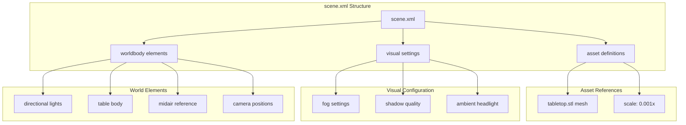
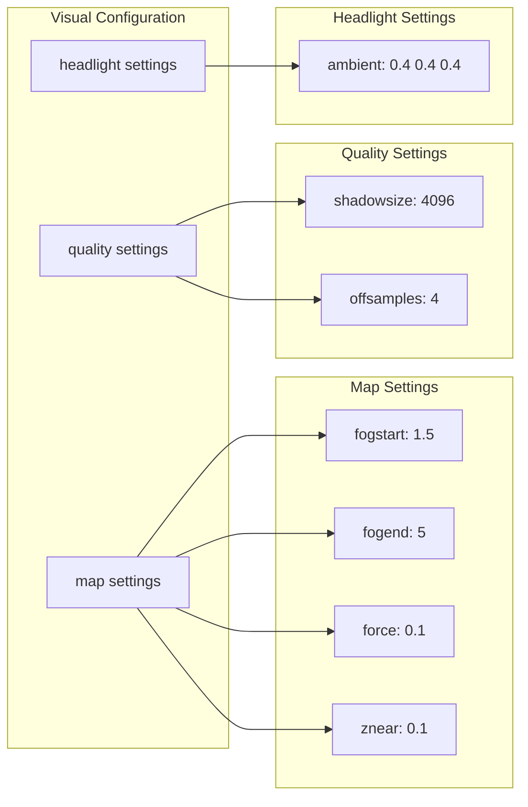
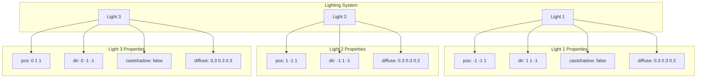

<!-- source: DeepWiki mcp.deepwiki.com · repo huggingface/gym-aloha · page 4.1 Scene Configuration · fetched 2026-10-26 -->

# Scene Configuration

<details>
<summary>Relevant source files</summary>

The following files were used as context for generating this wiki page:

- [gym_aloha/assets/scene.xml](gym_aloha/assets/scene.xml)
- [gym_aloha/assets/tabletop.stl](gym_aloha/assets/tabletop.stl)

</details>


This document describes the common scene elements, lighting, cameras, and environment setup defined in the MuJoCo simulation environment. The scene configuration provides the shared foundation that all ALOHA robotic tasks build upon, including visual settings, lighting, workspace elements, and camera perspectives.

For information about task-specific models and objects, see [Robot Models](#4.2). For details about individual robotic tasks, see [Tasks and Simulations](#3).

## Scene Structure Overview

The scene configuration in `gym-aloha/assets/scene.xml` defines the common simulation environment that serves as the foundation for all ALOHA tasks.



Sources: [gym_aloha/assets/scene.xml:1-38]()

## Asset Definitions

The scene defines 3D mesh assets that are used throughout the simulation environment.

| Asset | File | Scale | Purpose |
|-------|------|-------|---------|
| `tabletop` | `tabletop.stl` | `0.001 0.001 0.001` | Workspace table surface |

The tabletop mesh is scaled down by a factor of 1000 to convert from millimeters to meters, which is the standard unit system used in MuJoCo physics simulations.

Sources: [gym_aloha/assets/scene.xml:4-6]()

## Visual Settings

The scene configures visual rendering parameters to optimize simulation appearance and performance.



The visual settings include:
- **Fog rendering**: Creates depth perception with fog starting at 1.5 units and ending at 5 units
- **Shadow quality**: High-resolution shadows with 4096x4096 shadow maps and 4x anti-aliasing
- **Ambient lighting**: Soft headlight with RGB values of 0.4 for balanced illumination

Sources: [gym_aloha/assets/scene.xml:8-12]()

## Lighting Configuration

The scene establishes a three-point lighting setup using directional lights positioned around the workspace.



All lights use identical diffuse and specular values of `0.3 0.3 0.3` for consistent illumination. Light 1 and Light 3 have `castshadow="false"` to reduce computational overhead while maintaining adequate lighting coverage.

Sources: [gym_aloha/assets/scene.xml:15-19]()

## World Body Elements

The scene defines essential physical elements within the simulation world.

### Table Body

The primary workspace is defined by a table body positioned at `0 0.6 0` in world coordinates:

```xml
<body name="table" pos="0 .6 0">
    <geom group="1" mesh="tabletop" pos="0 0 0" type="mesh" 
          conaffinity="1" contype="1" name="table" rgba="0.2 0.2 0.2 1" />
</body>
```

The table geometry uses:
- **Collision properties**: `conaffinity="1"` and `contype="1"` for interaction with other objects
- **Visual appearance**: Dark gray color with `rgba="0.2 0.2 0.2 1"`
- **Collision group**: `group="1"` for organized collision detection

### Reference Points

A `midair` body at position `0 0.6 0.2` provides a spatial reference point above the table surface. This invisible site (`rgba="1 0 0 0"`) serves as a reference for positioning objects and calculating spatial relationships.

Sources: [gym_aloha/assets/scene.xml:21-26]()

## Camera Setup

The scene configures five camera positions to provide comprehensive viewing angles of the robotic workspace.

| Camera | Position | Target | FOV | Purpose |
|--------|----------|---------|-----|---------|
| `left_pillar` | `-0.5 0.2 0.6` | `table` | 78° | Left side perspective |
| `right_pillar` | `0.5 0.2 0.6` | `table` | 78° | Right side perspective |
| `top` | `0 0.6 0.8` | `table` | 78° | Overhead view |
| `angle` | `0 0 0.6` | `table` | 78° | Angled front view |
| `front_close` | `0 0.2 0.4` | `vx300s_left/camera_focus` | 78° | Close-up robot view |

All cameras use `mode="targetbody"` to automatically orient toward their specified target, ensuring consistent framing. The `front_close` camera specifically targets the left robot arm's focus point for detailed end-effector observations.

Sources: [gym_aloha/assets/scene.xml:28-32]()

## Integration with Robot Models

The scene configuration serves as the foundation that robot models and task-specific objects are added to. The `vx300s_left/camera_focus` target referenced by the `front_close` camera demonstrates how the scene integrates with robot components defined in separate model files.

The standardized lighting, table workspace, and camera positions ensure consistent environmental conditions across all ALOHA robotic tasks, enabling reliable performance comparisons and reproducible experiments.

Sources: [gym_aloha/assets/scene.xml:32]()

---

